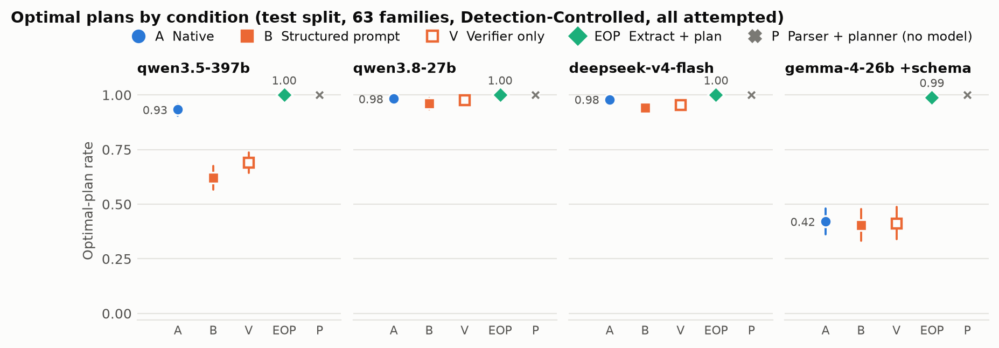
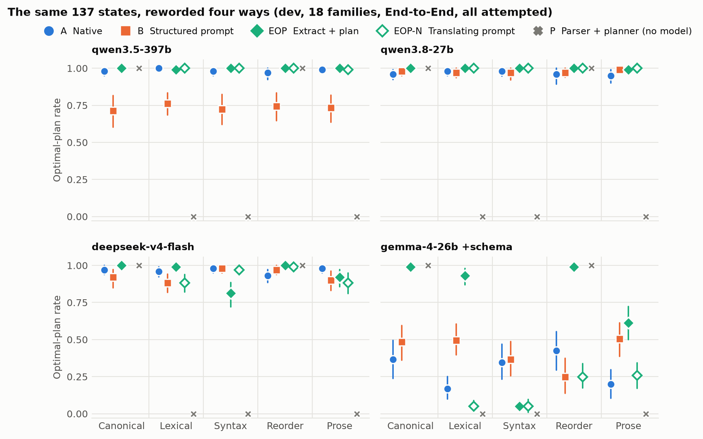
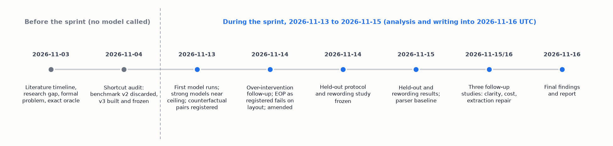
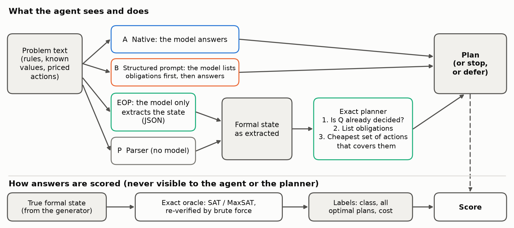

# What Would Be Enough?

**Evaluating Minimal Sufficient Epistemic Plans in LLM Agents**

Konstantinos Dalampekis, University of California, Los Angeles.
Apart Research AI x Epistemics Research Sprint, 2026-11-13 to 2026-11-15.

**Paper:** [`paper/report.pdf`](paper/report.pdf) · **Research story:** [`research/`](research/README.md) · **Experiments:** [`experiments/experiment_registry.md`](experiments/experiment_registry.md) · **Method details:** [`methodology/`](methodology/)

## The research question

An agent must decide whether an experiment run can be approved. Approval holds exactly when the protocol version is current and a checksum of the configuration matches. The agent can ask a person about the protocol (cost 3), run the checksum (cost 1), or request an audit report that also covers the protocol (cost 5).

- If it already knows the protocol is out of date, it needs nothing more. The answer is no.
- If it knows nothing, it needs the question and the computation. The audit would be a costlier way to the same fact.
- If nobody can be asked about the protocol, no action settles the matter. The right move is to defer.

Each case is a different answer to one question: **what would be enough to settle this?** We call the cheapest set of actions that is guaranteed to settle a question a *minimal sufficient epistemic plan*, and we ask whether language models can find it when the actions are of two kinds, gathering information and running computations.

## Why it matters

Noticing uncertainty is not enough for an agent that can use tools. It has to decide which action removes the uncertainty, whether one action is enough, and when to stop. Doing too little gives an answer without grounds. Doing too much spends compute and interrupts people for facts that were not needed. Continuing when the matter is settled, or when nothing available can settle it, shows that the agent does not know what its own evidence supports.

## What is in this repository

- **A formal task with exact answers.** States are small logic problems with rules, facts about the world, results of certified computations, and priced actions. An oracle computes, for every state, which kind of help it needs and every cheapest sufficient plan. It was checked against brute force on 228,199 cases with 0 disagreements ([`methodology/oracle_validation.md`](methodology/oracle_validation.md)).
- **A benchmark:** 300 problem families and 2,282 states, split by family into train, development and held-out test, with counterfactual pairs, price sweeps and four rewordings.
- **An evaluation of four open-weight models** in three modes that separate noticing a gap, diagnosing it and planning for it.
- **A mitigation, the Epistemic Obligation Planner (EOP),** and the controls needed to interpret it: a structured prompt, a verifier-only variant and a parser that uses no model.
- **The research record:** literature, original roadmap, every decision with its evidence, every hypothesis with its outcome, protocols frozen before their data existed, and the raw model responses.

## Key findings

Held-out test split, 63 families. Share of states for which the plan is a cheapest sufficient plan; an answer that fails or cannot be read counts as wrong. Brackets are 95% intervals that resample families.

| Model | Native | Structured prompt | EOP | Parser | EOP − native | Defers when nothing helps | Acts on newly sufficient states |
|---|---|---|---|---|---|---|---|
| qwen3.5-397b | 0.93 | 0.62 | 1.00 | 1.00 | +0.07 [+0.04, +0.10] | 0.89 | 0.20 [0.14, 0.27] |
| qwen3.8-27b | 0.98 | 0.96 | 1.00 | 1.00 | +0.02 [+0.01, +0.04] | 0.87 | 0.00 [0.00, 0.00] |
| deepseek-v4-flash | 0.98 | 0.94 | 1.00 | 1.00 | +0.02 [+0.01, +0.04] | 0.97 | 0.00 [0.00, 0.00] |
| gemma-4-26b +schema | 0.42 | 0.40 | 0.99 | 1.00 | +0.57 [+0.51, +0.62] | 0.00 | 0.72 [0.64, 0.79] |

1. **Three of four models plan near ceiling, and it replicates** from the development split (0.96, 0.98, 0.96, 0.45) to the held-out split (0.93, 0.98, 0.98, 0.42).
2. **The strong models also follow prices.** When one action's price crosses the point where the cheapest plan changes, the two models tested stay at 0.95–0.98; the weakest model drops from 0.31 to 0.16.
3. **Part of the "stopping failure" was our own benchmark text.** On the held-out split one strong model still proposed an action on 20% of states that were already sufficient. A follow-up study removed an ambiguity in how the text describes known values, and the rate fell from 14% to 3%. The weakest model's failure is real: 59% even with clear wording.
4. **The formal planner reaches 0.99–1.00, and so does a parser with no model.** On the benchmark's own wording, a model is not needed to read the state.
5. **Under rewording, planning stays reliable and reading the state does not.** The parser fails on three of four rewordings. Extraction by a model holds for two models and breaks for two. One repair call recovers most rejected extractions and adds some that are well-formed and wrong.

Follow-up studies at a glance (fresh families, registered after the held-out results were viewed):

| Model | Cost: cheapest plan, price above / below | Clarity: acts, original → clarified wording | Repair: exact state, first → with repair |
|---|---|---|---|
| qwen3.5-397b | 0.95 / 0.97 | 0.14 → 0.03 | not run |
| qwen3.8-27b | 0.95 / 0.98 | 0.00 → 0.00 | not run |
| deepseek-v4-flash | not run | not run | 0.89 → 0.97 |
| gemma-4-26b +schema | 0.31 / 0.16 | 0.73 → 0.59 | 0.21 → 0.78 |





## How we got here



The question was narrowed in steps, and several of our own assumptions did not survive:

- The first benchmark template could be solved by reading one rule. We discarded it and rebuilt the benchmark.
- Strong models turned out to plan near ceiling, so the interesting behaviour moved to stopping and to counterfactual edits.
- The mitigation, as first registered, failed for three of four models because its prompt never showed the required output layout. We report that outcome, and the amended version separately.
- A parser with no model matched the mitigation, which changed what its result means.
- A follow-up study showed that part of our stopping finding came from our own wording.

The full account, with the evidence for each step: [`research/research_decisions.md`](research/research_decisions.md). The plan as first written and what was executed: [`research/original_roadmap.md`](research/original_roadmap.md). Every hypothesis and its outcome: [`research/hypothesis_tracker.md`](research/hypothesis_tracker.md).

## Related work and the gap

Prior work studies which facts to ask for, when more computation pays, and when to act, ask or step back. We did not find an evaluation that puts information and computation in one priced action space and scores, against an exact answer, whether a plan is sufficient and minimal. We do not claim to introduce information seeking, computation allocation, abstention or solver-backed planning.

- How the field arrived at this question: [`research/literature_timeline.md`](research/literature_timeline.md)
- Paper-by-paper analysis and comparison matrix: [`research/literature_review.md`](research/literature_review.md)
- The gap and what we do not claim: [`research/research_gap_and_novelty.md`](research/research_gap_and_novelty.md)

## The formal problem and the mitigation



An *obligation* is a minimal set of unknowns on which a possibility where the answer is yes and one where it is no differ. A plan is sufficient exactly when it reveals something in every obligation, so the cheapest plan is a minimum-cost hitting set. EOP asks the model only to write down the state it reads; an exact planner then checks whether the question is already decided, lists the obligations and returns a cheapest plan, or defers. The planner is exact, so EOP measures whether the model reads the state correctly.

Details: [`methodology/formal_problem.md`](methodology/formal_problem.md), [`methodology/benchmark_design.md`](methodology/benchmark_design.md), [`methodology/eop_architecture.md`](methodology/eop_architecture.md), [`methodology/evaluation_protocol.md`](methodology/evaluation_protocol.md).

## How to read the evidence

| Standing | What |
|---|---|
| Registered, held-out | The planning hypotheses; over-intervention on newly sufficient states |
| Registered, development | Counterfactual pairs; the over-intervention follow-up; EOP as registered |
| Prospective test of an amended method | Amended EOP against the model's own answer, on the held-out split |
| Rewording study | Registered separately; never used to change EOP |
| Follow-up studies | Wording clarity, cost sensitivity, extraction repair: registered after the held-out results had been viewed, on families no model had seen |
| Exploratory | The split of over-intervention by re-certified values; extraction repair has no test |
| No model | Exact oracle; parser plus planner |

Registrations, each with a freeze record in `data/FREEZE_*.json`: [`PROTOCOL.md`](experiments/preregistrations/PROTOCOL.md), [`PREREG_T1.md`](experiments/preregistrations/PREREG_T1.md), [`PREREG_T1B.md`](experiments/preregistrations/PREREG_T1B.md), [`PREREG_EOP.md`](experiments/preregistrations/PREREG_EOP.md), [`PREREG_FINAL.md`](experiments/preregistrations/PREREG_FINAL.md), [`PREREG_ROBUST.md`](experiments/preregistrations/PREREG_ROBUST.md), [`PREREG_FOLLOWUP.md`](experiments/preregistrations/PREREG_FOLLOWUP.md), [`PREREG_REPAIR.md`](experiments/preregistrations/PREREG_REPAIR.md). Amendments and deviations: [`methodology/protocol_amendments.md`](methodology/protocol_amendments.md).

## Reproduce without any API call

Needs Python 3.11 or newer.

```bash
python -m venv .venv && .venv/bin/pip install -e ".[dev]" matplotlib markdown
```

Rebuild the datasets and check them against the freeze records:

```bash
.venv/bin/python experiments/generate_benchmark.py --template v3 --families 300 --out data/generated/pool_v3
.venv/bin/python experiments/generate_variants.py --pool data/generated/pool_v3/instances.jsonl --out data/generated/variants_v3
.venv/bin/python experiments/generate_t1.py
.venv/bin/python experiments/generate_robust.py
.venv/bin/python experiments/generate_followup.py
.venv/bin/python experiments/run_repair.py --generate
for n in FINAL ROBUST FOLLOWUP REPAIR; do .venv/bin/python experiments/freeze_protocol.py --name $n --verify; done
```

Run the tests:

```bash
.venv/bin/python -m pytest -q
```

Unpack the raw model responses and re-run every analysis from them:

```bash
for a in results/raw/*.tar.gz; do tar -xzf "$a"; done
M=adaption-qwen3.5-397b,adaption-qwen3.8-27b,adaption-deepseek-v4-flash,adaption-gemma-4-26b-a4b-it-schema
experiments/finish_runs.sh analyze
.venv/bin/python experiments/run_followup.py --analyze-only --models adaption-qwen3.5-397b,adaption-qwen3.8-27b,adaption-gemma-4-26b-a4b-it-schema
.venv/bin/python experiments/run_repair.py --analyze-only --models adaption-gemma-4-26b-a4b-it-schema,adaption-deepseek-v4-flash
```

What we checked ourselves, and what to expect, is in [`experiments/reproduction.md`](experiments/reproduction.md). To run models yourself (needs a key and spends credits), see [`docs/RUNNING.md`](docs/RUNNING.md).

## Limitations

- The tasks are synthetic logic problems in generated language. They are not evidence about open-ended decisions.
- EOP's planner is exact, so EOP measures extraction, and the version tested on held-out data was fixed on development data.
- Four open-weight models from one provider, temperature 0, one answer per item.
- Plans are fixed in advance and must guarantee the answer. Probabilities, noisy sources and step-by-step plans are not covered.
- The follow-up studies were designed after the held-out results had been viewed.

The full list, with dual-use considerations: [`methodology/limitations.md`](methodology/limitations.md).

## Repository map

| Path | What |
|---|---|
| [`paper/`](paper/) | The submitted report (PDF and source), the extended report, references |
| [`research/`](research/README.md) | Literature, research evolution, original roadmap, decisions, hypotheses, future work, original working documents |
| [`methodology/`](methodology/) | Formal problem, benchmark design, oracle validation, evaluation protocol, EOP, amendments, limitations |
| [`experiments/`](experiments/) | Experiment registry, reproduction notes, and the scripts that generate data, run models, analyse and draw |
| [`src/msep/`](src/msep/) | The library: formal state, oracle, benchmark generator, prompts, runner, planner, scoring |
| [`data/`](data/) | Freeze records, manifests and samples. Datasets are rebuilt from code and checked by hash |
| [`results/`](results/) | Result tables and summaries (`aggregate/`) and archived raw model responses, logs and the spend ledger (`raw/`) |
| [`figures/`](figures/) | Figures as PNG and SVG |
| [`tests/`](tests/) | Test suite |
| [`experiments/preregistrations/`](experiments/preregistrations/) | Registrations (`PROTOCOL.md`, `PREREG_*.md`), each pinned by a freeze record in `data/` |

## Before the sprint and during it

- **Before the sprint** (2026-11-03 and 2026-11-04): the formal model, the oracle and its validation, the benchmark generator and its audit, the planner code, the evaluation code and protocol. No language model had been called.
- **During the sprint** (from 2026-11-13): every model run and analysis, the counterfactual pairs, the EOP comparison with both amendments, the held-out evaluation, the rewording study, the three follow-up studies, and the report.

AI assistance: Claude (Anthropic), through Claude Code, was used throughout to write and test code, run and monitor experiments, analyse results and draft text. The paper's LLM Usage Statement gives the details. Reuse of the author's earlier code is limited to about 30 lines used only in oracle-validation instances ([`research/research_gap_and_novelty.md`](research/research_gap_and_novelty.md)).

## Licence, citation and acknowledgement

Code: Apache-2.0 ([`LICENSE`](LICENSE)). Writing, figures and synthetic datasets: CC BY 4.0. Model outputs are included as research evidence and are not licensed by us; the provider's terms apply. See [`DATA_LICENSE.md`](LICENSES/DATA_LICENSE.md) and [`CITATION.cff`](CITATION.cff).

We thank Apart Research for organizing the AI x Epistemics Research Sprint and Adaption for providing inference credits supporting the experiments.
