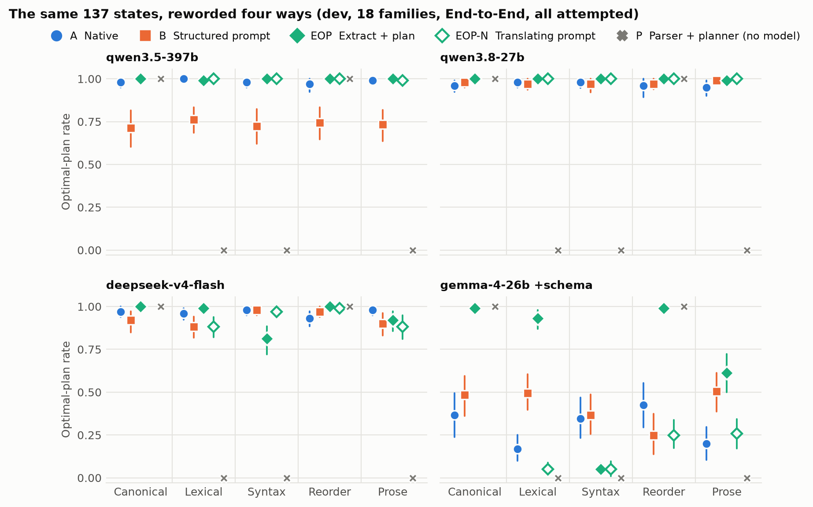

> **Read this first.** This is the extended technical report, kept for its formal details, full result tables, prompts, example items and literature review. It was written before the three follow-up studies. Its reading of the stopping results ("what remains is stopping") is **superseded**: follow-up Study 1 showed that most of one strong model's over-intervention came from an ambiguity in the benchmark text. The submission report, [`report.md`](report.md), states the final claims.

# What Would Be Enough? Evaluating Minimal Sufficient Epistemic Plans in LLM Agents[^1]

Konstantinos Dalampekis
University of California, Los Angeles

**With** Apart Research

## Abstract

An agent that cannot yet answer a question can gather information, run a computation, do both, or accept that nothing available will settle it. We ask whether language models can tell which of these is enough. We define Minimal Sufficient Epistemic Planning: given rules, known values and priced actions, name the resource a state needs and give the cheapest set of actions guaranteed to settle the question. An exact oracle labels a benchmark of 300 problem families. We evaluate four open-weight models in three modes that separate noticing a gap, diagnosing it and planning for it. On held-out data, three models find a cheapest sufficient plan on 0.93 to 0.98 of solvable states and the fourth on 0.42. The errors that remain are stopping errors: one strong model still proposes an action on 20% of states that an edit has just made sufficient, and the weak model never defers when nothing can help. A mitigation that has the model extract the formal state and lets an exact planner choose the actions reaches 0.99–1.00 on held-out data, but so does a parser with no model. When the same problems are reworded, the parser fails; the model extractor holds for two models and breaks for two. We report the mitigation as registered, where it failed for three of four models, next to the amended version.

## 1. Introduction

An agent that lacks grounds for a decision has four options: get more information, run a computation, do both, or accept that nothing available will settle the matter. Choosing well is an epistemic skill of its own. An agent that asks or computes more than it needs wastes resources and its user's attention. An agent that does less decides without justification. An agent that keeps acting when the question is already settled, or when no action can settle it, shows that it does not know what its own evidence supports.

This is a different failure from the better-known one of telling users what they want to hear. Assistants have been reported to match their answers to a user's stated views instead of the truth [35], and designers have found that no prompt made a model reliably say "I don't know" when it should [34]. We do not test deference to a user. We ask whether a model can tell what evidence would settle a question.

Most evaluations cover one side of this. Information-seeking benchmarks ask whether a model finds the missing facts [1, 2]. Adaptive-computation work asks when more reasoning pays [4, 7]. Agent studies ask when to act, ask or step back [3, 6]. We did not find an evaluation that puts information and computation in one action space and scores, against an exact answer, whether a plan is *sufficient* and *minimal*.

We define that task, **Minimal Sufficient Epistemic Planning (MSEP)**. A state has rules, known values, unknown facts about the world, unknown results of certified computations, and priced actions that reveal them. The agent must say which resource the state needs (information, computation, both, neither, or nothing more) and give the cheapest set of actions that is guaranteed to settle the question. Every label comes from an exact oracle.

**Our main contributions are:**

1. **A formal task, an exact oracle and a frozen benchmark.** 300 families and 2,282 states with matched siblings for every resource class, an obligation-based characterisation of sufficiency, and a shortcut audit that led us to discard our first template. *This part was built before the sprint (Appendix B).*
2. **A controlled evaluation of four open-weight models** in three modes that separate detection, diagnosis and planning, with a held-out test split run once under a frozen protocol. The three stronger models plan near ceiling. Their remaining errors are stopping errors: they act on states that are already sufficient, and they do not always defer when nothing can help.
3. **A mitigation with an honest record.** The Epistemic Obligation Planner (EOP) has the model extract the formal state and lets an exact planner choose the actions. As pre-registered it worked for one model of four; a format fix made after seeing development data made it work for all four; the held-out split then tested the fixed method prospectively.
4. **A test of what the mitigation result means.** A deterministic parser with no model matches EOP on our benchmark's regular wording. We reword the same problems four ways and compare the model extractor, the parser and native planning.

## 2. Related Work

Decision-theoretic metareasoning weighs the value of computation [9, 10], and cognitive science separates epistemic from pragmatic action [11]. LLM work asked whether a model's uncertainty tracks its errors [12–14], then whether it clarifies, abstains or retrieves [15–18], then why it is uncertain [19]. 2026 work makes sufficiency a criterion for reasoning length [21] and retrieved evidence [23], prices asking by value of information [22], and routes among interventions [25].

**What to ask.** MT-InfoSeek [1] tests whether models find minimal sufficient query sets. The authors report no model above 0.4 exact-set accuracy at k=2. Queries cost the same; a sufficient set always exists. QuestBench [36] gives problems with exactly one missing value and asks for the one question that settles them; the authors report 40–50% accuracy on its logic and planning sets.

**Ask, act or step back.** *Ask, Relax, or Act?* [2] labels decisions with exact solvers. The authors report 92.57% item accuracy against 85.56% matched-pair correctness for GPT-6-Astra; most errors are needless interventions. SURE-Act [3] learns from counterfactual rollouts; its controller was right on 0 of 24 source-shift pairs, and both sources are information. Active Epistemic Control [6] and EvoCtx [27] choose between acquiring and reasoning; both are methods.

**When to compute.** Rational Metareasoning [7] trains models to reason only when it pays. DIAL [4] reports that the correlation between entropy and the benefit of extra computation changes sign across models (−0.156 versus +0.428, FEVER); there, computation can lower success. In MSEP, computation is certified and cannot mislead.

**Relevant versus sufficient.** ToolChoiceConfusion [5] filters tools by causal sufficiency (reported success 0.99 against 0.83 unfiltered). It is a filter, not a test of the model's own pruning.

**Starting point.** Sufficiency and minimality appear separately for information [1], reasoning [21], evidence [23] and tools [5]. We did not find them scored jointly over information and certified computation, in one priced action space with states that need either, both or neither, against an exact oracle, with detection, diagnosis and planning measured separately.

**Logical roots.** The oracle is related to the logic of the reasons behind decisions [30, 31]: a minimal sufficient plan resembles a sufficient reason, and an obligation a necessary reason, with unknown variables in place of known values. That correspondence is our reading. The same-decision probability [32] is a probabilistic relative of our sufficiency test.

We do not claim that uncertainty detection, abstention, adaptive retrieval or computation, minimal sufficient information or epistemic planning are new, or that we are first.

## 3. Methods

### 3.1 Task and oracle

A state has propositional rules over a target Q, world facts (F1, F2, …) and computational facts (K1, K2, …); a set of known values; and a menu of priced actions. An **information action** reveals world facts. A **computation action** runs a certified procedure (modular exponentiation, a primality test, a SAT solver, an exact posterior) on inputs the agent already has. Its result is fixed but unknown until the action runs, and it never depends on hidden world facts.

A **plan** is a set of actions chosen before any result is seen. It is **sufficient** if every outcome it could produce leaves Q decided: no two assignments consistent with the rules and known values disagree on Q while agreeing on what the plan reveals. The **MSEP** is a cheapest sufficient plan. The **resource class** of a state is ALREADY_SUFFICIENT (the empty plan suffices), NEITHER (no available plan suffices), or INFORMATION_ONLY, COMPUTATION_ONLY or BOTH by the composition of its optimal plans.

An **obligation** is a minimal set of unknowns on which a Q-true and a Q-false possibility differ. A plan is sufficient exactly when it reveals something in every obligation, so the MSEP is a minimum-cost hitting set (proof in Appendix D). The oracle computes this by SAT and MaxSAT, and a separate brute-force path re-verifies every benchmark label. Validation ran 228,199 checks with 0 failures.

### 3.2 Benchmark

Each of 300 **families** is a random theory (and/or trees, parity, thresholds, case splits) with distractors, indirect dependencies and bulk actions. Within a family, sibling states come from one distribution and are binned by oracle label, so every family has all five resource classes plus optional trap siblings (relevant but insufficient; sufficient but not minimal). Splits are by family: 165 train, 72 dev, 63 test.

**Shortcut audit.** An adversarial audit showed that our first template was solved completely by reading one rule, and leaked hidden values. We rebuilt it (v3) and report shallow heuristics next to every model result. The strongest heuristic still gives a sufficient plan on 0.85 of resolvable dev states, so sufficiency alone is a weak metric here; optimality and stopping are harder.

### 3.3 Models, modes and scoring

Four open-weight models hosted by one provider: qwen3.5-397b, qwen3.8-27b, deepseek-v4-flash and gemma-4-26b (with a forced output schema). Temperature 0, one sample per item.

Three modes isolate where errors arise. **End-to-End:** the model sees the state and must detect, diagnose and plan. **Detection-Controlled:** it is told the state is insufficient. **Diagnosis-Controlled:** it is also told the resource class.

A plan is **optimal** if it is sufficient at the oracle's minimum cost. **Correct stopping** means an empty plan and the right answer on ALREADY_SUFFICIENT states, and deferral on NEITHER states. The primary basis is *all attempted*: a failed call or unparsable answer counts as wrong. Intervals are 95% bootstrap intervals that resample families.

### 3.4 Counterfactual pairs

A **T1 pair** applies one edit to a state (one value becomes known) so that the minimal plan changes. 122 of the 272 pairs in our follow-up set turn the state into one that is already sufficient. A model is correct on a pair only if it is correct on both states.

### 3.5 The Epistemic Obligation Planner and its comparison conditions

- **A, native:** the model answers the benchmark prompt.
- **B, structured prompt:** the same prompt plus five steps that walk through obligations.
- **EOP:** the model only *extracts* the visible state as JSON (variables, rules, known values, actions). An exact planner then checks whether Q is decided, lists the obligations and returns a minimum-cost hitting set. The planner never sees hidden values or oracle labels.
- **Verifier only:** B's plan, pruned against the extracted state, with no search.
- **P, parser:** a deterministic parser in place of the model, then the same planner. The parser reads only the prompt text with a fixed grammar. It was written as the inverse of our own renderer.

### 3.6 What was registered, and what changed

Every comparison was registered and hashed before its data existed. Two things did not go as registered, and we report both.

- **The registered EOP extraction prompt was defective.** It described the JSON fields in prose and never showed the layout our parser requires. Models without schema enforcement returned the right content in other layouts, and most extractions were rejected. A pipeline check found this before outcomes were scored. We added the layout to the prompt (**Amendment 1**) and report the registered and the amended condition separately. The amended method is development-informed.
- **gemma ignored its forced schema under the structured prompt** and answered in plain text. We score those answers from the text (**Amendment 2**, analysis only).

The held-out protocol was frozen after both amendments and before any test item was sent. It tests the amended EOP prospectively. It cannot turn the original registered experiment into a success.

### 3.7 Linguistic robustness

For 137 dev states (18 families) we generated four rewordings that keep the formal state, handles, action names and labels: **lexical** (new terminology), **syntax** (rules and facts as differently structured sentences), **reorder** (sections and items shuffled) and **prose** (running paragraphs combining all three). An inverse parser recovers the exact state from every variant. A separate language-model reader, given only 24 sample texts, reconstructed 24 of 24 states and flagged one scope ambiguity, which we fixed before freezing. We ran A, B, EOP and P on the variants, plus **EOP-N**, a registered secondary condition whose extraction prompt asks the model to translate reworded rules into the fixed notation.

## 4. Results

All rates count a failed call or an unreadable answer as wrong. The held-out split has 63 families: 468 states, and 804 states in counterfactual pairs. It was run under the frozen protocol.

### 4.1 Planning and stopping on held-out data

**Planning replicates.** In Detection-Controlled mode, qwen3.5, qwen3.8 and deepseek give a cheapest sufficient plan on 0.93, 0.98 and 0.98 of resolvable states (dev: 0.96, 0.98, 0.96); gemma on 0.42 (dev: 0.45). No item of the three stronger models fails in all three modes, so the mode decomposition attributes none of their errors to planning itself. For gemma it attributes 0.24 of items to diagnosis and 0.07 to planning.

**Registered hypotheses.** H2 (diagnosis is easier than planning) is not supported for any model. For qwen3.5 and gemma the difference is significant in the other direction: they give a sufficient plan more often than they name the right resource class (1.00 against 0.95; 0.88 against 0.77). H3 (relevance is confused with sufficiency) is supported for qwen3.8 only, and the effect is small: it judges sufficient plans correctly in 1.00 of cases and relevant-but-insufficient plans in 0.97 (Holm p = 0.008). gemma errs the other way and rejects 40% of sufficient plans. H4a and H4b (states needing both resources are harder) are not supported.

**What remains is stopping** (Table 1). When no available action can settle the question, the three stronger models defer on 0.89, 0.87 and 0.97 of states; gemma never does. On states that one edit has just made sufficient, qwen3.5 still proposes an action on 0.20 and gemma on 0.72. The registered test (rate above 0.05) is supported for both and for neither of the other two models, as on dev (0.17, 0.68, 0.00, 0.02).

**Table 1.** Stopping on the held-out split, native answer. Acts: proposes any action on a state that is already sufficient. Last column: registered test T-OI-1.

| Model | Defers on NEITHER (DC) | Acts when sufficient from the start (E2E) | Acts when one edit made it sufficient (E2E) | Above 0.05? (Holm p) |
|---|---|---|---|---|
| qwen3.5-397b | 0.89 [0.81, 0.97] | 0.13 | 0.20 [0.14, 0.27] (n=169) | yes (< 0.001) |
| qwen3.8-27b | 0.87 [0.79, 0.95] | 0.00 | 0.00 [0.00, 0.00] (n=169) | no (1.000) |
| deepseek-v4-flash | 0.97 [0.92, 1.00] | 0.00 | 0.00 [0.00, 0.00] (n=169) | no (1.000) |
| gemma-4-26b +schema | 0.00 [0.00, 0.00] | 0.67 | 0.72 [0.64, 0.79] (n=169) | yes (< 0.001) |

An exploratory split qualifies the qwen3.5 figure. Of its 34 unnecessary plans on newly sufficient states, 21 reveal only values that the text already lists as known, and 23 include a computation whose result the text already gives (see Limitations). 13 act on a value that is unknown (0.08 of 169). For gemma, 96 of 109 act on an unknown value.

### 4.2 EOP against native and structured prompting

**Table 2.** Share of cheapest sufficient plans on resolvable held-out states, Detection-Controlled. P is the parser with no model. Last column: registered one-sided test of EOP against native, Holm-adjusted. Intervals for every cell are in Appendix E.

| Model | A native | B structured | EOP | P parser | EOP − A | Holm p (one-sided) |
|---|---|---|---|---|---|---|
| qwen3.5-397b | 0.93 | 0.62 | 1.00 | 1.00 | +0.07 [+0.04, +0.10] | < 0.001 |
| qwen3.8-27b | 0.98 | 0.96 | 1.00 | 1.00 | +0.02 [+0.01, +0.04] | 0.005 |
| deepseek-v4-flash | 0.98 | 0.94 | 1.00 | 1.00 | +0.02 [+0.01, +0.04] | 0.004 |
| gemma-4-26b +schema | 0.42 | 0.40 | 0.99 | 1.00 | +0.57 [+0.51, +0.62] | < 0.001 |

EOP reaches 0.99–1.00 for every model, and the registered test of EOP against native is supported for all four. This is a prospective test of a method fixed on development data (Section 3.6), not the experiment as first registered. The gain is large only where native planning is weak: +0.57 for gemma, +0.07, +0.02 and +0.02 for the others. On counterfactual pairs, EOP is right on both states of 0.98 to 1.00 of pairs, against 0.85, 0.95, 0.91 and 0.24 for the native answer.

The structured prompt does not help. It leaves qwen3.8 and gemma where they were, costs deepseek 4 points and costs qwen3.5 31 points, because 119 of its 405 answers no longer follow the answer format. The verifier-only variant follows the structured prompt (Appendix E).

The parser P also scores 1.00. On the benchmark's own wording, a model is not needed to obtain the state.

### 4.3 Rewording

**The parser stops working; the model extractor mostly does not.** P scores 0.00 on the lexical, syntax and prose wordings and 1.00 on reorder. With the qwen models, EOP recovers the exact state in at least 0.99 of items in every wording.

**But EOP adds little where the model already plans well, and can do harm where extraction is brittle.** The registered test (EOP against native, pooled over the four wordings) is supported for gemma (+0.36 [+0.29, +0.43]) and qwen3.8 (+0.03 [+0.01, +0.06]), and not for qwen3.5 (+0.01) or deepseek (−0.03). On the syntax wording, deepseek's EOP falls to 0.81 while its native answer stays at 0.98, and gemma's EOP falls to 0.05, below its native 0.35. In 118 of gemma's 137 syntax items the extraction does not parse in the planner's notation.



**Figure 1.** The same 137 development states in canonical wording and four rewordings (End-to-End). Bars are 95% intervals.

**Most EOP failures are visible ones.** The planner rejects a malformed extraction, so the pipeline knows that it has no plan. The exception is gemma on prose, where 24 of 137 extractions are well-formed but are not the true state.

EOP-N, the prompt that asks for translation into the fixed notation, repairs deepseek on syntax (0.97) and lowers it on lexical and prose (0.88). gemma returns no text for most EOP-N items.

## 5. Discussion and Limitations

**The gap is in stopping, not in planning.** Three of four models find cheapest sufficient plans almost always when a plan exists. Their errors come when the right plan is the empty one: the question is already settled, or nothing on offer can settle it. A benchmark that scores only whether the model found the missing facts would not see this.

**A formal state is enough; getting it is the open part.** Given the right state, an exact planner solves the task, so the mitigation question reduces to extraction. On regular text a parser does it without a model. On reworded text the parser fails and two models extract almost perfectly, but those two also plan well natively. EOP pays off for the model that reads well and plans badly (gemma on three wordings) and backfires when a wording breaks its extraction. Its failures are mostly rejected outputs, which a system can catch and route elsewhere.

**Prompting for structure is not a substitute.** On held-out data the structured prompt improved no model's plan quality and broke the output format of one. On reworded text it helped gemma on two wordings and hurt it on another.

### Limitations

The tasks are small synthetic logic problems in generated language; the results are not evidence about open-ended decisions. EOP's planner is exact, so EOP measures extraction, and the version tested on held-out data was fixed after seeing development data. We ran four open-weight models from one provider at temperature 0, with one answer per item. Plans are static and must guarantee the answer. Our benchmark text has an ambiguity that inflates one stopping measure (Section 4.1). The rewordings come from our own templates and were audited by a language model, not by people. The held-out results were first viewed before one model's run had finished (Appendix C). Appendix A has the full list.

### Future Work

Sequential plans, where the next action depends on the last result. Sufficiency as a probability threshold instead of a guarantee, where the same-decision probability [32] is the natural tool. Tasks written by people. A corrected benchmark text, to re-measure stopping without the ambiguity. Constrained decoding for the extraction step.

## 6. Conclusion

We asked whether language models can tell what would be enough to settle a question, when the options are information, computation, both or nothing. On a benchmark with exact answers, three of four open-weight models choose cheapest sufficient plans almost always, on development and on held-out data. They are less reliable at recognising that nothing more is needed or that nothing available will help. Handing the planning to an exact solver works when the model can extract the state, and that step, not planning, is what breaks under rewording.

## Code and Data

- **Code repository:** this repository
- **Data:** every dataset regenerates deterministically from the repository; SHA-256 hashes are in the freeze records (`data/FREEZE_*.json`). Raw model responses are archived in the repository.
- **Registrations:** `PROTOCOL.md`, `PREREG_T1.md`, `PREREG_T1B.md`, `PREREG_EOP.md` (Amendments 1 and 2), `PREREG_FINAL.md`, `PREREG_ROBUST.md`.

## Author Contributions

See the submission report, [`report.md`](report.md).

## Acknowledgements

We thank Apart Research for organizing the AI x Epistemics Research Sprint and Adaption for providing inference credits supporting the experiments.

## References

Format: Authors (Year). Title. Venue or arXiv id. URL. Entries without a mark were confirmed on the listed page on 2026-11-14 (title, full author list, year, venue) and their abstract was read.

† Bibliographic details from Crossref; not read at the source. Cited only for what the title and venue show. For [11] the abstract deposited with Crossref was read; the publisher page was not.

1. Huang, Y., Zhang, J., Dai, M., Su, X., Gao, S., Wang, Z., Zitnik, M. (2026). Do LLMs Know What to Ask and When? Evaluating Multi-Turn Information Seeking. arXiv:2608.14808. https://arxiv.org/abs/2608.14808
2. Li, A., Lin, Y., Kou, F., Su, Z., Tiwari, P., Li, W., Zhu, S., Zha, H., Wang, B. (2026). Ask, Relax, or Act? Evaluating Actionable Indeterminacy in LLM Preference Reasoning. arXiv:2610.03102. https://arxiv.org/abs/2610.03102
3. Liu, Q., Jiao, Q., Guo, B., Dai, W., Yang, C., Liu, J., Metaxas, D. N., Shi, Y., Jiang, Z., Guo, M. (2026). Agents' Last Doubt: Knowing When to Act and When to Step Back in Tool-Using Agents. arXiv:2610.24194. https://arxiv.org/abs/2610.24194
4. Li, Z., Huang, J., Guo, X., Wang, G., Zhang, C. (2026). Same Signal, Opposite Meaning: Direction-Informed Adaptive Learning for LLM Agents. arXiv:2605.06908 (v2). https://arxiv.org/abs/2605.06908
5. Babu, R. S., Iyer, L. G. (2026). ToolChoiceConfusion: Causal Minimal Tool Filtering for Reliable LLM Agents. arXiv:2606.06284. https://arxiv.org/abs/2606.06284
6. Qu, S. (2026). Active Epistemic Control for Query-Efficient Verified Planning. arXiv:2602.03974. https://arxiv.org/abs/2602.03974
7. De Sabbata, C. N., Sumers, T. R., AlKhamissi, B., Bosselut, A., Griffiths, T. L. (2024). Rational Metareasoning for Large Language Models. arXiv:2410.05563 (v3, 2025). https://arxiv.org/abs/2410.05563
8. Wang, Z., Jin, S., Cao, Z., Wang, L. (2026). When Planning Fails Despite Correct Execution: On Epistemic Calibration for LLM-Based Multi-Agent Systems. ICML 2026 (poster); arXiv:2605.23414. https://arxiv.org/abs/2605.23414
9. Horvitz, E. (1988). Reasoning Under Varying and Uncertain Resource Constraints. Morgan Kaufmann Publishers (publisher as listed on the Microsoft Research page, which names no proceedings). https://www.microsoft.com/en-us/research/publication/reasoning-under-varying-and-uncertain-resource-constraints/
10. † Russell, S., Wefald, E. (1991). Principles of metareasoning. Artificial Intelligence, 49(1–3), 361–395. https://doi.org/10.1016/0004-3702(91)90015-C
11. † Kirsh, D., Maglio, P. (1994). On Distinguishing Epistemic from Pragmatic Action. Cognitive Science, 18(4), 513–549. https://doi.org/10.1207/s15516709cog1804_1
12. Kadavath, S., Conerly, T., Askell, A., Henighan, T., Drain, D., Perez, E., Schiefer, N., Hatfield-Dodds, Z., DasSarma, N., Tran-Johnson, E., Johnston, S., El-Showk, S., Jones, A., Elhage, N., Hume, T., Chen, A., Bai, Y., Bowman, S., Fort, S., Ganguli, D., Hernandez, D., Jacobson, J., Kernion, J., Kravec, S., Lovitt, L., Ndousse, K., Olsson, C., Ringer, S., Amodei, D., Brown, T., Clark, J., Joseph, N., Mann, B., McCandlish, S., Olah, C., Kaplan, J. (2022). Language Models (Mostly) Know What They Know. arXiv:2207.05221. https://arxiv.org/abs/2207.05221
13. Zhu, C., Xu, B., Wang, Q., Zhang, Y., Mao, Z. (2023). On the Calibration of Large Language Models and Alignment. Findings of the Association for Computational Linguistics: EMNLP 2023, 9778–9795. https://aclanthology.org/2023.findings-emnlp.654/
14. Farquhar, S., Kossen, J., Kuhn, L., Gal, Y. (2024). Detecting hallucinations in large language models using semantic entropy. Nature, 630, 625–630. https://www.nature.com/articles/s41586-024-07421-0
15. Zhang, T., Qin, P., Deng, Y., Huang, C., Lei, W., Liu, J., Jin, D., Liang, H., Chua, T.-S. (2024). CLAMBER: A Benchmark of Identifying and Clarifying Ambiguous Information Needs in Large Language Models. Proceedings of the 62nd Annual Meeting of the Association for Computational Linguistics (Volume 1: Long Papers), 10746–10766. https://aclanthology.org/2024.acl-long.578/
16. Kirichenko, P., Ibrahim, M., Chaudhuri, K., Bell, S. J. (2025). AbstentionBench: Reasoning LLMs Fail on Unanswerable Questions. Advances in Neural Information Processing Systems 38 (NeurIPS 2025), Datasets and Benchmarks Track. https://papers.nips.cc/paper_files/paper/2025/hash/fb122bfc3f0127a94ded048b5b03496f-Abstract-Datasets_and_Benchmarks_Track.html
17. Moskvoretskii, V., Marina, M., Salnikov, M., Ivanov, N., Pletenev, S., Galimzianova, D., Krayko, N., Konovalov, V., Nikishina, I., Panchenko, A. (2025). Adaptive Retrieval Without Self-Knowledge? Bringing Uncertainty Back Home. Proceedings of the 63rd Annual Meeting of the Association for Computational Linguistics (Volume 1: Long Papers), 6355–6384. https://aclanthology.org/2025.acl-long.319/
18. Yao, Z., Qi, W., Pan, L., Cao, S., Hu, L., Weichuan, L., Hou, L., Li, J. (2025). SeaKR: Self-aware Knowledge Retrieval for Adaptive Retrieval Augmented Generation. Proceedings of the 63rd Annual Meeting of the Association for Computational Linguistics (Volume 1: Long Papers), 27022–27043. https://aclanthology.org/2025.acl-long.1312/
19. Liu, J., Peng, J., Wu, X., Li, X., Ge, T., Zheng, B., Liu, Y. (2025). Do not Abstain! Identify and Solve the Uncertainty. Proceedings of the 63rd Annual Meeting of the Association for Computational Linguistics (Volume 1: Long Papers), 17177–17197. https://aclanthology.org/2025.acl-long.840/
20. Kim, J., Luo, X., Kim, M., Lee, S., Li, D., Yang, Y. (2026). Understanding Reasoning in LLMs through Strategic Information Allocation under Uncertainty. arXiv:2603.15500. https://arxiv.org/abs/2603.15500
21. Wang, J., Liang, B., Hu, C., Zhang, L., Liu, X., Zhang, M., Li, J., Li, X. (2026). SuCo: Sufficiency-guided Continuous Adaptive Reasoning. Proceedings of the 43rd International Conference on Machine Learning, PMLR 306:127953–127970. https://proceedings.mlr.press/v306/wang26dz.html
22. Dong, Y. R., Hu, T., Hui, Z., Zhang, C., Vulić, I., Bobu, A., Collier, N. (2026). Value of Information: A Framework for Human–Agent Communication. Proceedings of the 64th Annual Meeting of the Association for Computational Linguistics (Volume 1: Long Papers), 42879–42896. https://aclanthology.org/2026.acl-long.1987/
23. Chen, S., Hua, P., Xiao, Y. (2026). Relevance Is Not Sufficient Evidence: Detecting Evidence Gaps Before Generation in RAG. arXiv:2609.37469. https://arxiv.org/abs/2609.37469
24. Liu, Y., Padmanabhan, B., Viswanathan, S. (2026). Before Agents Decide: Epistemic Action in LLM-Based Systems. arXiv:2610.00511. https://arxiv.org/abs/2610.00511
25. † Yin, S., Zhang, R. (2026). Failure-mode-aware uncertainty intervention routing for large language models. Knowledge-Based Systems, 351, 116685. https://doi.org/10.1016/j.knosys.2026.116685
26. † Kinalioglu, I. H. (2026). EPRAG: An epistemic policy framework for action selection in multi-source enterprise retrieval-augmented generation. Knowledge-Based Systems, 352, 116929. https://doi.org/10.1016/j.knosys.2026.116929
27. Chen, R., Wang, J., Li, W., Wei, X.-Y., Qing, L. (2026). To Retrieve or To Think? Cross-Boundary Context Evolution for Multi-hop Complex Reasoning. Findings of the Association for Computational Linguistics: EMNLP 2026, 51247–51259. https://aclanthology.org/2026.findings-emnlp.2385/
28. Mei, Z., Zhang, C., Yin, T., Lidard, J., Sho, O., Majumdar, A. (2026). Reasoning about Uncertainty: Do Reasoning Models Know When They Don't Know? Findings of the Association for Computational Linguistics: EACL 2026, 3408–3458. https://aclanthology.org/2026.findings-eacl.178/
29. Lacombe, R., Wu, K., Dilworth, E. (2025). Don't Think Twice! Over-Reasoning Impairs Confidence Calibration. arXiv:2508.15050. https://arxiv.org/abs/2508.15050
30. Darwiche, A., Hirth, A. (2020). On the Reasons Behind Decisions. ECAI 2020, IOS Press. https://doi.org/10.3233/FAIA200158 (arXiv:2002.09284)
31. Darwiche, A., Ji, C. (2022). On the Computation of Necessary and Sufficient Explanations. AAAI 2022, 36(5), 5582–5591. https://doi.org/10.1609/aaai.v36i5.20498 (arXiv:2203.10451)
32. Chen, S. J., Choi, A., Darwiche, A. (2014). Algorithms and Applications for the Same-Decision Probability. Journal of Artificial Intelligence Research 49, 601–633. https://doi.org/10.1613/jair.4218
33. Choi, Y., Darwiche, A., Van den Broeck, G. (2017). Optimal Feature Selection for Decision Robustness in Bayesian Networks. IJCAI 2017, 1554–1560. https://doi.org/10.24963/ijcai.2017/215
34. Zamfirescu-Pereira, J.D., Wei, H., Xiao, A., Gu, K., Jung, G., Lee, M. G., Hartmann, B., Yang, Q. (2023). Herding AI Cats: Lessons from Designing a Chatbot by Prompting GPT-3. DIS 2023, 2206–2220. https://doi.org/10.1145/3563657.3596138
35. Sharma, M., Tong, M., Korbak, T., Duvenaud, D., Askell, A., Bowman, S. R., Cheng, N., Durmus, E., Hatfield-Dodds, Z., Johnston, S. R., Kravec, S., Maxwell, T., McCandlish, S., Ndousse, K., Rausch, O., Schiefer, N., Yan, D., Zhang, M., Perez, E. (2023). Towards Understanding Sycophancy in Language Models. arXiv:2310.13548; ICLR 2024. https://arxiv.org/abs/2310.13548
36. Li, B. Z., Kim, B., Wang, Z. (2025). QuestBench: Can LLMs ask the right question to acquire information in reasoning tasks? NeurIPS 2025, Datasets and Benchmarks Track; arXiv:2503.22674. https://arxiv.org/abs/2503.22674 (confirmed on the arXiv page on 2026-11-15)

## Appendix A. Limitations and Dual-Use / Ethical Considerations

### A.1 What the results do and do not establish

- **The tasks are synthetic.** Every state is a small propositional problem written in regular, machine-generated language. The results describe behaviour on these tasks. They are not evidence about open-ended decisions with messy evidence.
- **EOP measures extraction, not planning.** Its planner is exact. Whatever EOP gains or loses comes from whether the model turns the text into the right formal state. On canonical text a parser with no model does this for every dev item, so a high EOP score on canonical text does not show that the model contributes anything. The rewording study is the test of that. Its outcome: the parser fails on three of the four rewordings, and EOP with a model keeps working for two models and breaks for two (Section 4.3).
- **The mitigation that was tested on held-out data was chosen on development data.** The registered extraction prompt was defective (Section 3.6). The held-out run is a prospective test of the amended method only.
- **Four open-weight models, one provider, temperature 0, one answer per item.** No closed frontier model was run. We have no estimate of run-to-run variation. The provider can change what it serves; we record the served model for every response.
- **Static plans and guaranteed sufficiency only.** A plan is chosen once, before any result is seen. "Sufficient" means the answer is settled in every world the rules allow. Real decisions often accept less than a guarantee and adapt as results arrive. Probabilities, noisy sources and sequential plans are outside this work.
- **Costs are abstract units,** not time or money.
- **The benchmark text has an ambiguity that affects one headline measure.** The header of the computational facts says the certified value "is not yet known", while the known-values line can list one, and the action for it is usually still offered. A model that re-runs that computation is counted as over-intervening. We report the over-intervention rate with and without these cases (exploratory; Section 4.1 and Appendix E).
- **The rewordings are ours.** They come from templates, not from people, and cover four kinds of change. The ambiguity audit used a language model as the reader, on 24 texts. No person audited them.
- **The run was interrupted.** The laptop that drove the experiments slept once and lost its connection more than once. Calls that failed were retried under the registered rule of three attempts per job. On 2026-11-15 from 19:57 UTC the provider answered every deepseek-v4-flash call with an error, and that run was paused by hand. The provider recovered at 20:54 UTC and the run finished at 22:26 UTC with every call answered.
- **Not run:** the planned experiments on sequential plans, uncertain computation and further benchmark tiers (E10, E11, E13, E14, T3 in the repository's roadmap).

### A.2 Dual-use and ethical considerations

- **Could this be used to manipulate rather than inform?** The method computes which missing facts would settle a question for the agent itself. It has no model of what another person believes. Used as intended it reduces unnecessary questions and makes an agent say when nothing available can settle the matter. Pointed at a person, the same idea (find the smallest set of facts that fixes a conclusion) describes selective disclosure. Our code does not do this and would need a different formal model to do it, but the direction is foreseeable and we name it.
- **False confidence from an exact planner.** "Already sufficient: stop" from a solver looks authoritative. It is only as right as the extracted state. A wrong extraction gives a confident, wrong stop, and stopping early means a check that was needed is skipped. We count every invalid extraction as a failure and report extraction errors by field. A deployed version should show the extracted state to the user before acting on it.
- **"Minimal" must not be read as "skip checks".** A minimal plan here is the cheapest among plans that are sufficient. Sufficiency comes first. Citing this work to justify fewer checks without a sufficiency guarantee would misuse it.
- **Benchmark scores can be over-read.** The benchmark is public and regular, and a fixed parser with an exact planner solves the canonical version. A high score on it is not a certificate of good epistemic behaviour.
- **Personal data.** None was used. All items are synthetic. There were no human participants. The published model outputs are answers to synthetic prompts.
- **Resources.** 69,562 model calls over the sprint, including the follow-up studies (65,120 answered, 830 truncated, 3,612 failed), costing 480 of the provider's credits.

## Appendix B. Prior work and sprint work

The sprint ran from 2026-11-13 to 2026-11-15. The repository's history separates the two periods.

**Built before the sprint** (16 commits on 2026-11-03 and 2026-11-04; benchmark frozen in `data/FREEZE_v3.json`):
- the formal model, the exact oracle and its validation;
- benchmark templates v2 and v3, the shortcut audit and the heuristic baselines;
- the planner code used by EOP and the state-extraction interface (no model had been run with them);
- the evaluation code for the three modes, the scoring and the statistics;
- the evaluation protocol and a paper skeleton.

No language model had been called before the sprint.

**Reuse of the author's earlier code.** About 30 lines of syllogism semantics were adapted from an earlier project of the author (STML) for one simple task kind, which is used only in random oracle-validation instances; they were checked against brute force first. The oracle's independent SAT check follows that project in method only, with no code copied. No results from earlier projects are used or reported. The record is `PRIOR_WORK.md` §8.

**Built during the sprint** (commits from 2026-11-13):
- the provider integration and every model run reported here;
- the counterfactual pairs (T1), the registered follow-up on over-intervention (T1B) and their analyses;
- the EOP comparison (conditions A, B, EOP, verifier), both amendments and the parser audit;
- the held-out protocol and evaluation;
- the linguistic robustness study: generator, validation, audit and evaluation;
- this report.

## Appendix C. Status of the evidence

Each analysis belongs to one tier. The tiers are not mixed in any table or claim.

| Tier | Analysis | Data | Where it was fixed | How to read it |
|---|---|---|---|---|
| 1. Registered, held-out | F0: H2, H3, H4a, H4b (McNemar, Holm). F2: over-intervention on newly sufficient states (T-OI-1, Holm) | test split | `PROTOCOL.md` §8; `PREREG_T1B.md`; `PREREG_FINAL.md` §5 | Confirmatory |
| 2. Registered, development | Counterfactual-pair decision rules; T-OI-1 and T-OI-2; registered EOP condition C against native | dev split | `PREREG_T1.md`, `PREREG_T1B.md`, `PREREG_EOP.md` | Confirmatory for the dev split; each registered before its data existed |
| 3. Prospective test of a development-informed method | F1: EOP in its frozen configuration against native (Holm) | test split | `PREREG_FINAL.md` §3, §5 | Confirmatory for the amended method. For gemma +schema the frozen configuration is the registered condition C |
| 4. Development-informed | Amended extraction prompt (C′, D′) on dev; message-text parse for gemma (Bt, Dt; analysis only) | dev split | `PREREG_EOP.md` Amendments 1 and 2 | Not the registered treatment. Reported next to it, never in its place |
| 5. Robustness | One registered test: EOP against native, pooled over the four wordings (Holm). Everything else descriptive. EOP-N is a registered secondary condition | 18 dev families, reworded | `PREREG_ROBUST.md` | Frozen separately. Never used to change EOP or to re-run the test split |
| 6. Descriptive and exploratory | Registered as descriptive: H1, H5, the mode decomposition. Exploratory: the split of over-intervention by whether the action only re-certifies a known value; the worked examples | dev and test | `PREREG_FINAL.md` §5; re-certification script committed before the held-out analysis | No test. The exploratory split generates a hypothesis; it confirms none |
| 7. No model | Exact oracle (1.0 by definition); deterministic parser + planner (P) | all | `PREREG_FINAL.md` §3 | P reads only the prompt text, but it is the inverse of our own renderer |

**The registered EOP result on dev.** Plan optimality, Detection-Controlled, all attempted, on the 401 resolvable states among 473 items (72 families).

| Model | Native (A) | Registered EOP (C) | Items with no usable extraction (C) | Amended EOP (C′) |
|---|---|---|---|---|
| qwen3.5-397b | 0.955 | 0.691 | 150 / 473 | 1.000 |
| qwen3.8-27b | 0.975 | 0.646 | 163 / 473 | 1.000 |
| deepseek-v4-flash | 0.963 | 0.027 | 461 / 473 | 1.000 |
| gemma-4-26b +schema | 0.446 | 0.993 | 3 / 473 | not run |

The registered test (C better than A) was supported for gemma +schema only. For the other three models the registered condition failed, because the registered prompt never showed the required layout. That is the registered outcome. The C′ column is development-informed.

**Deviations and known defects.** None changes a registered outcome. All are kept visible in the repository; the full list with timestamps is in `docs/EXPERIMENT_INDEX.md`, sections 5 and 6.

- Amendments 1 and 2 (Section 3.6), each dated before the outcomes it affects were scored.
- For the held-out run we added the test item sets and one p-value to the EOP analysis script before any test response (`PREREG_FINAL.md` §8). The earlier freeze records for that script no longer verify, by design. The held-out and robustness freeze records verify.
- `PREREG_T1B.md` and `PREREG_EOP.md` are dated 2026-11-14. Their first commits are at 23:53 and 23:58 UTC on 2026-11-13. The commit times are the authoritative ones.
- `PROTOCOL.md` still says "Not frozen" in its header. Its content was hashed with each freeze.
- The decoy metrics of experiment E5 (`decoy_selected`, `decoy_only_plan`) look for action names of benchmark v2 and are invalid on v3. We do not report them.
- One development report prints p-values for H2–H4 under the heading "Confirmatory tests". Those tests were registered for the test split. The dev values are not confirmatory.
- One Diagnosis-Controlled item of gemma +schema has no response on dev and is left out of its denominator (400 instead of 401) rather than counted as a failure.
- Our internal dev summary of 2026-11-14 contained errors found on an independent re-read (wrong counts and two statements that were too strong). They are corrected in place with a log (`results/aggregate/GATE2_DEV_REPORT.md`).
- During the held-out run, a script paused the run processes while the provider was unreachable and resumed them afterwards. It changes no prompt, item or setting. Its log is in the repository.
- A provider outage stopped the last held-out run (deepseek-v4-flash) on 2026-11-15 at 19:57 UTC. The run was paused by hand at 20:22 UTC, in the same way as the script above, so that calls that could not succeed did not use up their attempts.
- **The held-out results were first analysed before that run had finished.** The protocol says they are analysed once, after every chain has finished. We decided to look at 20:23 UTC with three models complete. Before any result was opened, a note fixing what would happen to the missing calls was committed (`results/aggregate/final_test/INTERIM_NOTE.md`): resume with the same commands when the provider answers, re-run the frozen analysis on the complete data, and otherwise apply the registered rule for running out of time. The frozen analysis scripts were used unchanged. Outcome: the provider recovered, the run finished at 22:26 UTC, before the cut-off fixed in the note, and no step was dropped. The frozen analysis was run again on the complete data at 22:36 UTC, and every held-out number in this report is from that second run. Between the two runs only deepseek-v4-flash rows changed: its native optimal-plan rate was 0.73 in the first (108 of 405 Detection-Controlled items had no answer yet and counted as wrong) and is 0.98 in the second; EOP minus native went from +0.27 to +0.02. No row of another model changed at two decimals. No prompt, item, analysis or reporting choice was changed in between.
- Seven calls, all of gemma-4-26b +schema, failed all three attempts and count as wrong: four native planning calls and one decision call on the held-out split, one counterfactual-pair item and one rewording item. Every call of the other three models has an answer. In the held-out native run each model key was served by a single model identifier throughout.

## Appendix D. Formal details

**Sufficiency.** Let 𝒜(S) be the assignments consistent with the rules and the known values of state S, and R(π) the variables that plan π reveals. π is *sufficient* iff there are no a, b ∈ 𝒜(S) with a(Q) ≠ b(Q) and a|R(π) = b|R(π). This is an ex-ante notion: the plan is fixed before any result is seen and must work for every outcome.

**Cost and class.** Each action has a positive integer cost; a plan costs the sum. An MSEP is a minimum-cost sufficient plan. A state is ALREADY_SUFFICIENT if the empty plan is sufficient, NEITHER if no plan over the available actions is, and otherwise INFORMATION_ONLY, COMPUTATION_ONLY or BOTH by the composition shared by its optimal plans. States whose optimal plans tie across compositions are excluded. NEITHER is relative to the action menu.

**Obligations.** A *distinguishing pair* is a, b ∈ 𝒜(S) with a(Q) ≠ b(Q). Its *difference set* is the set of unknown non-target variables on which they differ. An *obligation* is an inclusion-minimal difference set. An action *discharges* an obligation if it reveals one of its variables, or Q.

**Proposition.** Under logical entailment, π is sufficient iff it discharges every obligation. So an MSEP is a minimum-cost hitting set of the obligations, and a state is sufficient iff it has no obligations.

*Proof.* If π misses an obligation D, the pair that D came from agrees on R(π) and disagrees on Q, so π is not sufficient. Conversely, if π is not sufficient, some distinguishing pair agrees on R(π); its difference set is disjoint from R(π) and contains a minimal difference set, which is an obligation that π misses. ∎

**Information versus certified computation.** A computation action never reads the hidden world: its result is a fixed function of visible inputs. Validation checks that computation outcomes are identical in every consistent world (24,256 checks, 0 failures). By convention, a model that settles a computational fact in its head has not run the certified procedure. How much this convention matters was to be measured by a control experiment (E14) that was not run.

**Oracle.** Three exact paths for the logical rule: brute-force enumeration (used to re-verify every benchmark label); a SAT distinguishing-pair check with weighted MaxSAT refinement, which also enumerates all inclusion-minimal plans; and obligation extraction with a MaxSAT hitting set. Validation compared them on 10,000 small and 2,000 medium random instances and on benchmark families: 228,199 checks, 0 failures.

**Certified tasks.** Modular exponentiation with a 10–12 digit prime modulus; primality of 13–14 digit numbers; satisfiability of random 3-CNF near the threshold (20 variables, 85 clauses); a naive-Bayes posterior over sixteen observations against a close threshold. They were chosen to be impractical to do mentally.

**Rendering.** States are rendered with neutral handles (F1…, K1…, Q) in one of three surface themes. A rule-based parser rebuilds the formal state from the text alone and the oracle re-solves it; the round trip has 0 mismatches on all 2,282 states. This parser is the baseline P of Section 3.5.

**Not implemented.** Conditional plans (the next action depends on an earlier result), order-dependent actions, and the posterior-threshold decision rule in the benchmark. Every result is about static plans under logical entailment.

## Appendix E. Extended results

Rows named `heuristic-` are text-only baselines with no language model; rows named `policy-` are fixed policies (always answer, ask everything, compute everything, abstain).

### E.1 Held-out test split: the registered measures

#### Plan sufficiency by mode (resolvable states)

Two bases, the same in every mode. **All answers:** an unparsed or truncated answer counts as a failure. **Parsed only:** unparsed answers are left out; the number left out is shown as `unparsed/n`. A gap between the two means output-format or truncation failures, not planning failures.

| Agent / model | E2E all | E2E parsed | DC all | DC parsed | DxC all | DxC parsed | unparsed/n (E2E, DC, DxC) |
|---|---|---|---|---|---|---|---|
| qwen3.5-397b | 0.99 [0.99, 1.00] | 1.00 [0.99, 1.00] | 1.00 [0.99, 1.00] | 1.00 [1.00, 1.00] | 0.99 [0.98, 1.00] | 0.99 [0.99, 1.00] | 1/342, 1/342, 1/342 |
| qwen3.8-27b | 0.98 [0.97, 0.99] | 1.00 [0.99, 1.00] | 0.99 [0.97, 1.00] | 1.00 [0.99, 1.00] | 0.99 [0.99, 1.00] | 1.00 [1.00, 1.00] | 5/342, 3/342, 2/342 |
| gemma-4-26b-a4b-it-schema | 0.84 [0.79, 0.89] | 0.85 [0.80, 0.89] | 0.88 [0.83, 0.92] | 0.88 [0.84, 0.92] | 0.92 [0.88, 0.95] | 0.92 [0.88, 0.96] | 2/341, 1/341, 1/340 |
| deepseek-v4-flash | 0.97 [0.96, 0.99] | 1.00 [1.00, 1.00] | 0.99 [0.98, 1.00] | 1.00 [0.99, 1.00] | 0.99 [0.98, 1.00] | 1.00 [1.00, 1.00] | 9/342, 3/342, 3/342 |
| heuristic-h1 | 0.70 [0.63, 0.78] | 0.70 [0.63, 0.78] | 0.70 [0.63, 0.78] | 0.70 [0.63, 0.78] | 0.70 [0.63, 0.78] | 0.70 [0.63, 0.78] | 0/342, 0/342, 0/342 |
| heuristic-h1p | 0.67 [0.58, 0.76] | 0.67 [0.58, 0.76] | 0.67 [0.59, 0.75] | 0.67 [0.59, 0.75] | 0.67 [0.58, 0.75] | 0.67 [0.58, 0.75] | 0/342, 0/342, 0/342 |
| heuristic-h1pp | 0.88 [0.84, 0.91] | 0.88 [0.84, 0.91] | 0.88 [0.84, 0.91] | 0.88 [0.84, 0.91] | 0.88 [0.84, 0.91] | 0.88 [0.84, 0.91] | 0/342, 0/342, 0/342 |
| policy-always_answer | 0.00 [0.00, 0.00] | 0.00 [0.00, 0.00] | 0.00 [0.00, 0.00] | 0.00 [0.00, 0.00] | 0.00 [0.00, 0.00] | 0.00 [0.00, 0.00] | 0/342, 0/342, 0/342 |
| policy-always_ask | 0.23 [0.21, 0.25] | 0.23 [0.21, 0.25] | 0.23 [0.21, 0.25] | 0.23 [0.21, 0.25] | 0.23 [0.21, 0.25] | 0.23 [0.21, 0.25] | 0/342, 0/342, 0/342 |
| policy-always_compute | 0.25 [0.22, 0.27] | 0.25 [0.22, 0.27] | 0.25 [0.22, 0.27] | 0.25 [0.22, 0.27] | 0.25 [0.22, 0.27] | 0.25 [0.22, 0.27] | 0/342, 0/342, 0/342 |
| policy-always_abstain | 0.00 [0.00, 0.00] | 0.00 [0.00, 0.00] | 0.00 [0.00, 0.00] | 0.00 [0.00, 0.00] | 0.00 [0.00, 0.00] | 0.00 [0.00, 0.00] | 0/342, 0/342, 0/342 |

#### Diagnosis vs planning (H2), Detection-Controlled

| Agent / model | Class correct | Plan sufficient | Plan sufficient given class correct | McNemar p |
|---|---|---|---|---|
| qwen3.5-397b | 0.95 [0.93, 0.97] | 1.00 [0.99, 1.00] | 1.00 [1.00, 1.00] | 3.05e-05 |
| qwen3.8-27b | 0.99 [0.97, 1.00] | 0.99 [0.97, 1.00] | 1.00 [1.00, 1.00] | 1 |
| gemma-4-26b-a4b-it-schema | 0.77 [0.72, 0.81] | 0.88 [0.83, 0.92] | 0.90 [0.86, 0.94] | 7.66e-05 |
| deepseek-v4-flash | 0.98 [0.97, 1.00] | 0.99 [0.98, 1.00] | 1.00 [0.99, 1.00] | 0.625 |
| heuristic-h1 | 0.77 [0.71, 0.83] | 0.70 [0.63, 0.78] | 0.81 [0.75, 0.87] | 0.0154 |
| heuristic-h1p | 0.59 [0.51, 0.67] | 0.67 [0.59, 0.75] | 1.00 [1.00, 1.00] | 2.98e-08 |
| heuristic-h1pp | 0.77 [0.72, 0.82] | 0.88 [0.84, 0.91] | 1.00 [1.00, 1.00] | 2.91e-11 |
| policy-always_answer | 0.00 [0.00, 0.00] | 0.00 [0.00, 0.00] | – | 1 |
| policy-always_ask | 0.23 [0.21, 0.25] | 0.23 [0.21, 0.25] | 1.00 [1.00, 1.00] | 1 |
| policy-always_compute | 0.25 [0.22, 0.27] | 0.25 [0.22, 0.27] | 1.00 [1.00, 1.00] | 1 |
| policy-always_abstain | 0.00 [0.00, 0.00] | 0.00 [0.00, 0.00] | – | 1 |

#### E3 Resource diagnosis

| Agent / model | Mode | Accuracy | Macro-F1 | Balanced acc. | Surface-feature baseline (all counts) |
|---|---|---|---|---|---|
| qwen3.5-397b | Detection-Controlled | 0.94 [0.92, 0.96] | 0.94 [0.91, 0.96] | 0.92 [0.89, 0.95] | 0.45 |
| qwen3.5-397b | End-to-End | 0.96 [0.94, 0.98] | 0.96 [0.95, 0.98] | 0.95 [0.92, 0.97] | 0.45 |
| qwen3.8-27b | Detection-Controlled | 0.97 [0.95, 0.98] | 0.97 [0.96, 0.99] | 0.96 [0.94, 0.98] | 0.45 |
| qwen3.8-27b | End-to-End | 0.97 [0.95, 0.98] | 0.98 [0.96, 0.99] | 0.96 [0.94, 0.98] | 0.45 |
| gemma-4-26b-a4b-it-schema | Detection-Controlled | 0.65 [0.61, 0.69] | 0.51 [0.48, 0.55] | 0.52 [0.49, 0.56] | 0.45 |
| gemma-4-26b-a4b-it-schema | End-to-End | 0.61 [0.57, 0.66] | 0.49 [0.45, 0.53] | 0.49 [0.46, 0.54] | 0.45 |
| deepseek-v4-flash | Detection-Controlled | 0.98 [0.96, 0.99] | 0.99 [0.97, 1.00] | 0.98 [0.96, 0.99] | 0.45 |
| deepseek-v4-flash | End-to-End | 0.96 [0.94, 0.98] | 0.98 [0.96, 0.99] | 0.96 [0.93, 0.98] | 0.45 |
| heuristic-h1 | Detection-Controlled | 0.69 [0.63, 0.73] | 0.61 [0.56, 0.66] | 0.62 [0.57, 0.67] | 0.45 |
| heuristic-h1 | End-to-End | 0.69 [0.63, 0.74] | 0.61 [0.56, 0.67] | 0.62 [0.57, 0.67] | 0.45 |
| heuristic-h1p | Detection-Controlled | 0.66 [0.59, 0.73] | 0.67 [0.61, 0.73] | 0.69 [0.63, 0.75] | 0.45 |
| heuristic-h1p | End-to-End | 0.66 [0.59, 0.73] | 0.67 [0.61, 0.73] | 0.69 [0.63, 0.75] | 0.45 |
| heuristic-h1pp | Detection-Controlled | 0.81 [0.77, 0.85] | 0.80 [0.76, 0.84] | 0.80 [0.76, 0.84] | 0.45 |
| heuristic-h1pp | End-to-End | 0.81 [0.77, 0.85] | 0.80 [0.75, 0.84] | 0.80 [0.76, 0.84] | 0.45 |
| policy-always_answer | Detection-Controlled | 0.00 [0.00, 0.00] | 0.00 [0.00, 0.00] | 0.00 [0.00, 0.00] | 0.45 |
| policy-always_answer | End-to-End | 0.00 [0.00, 0.00] | 0.00 [0.00, 0.00] | 0.00 [0.00, 0.00] | 0.45 |
| policy-always_ask | Detection-Controlled | 0.19 [0.18, 0.21] | 0.08 [0.08, 0.09] | 0.25 [0.25, 0.25] | 0.45 |
| policy-always_ask | End-to-End | 0.19 [0.18, 0.21] | 0.08 [0.07, 0.09] | 0.25 [0.25, 0.25] | 0.45 |
| policy-always_compute | Detection-Controlled | 0.21 [0.18, 0.23] | 0.09 [0.08, 0.09] | 0.25 [0.25, 0.25] | 0.45 |
| policy-always_compute | End-to-End | 0.21 [0.19, 0.23] | 0.09 [0.08, 0.09] | 0.25 [0.25, 0.25] | 0.45 |
| policy-always_abstain | Detection-Controlled | 0.16 [0.15, 0.16] | 0.07 [0.07, 0.07] | 0.25 [0.25, 0.25] | 0.45 |
| policy-always_abstain | End-to-End | 0.16 [0.15, 0.16] | 0.07 [0.07, 0.07] | 0.25 [0.25, 0.25] | 0.45 |

#### E7 BOTH vs single-resource (Detection-Controlled)

| Agent / model | INFORMATION_ONLY | COMPUTATION_ONLY | BOTH | BOTH plans using one resource |
|---|---|---|---|---|
| qwen3.5-397b | 0.98 [0.95, 1.00] | 1.00 [1.00, 1.00] | 1.00 [1.00, 1.00] | 0.00 [0.00, 0.00] |
| qwen3.8-27b | 1.00 [1.00, 1.00] | 1.00 [1.00, 1.00] | 0.97 [0.92, 1.00] | 0.02 [0.00, 0.05] |
| gemma-4-26b-a4b-it-schema | 0.97 [0.92, 1.00] | 0.95 [0.89, 1.00] | 0.86 [0.76, 0.94] | 0.08 [0.02, 0.16] |
| deepseek-v4-flash | 0.98 [0.95, 1.00] | 1.00 [1.00, 1.00] | 0.98 [0.95, 1.00] | 0.00 [0.00, 0.00] |
| heuristic-h1 | 0.84 [0.75, 0.92] | 0.73 [0.60, 0.84] | 0.68 [0.57, 0.79] | 0.16 [0.08, 0.25] |
| heuristic-h1p | 0.78 [0.67, 0.87] | 0.65 [0.52, 0.76] | 0.67 [0.54, 0.78] | 0.00 [0.00, 0.00] |
| heuristic-h1pp | 0.89 [0.81, 0.97] | 0.90 [0.83, 0.97] | 0.87 [0.78, 0.95] | 0.00 [0.00, 0.00] |
| policy-always_answer | 0.00 [0.00, 0.00] | 0.00 [0.00, 0.00] | 0.00 [0.00, 0.00] | 0.00 [0.00, 0.00] |
| policy-always_ask | 1.00 [1.00, 1.00] | 0.00 [0.00, 0.00] | 0.00 [0.00, 0.00] | 1.00 [1.00, 1.00] |
| policy-always_compute | 0.00 [0.00, 0.00] | 1.00 [1.00, 1.00] | 0.00 [0.00, 0.00] | 1.00 [1.00, 1.00] |
| policy-always_abstain | 0.00 [0.00, 0.00] | 0.00 [0.00, 0.00] | 0.00 [0.00, 0.00] | 0.00 [0.00, 0.00] |

#### E5 Relevance vs sufficiency (judgments)

| Agent / model | Accuracy, sufficient plans | Accuracy, relevant-insufficient plans | Pairs both correct | McNemar p |
|---|---|---|---|---|
| qwen3.5-397b | 0.97 [0.94, 0.99] | 1.00 [1.00, 1.00] | 0.98 [0.96, 0.99] | 0.00781 |
| qwen3.8-27b | 1.00 [1.00, 1.00] | 0.97 [0.95, 0.99] | 0.97 [0.95, 0.99] | 0.00195 |
| gemma-4-26b-a4b-it-schema | 0.60 [0.53, 0.68] | 0.91 [0.87, 0.95] | 0.57 [0.50, 0.65] | 6.16e-14 |
| deepseek-v4-flash | 0.99 [0.98, 1.00] | 0.98 [0.97, 0.99] | 0.98 [0.96, 0.99] | 0.125 |
| heuristic-h1 | 0.70 [0.62, 0.78] | 0.88 [0.84, 0.92] | 0.65 [0.57, 0.73] | 0.000189 |
| heuristic-h1p | 0.47 [0.37, 0.57] | 1.00 [1.00, 1.00] | 0.49 [0.38, 0.60] | 1.04e-53 |
| heuristic-h1pp | 0.61 [0.53, 0.69] | 1.00 [1.00, 1.00] | 0.67 [0.58, 0.75] | 2.41e-35 |
| policy-always_answer | 1.00 [1.00, 1.00] | 0.00 [0.00, 0.00] | 0.00 [0.00, 0.00] | 1.74e-105 |
| policy-always_ask | 0.93 [0.89, 0.96] | 0.34 [0.29, 0.39] | 0.32 [0.27, 0.37] | 1.07e-55 |
| policy-always_compute | 0.96 [0.93, 0.98] | 0.38 [0.34, 0.42] | 0.36 [0.32, 0.40] | 1.47e-54 |
| policy-always_abstain | 0.00 [0.00, 0.00] | 1.00 [1.00, 1.00] | 0.00 [0.00, 0.00] | 1.74e-105 |

#### E1, E2, E4, E6, E8, E9

| Agent / model | E1 base decision acc. | E2 detection acc. (E2E) | E2 over-answering | E4 exact match (DxC) | E6 optimal given sufficient (DC) | E8 correct defer (DC) | E9 premature stop (DC) | E9 continued after ex-post sufficiency (DC; compare with oracle) |
|---|---|---|---|---|---|---|---|---|
| qwen3.5-397b | 1.00 [1.00, 1.00] | 0.97 [0.96, 0.99] | 0.00 [0.00, 0.01] | 0.97 [0.95, 0.99] | 0.94 [0.91, 0.96] | 0.89 [0.81, 0.97] | 0.00 [0.00, 0.00] | 0.21 [0.15, 0.27] |
| qwen3.8-27b | 1.00 [1.00, 1.00] | 0.97 [0.96, 0.99] | 0.00 [0.00, 0.01] | 0.99 [0.99, 1.00] | 0.99 [0.99, 1.00] | 0.87 [0.79, 0.95] | 0.00 [0.00, 0.01] | 0.16 [0.11, 0.21] |
| gemma-4-26b-a4b-it-schema | 0.61 [0.48, 0.74] | 0.90 [0.89, 0.92] | 0.00 [0.00, 0.01] | 0.44 [0.38, 0.50] | 0.48 [0.42, 0.54] | 0.00 [0.00, 0.00] | 0.07 [0.03, 0.11] | 0.29 [0.22, 0.36] |
| deepseek-v4-flash | 0.98 [0.95, 1.00] | 0.97 [0.96, 0.99] | 0.00 [0.00, 0.00] | 0.99 [0.98, 1.00] | 0.99 [0.98, 1.00] | 0.97 [0.92, 1.00] | 0.00 [0.00, 0.00] | 0.17 [0.11, 0.22] |
| heuristic-h1 | 0.73 [0.62, 0.84] | 0.93 [0.91, 0.94] | 0.00 [0.00, 0.00] | 0.51 [0.44, 0.58] | 0.73 [0.65, 0.80] | 0.24 [0.14, 0.35] | 0.24 [0.17, 0.31] | 0.16 [0.10, 0.22] |
| heuristic-h1p | 0.73 [0.62, 0.84] | 0.93 [0.91, 0.94] | 0.00 [0.00, 0.00] | 0.48 [0.41, 0.56] | 0.72 [0.64, 0.80] | 1.00 [1.00, 1.00] | 0.00 [0.00, 0.00] | 0.18 [0.12, 0.24] |
| heuristic-h1pp | 0.75 [0.63, 0.86] | 0.93 [0.91, 0.95] | 0.00 [0.00, 0.00] | 0.61 [0.54, 0.67] | 0.69 [0.62, 0.76] | 1.00 [1.00, 1.00] | 0.00 [0.00, 0.00] | 0.27 [0.20, 0.35] |
| policy-always_answer | 0.51 [0.38, 0.63] | 0.13 [0.13, 0.14] | 1.00 [1.00, 1.00] | 0.00 [0.00, 0.00] | – | 0.00 [0.00, 0.00] | 1.00 [1.00, 1.00] | 0.00 [0.00, 0.00] |
| policy-always_ask | 0.51 [0.38, 0.63] | 0.87 [0.86, 0.87] | 0.00 [0.00, 0.00] | 0.01 [0.00, 0.02] | 0.04 [0.00, 0.10] | 0.00 [0.00, 0.00] | 0.67 [0.61, 0.73] | 0.29 [0.24, 0.34] |
| policy-always_compute | 0.51 [0.38, 0.63] | 0.87 [0.86, 0.87] | 0.00 [0.00, 0.00] | 0.01 [0.00, 0.02] | 0.05 [0.01, 0.10] | 0.00 [0.00, 0.00] | 0.67 [0.61, 0.73] | 0.29 [0.23, 0.36] |
| policy-always_abstain | 0.49 [0.37, 0.62] | 0.87 [0.86, 0.87] | 0.00 [0.00, 0.00] | 0.00 [0.00, 0.00] | – | 1.00 [1.00, 1.00] | 0.00 [0.00, 0.00] | 0.00 [0.00, 0.00] |

#### Mode decomposition (same instances across modes; resolvable states)

An End-to-End failure that disappears in Detection-Controlled is attributed to detection/framing; a Detection-Controlled failure that disappears in Diagnosis-Controlled to diagnosis; only failures in all three modes are planning failures. Only instances whose answers parsed in all three modes are used; the number excluded is in the last column.

| Agent / model | e2e_success | e2e_fail_detection_wrong | e2e_fail_but_dc_success | dc_fail_but_dxc_success (diagnosis-attributable) | fail_in_all_modes (planning) | excluded (unparsed in some mode) |
|---|---|---|---|---|---|---|
| qwen3.5-397b | 0.97 [0.95, 0.99] | 0.00 [0.00, 0.01] | 0.01 [0.00, 0.03] | 0.05 [0.03, 0.07] | 0.00 [0.00, 0.00] | 3 |
| qwen3.8-27b | 0.99 [0.98, 1.00] | 0.00 [0.00, 0.01] | 0.00 [0.00, 0.01] | 0.01 [0.00, 0.02] | 0.00 [0.00, 0.00] | 8 |
| gemma-4-26b-a4b-it-schema | 0.67 [0.62, 0.72] | 0.00 [0.00, 0.00] | 0.07 [0.04, 0.10] | 0.24 [0.20, 0.29] | 0.07 [0.04, 0.11] | 4 |
| deepseek-v4-flash | 0.99 [0.98, 1.00] | 0.00 [0.00, 0.00] | 0.00 [0.00, 0.01] | 0.01 [0.00, 0.02] | 0.00 [0.00, 0.00] | 15 |
| heuristic-h1 | 0.63 [0.55, 0.70] | 0.00 [0.00, 0.00] | 0.00 [0.00, 0.00] | 0.08 [0.05, 0.11] | 0.30 [0.22, 0.37] | 0 |
| heuristic-h1p | 0.59 [0.51, 0.67] | 0.00 [0.00, 0.00] | 0.00 [0.00, 0.00] | 0.08 [0.05, 0.11] | 0.33 [0.25, 0.42] | 0 |
| heuristic-h1pp | 0.77 [0.72, 0.82] | 0.00 [0.00, 0.00] | 0.00 [0.00, 0.00] | 0.11 [0.07, 0.14] | 0.12 [0.09, 0.16] | 0 |
| policy-always_answer | 0.00 [0.00, 0.00] | 1.00 [1.00, 1.00] | 0.00 [0.00, 0.00] | 0.00 [0.00, 0.00] | 1.00 [1.00, 1.00] | 0 |
| policy-always_ask | 0.23 [0.21, 0.25] | 0.00 [0.00, 0.00] | 0.00 [0.00, 0.00] | 0.00 [0.00, 0.00] | 0.77 [0.75, 0.79] | 0 |
| policy-always_compute | 0.25 [0.22, 0.27] | 0.00 [0.00, 0.00] | 0.00 [0.00, 0.00] | 0.00 [0.00, 0.00] | 0.75 [0.73, 0.78] | 0 |
| policy-always_abstain | 0.00 [0.00, 0.00] | 0.00 [0.00, 0.00] | 0.00 [0.00, 0.00] | 0.00 [0.00, 0.00] | 1.00 [1.00, 1.00] | 0 |

#### Confirmatory tests (Holm-adjusted; see PROTOCOL.md §4)

| Agent / model | Test | p | Holm p |
|---|---|---|---|
| qwen3.5-397b | H2_diagnosis_vs_plan_sufficiency_DC | 3.05e-05 | 0.000122 |
| qwen3.5-397b | H3_relevance_vs_sufficiency_judgment | 0.00781 | 0.0234 |
| qwen3.5-397b | H4_INFO_vs_BOTH_DC | 1 | 1 |
| qwen3.5-397b | H4_COMP_vs_BOTH_DC | 1 | 1 |
| qwen3.8-27b | H2_diagnosis_vs_plan_sufficiency_DC | 1 | 1 |
| qwen3.8-27b | H3_relevance_vs_sufficiency_judgment | 0.00195 | 0.00781 |
| qwen3.8-27b | H4_INFO_vs_BOTH_DC | 0.5 | 1 |
| qwen3.8-27b | H4_COMP_vs_BOTH_DC | 0.5 | 1 |
| gemma-4-26b-a4b-it-schema | H2_diagnosis_vs_plan_sufficiency_DC | 7.66e-05 | 0.00023 |
| gemma-4-26b-a4b-it-schema | H3_relevance_vs_sufficiency_judgment | 6.16e-14 | 2.46e-13 |
| gemma-4-26b-a4b-it-schema | H4_INFO_vs_BOTH_DC | 0.0391 | 0.0781 |
| gemma-4-26b-a4b-it-schema | H4_COMP_vs_BOTH_DC | 0.146 | 0.146 |
| deepseek-v4-flash | H2_diagnosis_vs_plan_sufficiency_DC | 0.625 | 1 |
| deepseek-v4-flash | H3_relevance_vs_sufficiency_judgment | 0.125 | 0.5 |
| deepseek-v4-flash | H4_INFO_vs_BOTH_DC | 1 | 1 |
| deepseek-v4-flash | H4_COMP_vs_BOTH_DC | 1 | 1 |

#### Usage

- qwen3.5-397b: 1814 requests, parse errors 0.00, refusals 0.00, truncations 0.00, cost 44.0523 credits; served models {'qwen3.5-397b-a17b-nvfp4': 1814}
- qwen3.8-27b: 1814 requests, parse errors 0.02, refusals 0.00, truncations 0.02, cost 8.8796 credits; served models {'qwen3.8-27b': 1814}
- gemma-4-26b-a4b-it-schema: 1809 requests, parse errors 0.01, refusals 0.00, truncations 0.01, cost 0.5394 credits; served models {'gemma-4-26b-a4b-it': 1809}
- deepseek-v4-flash: 1814 requests, parse errors 0.01, refusals 0.00, truncations 0.01, cost 0.8097 credits; served models {'deepseek-v4-flash': 1814}
- heuristic-h1: 1814 requests, parse errors 0.00, refusals 0.00, truncations 0.00, cost $0.0000; served models {'mock:h1': 1814}
- heuristic-h1p: 1814 requests, parse errors 0.00, refusals 0.00, truncations 0.00, cost $0.0000; served models {'mock:h1p': 1814}
- heuristic-h1pp: 1814 requests, parse errors 0.00, refusals 0.00, truncations 0.00, cost $0.0000; served models {'mock:h1pp': 1814}
- policy-always_answer: 1814 requests, parse errors 0.00, refusals 0.00, truncations 0.00, cost $0.0000; served models {'mock:always_answer': 1814}
- policy-always_ask: 1814 requests, parse errors 0.00, refusals 0.00, truncations 0.00, cost $0.0000; served models {'mock:always_ask': 1814}
- policy-always_compute: 1814 requests, parse errors 0.00, refusals 0.00, truncations 0.00, cost $0.0000; served models {'mock:always_compute': 1814}
- policy-always_abstain: 1814 requests, parse errors 0.00, refusals 0.00, truncations 0.00, cost $0.0000; served models {'mock:always_abstain': 1814}

### E.2 Held-out test split: conditions on every item set

Tables only. Extraction failure counts and pair-level accuracy are in `results/aggregate/final_test/eop/eop_tables.md`.

#### v3test: 468 items, 63 families

**detection_controlled — optimal / sufficient (all attempted, resolvable); stop = correct stopping on ALREADY_SUFFICIENT and NEITHER**

| model | A native | B structured | EOP | verifier only | P parser | EOP − A (optimal) | EOP − B | EOP − verifier | stop A → EOP | unparsed A / B / EOP |
|---|---|---|---|---|---|---|---|---|---|---|
| qwen3.5-397b | 0.93 / 1.00 | 0.62 / 0.69 | 1.00 / 1.00 (C2) | 0.69 / 0.69 (D2) | 1.00 / 1.00 | +0.07 [+0.04, +0.10] | +0.38 [+0.32, +0.43] | +0.31 [+0.26, +0.36] | 0.98 → 1.00 | 2/405 / 119/405 / 0/405 |
| qwen3.8-27b | 0.98 / 0.99 | 0.96 / 0.98 | 1.00 / 1.00 (C2) | 0.98 / 0.98 (D2) | 1.00 / 1.00 | +0.02 [+0.01, +0.04] | +0.04 [+0.01, +0.07] | +0.02 [+0.01, +0.04] | 0.90 → 1.00 | 9/405 / 5/405 / 0/405 |
| gemma-4-26b-a4b-it-schema | 0.42 / 0.88 | 0.40 / 0.43 (Bt) | 0.99 / 0.99 (C) | 0.41 / 0.42 (Dt) | 1.00 / 1.00 | +0.57 [+0.51, +0.62] | +0.58 [+0.51, +0.66] | +0.58 [+0.50, +0.65] | 0.97 → 1.00 | 4/405 / 238/405 / 4/405 |
| deepseek-v4-flash | 0.98 / 0.99 | 0.94 / 0.96 | 1.00 / 1.00 (C2) | 0.95 / 0.96 (D2) | 1.00 / 1.00 | +0.02 [+0.01, +0.04] | +0.06 [+0.04, +0.08] | +0.05 [+0.03, +0.07] | 0.97 → 1.00 | 5/405 / 19/405 / 0/405 |

**end_to_end — optimal / sufficient (all attempted, resolvable); stop = correct stopping on ALREADY_SUFFICIENT and NEITHER**

| model | A native | B structured | EOP | verifier only | P parser | EOP − A (optimal) | EOP − B | EOP − verifier | stop A → EOP | unparsed A / B / EOP |
|---|---|---|---|---|---|---|---|---|---|---|
| qwen3.5-397b | 0.95 / 0.99 | 0.62 / 0.70 | 1.00 / 1.00 (C2) | 0.69 / 0.70 (D2) | 1.00 / 1.00 | +0.05 [+0.03, +0.07] | +0.38 [+0.33, +0.43] | +0.31 [+0.26, +0.36] | 0.92 → 1.00 | 2/468 / 126/468 / 0/468 |
| qwen3.8-27b | 0.98 / 0.98 | 0.97 / 0.98 | 1.00 / 1.00 (C2) | 0.98 / 0.98 (D2) | 1.00 / 1.00 | +0.02 [+0.01, +0.04] | +0.03 [+0.01, +0.05] | +0.02 [+0.01, +0.04] | 0.95 → 1.00 | 10/468 / 6/468 / 0/468 |
| gemma-4-26b-a4b-it-schema | 0.39 / 0.84 | 0.46 / 0.50 (Bt) | 0.99 / 0.99 (C) | 0.46 / 0.49 (Dt) | 1.00 / 1.00 | +0.59 [+0.53, +0.65] | +0.53 [+0.45, +0.61] | +0.53 [+0.45, +0.61] | 0.55 → 0.98 | 7/468 / 235/468 / 6/468 |
| deepseek-v4-flash | 0.97 / 0.97 | 0.92 / 0.94 | 1.00 / 1.00 (C2) | 0.94 / 0.94 (D2) | 1.00 / 1.00 | +0.03 [+0.01, +0.05] | +0.08 [+0.05, +0.11] | +0.06 [+0.03, +0.10] | 0.97 → 1.00 | 13/468 / 22/468 / 0/468 |

#### t1test: 804 items, 63 families

**end_to_end — optimal / sufficient (all attempted, resolvable); stop = correct stopping on ALREADY_SUFFICIENT and NEITHER**

| model | A native | B structured | EOP | verifier only | P parser | EOP − A (optimal) | EOP − B | EOP − verifier | stop A → EOP | unparsed A / B / EOP |
|---|---|---|---|---|---|---|---|---|---|---|
| qwen3.5-397b | 0.94 / 1.00 | 0.68 / 0.75 | 1.00 / 1.00 (C2) | 0.74 / 0.75 (D2) | 1.00 / 1.00 | +0.06 [+0.03, +0.09] | +0.32 [+0.27, +0.37] | +0.26 [+0.22, +0.30] | 0.85 → 1.00 | 1/804 / 186/804 / 0/804 |
| qwen3.8-27b | 0.98 / 0.98 | 0.98 / 0.99 | 1.00 / 1.00 (C2) | 0.99 / 0.99 (D2) | 1.00 / 1.00 | +0.02 [+0.01, +0.03] | +0.02 [+0.01, +0.04] | +0.01 [+0.00, +0.02] | 0.96 → 1.00 | 16/804 / 7/804 / 0/804 |
| gemma-4-26b-a4b-it-schema | 0.41 / 0.84 | 0.43 / 0.48 (Bt) | 0.99 / 0.99 (C) | 0.45 / 0.47 (Dt) | 1.00 / 1.00 | +0.58 [+0.53, +0.64] | +0.56 [+0.50, +0.62] | +0.54 [+0.48, +0.60] | 0.29 → 0.99 | 18/804 / 413/804 / 6/804 |
| deepseek-v4-flash | 0.94 / 0.95 | 0.94 / 0.95 | 1.00 / 1.00 (C2) | 0.95 / 0.95 (D2) | 1.00 / 1.00 | +0.06 [+0.04, +0.07] | +0.06 [+0.04, +0.08] | +0.05 [+0.03, +0.07] | 0.97 → 1.00 | 29/804 / 32/804 / 0/804 |

### E.3 Rewording study

All attempted; unparsed, invalid or failed = incorrect. Optimal-plan rate on resolvable states; `state` = extracted state exactly equal to the canonical state.

#### qwen3.5-397b (frozen extraction: s3v2)

| wording | A native | B structured | EOP optimal | EOP state | EOP-N optimal | EOP-N state | P parser optimal | EOP − A | EOP variant − canonical |
|---|---|---|---|---|---|---|---|---|---|
| canonical | 0.98 | 0.71 | 1.00 | 1.00 | | | 1.00 | | |
| lexical | 1.00 | 0.76 | 0.99 | 0.99 | 1.00 | 1.00 | 0.00 | -0.01 [-0.03, +0.00] | -0.01 [-0.03, +0.00] |
| syntax | 0.98 | 0.72 | 1.00 | 1.00 | 1.00 | 0.99 | 0.00 | +0.02 [+0.00, +0.05] | +0.00 [+0.00, +0.00] |
| reorder | 0.97 | 0.74 | 1.00 | 1.00 | 1.00 | 1.00 | 1.00 | +0.03 [+0.00, +0.08] | +0.00 [+0.00, +0.00] |
| prose | 0.99 | 0.73 | 1.00 | 1.00 | 0.99 | 0.99 | 0.00 | +0.01 [+0.00, +0.03] | +0.00 [+0.00, +0.00] |

Pooled over the four wordings: EOP − A +0.01 [-0.00, +0.03], one-sided p 0.0771, Holm p 0.1542; EOP-N − A +0.01 [-0.00, +0.03]; EOP − P +0.75 [+0.74, +0.75].

#### qwen3.8-27b (frozen extraction: s3v2)

| wording | A native | B structured | EOP optimal | EOP state | EOP-N optimal | EOP-N state | P parser optimal | EOP − A | EOP variant − canonical |
|---|---|---|---|---|---|---|---|---|---|
| canonical | 0.96 | 0.98 | 1.00 | 1.00 | | | 1.00 | | |
| lexical | 0.98 | 0.97 | 1.00 | 1.00 | 1.00 | 1.00 | 0.00 | +0.02 [+0.00, +0.05] | +0.00 [+0.00, +0.00] |
| syntax | 0.98 | 0.97 | 1.00 | 0.99 | 1.00 | 0.99 | 0.00 | +0.02 [+0.00, +0.05] | +0.00 [+0.00, +0.00] |
| reorder | 0.96 | 0.97 | 1.00 | 1.00 | 1.00 | 1.00 | 1.00 | +0.04 [+0.00, +0.11] | +0.00 [+0.00, +0.00] |
| prose | 0.95 | 0.99 | 0.99 | 0.99 | 1.00 | 0.99 | 0.00 | +0.04 [-0.01, +0.09] | -0.01 [-0.03, +0.00] |

Pooled over the four wordings: EOP − A +0.03 [+0.01, +0.06], one-sided p 0.0047, Holm p 0.014100000000000001; EOP-N − A +0.03 [+0.01, +0.06]; EOP − P +0.75 [+0.74, +0.75].

#### deepseek-v4-flash (frozen extraction: s3v2)

| wording | A native | B structured | EOP optimal | EOP state | EOP-N optimal | EOP-N state | P parser optimal | EOP − A | EOP variant − canonical |
|---|---|---|---|---|---|---|---|---|---|
| canonical | 0.97 | 0.92 | 1.00 | 1.00 | | | 1.00 | | |
| lexical | 0.96 | 0.88 | 0.99 | 0.98 | 0.88 | 0.87 | 0.00 | +0.03 [-0.01, +0.07] | -0.01 [-0.03, +0.00] |
| syntax | 0.98 | 0.98 | 0.81 | 0.81 | 0.97 | 0.98 | 0.00 | -0.17 [-0.25, -0.09] | -0.19 [-0.28, -0.11] |
| reorder | 0.93 | 0.97 | 1.00 | 1.00 | 0.99 | 0.97 | 1.00 | +0.07 [+0.03, +0.12] | +0.00 [+0.00, +0.00] |
| prose | 0.98 | 0.90 | 0.92 | 0.92 | 0.88 | 0.88 | 0.00 | -0.06 [-0.12, -0.01] | -0.08 [-0.14, -0.03] |

Pooled over the four wordings: EOP − A -0.03 [-0.06, +0.00], one-sided p 0.9836, Holm p 0.9836; EOP-N − A -0.03 [-0.07, +0.01]; EOP − P +0.68 [+0.65, +0.71].

#### gemma-4-26b-a4b-it-schema (frozen extraction: s3)

| wording | A native | B structured | EOP optimal | EOP state | EOP-N optimal | EOP-N state | P parser optimal | EOP − A | EOP variant − canonical |
|---|---|---|---|---|---|---|---|---|---|
| canonical | 0.37 | 0.49 | 0.99 | 0.98 | | | 1.00 | | |
| lexical | 0.17 | 0.50 | 0.93 | 0.93 | 0.05 | 0.05 | 0.00 | +0.76 [+0.65, +0.87] | -0.06 [-0.11, -0.02] |
| syntax | 0.35 | 0.37 | 0.05 | 0.07 | 0.05 | 0.04 | 0.00 | -0.30 [-0.44, -0.17] | -0.94 [-0.98, -0.90] |
| reorder | 0.43 | 0.25 | 0.99 | 0.99 | 0.25 | 0.26 | 1.00 | +0.56 [+0.44, +0.68] | +0.00 [-0.03, +0.03] |
| prose | 0.20 | 0.50 | 0.61 | 0.46 | 0.26 | 0.19 | 0.00 | +0.42 [+0.29, +0.53] | -0.38 [-0.49, -0.26] |

Pooled over the four wordings: EOP − A +0.36 [+0.29, +0.43], one-sided p < 0.0001, Holm p < 0.0001; EOP-N − A -0.13 [-0.21, -0.05]; EOP − P +0.40 [+0.36, +0.43].

### E.4 Development split beside the held-out split

#### Native planning, development split (72 families)

All attempted. Detection: says correctly whether the state is sufficient (End-to-End). Sufficient and optimal: resolvable states. Defer: empty plan and "defer" on NEITHER states. Acts when sufficient: proposes an action on an ALREADY_SUFFICIENT state.

| Model | Detection (E2E) | Plan sufficient (E2E) | Plan optimal (DC) | Defers on NEITHER (DC) | Acts when sufficient (E2E) |
|---|---|---|---|---|---|
| qwen3.5-397b | 0.99 [0.98, 0.99] | 1.00 [0.99, 1.00] | 0.96 [0.93, 0.98] | 0.81 [0.71, 0.89] | 0.08 [0.03, 0.15] |
| qwen3.8-27b | 0.96 [0.94, 0.98] | 0.97 [0.95, 0.99] | 0.98 [0.96, 0.99] | 0.88 [0.79, 0.94] | 0.00 [0.00, 0.00] |
| deepseek-v4-flash | 0.97 [0.95, 0.98] | 0.96 [0.94, 0.98] | 0.96 [0.94, 0.98] | 0.93 [0.86, 0.99] | 0.01 [0.00, 0.04] |
| gemma-4-26b +schema | 0.89 [0.88, 0.90] | 0.85 [0.80, 0.89] | 0.45 [0.39, 0.51] | 0.00 [0.00, 0.00] | 0.61 [0.49, 0.72] |

#### Conditions, development split, detection-controlled

Optimal-plan rate on resolvable states, all attempted, 95% family-clustered bootstrap interval. EOP uses the frozen extraction prompt of each model (v2; gemma +schema: registered v1).

| Model | A native | B structured | Verifier only | EOP | P parser | EOP − A | Holm p (one-sided) |
|---|---|---|---|---|---|---|---|
| qwen3.5-397b | 0.96 [0.93, 0.98] | 0.68 [0.62, 0.73] | 0.74 [0.69, 0.78] | 1.00 [1.00, 1.00] (v2) | 1.00 | +0.04 [+0.02, +0.07] | n/a |
| qwen3.8-27b | 0.98 [0.96, 0.99] | 0.98 [0.96, 1.00] | 0.99 [0.98, 1.00] | 1.00 [1.00, 1.00] (v2) | 1.00 | +0.02 [+0.01, +0.04] | n/a |
| deepseek-v4-flash | 0.96 [0.94, 0.98] | 0.95 [0.93, 0.97] | 0.97 [0.95, 0.98] | 1.00 [1.00, 1.00] (v2) | 1.00 | +0.04 [+0.02, +0.06] | n/a |
| gemma-4-26b +schema | 0.45 [0.39, 0.51] | 0.39 [0.34, 0.45] (text) | 0.41 [0.35, 0.47] | 0.99 [0.98, 1.00] (v1) | 1.00 | +0.55 [+0.48, +0.61] | n/a |

#### Over-intervention on states that one edit made sufficient (End-to-End)

Share of such states on which the model proposes any action. Beside it: the same rate on states that were sufficient from the start. Registered test T-OI-1: rate above 0.05, one-sided, Holm across models.

| Model | Dev: after the edit | Dev: sufficient from the start | Dev: above 0.05? (Holm p) | Test: after the edit | Test: sufficient from the start | Test: above 0.05? (Holm p) |
|---|---|---|---|---|---|---|
| qwen3.5-397b | 0.17 [0.10, 0.26] (n=122) | 0.12 | yes (0.001) | 0.20 [0.14, 0.27] (n=169) | 0.13 | yes (< 0.001) |
| qwen3.8-27b | 0.00 [0.00, 0.00] (n=122) | 0.00 | no (1.000) | 0.00 [0.00, 0.00] (n=169) | 0.00 | no (1.000) |
| deepseek-v4-flash | 0.02 [0.00, 0.04] (n=122) | 0.00 | no (1.000) | 0.00 [0.00, 0.00] (n=169) | 0.00 | no (1.000) |
| gemma-4-26b +schema | 0.68 [0.56, 0.78] (n=122) | 0.64 | yes (< 0.001) | 0.72 [0.64, 0.79] (n=169) | 0.67 | yes (< 0.001) |

## Appendix F. Prompts and an example item in each wording

**Closing paragraph of every canonical item**

```text
Decision rule: a decision about Q is justified only if it follows with certainty from the rules and the known values.
Information actions (ASK_...) are the only way to obtain new evidence about the world. Computation actions run a certified procedure (code execution, a primality test, a SAT solver, or an exact posterior calculation) on inputs you already have; a computational fact becomes part of the decision state only through its certified result, not through an uncertified estimate. You are choosing a plan before running anything: actions are chosen together, before any result is seen.
```

**Answer format (conditions A and B; appended to the state)**

```text
Answer with one JSON object and nothing else:
{
  "state_sufficient": true or false,
  "resource_class": "ALREADY_SUFFICIENT" | "INFORMATION_ONLY" | "COMPUTATION_ONLY" | "BOTH" | "NEITHER",
  "plan": [{"type": "ASK" or "COMPUTE", "action": "<action name exactly as listed>"}],
  "stop_after_plan": true or false,
  "decision": "true" | "false" | "defer",
  "confidence": number between 0 and 1,
  "short_justification": "<one or two sentences>"
}
"plan" is the cheapest set of actions that would make the decision justified whatever their results are.
Use an empty plan if the decision is already justified, or if no available plan can justify it.
"decision" is your answer about Q now if the decision is already justified, otherwise "defer".
```

In Detection-Controlled mode the line "The current state is not yet sufficient to justify a reliable decision." precedes the answer format. In Diagnosis-Controlled mode a second line names the resource class.

**Structured obligation prompt (condition B; appended after the answer format)**

```text
Before answering, reason about the epistemic obligations step by step:
1. List what is already known.
2. Decide whether the known facts already settle Q under the rules. If they do, the plan is empty.
3. If not, list the obligations: each unknown fact or uncertified computational result whose value could still change the answer about Q.
4. For each obligation, list the available actions that would settle it. An action that settles no obligation is unnecessary.
5. Choose the cheapest set of actions that settles every obligation whatever the results are, and remove any action that is not needed. If some obligation cannot be settled by any available action, no plan can justify the decision: use an empty plan and decision "defer".
You may write this reasoning briefly before the JSON object, without curly braces; the JSON object must come last.
```

**Extraction prompt v2 (EOP; appended to the state alone). The registered v1 prompt is the first six lines, without the layout.**

```text
Extract the formal state from the problem above. Do not solve it.
Return one JSON object:
- "variables": every fact handle (F1, F2, ...) with kind "world" and every computational fact (K1, ...) with kind "computed". Do not include Q.
- "rules": each rule copied exactly in the same notation (use the handles, "and", "or", "not", "if ... then ...", "if and only if", parentheses).
- "known": each value listed under "Known so far".
- "actions": each available action with its exact name, kind, cost and the handles it reveals.
Use exactly this JSON layout (lists of objects with these keys; the values here are only an example):
{
  "variables": [{"handle": "F1", "kind": "world"}, {"handle": "K1", "kind": "computed"}],
  "rules": ["if F1 then not K1", "Q if and only if (F2 and K1)"],
  "known": [{"handle": "F2", "value": true}],
  "actions": [{"name": "ASK_F1", "kind": "information", "cost": 3, "reveals": ["F1"]},
              {"name": "COMPUTE_K1", "kind": "computation", "cost": 2, "reveals": ["K1"]}]
}
Answer with this one JSON object and nothing else.
```

**Extraction prompt v3 (EOP-N, robustness study only).** The same layout; the field descriptions ask the model to translate:

```text
Extract the formal state from the problem above. Do not solve it.
The problem may word things in its own way; report its content in the fixed form below.
Return one JSON object:
- "variables": every fact about the world (handles F1, F2, ...) with kind "world" and every computational or derived fact (handles K1, ...) with kind "computed". Do not include Q.
- "rules": every rule or constraint the problem states, each written in this notation: the handles, "and", "or", "not", "if ... then ...", "if and only if", parentheses. If the problem states a rule in other words, translate it faithfully into this notation (for example "K1 is false whenever F1 is true" becomes "if F1 then not K1").
- "known": every value the problem says is already known or established.
- "actions": every available action or step with its exact name, its kind ("information" if it obtains evidence about the world, "computation" if it runs a procedure), its cost and the handles it reveals.
```

**Example state** (train split, family `G0a5c7e47d1`; oracle class BOTH, optimal cost 7, optimal plan ASK_F2, ASK_F3, EXECUTE_CODE_K1).

*Canonical wording*

```text
Decision: is it true that the experiment run is approved (Q)?

Facts about the world (each is true or false):
  F1: the waste bin was emptied
  F2: the freezer log was checked
  F3: the visitor list is closed
  F4: the protocol version is current
  F5: the safety officer signed off
Computational facts (each is fully determined by inputs shown here; its certified value is not yet known):
  K1: pow(92622104126, 48156954060, 236700561991) equals 49760859217

Rules (all of these are true):
  1. if F4 then not F3
  2. if F5 then F1
  3. Q if and only if not ((not F2 if and only if not K1) and not F3)

Known so far: nothing

Available actions:
  ASK_F1 (information, cost 4): find out the value of F1
  ASK_F2 (information, cost 1): find out the value of F2
  ASK_F3 (information, cost 3): find out the value of F3
  ASK_F4 (information, cost 4): find out the value of F4
  ASK_F5 (information, cost 4): find out the value of F5
  EXECUTE_CODE_K1 (computation, cost 3): run the certified procedure and record the value of K1
[closing paragraph: the decision rule and what information and computation actions do]
```

*Lexical variant*

```text
Question to settle: does the following hold: the experiment run is approved? Call this statement Q.

Conditions in the world (each one either holds or does not hold):
  F1: the waste bin was emptied
  F2: the freezer log was checked
  F3: the visitor list is closed
  F4: the protocol version is current
  F5: the safety officer signed off
Derived results (each one is completely fixed by the inputs given here; its verified outcome has not been obtained yet):
  K1: pow(92622104126, 48156954060, 236700561991) equals 49760859217

Constraints (every one of them holds):
  1. if F4 then not F3
  2. if F5 then F1
  3. Q if and only if not ((not F2 if and only if not K1) and not F3)

Established so far: nothing yet

Steps you can take:
  ASK_F1 (evidence query, price 4): learn the actual status of F1
  ASK_F2 (evidence query, price 1): learn the actual status of F2
  ASK_F3 (evidence query, price 3): learn the actual status of F3
  ASK_F4 (evidence query, price 4): learn the actual status of F4
  ASK_F5 (evidence query, price 4): learn the actual status of F5
  EXECUTE_CODE_K1 (calculation, price 3): execute the verified procedure and note the outcome for K1
[closing paragraph: the decision rule and what information and computation actions do]
```

*Syntax variant*

```text
Decision: is it true that the experiment run is approved (Q)?

Facts about the world (each is true or false):
  F1 stands for the statement that the waste bin was emptied.
  F2 stands for the statement that the freezer log was checked.
  F3 stands for the statement that the visitor list is closed.
  F4 stands for the statement that the protocol version is current.
  F5 stands for the statement that the safety officer signed off.
Computational facts (each is fully determined by inputs shown here; its certified value is not yet known):
  K1 stands for the statement that pow(92622104126, 48156954060, 236700561991) equals 49760859217.

Rules (all of these are true):
  1. Whenever F4 is true, F3 is false.
  2. In every case where F5 is true, F1 is true.
  3. Q is true exactly when (it is not the case that (F3 is false and (F2 is false exactly when K1 is false))).

Known so far: no value is known yet.

Available actions:
  ASK_F1 is an information action with cost 4 that finds out the value of F1.
  For a cost of 1, the information action ASK_F2 finds out the value of F2.
  ASK_F3 is an information action with cost 3 that finds out the value of F3.
  ASK_F4 is an information action with cost 4 that finds out the value of F4.
  ASK_F5 is an information action with cost 4 that finds out the value of F5.
  For a cost of 3, the computation action EXECUTE_CODE_K1 runs the certified procedure and records the value of K1.
[closing paragraph: the decision rule and what information and computation actions do]
```

*Reorder variant*

```text
Decision: is it true that the experiment run is approved (Q)?

Available actions:
  ASK_F3 (information, cost 3): find out the value of F3
  ASK_F2 (information, cost 1): find out the value of F2
  EXECUTE_CODE_K1 (computation, cost 3): run the certified procedure and record the value of K1
  ASK_F1 (information, cost 4): find out the value of F1
  ASK_F5 (information, cost 4): find out the value of F5
  ASK_F4 (information, cost 4): find out the value of F4

Known so far: nothing

Rules (all of these are true):
  1. if F5 then F1
  2. if F4 then not F3
  3. Q if and only if not ((not F2 if and only if not K1) and not F3)

Facts about the world (each is true or false):
  F3: the visitor list is closed
  F2: the freezer log was checked
  F5: the safety officer signed off
  F1: the waste bin was emptied
  F4: the protocol version is current
Computational facts (each is fully determined by inputs shown here; its certified value is not yet known):
  K1: pow(92622104126, 48156954060, 236700561991) equals 49760859217
[closing paragraph: the decision rule and what information and computation actions do]
```

*Prose variant*

```text
You need to settle one question: is it the case that the experiment run is approved? We refer to this statement as Q.

Several conditions in the world matter here, and each of them either holds or does not hold. F2 says that the freezer log was checked. F1 says that the waste bin was emptied. F3 says that the visitor list is closed. F5 says that the safety officer signed off. F4 says that the protocol version is current. There are also derived results; each is completely fixed by the inputs given here, but its verified outcome has not been obtained yet. K1 says that pow(92622104126, 48156954060, 236700561991) equals 49760859217.

At this point nothing has been established yet.

You can take the following steps, each at a price. Paying 4 lets you use the evidence query ASK_F5, which reveals the actual status of F5. The evidence query ASK_F3 has a price of 3; it reveals the actual status of F3. The evidence query ASK_F4 has a price of 4; it reveals the actual status of F4. Paying 4 lets you use the evidence query ASK_F1, which reveals the actual status of F1. Paying 3 lets you use the calculation EXECUTE_CODE_K1, which executes the verified procedure and reports the outcome for K1. Paying 1 lets you use the evidence query ASK_F2, which reveals the actual status of F2.

The situation obeys the following constraints, all of which hold. Whenever F4 holds, F3 does not hold. (it is not the case that ((K1 does not hold exactly when F2 does not hold) and F3 does not hold)) exactly when Q holds. In every case where F5 holds, F1 holds.
[closing paragraph: the decision rule and what information and computation actions do]
```

## Appendix G. Literature review: how the question evolved and where current work stops

This appendix follows the project's literature timeline (cutoff 2026-11-02). "The authors report" marks numbers from an abstract or from a paper read at the source. References marked † in Part C are cited from bibliographic records only.

**B.1 Foundations: is it worth thinking or asking more?** Horvitz [9] (1988) describes using decision theory to optimise the value of computation under uncertain and varying resource limits. Decision-theoretic metareasoning [10] is the source that [7] cites for the value of computation. Kirsh and Maglio [11] (1994) distinguish pragmatic action from epistemic action, which is performed to uncover information that is hidden or hard to compute mentally. The LLM-era question is whether models can weigh thinking against asking reliably.

**B.2 2022–2025: is the model uncertain, and why?** *Self-knowledge and calibration.* Kadavath et al. [12] (2022) report that larger models are well calibrated on multiple-choice and true/false questions in the right format, but struggle to calibrate "I know" predictions on new tasks. Zhu et al. [13] (2023) examine calibration across pretraining and alignment training. *Semantic uncertainty.* Farquhar et al. [14] (2024) compute entropy over meanings instead of word sequences to detect confabulations. *Clarification.* CLAMBER [15] (2024; 12K items) reports limited ability to identify and clarify ambiguous queries. *Abstention.* AbstentionBench [16] (2025; 20 datasets, 20 models) reports that reasoning fine-tuning degrades abstention by 24% on average. *Adaptive retrieval.* SeaKR [18] (2025) retrieves when uncertainty read from internal states is high. Moskvoretskii et al. [17] (2025) compare 35 methods and report that uncertainty estimators often beat complex pipelines on efficiency and self-knowledge at comparable QA performance. *Diagnosing the cause.* ConfuseBench [19] (2025) asks whether uncertainty comes from document scarcity, limited capability or query ambiguity. The authors report that models struggle to identify the cause and tend to blame ambiguity. *Reasoning and calibration.* Mei et al. [28] (2026) and Lacombe et al. [29] (2025) report that deeper reasoning worsens calibration; in [29], search-augmented generation reaches 89.3% accuracy against 48.7% for reasoning models. These works ask whether and why a model is uncertain; their abstracts do not describe scoring a minimal sufficient remedy.

**A behavioural motivation.** Assistants have been reported to match their answers to a user's stated views instead of the truth [35], and designers have found that no prompt made a model reliably say "I don't know" when it should [34]. MSEP does not test deference to a user. It asks what evidence would settle a question.

**B.3 When to compute.** Rational Metareasoning [7] (2024-10-07) trains an LLM with a value-of-computation reward to reason only where it pays; the abstract reports 20–37% fewer generated tokens across three models. Stated limitation: not tested on agents, where tool costs would enter the reward. DIAL [4] (2026-05-07) asks whether an uncertainty signal tells an agent when extra computation helps (a rollout optimizer; six environments, three open-weight models). The authors report that the Spearman correlation between token entropy and the optimizer's benefit changes sign: on FEVER, −0.156 for Phi-3.5 and +0.428 for Llama-3.1. SuCo [21] (ICML 2026) defines a Minimal Sufficient CoT, the shortest prefix of a reasoning trace adequate for the correct answer, and trains models toward it. Kim et al. [20] (2026-03-16) recast reasoning as strategic information allocation, separating procedural steps from verbalised uncertainty. Untested here: which certified computation would settle a question, and any information action.

**B.4 What to ask.** MT-InfoSeek [1] (2026-08-14) moved from "is information missing?" to "which variables make the answer unique?" (5,251 problems, 9,006 task instances; GPT-5, Gemini-3-Flash, Qwen3 and gpt-oss models). The authors report that accuracy in predicting k falls below 0.5 for k≥2, and that no model exceeds 0.4 exact-set accuracy at k=2 or 0.2 at k=3 when choosing queries freely. Stated limitations: equal query costs, LLM oracles in two domains, and a sufficient set for every problem. Dong et al. [22] (ACL 2026) use value of information to decide whether to ask the user, weighing expected utility gain against the user's cost. Across four domains the authors report up to 1.36 utility points over the best tuned baseline in high-cost settings. Untested: unequal costs with exact minimal sets, computation actions, and states that nothing can resolve.

**B.5 Which intervention: ask, act, or step back.** Active Epistemic Control [6] (2026-02-03) is a planner that queries the environment or simulates a predicate, and commits only on grounded facts. On ALFWorld the authors report 98.7% success against 98.3% for the strongest baseline. EPC-AW [8] (2026-05-22) checks whether plans stay supported under varying information conditions. Liu et al. [24] (2026-09-30) is a position paper that brings epistemic action to LLM agents and distinguishes acquiring missing evidence, transforming available evidence and probing a system. EvoCtx [27] (EMNLP Findings 2026) decides whether to retrieve or to refine reasoning within the existing context, on multi-hop QA. Uncertainty intervention routing [25] and an epistemic policy for action selection in enterprise RAG [26] also belong here. *Ask, Relax, or Act?* [2] (2026-10-02) uses exact solvers to label Act, Ask or Relax (4,320 prompts, four models); matched pairs flip whether intervention is needed. The authors report 92.57% accuracy and 85.56% pair correctness for GPT-6-Astra; 303 of its 321 errors fall on tasks where acting was right. SURE-Act [3] (2026-10-16) executes every legal action category at 1,036 ToolSandbox decision points and trains a controller on the outcomes. The authors report end-to-end gains of up to 0.0575 and, in a source-shift test where the missing fact moves between the environment and the user, the right choice on 0 of 24 pairs. Stated limitations: one benchmark and one rollout per label. Untested in this strand: plans over information and certified computation, scored for minimality.

**B.6 Relevant versus sufficient.** ToolChoiceConfusion [5] (2026-06-04; 102 synthetic tasks, 100 tools, four models) reports success of 0.83 with all tools, 0.61 and 0.65 with keyword and executable-only filters, and 0.99 with its causal filter. The filter decides for the model, and tool contracts are assumed available. RINSE [23] (2026-09-27) judges, before generation, whether retrieved passages suffice. The authors report that 12 generators answer 40.0–99.3% of insufficient-evidence questions even when told to abstain, and that RINSE ranks sufficient above insufficient evidence with a score of 0.837, against 0.746 for the best of ten prior methods.

| Strand | Representative work | What it measures | What it leaves open that MSEP tests |
|---|---|---|---|
| Is the model uncertain? | [12]–[14], [28], [29] | calibration and uncertainty signals | which action would resolve the uncertainty |
| What to do, and why | [15]–[19] | clarifying, abstaining, retrieving; cause of uncertainty | the cheapest sufficient remedy, scored exactly |
| When to compute | [4], [7], [20], [21] | when reasoning pays; minimal sufficient reasoning | which certified computation settles a question |
| What to ask | [1], [22] | minimal sufficient queries; value of asking | unequal costs; computation; BOTH and NEITHER states |
| Which intervention | [2], [3], [6], [8], [24]–[27] | decision category; rollout values; method success | minimal mixed plans against an exact oracle |
| Relevant versus sufficient | [5], [23] | sufficiency of tools and of evidence | the model's own pruning of unnecessary actions |

**Why we start here.** The field moved from "is the model uncertain?" [12–14] to "why?" [19] to "which intervention?" [2, 3, 22, 25]. Sufficiency and minimality now appear separately for information [1], reasoning [21], evidence [23] and tools [5]. Some methods choose between acquiring and reasoning [6, 27], and one study compares search with longer reasoning [29]. We did not find these combined: sufficiency and minimality scored jointly over information and certified computation, with an exact oracle, including states that need both or that nothing resolves. MSEP therefore puts priced information and certified-computation actions in one action space, decides sufficiency and minimality exactly, and separates detection, diagnosis and planning in three modes. Minimal sufficient query sets were already formalised in [1], the cause of uncertainty was already a benchmark target in [19], and our counterfactual pairs follow the matched-pair design of [2].

**Logical roots.** The oracle is related to the logical theory of the reasons behind decisions [30, 31]. There, a sufficient reason is a minimal set of an instance's values that fixes a decision, and a necessary reason is a minimal set whose change can flip it. A minimal sufficient plan resembles the first and an obligation the second, with unknown variables in place of the known values of one instance. The papers do not state this correspondence; it is our reading. The posterior-threshold rule, which the benchmark does not use, is related to the same-decision probability: the probability that a threshold decision survives further observations [32]. Choosing observations in advance for decision robustness was studied for Bayesian network classifiers [33]. MSEP's version is logical and worst-case, mixes information with certified computation, and is used to evaluate language models.

**What we do not claim.** We do not claim that uncertainty detection, calibration, abstention, adaptive retrieval or computation, diagnosis of the cause of uncertainty, minimal sufficient information or reasoning, the gap between relevance and sufficiency, the choice between retrieving and thinking, counterfactual action values or epistemic planning are new. We do not claim that models underestimate missing information, or that uncertainty is a poor guide to compute need; those are findings of [1] and [4]. We do not claim to be first: our wording is "we did not find", with a literature cutoff of 2026-11-02 and a candidate list that is not a systematic search. The benchmark is synthetic and static; we do not claim transfer to natural tasks.

## LLM Usage Statement

See the LLM Usage Statement of the submission report, [`report.md`](report.md).

[^1]: Research conducted at the AI x Epistemics Research Sprint, November 2026.
