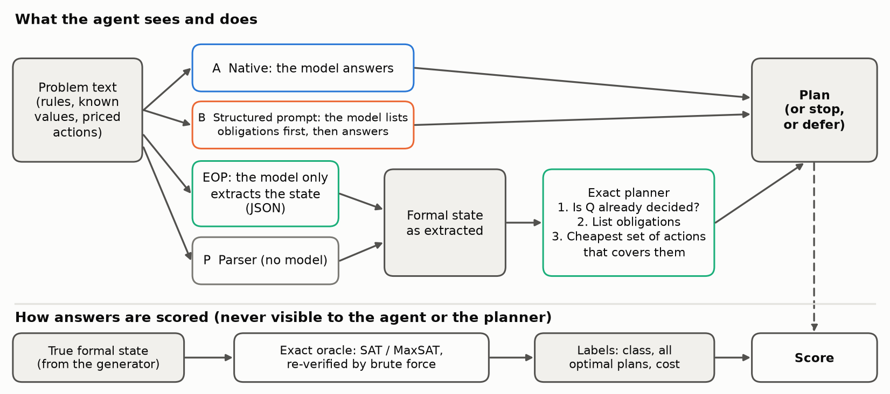
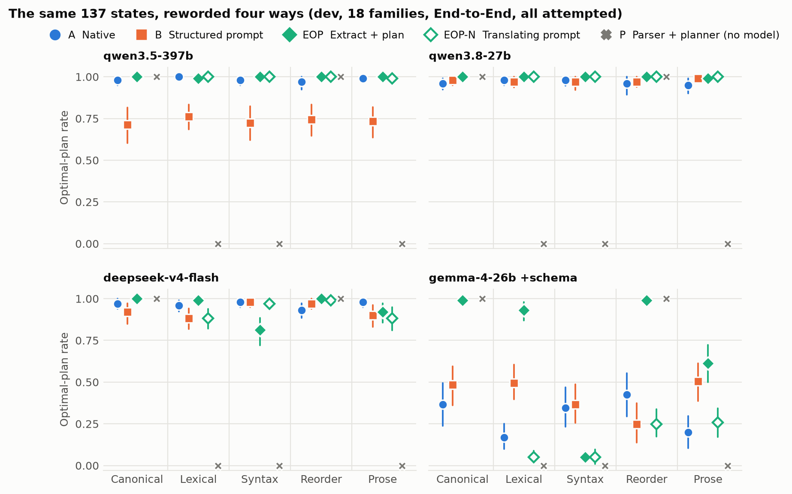

# What Would Be Enough? Evaluating Minimal Sufficient Epistemic Plans in LLM Agents[^1]

Konstantinos Dalampekis  
University of California, Los Angeles

**With** Apart Research

## Abstract

An agent that cannot yet answer a question can gather information, run a computation, do both, or accept that nothing available will settle it. We ask whether language models can tell which of these is enough. We define Minimal Sufficient Epistemic Planning: given rules, known values and priced actions, give the cheapest set of actions guaranteed to settle the question. An exact oracle labels a benchmark of 300 problem families. On a held-out split, three of four open-weight models find a cheapest sufficient plan on 0.93–0.98 of solvable states and the fourth on 0.42. The strong models also follow the cheapest plan when prices change; the weak one does not. One strong model appeared to keep acting on 20% of states that were already sufficient, but a follow-up on fresh problems shows that most of this came from an ambiguity in our own benchmark text (14% falls to 3% with clear wording); the weak model's stopping failure is real (59%). A mitigation that has the model extract the formal state and lets an exact planner choose the actions reaches 0.99–1.00 on held-out data, but so does a parser with no model. Under rewording the parser fails and the model extractor holds for two models and breaks for two. One repair call recovers most rejected extractions and adds some silent errors; a few of these become confident wrong answers. Planning on a correct formal state is reliable; obtaining a faithful state from language is the open problem.

## 1. Introduction

Suppose an agent must decide whether an experiment run can be approved: approval holds exactly when the protocol version is current and a configuration checksum matches. It can ask a person about the protocol (cost 3), run the checksum (cost 1), or request an audit that also covers the protocol (cost 5). If it already knows the protocol is out of date, it needs nothing: the answer is no. If it knows nothing, it needs the question and the checksum; the audit is a costlier route to the same fact. If nobody can be asked, nothing settles the matter and it should defer.

Each case answers one question differently: *what would be enough to settle this?* Too little, and the agent decides without grounds; too much, and it spends compute and people's attention; acting when the matter is settled, or when nothing can settle it, shows it does not know what its evidence supports. For safety, the attraction is that sufficiency can be checked: if an agent's stopping decision is computed from an explicit state, it can be audited, and the remaining risk sits in how that state was obtained. This is a different failure from telling users what they want to hear [1, 2].

Existing evaluations cover parts of this: which facts to ask for [3, 4, 5], when more computation pays [6, 7], when to act, ask or step back [8, 9]. We found none that puts information and computation in one priced action space and scores, against an exact answer, whether a plan is *sufficient* and *minimal*. We define that task, **Minimal Sufficient Epistemic Planning (MSEP)**.

**Our main contributions are:**

1. **Task, oracle and benchmark.** 300 problem families and 2,282 states whose right response is information, computation, both, nothing, or deferral, each labelled with all its cheapest sufficient plans. *Built before the sprint (Appendix B).*
2. **Evaluation of four open-weight models** on a held-out split under a frozen protocol, plus three follow-up studies. Three models plan near ceiling and follow price changes. Their apparent stopping errors came mostly from an ambiguity in our own text; the weakest model's stopping and cost errors are real.
3. **A formal mitigation and its boundary.** The Epistemic Obligation Planner (EOP) has the model extract the formal state and lets an exact planner choose the actions. It reaches 0.99–1.00 held-out, as does a parser with no model; under rewording, planning stays exact while extraction from language does not, and repairing extractions introduces silent errors.

## 2. Related Work

**What to ask.** MT-InfoSeek [3] tests whether models find minimal sufficient query sets; the authors report no model above 0.4 exact-set accuracy at k=2. QuestBench [5] gives problems with exactly one missing value; the authors report 40–50% accuracy on its logic and planning sets. In both, queries cost the same, a sufficient set always exists, and no computation is on offer.

**Ask, act, compute or step back.** *Ask, Relax, or Act?* [4] labels decisions with exact solvers and finds that most errors are needless interventions. SURE-Act [8] learns from counterfactual rollouts; Active Epistemic Control [9] decides what to check before committing a plan; Rational Metareasoning [7] trains models to reason only when it pays; DIAL [6] finds that the benefit of extra computation tracks uncertainty differently across models; ToolChoiceConfusion [10] filters tools by causal sufficiency for the model. None scores the cheapest *set* of steps that guarantees the answer.

**From language to logic.** EOP depends on translating text into a formal state. Solver-backed pipelines use an LLM as semantic parser [11, 12], repair from solver messages [11] or constrain the output grammar [13]. A formalization can be well-formed and still unfaithful [14], which motivates roundtrip checks and repair [15].

**What is new here.** The question descends from metareasoning about the value of computation [16, 17] and the distinction between epistemic and pragmatic action [18]; recent work makes sufficiency a criterion for reasoning length [19] and retrieved evidence [20] and prices asking by value of information [21]. We do not claim information seeking, computation allocation, abstention or solver-backed planning as new. Our contribution is a controlled, exactly scored evaluation of *minimal sufficient plans over two kinds of epistemic resource*, and a measured account of where a formal mitigation works. On our reading the oracle relates to the logic of sufficient and necessary reasons for decisions [22, 23].

## 3. Methods

### 3.1 The task

A **state** has propositional rules over a target Q, facts about the world, computational facts, the values already known, and a menu of priced actions. An **information action** reveals world facts. A **computation action** runs a certified procedure (for example modular exponentiation or a SAT check) on inputs the agent already has; its result is fixed but unknown until it is run, and it never depends on hidden world facts.

A **plan** is a set of actions chosen before any result is seen. It is **sufficient** if every outcome it could produce leaves Q decided. The **minimal sufficient epistemic plan** is a cheapest sufficient plan. A state's **resource class** is ALREADY_SUFFICIENT (the empty plan suffices), NEITHER (no available plan suffices), or INFORMATION_ONLY, COMPUTATION_ONLY or BOTH by what its cheapest plans contain. In the example of Section 1, knowing nothing gives BOTH, with plan {ask, checksum} at cost 4, not {audit, checksum} at cost 6.

**Oracle.** An *obligation* is a minimal set of unknowns on which a Q-true and a Q-false possibility differ. A plan is sufficient exactly when it reveals something in every obligation, so the cheapest plan is a minimum-cost hitting set. The oracle computes it by SAT and MaxSAT; a separate brute-force path re-verified every label (228,199 checks, 0 disagreements).

### 3.2 Benchmark

Each of 300 **families** is a random theory with distractors, indirect dependencies and bulk actions. Sibling states of a family cover all five resource classes, plus trap states (relevant but insufficient plans; sufficient but not minimal plans). Splits are by family: 165 train, 72 development, 63 held-out test. An adversarial audit showed that our first template could be solved by reading one rule; we rebuilt it and report text-only heuristics beside the models. **Counterfactual pairs** apply one edit to a state (one value becomes known) so that the cheapest plan changes; on the test split, 169 such edits make the state already sufficient.

### 3.3 Models, modes and scoring

Four open-weight models from one provider, at temperature 0 with one answer per item: qwen3.5-397b, qwen3.8-27b, deepseek-v4-flash and gemma-4-26b (with a forced output schema). Three modes locate errors. **End-to-End:** the model must notice, diagnose and plan. **Detection-Controlled:** it is told the state is insufficient. **Diagnosis-Controlled:** it is also told the resource class.

A plan is **optimal** if it is sufficient at the oracle's minimum cost; every tied cheapest plan counts. All rates are on an *all attempted* basis: a failed call or unreadable answer counts as wrong. Intervals are 95% bootstrap intervals that resample families, never single items. Registered tests are Holm-adjusted across models.

### 3.4 The Epistemic Obligation Planner and its comparisons

We compare four conditions (Figure 1): the model's **native** answer; a **structured prompt** that adds five steps walking through obligations; **EOP**, whose planner never sees hidden values or labels; and a **parser** in place of the model, followed by the same planner. The parser was written as the inverse of our text generator, so it shows what the benchmark's regular wording gives away. To test dependence on that wording, 137 development states were rendered in four other wordings that keep the formal state: new terminology (lexical), restructured sentences (syntax), shuffled sections (reorder), and running prose.

**Figure 1.** The conditions. In EOP the model only extracts the visible state; an exact planner then checks whether Q is decided, lists the obligations and returns a cheapest hitting set. The evaluation oracle is separate and sees the true state.

### 3.5 What was registered, and how to read each result

Every comparison was registered and hashed before its data existed, and results differ in standing. **Registered, held-out:** the planning hypotheses (H2–H4) and the test of over-intervention on newly sufficient states. **Prospective test of an amended method:** EOP on held-out data; the registered extraction prompt never showed the layout our reader requires, so we added it after the development split and report both versions (Appendix B). **Rewording study:** registered separately; never used to change EOP. **Follow-up studies:** registered *after* the held-out results had been viewed, on train families no model had seen; new evidence, not part of the original confirmation. **Exploratory and post hoc:** labelled where they occur.

## 4. Results

**Table 1.** Held-out test split (63 families). Columns 2–5: share of cheapest sufficient plans on resolvable states, Detection-Controlled. EOP − native: registered one-sided test, Holm p ≤ 0.005 for every model. Last two columns: the native answer's deferral on NEITHER states, and the share of 169 newly sufficient states on which it still acts (registered test that the rate exceeds 0.05: Holm p < 0.001 for qwen3.5 and gemma, 1.0 for the others).

| Model | Native | Structured prompt | EOP | Parser | EOP − native | Defers when nothing helps | Acts on newly sufficient states |
|---|---|---|---|---|---|---|---|
| qwen3.5-397b | 0.93 | 0.62 | 1.00 | 1.00 | +0.07 [+0.04, +0.10] | 0.89 | 0.20 [0.14, 0.27] |
| qwen3.8-27b | 0.98 | 0.96 | 1.00 | 1.00 | +0.02 [+0.01, +0.04] | 0.87 | 0.00 [0.00, 0.00] |
| deepseek-v4-flash | 0.98 | 0.94 | 1.00 | 1.00 | +0.02 [+0.01, +0.04] | 0.97 | 0.00 [0.00, 0.00] |
| gemma-4-26b +schema | 0.42 | 0.40 | 0.99 | 1.00 | +0.57 [+0.51, +0.62] | 0.00 | 0.72 [0.64, 0.79] |

### 4.1 Native planning is strong, including under price changes

**Three of four models plan near ceiling, and it replicates.** qwen3.5, qwen3.8 and deepseek give a cheapest sufficient plan on 0.93, 0.98 and 0.98 of resolvable held-out states (development: 0.96, 0.98, 0.96); gemma on 0.42 (0.45). No item of the three stronger models fails in all three modes, so none of their errors is attributed to planning itself.

**Most registered hypotheses were not supported** (Appendix B): diagnosis is not easier than planning, relevance is confused with sufficiency only slightly and for one model, and states needing both resources are not harder.

**The strong models follow prices; gemma does not** (follow-up Study 2, Table 2). Moving one action's price across the exact point where the cheapest plan changes (209 problems, 60 fresh families), qwen3.5 and qwen3.8 stay at 0.95–0.98 on both sides; cost insensitivity is not supported for either. gemma's plans are sufficient on 0.89 but cheapest on 0.31 above and 0.16 below the boundary (Holm p < 0.001).

**Table 2.** The three follow-up studies (fresh train families; intervals and tests in Appendix C). Cost: optimal-plan rate with one price just above and just below the point where the cheapest plan changes. Clarity: share of already-sufficient states on which the model still acts. Repair: exact extracted state on reworded items, frozen prompt.

| Model | Cost: cheapest plan, price above / below | Clarity: acts, original → clarified wording | Repair: exact state, first → with repair |
|---|---|---|---|
| qwen3.5-397b | 0.95 / 0.97 | 0.14 → 0.03 | not run |
| qwen3.8-27b | 0.95 / 0.98 | 0.00 → 0.00 | not run |
| deepseek-v4-flash | not run | not run | 0.89 → 0.97 |
| gemma-4-26b +schema | 0.31 / 0.16 | 0.73 → 0.59 | 0.21 → 0.78 |

### 4.2 Stopping: partly an artifact of our text, partly real

When no available action can settle the question, the three stronger models defer on 0.89, 0.87 and 0.97 of states; gemma never does. On the 169 held-out states that one edit has just made sufficient, qwen3.5 still proposes an action on 0.20 [0.14, 0.27] and gemma on 0.72 [0.64, 0.79]; the registered test is supported for both (Table 1).

**A confound in our own text.** The benchmark says every computational value "is not yet known", while the known-values line can list it; 21 of qwen3.5's 34 unnecessary plans only re-obtain such listed values (exploratory).

**Removing the ambiguity removes most of qwen3.5's error and part of gemma's** (follow-up Study 1, Table 2). We rendered 436 states from 60 fresh families twice, changing only that header to say a value is unknown *unless listed as known*. qwen3.5 then acts on 0.03 [0.01, 0.05] of already-sufficient states instead of 0.14; gemma on 0.59 [0.51, 0.66] instead of 0.73 (both Holm p < 0.001). Premature stopping on states that still need action did not rise beyond the registered harm threshold.

### 4.3 EOP works where extraction works

**On the benchmark's own wording, EOP reaches 0.99–1.00, and a model is not needed for that.** The registered test of EOP against native is supported for all four models (Table 1), but the gain is large only for gemma (+0.57), and the parser with no model also scores 1.00. The structured prompt helps no model and costs qwen3.5 31 points, because 119 of its 405 answers no longer follow the answer format.

**Figure 2.** The same 137 development states in the benchmark's wording and four rewordings (End-to-End; bars are 95% intervals).

**Under rewording, the parser fails and the model extractor holds for two models and breaks for two** (Figure 2). The parser scores 0.00 on three of four rewordings. The qwen models recover the exact state in at least 0.99 of items in every wording, but also plan at 0.95–1.00 natively; pooled, EOP beats native for gemma (+0.36 [+0.29, +0.43]) and slightly for qwen3.8 (+0.03), not for qwen3.5 or deepseek. On the syntax wording deepseek's EOP falls to 0.81 (native 0.98) and gemma's to 0.05 (native 0.35). Most failures are visible, because the planner rejects malformed extractions; gemma on prose is the exception, with 24 of 137 well-formed but wrong.

### 4.4 Can rejected extractions be repaired?

**One repair call recovers most rejected extractions and adds some silent errors** (exploratory follow-up Study 3, Table 2). On 174 reworded items from 12 fresh families, each rejected extraction was returned once with the reader's message, as in solver-message refinement [11]. With gemma's frozen prompt, exact states rose from 0.21 to 0.78 and optimal plans from 0.29 to 0.93, but accepted-but-wrong states rose from 0.07 to 0.16. deepseek rose from 0.89 to 0.97 with none.

**Most wrong states leave the plan intact; a few become confident wrong answers** (exploratory, post hoc, no model calls). Planning on each accepted-but-wrong state and scoring the plan on the true state: with gemma's frozen prompt and repair, 23 of 27 still gave an optimal plan, one was rejected by the planner, and 3 (0.02 [0.01, 0.03] of items, 1 before repair) made the system answer at once with the wrong value. Parser acceptance, an exact state and a correct decision are different properties.

## 5. Discussion and Limitations

**Where the errors came from.** We expected models to confuse relevance with sufficiency; mostly they did not. The failures had two sources. One was our own text: a benchmark that states what is known inconsistently measures how a model resolves the inconsistency, not whether it knows when to stop; the registered result stands, its interpretation changes. The other is real: the weakest model's plans usually settle the question but are rarely the cheapest, ignore prices, and continue when nothing more is needed.

**Formal correctness is conditional on semantic faithfulness.** An exact planner removes planning errors by construction, and its stopping decisions can be audited. But its guarantees hold for the state it is given, not for the task the text describes: the parser fails on rewording, extraction holds for some models only, and repair turns some rejected extractions into accepted wrong ones. A reader that accepts an answer has checked its form, not its meaning, and the wrong states that mattered produced the worst outcome available, an immediate confident answer with no check. Solver-backed agents should report this condition next to their guarantees.

### Limitations

Small synthetic logic problems in generated language, not open-ended decisions. EOP measures extraction, and its held-out version was fixed on development data. Four open-weight models from one provider, temperature 0, one answer per item. Static plans that must guarantee the answer; abstract costs. Rewordings from our own templates, audited by a language model, not people. The held-out results were first viewed during a provider outage, before one run had finished, under a rule fixed beforehand (Appendix B); the follow-ups were designed afterwards. Full list: Appendix A.

### Future Work

The next problem is faithful translation from language to a formal state, and knowing when a translation is faithful enough to act on: extraction that cites its source sentences; typed or grammar-constrained decoding [13]; verification independent of the extractor, including roundtrip checks [15]; several independent formalizations, acting only when they agree; and abstention calibrated to the chance the state is wrong. Consistency alone cannot show faithfulness [14]; this benchmark supplies exact references. Such methods should be tested on human-written, ambiguous tasks and judged by the consequences of undetected errors, not extraction accuracy alone. Further: sequential plans and probabilistic sufficiency [24].

## 6. Conclusion

We asked whether language models can tell what would be enough to settle a question. On a benchmark with exact answers, three of four open-weight models plan near ceiling and follow prices; their apparent stopping errors came largely from our own text, while the weakest model's errors are real. Exact formal planning gives reliable epistemic plans, conditional on a faithful representation of the task; linguistic variation, benchmark ambiguity and silent semantic errors limit end-to-end reliability. The next programme is formalizations that can establish when their translations are faithful enough to act on.

## Code and Data

- **Code repository:** https://github.com/kdalampekis/what-would-be-enough-research
- **Data:** every dataset regenerates deterministically from the repository and is pinned by SHA-256 in freeze records. The raw model responses behind every reported table are archived in the repository.
- **Registrations:** `PROTOCOL.md`, `PREREG_T1.md`, `PREREG_T1B.md`, `PREREG_EOP.md` (two amendments), `PREREG_FINAL.md`, `PREREG_ROBUST.md`, `PREREG_FOLLOWUP.md`, `PREREG_REPAIR.md`.
- **Extended report:** formal details and proofs, all result tables with intervals, prompts, example items in every wording and the full literature review (`paper/extended_report.md`).

## Author Contributions

Konstantinos Dalampekis is the sole author. The author set the research question and direction, made the decisions recorded at each registration and gate, and is responsible for the content. The role of AI tools is described in the LLM Usage Statement.

## Acknowledgements

We thank Apart Research for organizing the AI x Epistemics Research Sprint and Adaption for providing inference credits supporting the experiments.

## References

Format: Authors (Year). Title. Venue or arXiv id. URL. Unless marked, each entry was confirmed on the listed page (title, authors, year, venue) and its abstract was read.

† Bibliographic details from Crossref; not read at the source. Cited only for what the title and venue show.

1. Sharma, M., Tong, M., Korbak, T., Duvenaud, D., Askell, A., Bowman, S. R., Cheng, N., Durmus, E., Hatfield-Dodds, Z., Johnston, S. R., Kravec, S., Maxwell, T., McCandlish, S., Ndousse, K., Rausch, O., Schiefer, N., Yan, D., Zhang, M., Perez, E. (2023). Towards Understanding Sycophancy in Language Models. arXiv:2310.13548; ICLR 2024. https://arxiv.org/abs/2310.13548
2. Zamfirescu-Pereira, J.D., Wei, H., Xiao, A., Gu, K., Jung, G., Lee, M. G., Hartmann, B., Yang, Q. (2023). Herding AI Cats: Lessons from Designing a Chatbot by Prompting GPT-3. DIS 2023, 2206–2220. https://doi.org/10.1145/3563657.3596138
3. Huang, Y., Zhang, J., Dai, M., Su, X., Gao, S., Wang, Z., Zitnik, M. (2026). Do LLMs Know What to Ask and When? Evaluating Multi-Turn Information Seeking. arXiv:2608.14808. https://arxiv.org/abs/2608.14808
4. Li, A., Lin, Y., Kou, F., Su, Z., Tiwari, P., Li, W., Zhu, S., Zha, H., Wang, B. (2026). Ask, Relax, or Act? Evaluating Actionable Indeterminacy in LLM Preference Reasoning. arXiv:2610.03102. https://arxiv.org/abs/2610.03102
5. Li, B. Z., Kim, B., Wang, Z. (2025). QuestBench: Can LLMs ask the right question to acquire information in reasoning tasks? NeurIPS 2025, Datasets and Benchmarks Track; arXiv:2503.22674. https://arxiv.org/abs/2503.22674 (confirmed on the arXiv page on 2026-11-15)
6. Li, Z., Huang, J., Guo, X., Wang, G., Zhang, C. (2026). Same Signal, Opposite Meaning: Direction-Informed Adaptive Learning for LLM Agents. arXiv:2605.06908 (v2). https://arxiv.org/abs/2605.06908
7. De Sabbata, C. N., Sumers, T. R., AlKhamissi, B., Bosselut, A., Griffiths, T. L. (2024). Rational Metareasoning for Large Language Models. arXiv:2410.05563 (v3, 2025). https://arxiv.org/abs/2410.05563
8. Liu, Q., Jiao, Q., Guo, B., Dai, W., Yang, C., Liu, J., Metaxas, D. N., Shi, Y., Jiang, Z., Guo, M. (2026). Agents' Last Doubt: Knowing When to Act and When to Step Back in Tool-Using Agents. arXiv:2610.24194. https://arxiv.org/abs/2610.24194
9. Qu, S. (2026). Active Epistemic Control for Query-Efficient Verified Planning. arXiv:2602.03974. https://arxiv.org/abs/2602.03974
10. Babu, R. S., Iyer, L. G. (2026). ToolChoiceConfusion: Causal Minimal Tool Filtering for Reliable LLM Agents. arXiv:2606.06284. https://arxiv.org/abs/2606.06284
11. Pan, L., Albalak, A., Wang, X., Wang, W. (2023). Logic-LM: Empowering Large Language Models with Symbolic Solvers for Faithful Logical Reasoning. Findings of the Association for Computational Linguistics: EMNLP 2023, 3806–3824. https://aclanthology.org/2023.findings-emnlp.248/
12. Olausson, T., Gu, A., Lipkin, B., Zhang, C., Solar-Lezama, A., Tenenbaum, J., Levy, R. (2023). LINC: A Neurosymbolic Approach for Logical Reasoning by Combining Language Models with First-Order Logic Provers. EMNLP 2023, 5153–5176. https://aclanthology.org/2023.emnlp-main.313/
13. Geng, S., Josifoski, M., Peyrard, M., West, R. (2023). Grammar-Constrained Decoding for Structured NLP Tasks without Finetuning. EMNLP 2023, 10932–10952. https://aclanthology.org/2023.emnlp-main.674/
14. Kim, K., Poiroux, A., Bosselut, A. (2026). Do LLMs Game Formalization? Evaluating Faithfulness in Logical Reasoning. arXiv:2604.19459; VerifAI-2 Workshop at ICLR 2026 (non-archival). https://arxiv.org/abs/2604.19459
15. Amrollahi, D., Lopez, J., Barrett, C. (2026). Faithful Autoformalization via Roundtrip Verification and Repair. Findings of the Association for Computational Linguistics: EMNLP 2026, 9836–9852. https://aclanthology.org/2026.findings-emnlp.469/
16. Horvitz, E. (1988). Reasoning Under Varying and Uncertain Resource Constraints. Morgan Kaufmann Publishers (publisher as listed on the Microsoft Research page, which names no proceedings). https://www.microsoft.com/en-us/research/publication/reasoning-under-varying-and-uncertain-resource-constraints/
17. † Russell, S., Wefald, E. (1991). Principles of metareasoning. Artificial Intelligence, 49(1–3), 361–395. https://doi.org/10.1016/0004-3702(91)90015-C
18. † Kirsh, D., Maglio, P. (1994). On Distinguishing Epistemic from Pragmatic Action. Cognitive Science, 18(4), 513–549. https://doi.org/10.1207/s15516709cog1804_1
19. Wang, J., Liang, B., Hu, C., Zhang, L., Liu, X., Zhang, M., Li, J., Li, X. (2026). SuCo: Sufficiency-guided Continuous Adaptive Reasoning. Proceedings of the 43rd International Conference on Machine Learning, PMLR 306:127953–127970. https://proceedings.mlr.press/v306/wang26dz.html
20. Chen, S., Hua, P., Xiao, Y. (2026). Relevance Is Not Sufficient Evidence: Detecting Evidence Gaps Before Generation in RAG. arXiv:2609.37469. https://arxiv.org/abs/2609.37469
21. Dong, Y. R., Hu, T., Hui, Z., Zhang, C., Vulić, I., Bobu, A., Collier, N. (2026). Value of Information: A Framework for Human–Agent Communication. Proceedings of the 64th Annual Meeting of the Association for Computational Linguistics (Volume 1: Long Papers), 42879–42896. https://aclanthology.org/2026.acl-long.1987/
22. Darwiche, A., Hirth, A. (2020). On the Reasons Behind Decisions. ECAI 2020, IOS Press. https://doi.org/10.3233/FAIA200158 (arXiv:2002.09284)
23. Darwiche, A., Ji, C. (2022). On the Computation of Necessary and Sufficient Explanations. AAAI 2022, 36(5), 5582–5591. https://doi.org/10.1609/aaai.v36i5.20498 (arXiv:2203.10451)
24. Chen, S. J., Choi, A., Darwiche, A. (2014). Algorithms and Applications for the Same-Decision Probability. Journal of Artificial Intelligence Research 49, 601–633. https://doi.org/10.1613/jair.4218

## Appendix A. Limitations and Dual-Use / Ethical Considerations

**What the results do and do not establish.**

- **Synthetic tasks.** Every state is a small propositional problem in regular, machine-generated language. The results describe behaviour on these tasks and are not evidence about open-ended decisions with messy evidence.
- **EOP measures extraction, not planning.** Its planner is exact. On the benchmark's own wording a parser with no model extracts every state, so a high EOP score there does not show that the model contributes anything; the rewording study tests that.
- **The mitigation tested on held-out data was chosen on development data** (Appendix B).
- **Four open-weight models, one provider, temperature 0, one answer per item.** No closed frontier model was run and we have no estimate of run-to-run variation. The served model identifier is recorded for every response.
- **Static plans and guaranteed sufficiency only.** A plan is chosen once, before any result is seen, and must settle the answer in every world the rules allow. Probabilities, noisy sources and step-by-step plans are outside this work. Costs are abstract units, not time or money.
- **An ambiguity in the benchmark text** affects one stopping measure (Section 4.2). The clarity study was designed to measure it.
- **The rewordings are ours:** four template-based kinds of change, audited by a language model on 24 texts, not by people.
- **Follow-up studies** were designed after the held-out results had been viewed. They use families no model had seen, and their protocols were frozen before their first response, but their questions were chosen with knowledge of the earlier results.
- **Not run:** sequential plans, uncertain computation, further benchmark tiers, and a source-grounded extraction arm planned for Study 3.

**Dual-use and ethical considerations.**

- **Selective disclosure.** The method computes which missing facts would settle a question for the agent itself. Pointed at a person, the same idea (the smallest set of facts that fixes a conclusion) describes selective disclosure or selective evidence gathering. Our code has no model of another party's beliefs and would need a different formal model to do this, but the direction is foreseeable and we name it.
- **False confidence from an exact planner.** "Already sufficient: stop" from a solver looks authoritative and is only as right as the extracted state. A wrong extraction gives a confident, wrong stop, and a check that was needed is skipped. We count every invalid extraction as a failure and report well-formed but wrong extractions separately. A deployed version should show the extracted state before acting on it.
- **"Minimal" must not be read as "skip checks".** A minimal plan is the cheapest among sufficient plans. Citing this work to justify fewer checks without a sufficiency guarantee would misuse it.
- **Benchmark scores can be over-read.** A fixed parser with an exact planner solves the canonical benchmark. A high score on it is not a certificate of good epistemic behaviour.
- **Data and privacy.** All items are synthetic. No personal data and no human participants were involved. Model outputs are answers to synthetic prompts.
- **Resources.** 69,562 model calls over the sprint (65,120 answered, 830 truncated, 3,612 failed), costing 480 of the provider's credits.

## Appendix B. Provenance, amendments and deviations

**Before the sprint and during it.** The sprint ran from 2026-11-13 to 2026-11-15; the repository history separates the two periods. Times in this report are UTC. The author worked in Los Angeles (UTC−8): the follow-up studies and the final analyses, dated 2026-11-16 in UTC, fall on 2026-11-15 local time.

- *Built before the sprint* (2026-11-03 and 2026-11-04): the formal model, the exact oracle and its validation, the benchmark templates and shortcut audit, the planner code used by EOP, the evaluation code and the evaluation protocol. No language model had been called.
- *Built during the sprint:* the provider integration and every model run; the counterfactual pairs and their analyses; the EOP comparison with both amendments and the parser audit; the held-out protocol and evaluation; the rewording study; the three follow-up studies; this report.
- *Reuse of the author's earlier code:* about 30 lines of syllogism semantics from an earlier project, used only in random oracle-validation instances and checked against brute force. No results from earlier projects are reported.

**EOP as registered.** The registered extraction prompt described the output fields in prose and never showed the layout the reader requires. Models without schema enforcement returned the right content in other layouts and were rejected. Table B1 shows the registered outcome on the development split beside the amended prompt.

**Table B1.** EOP as registered and as amended (development split, 72 families; optimal plans, Detection-Controlled, all attempted).

| Model | Native | EOP as registered | Items with no usable extraction | EOP, amended prompt |
|---|---|---|---|---|
| qwen3.5-397b | 0.96 | 0.69 | 150 / 473 | 1.00 |
| qwen3.8-27b | 0.98 | 0.65 | 163 / 473 | 1.00 |
| deepseek-v4-flash | 0.96 | 0.03 | 461 / 473 | 1.00 |
| gemma-4-26b +schema | 0.45 | 0.99 | 3 / 473 | not run |

The registered test (EOP better than native) was supported for gemma only. That is the registered outcome and it stands. *Amendment 1* added the layout to the prompt; the amended method is development-informed, and the held-out split tested it prospectively. *Amendment 2* (analysis only): gemma ignored its forced schema under the structured prompt and answered in plain text, and those answers are scored from the text.

**Registered planning hypotheses (held-out, Section 4.1).** H2 (diagnosis is easier than planning) is supported for no model; for qwen3.5 and gemma the difference is significant in the other direction. H3 (relevance is confused with sufficiency) is supported for qwen3.8 only, with a small effect (1.00 against 0.97, Holm p = 0.008). H4 (states needing both resources are harder) is not supported.

**Deviations.** None changes a registered outcome; all are recorded in the repository.

- For the held-out run, the test item sets and one p-value were added to the EOP analysis script before any test response.
- A script paused the runs while the provider was unreachable and resumed them afterwards; it changes no prompt, item or setting.
- **The held-out results were first analysed before one run had finished.** A provider outage stopped deepseek's held-out run on 2026-11-15 at 19:57 UTC. The project owner decided to look at the results with three models complete. Before any result was opened, a note fixing what would happen to the missing calls was committed (resume with the same commands; re-run the frozen analysis on the complete data). The provider recovered, the run finished, and every held-out number in this report is from the analysis of the complete data. Between the two analyses only deepseek's rows changed (native optimal-plan rate 0.73 with 108 unanswered items, then 0.98). No prompt, item, analysis or reporting choice was changed in between.
- Seven calls, all of gemma, failed all three registered attempts and count as wrong. Every call of the other three models has an answer.
- The three follow-up studies were registered after the held-out results had been viewed (`PREREG_FOLLOWUP.md`, `PREREG_REPAIR.md`). Each was frozen before its first response and analysed once.

## Appendix C. Follow-up studies: full tables

All three studies were registered after the held-out results had been viewed, used train families that no model had seen, and were analysed once. Full output: `results/aggregate/followup/` and `results/aggregate/repair/`.

**Table C1.** Study 1, wording clarity (End-to-End; 256 already-sufficient states and 120 control states from 60 families; all attempted). Registered test: the rate of acting falls under the clarified wording (one-sided, Holm across models).

| Model | Acts, original wording | Acts, clarified wording | Change | Holm p | Re-runs a known computation | Premature stops on states that need action, change |
|---|---|---|---|---|---|---|
| qwen3.5-397b | 0.14 [0.09, 0.19] | 0.03 [0.01, 0.05] | -0.11 [-0.16, -0.06] | < 0.001 | 0.10 → 0.00 | -1 of 120 |
| qwen3.8-27b | 0.00 [0.00, 0.01] | 0.00 [0.00, 0.00] | -0.00 [-0.01, +0.00] | 0.368 | 0.00 → 0.00 | +0 of 120 |
| gemma-4-26b +schema | 0.73 [0.67, 0.79] | 0.59 [0.51, 0.66] | -0.15 [-0.21, -0.09] | < 0.001 | 0.14 → 0.02 | +2 of 120 |

**Table C2.** Study 2, cost sensitivity (Detection-Controlled; 209 price sweeps from 60 families; all attempted). Registered test: the optimal-plan rate is higher just above the boundary than just below it (one-sided, Holm across models).

| Model | Cheapest plan, price just above | Cheapest plan, price just below | Above − below | Holm p | Sufficient, below | Below items: cheapest / kept old plan / other sufficient / insufficient or none |
|---|---|---|---|---|---|---|
| qwen3.5-397b | 0.95 [0.92, 0.98] | 0.97 [0.95, 0.99] | -0.02 [-0.06, +0.02] | 1.000 | 1.00 | 203 / 0 / 6 / 0 |
| qwen3.8-27b | 0.95 [0.90, 0.98] | 0.98 [0.95, 1.00] | -0.03 [-0.08, +0.01] | 1.000 | 0.98 | 204 / 0 / 0 / 5 |
| gemma-4-26b +schema | 0.31 [0.24, 0.38] | 0.16 [0.11, 0.22] | +0.14 [+0.06, +0.23] | < 0.001 | 0.89 | 34 / 62 / 91 / 22 |

**Table C3.** Study 3, one diagnostic repair call (174 reworded items from 12 families; all attempted; exploratory, no test). Rise: paired 95% interval of the change in accepted-but-wrong extractions. A registered reading rule applies: an answer written as message text instead of a function call is read from the text.

| Model | First prompt | Exact state: first → with repair | Gain | Accepted but wrong: first → with repair (rise) | Optimal plan: first → with repair | Rejected first answers: recovered / wrong / still rejected |
|---|---|---|---|---|---|---|
| gemma-4-26b +schema | frozen | 0.21 → 0.78 | +0.56 [+0.47, +0.65] | 0.07 → 0.16 (+0.09 [+0.03, +0.15]) | 0.29 → 0.93 | 98 / 15 / 12 of 125 |
| gemma-4-26b +schema | translating | 0.67 → 0.74 | +0.07 [+0.02, +0.12] | 0.15 → 0.17 (+0.02 [+0.01, +0.05]) | 0.75 → 0.87 | 12 / 4 / 15 of 31 |
| deepseek-v4-flash | frozen | 0.89 → 0.97 | +0.09 [+0.04, +0.13] | 0.00 → 0.00 (+0.00 [+0.00, +0.00]) | 0.90 → 0.97 | 15 / 0 / 5 of 20 |
| deepseek-v4-flash | translating | 0.95 → 0.97 | +0.02 [+0.01, +0.05] | 0.00 → 0.00 (+0.00 [+0.00, +0.00]) | 0.94 → 0.97 | 4 / 0 / 5 of 9 |

**Reader artifact.** Study 3 also exposed a reader artifact: gemma's "empty" answers under the translating prompt (EOP-N in Figure 2) were answers written as plain text instead of the forced function call. Read as text, that prompt gives the exact state on 0.67 of the Study 3 items, so Figure 2 understates EOP-N for gemma.

**Silent errors (exploratory, post hoc).** Designed on 2026-11-15 after the Study 3 results had been seen; no model calls. Each accepted-but-wrong extraction is planned on by the exact planner and its plan scored on the true state. Output: `results/aggregate/repair/silent_errors.md`, from `experiments/analyze_silent_errors.py`. No arm produced a plan that was sufficient but costlier, insufficient, or an unnecessary intervention; every consequential error was an immediate answer with the wrong value.

**Table C4.** Accepted-but-wrong extractions in Study 3, classified by the plan the exact planner makes on them, scored on the true state (174 items per row; interval: family-clustered 95%). deepseek-v4-flash had no accepted-but-wrong extraction in any arm.

| Model, first prompt | Stage | Accepted but wrong | Plan still optimal | Rejected by the planner | Wrong answer at once (silent, consequential) | Silent consequential, per item |
|---|---|---|---|---|---|---|
| gemma-4-26b +schema, frozen | first answer | 12 | 11 | 0 | 1 | 0.01 [0.00, 0.02] |
| gemma-4-26b +schema, frozen | with repair | 27 | 23 | 1 | 3 | 0.02 [0.01, 0.03] |
| gemma-4-26b +schema, translating | first answer | 26 | 23 | 1 | 2 | 0.01 [0.00, 0.03] |
| gemma-4-26b +schema, translating | with repair | 30 | 27 | 1 | 2 | 0.01 [0.00, 0.03] |

## LLM Usage Statement

We used Claude (Anthropic), through Claude Code, throughout the project: to write and test most of the code, to run and monitor the experiments, to analyse results and to draft this report. A separate Claude agent, given only the texts, audited a sample of the reworded items for ambiguity; this is not a human audit. The author set the research questions, made the protocol decisions recorded in the registrations (including both amendments, the choice of held-out conditions and the follow-up studies), and reviewed the results and the text. Every number in the report is read from result files in the repository.

[^1]: Research conducted at the AI x Epistemics Research Sprint, November 2026.
