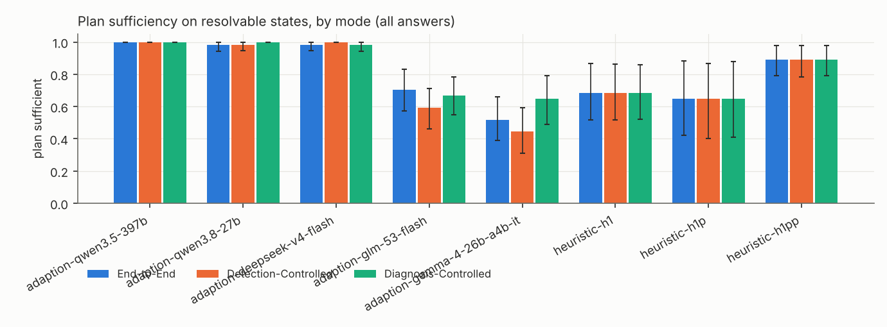
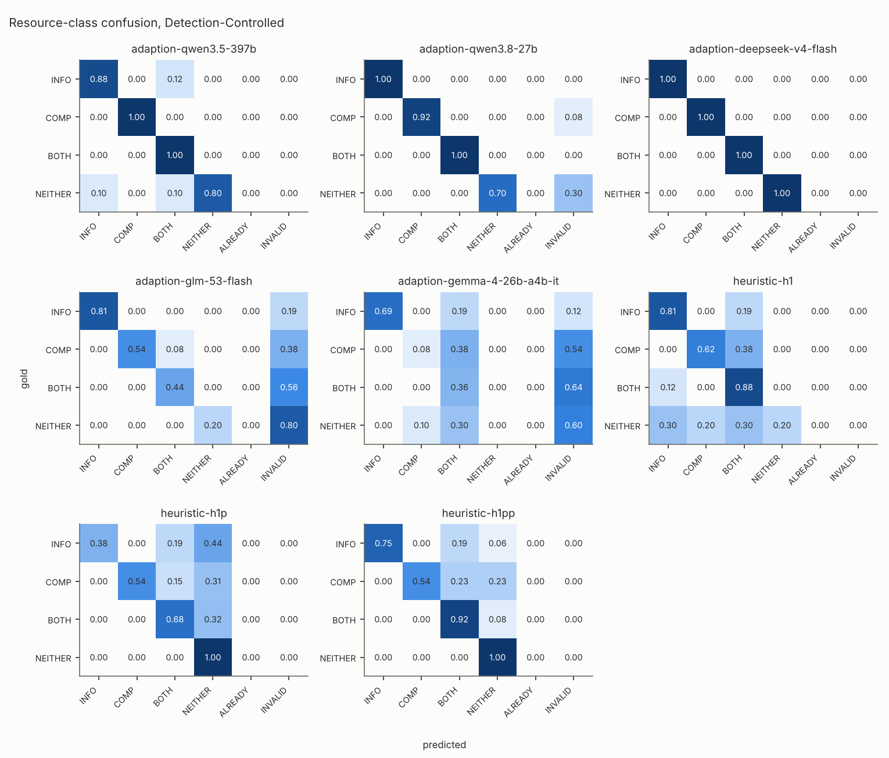

# Model results: calibration_dev

> `heuristic-*` rows are real deterministic baselines (no language model, text only). `mock-*` rows are synthetic fixtures.

Split(s): dev · families: 10 · generated from `summary.json` by `msep.eval.report`.

Every number names its mode. End-to-End mixes detection with planning and is never read as a planning failure. Intervals are 95% family-clustered bootstrap.

## Plan sufficiency by mode (resolvable states)

Two bases, the same in every mode. **All answers:** an unparsed or truncated answer counts as a failure. **Parsed only:** unparsed answers are left out; the number left out is shown as `unparsed/n`. A gap between the two means output-format or truncation failures, not planning failures.

| Agent / model | E2E all | E2E parsed | DC all | DC parsed | DxC all | DxC parsed | unparsed/n (E2E, DC, DxC) |
|---|---|---|---|---|---|---|---|
| adaption-qwen3.5-397b | 1.00 [1.00, 1.00] | 1.00 [1.00, 1.00] | 1.00 [1.00, 1.00] | 1.00 [1.00, 1.00] | 1.00 [1.00, 1.00] | 1.00 [1.00, 1.00] | 0/54, 0/54, 0/54 |
| adaption-qwen3.8-27b | 0.98 [0.94, 1.00] | 1.00 [1.00, 1.00] | 0.98 [0.94, 1.00] | 1.00 [1.00, 1.00] | 1.00 [1.00, 1.00] | 1.00 [1.00, 1.00] | 1/54, 1/54, 0/54 |
| adaption-deepseek-v4-flash | 0.98 [0.94, 1.00] | 1.00 [1.00, 1.00] | 1.00 [1.00, 1.00] | 1.00 [1.00, 1.00] | 0.98 [0.94, 1.00] | 1.00 [1.00, 1.00] | 1/54, 0/54, 1/54 |
| adaption-glm-53-flash | 0.70 [0.57, 0.83] | 1.00 [1.00, 1.00] | 0.59 [0.46, 0.71] | 1.00 [1.00, 1.00] | 0.67 [0.55, 0.78] | 1.00 [1.00, 1.00] | 16/54, 22/54, 18/54 |
| adaption-gemma-4-26b-a4b-it | 0.52 [0.39, 0.66] | 0.90 [0.77, 1.00] | 0.44 [0.31, 0.59] | 0.83 [0.62, 1.00] | 0.65 [0.49, 0.79] | 0.92 [0.78, 1.00] | 23/54, 25/54, 16/54 |
| heuristic-h1 | 0.69 [0.52, 0.87] | 0.69 [0.52, 0.87] | 0.69 [0.52, 0.86] | 0.69 [0.52, 0.86] | 0.69 [0.52, 0.86] | 0.69 [0.52, 0.86] | 0/54, 0/54, 0/54 |
| heuristic-h1p | 0.65 [0.42, 0.88] | 0.65 [0.42, 0.88] | 0.65 [0.40, 0.87] | 0.65 [0.40, 0.87] | 0.65 [0.41, 0.88] | 0.65 [0.41, 0.88] | 0/54, 0/54, 0/54 |
| heuristic-h1pp | 0.89 [0.79, 0.98] | 0.89 [0.79, 0.98] | 0.89 [0.78, 0.98] | 0.89 [0.78, 0.98] | 0.89 [0.79, 0.98] | 0.89 [0.79, 0.98] | 0/54, 0/54, 0/54 |

## Diagnosis vs planning (H2), Detection-Controlled

| Agent / model | Class correct | Plan sufficient | Plan sufficient given class correct | McNemar p |
|---|---|---|---|---|
| adaption-qwen3.5-397b | 0.96 [0.88, 1.00] | 1.00 [1.00, 1.00] | 1.00 [1.00, 1.00] | 0.5 |
| adaption-qwen3.8-27b | 0.98 [0.94, 1.00] | 0.98 [0.94, 1.00] | 1.00 [1.00, 1.00] | 1 |
| adaption-deepseek-v4-flash | 1.00 [1.00, 1.00] | 1.00 [1.00, 1.00] | 1.00 [1.00, 1.00] | 1 |
| adaption-glm-53-flash | 0.57 [0.44, 0.70] | 0.59 [0.46, 0.71] | 1.00 [1.00, 1.00] | 1 |
| adaption-gemma-4-26b-a4b-it | 0.39 [0.29, 0.50] | 0.44 [0.31, 0.59] | 0.81 [0.57, 1.00] | 0.549 |
| heuristic-h1 | 0.80 [0.67, 0.92] | 0.69 [0.52, 0.86] | 0.67 [0.45, 0.86] | 0.286 |
| heuristic-h1p | 0.56 [0.34, 0.77] | 0.65 [0.40, 0.87] | 1.00 [1.00, 1.00] | 0.0625 |
| heuristic-h1pp | 0.78 [0.66, 0.89] | 0.89 [0.78, 0.98] | 1.00 [1.00, 1.00] | 0.0312 |

## E3 Resource diagnosis

| Agent / model | Mode | Accuracy | Macro-F1 | Balanced acc. | Surface-feature baseline (all counts) |
|---|---|---|---|---|---|
| adaption-qwen3.5-397b | Detection-Controlled | 0.94 [0.84, 1.00] | 0.93 [0.83, 1.00] | 0.92 [0.81, 1.00] | 0.41 |
| adaption-qwen3.5-397b | End-to-End | 0.95 [0.88, 1.00] | 0.96 [0.88, 1.00] | 0.94 [0.86, 1.00] | 0.41 |
| adaption-qwen3.8-27b | Detection-Controlled | 0.94 [0.89, 0.98] | 0.95 [0.88, 0.99] | 0.91 [0.83, 0.97] | 0.41 |
| adaption-qwen3.8-27b | End-to-End | 0.94 [0.87, 1.00] | 0.95 [0.88, 1.00] | 0.92 [0.83, 1.00] | 0.41 |
| adaption-deepseek-v4-flash | Detection-Controlled | 1.00 [1.00, 1.00] | 1.00 [1.00, 1.00] | 1.00 [1.00, 1.00] | 0.41 |
| adaption-deepseek-v4-flash | End-to-End | 0.95 [0.91, 1.00] | 0.97 [0.92, 1.00] | 0.94 [0.88, 1.00] | 0.41 |
| adaption-glm-53-flash | Detection-Controlled | 0.52 [0.41, 0.61] | 0.63 [0.53, 0.70] | 0.50 [0.41, 0.58] | 0.41 |
| adaption-glm-53-flash | End-to-End | 0.64 [0.52, 0.76] | 0.75 [0.61, 0.85] | 0.63 [0.49, 0.77] | 0.41 |
| adaption-gemma-4-26b-a4b-it | Detection-Controlled | 0.33 [0.24, 0.42] | 0.34 [0.25, 0.42] | 0.28 [0.21, 0.36] | 0.41 |
| adaption-gemma-4-26b-a4b-it | End-to-End | 0.42 [0.31, 0.53] | 0.45 [0.34, 0.55] | 0.36 [0.27, 0.48] | 0.41 |
| heuristic-h1 | Detection-Controlled | 0.70 [0.58, 0.82] | 0.63 [0.48, 0.76] | 0.63 [0.50, 0.75] | 0.41 |
| heuristic-h1 | End-to-End | 0.70 [0.58, 0.81] | 0.63 [0.48, 0.76] | 0.63 [0.51, 0.75] | 0.41 |
| heuristic-h1p | Detection-Controlled | 0.62 [0.44, 0.81] | 0.62 [0.44, 0.79] | 0.65 [0.50, 0.80] | 0.41 |
| heuristic-h1p | End-to-End | 0.62 [0.46, 0.81] | 0.62 [0.45, 0.80] | 0.65 [0.51, 0.81] | 0.41 |
| heuristic-h1pp | Detection-Controlled | 0.81 [0.71, 0.91] | 0.79 [0.70, 0.89] | 0.80 [0.72, 0.89] | 0.41 |
| heuristic-h1pp | End-to-End | 0.81 [0.72, 0.90] | 0.79 [0.70, 0.89] | 0.80 [0.73, 0.90] | 0.41 |

## E7 BOTH vs single-resource (Detection-Controlled)

| Agent / model | INFORMATION_ONLY | COMPUTATION_ONLY | BOTH | BOTH plans using one resource |
|---|---|---|---|---|
| adaption-qwen3.5-397b | 1.00 [1.00, 1.00] | 1.00 [1.00, 1.00] | 1.00 [1.00, 1.00] | 0.00 [0.00, 0.00] |
| adaption-qwen3.8-27b | 1.00 [1.00, 1.00] | 0.90 [0.70, 1.00] | 1.00 [1.00, 1.00] | 0.00 [0.00, 0.00] |
| adaption-deepseek-v4-flash | 1.00 [1.00, 1.00] | 1.00 [1.00, 1.00] | 1.00 [1.00, 1.00] | 0.00 [0.00, 0.00] |
| adaption-glm-53-flash | 0.80 [0.50, 1.00] | 0.70 [0.40, 1.00] | 0.40 [0.10, 0.70] | 0.00 [0.00, 0.00] |
| adaption-gemma-4-26b-a4b-it | 0.90 [0.70, 1.00] | 0.50 [0.20, 0.80] | 0.40 [0.10, 0.70] | 0.00 [0.00, 0.00] |
| heuristic-h1 | 0.70 [0.40, 1.00] | 1.00 [1.00, 1.00] | 0.60 [0.30, 0.90] | 0.20 [0.00, 0.50] |
| heuristic-h1p | 0.70 [0.40, 0.90] | 0.80 [0.50, 1.00] | 0.70 [0.40, 0.90] | 0.00 [0.00, 0.00] |
| heuristic-h1pp | 1.00 [1.00, 1.00] | 0.80 [0.50, 1.00] | 0.90 [0.70, 1.00] | 0.00 [0.00, 0.00] |

## E5 Relevance vs sufficiency (judgments)

| Agent / model | Accuracy, sufficient plans | Accuracy, relevant-insufficient plans | Pairs both correct | McNemar p |
|---|---|---|---|---|
| adaption-qwen3.5-397b | 1.00 [1.00, 1.00] | 1.00 [1.00, 1.00] | 1.00 [1.00, 1.00] | 1 |
| adaption-qwen3.8-27b | 1.00 [1.00, 1.00] | 0.98 [0.93, 1.00] | 0.98 [0.93, 1.00] | 1 |
| adaption-deepseek-v4-flash | 1.00 [1.00, 1.00] | 1.00 [1.00, 1.00] | 1.00 [1.00, 1.00] | 1 |
| adaption-glm-53-flash | 1.00 [1.00, 1.00] | 0.98 [0.94, 1.00] | 0.98 [0.94, 1.00] | 1 |
| adaption-gemma-4-26b-a4b-it | 0.85 [0.65, 1.00] | 0.82 [0.66, 0.96] | 0.69 [0.49, 0.87] | 0.607 |
| heuristic-h1 | 0.56 [0.35, 0.77] | 0.88 [0.79, 0.96] | 0.53 [0.32, 0.73] | 0.0169 |
| heuristic-h1p | 0.37 [0.12, 0.65] | 1.00 [1.00, 1.00] | 0.41 [0.12, 0.71] | 3.73e-09 |
| heuristic-h1pp | 0.52 [0.27, 0.81] | 1.00 [1.00, 1.00] | 0.57 [0.30, 0.84] | 9.54e-07 |

## E1, E2, E4, E6, E8, E9

| Agent / model | E1 base decision acc. | E2 detection acc. (E2E) | E2 over-answering | E4 exact match (DxC) | E6 optimal given sufficient (DC) | E8 correct defer (DC) | E9 premature stop (DC) | E9 continued after ex-post sufficiency (DC; compare with oracle) |
|---|---|---|---|---|---|---|---|---|
| adaption-qwen3.5-397b | 1.00 [1.00, 1.00] | 1.00 [1.00, 1.00] | 0.00 [0.00, 0.00] | 1.00 [1.00, 1.00] | 0.96 [0.88, 1.00] | 0.80 [0.50, 1.00] | 0.00 [0.00, 0.00] | 0.20 [0.08, 0.36] |
| adaption-qwen3.8-27b | 1.00 [1.00, 1.00] | 0.95 [0.88, 1.00] | 0.00 [0.00, 0.00] | 0.96 [0.91, 1.00] | 0.98 [0.94, 1.00] | 0.70 [0.40, 0.90] | 0.00 [0.00, 0.00] | 0.17 [0.04, 0.33] |
| adaption-deepseek-v4-flash | 1.00 [1.00, 1.00] | 0.95 [0.90, 0.99] | 0.00 [0.00, 0.00] | 0.98 [0.94, 1.00] | 0.98 [0.94, 1.00] | 1.00 [1.00, 1.00] | 0.00 [0.00, 0.00] | 0.19 [0.07, 0.34] |
| adaption-glm-53-flash | 1.00 [1.00, 1.00] | 0.68 [0.57, 0.79] | 0.00 [0.00, 0.00] | 1.00 [1.00, 1.00] | 0.94 [0.79, 1.00] | 0.20 [0.00, 0.50] | 0.00 [0.00, 0.00] | 0.16 [0.00, 0.30] |
| adaption-gemma-4-26b-a4b-it | 0.50 [0.20, 0.80] | 0.47 [0.34, 0.60] | 0.00 [0.00, 0.00] | 0.61 [0.38, 0.80] | 0.58 [0.43, 0.75] | 0.00 [0.00, 0.00] | 0.00 [0.00, 0.00] | 0.29 [0.07, 0.50] |
| heuristic-h1 | 0.70 [0.40, 1.00] | – | – | – | – | – | – | – |
| heuristic-h1p | 0.70 [0.40, 1.00] | – | – | – | – | – | – | – |
| heuristic-h1pp | 0.70 [0.40, 1.00] | – | – | – | – | – | – | – |

## Mode decomposition (same instances across modes; resolvable states)

An End-to-End failure that disappears in Detection-Controlled is attributed to detection/framing; a Detection-Controlled failure that disappears in Diagnosis-Controlled to diagnosis; only failures in all three modes are planning failures. Only instances whose answers parsed in all three modes are used; the number excluded is in the last column.

| Agent / model | e2e_success | e2e_fail_detection_wrong | e2e_fail_but_dc_success | dc_fail_but_dxc_success (diagnosis-attributable) | fail_in_all_modes (planning) | excluded (unparsed in some mode) |
|---|---|---|---|---|---|---|
| adaption-qwen3.5-397b | 0.96 [0.91, 1.00] | 0.00 [0.00, 0.00] | 0.02 [0.00, 0.06] | 0.04 [0.00, 0.12] | 0.00 [0.00, 0.00] | 0 |
| adaption-qwen3.8-27b | 1.00 [1.00, 1.00] | 0.00 [0.00, 0.00] | 0.00 [0.00, 0.00] | 0.00 [0.00, 0.00] | 0.00 [0.00, 0.00] | 2 |
| adaption-deepseek-v4-flash | 1.00 [1.00, 1.00] | 0.00 [0.00, 0.00] | 0.00 [0.00, 0.00] | 0.00 [0.00, 0.00] | 0.00 [0.00, 0.00] | 2 |
| adaption-glm-53-flash | 1.00 [1.00, 1.00] | 0.00 [0.00, 0.00] | 0.00 [0.00, 0.00] | 0.05 [0.00, 0.17] | 0.00 [0.00, 0.00] | 34 |
| adaption-gemma-4-26b-a4b-it | 0.73 [0.50, 0.94] | 0.00 [0.00, 0.00] | 0.00 [0.00, 0.00] | 0.27 [0.10, 0.39] | 0.07 [0.00, 0.27] | 39 |
| heuristic-h1 | 0.54 [0.33, 0.74] | 0.00 [0.00, 0.00] | 0.00 [0.00, 0.00] | 0.15 [0.05, 0.27] | 0.31 [0.14, 0.48] | 0 |
| heuristic-h1p | 0.56 [0.34, 0.77] | 0.00 [0.00, 0.00] | 0.00 [0.00, 0.00] | 0.09 [0.00, 0.22] | 0.35 [0.13, 0.59] | 0 |
| heuristic-h1pp | 0.78 [0.67, 0.89] | 0.00 [0.00, 0.00] | 0.00 [0.00, 0.00] | 0.11 [0.02, 0.24] | 0.11 [0.02, 0.21] | 0 |

## Instruction compliance and hierarchical metrics

| Agent / model | DC: claims sufficient (contradicts prompt) | DxC: class differs from given | A_D | A_G | A_P (DC) | A_P' (DxC) | A_S | A_E2E |
|---|---|---|---|---|---|---|---|---|
| adaption-qwen3.5-397b | 0.00 [0.00, 0.00] | 0.00 [0.00, 0.00] | 1.00 [1.00, 1.00] | 0.94 [0.84, 1.00] | 1.00 [1.00, 1.00] | 1.00 [1.00, 1.00] | 1.00 [1.00, 1.00] | 0.96 [0.90, 1.00] |
| adaption-qwen3.8-27b | 0.00 [0.00, 0.00] | 0.00 [0.00, 0.00] | 0.95 [0.88, 1.00] | 0.94 [0.89, 0.98] | 0.98 [0.94, 1.00] | 0.96 [0.91, 1.00] | 0.98 [0.93, 1.00] | 0.95 [0.88, 1.00] |
| adaption-deepseek-v4-flash | 0.00 [0.00, 0.00] | 0.00 [0.00, 0.00] | 0.95 [0.90, 0.99] | 1.00 [1.00, 1.00] | 0.98 [0.94, 1.00] | 0.96 [0.91, 1.00] | 1.00 [1.00, 1.00] | 0.95 [0.90, 0.99] |
| adaption-glm-53-flash | 0.00 [0.00, 0.00] | 0.00 [0.00, 0.00] | 0.68 [0.57, 0.79] | 0.52 [0.41, 0.61] | 0.97 [0.88, 1.00] | 0.67 [0.55, 0.78] | 0.98 [0.94, 1.00] | 0.68 [0.57, 0.79] |
| adaption-gemma-4-26b-a4b-it | 0.00 [0.00, 0.00] | 0.05 [0.00, 0.12] | 0.47 [0.34, 0.60] | 0.33 [0.24, 0.42] | 0.62 [0.43, 0.82] | 0.43 [0.25, 0.59] | 0.69 [0.49, 0.87] | 0.27 [0.15, 0.39] |
| heuristic-h1 | 0.00 [0.00, 0.00] | 0.20 [0.08, 0.35] | 0.91 [0.87, 0.95] | 0.70 [0.58, 0.82] | 0.51 [0.30, 0.70] | 0.41 [0.22, 0.59] | 0.53 [0.32, 0.73] | 0.36 [0.20, 0.52] |
| heuristic-h1p | 0.00 [0.00, 0.00] | 0.44 [0.23, 0.65] | 0.91 [0.87, 0.95] | 0.62 [0.44, 0.81] | 0.83 [0.58, 0.97] | 0.46 [0.24, 0.69] | 0.41 [0.12, 0.71] | 0.51 [0.34, 0.69] |
| heuristic-h1pp | 0.00 [0.00, 0.00] | 0.22 [0.10, 0.33] | 0.91 [0.87, 0.95] | 0.81 [0.71, 0.91] | 0.76 [0.53, 0.95] | 0.59 [0.40, 0.77] | 0.57 [0.30, 0.84] | 0.61 [0.47, 0.76] |

## Strata: shallow-heuristic difficulty and template

`heuristic_hard` = instances where the text-only h1pp baseline fails. A model's advantage over shallow reading shows only there.

| Agent / model | Stratum | Instances | DC class correct | DC plan sufficient | DC plan optimal |
|---|---|---|---|---|---|
| adaption-qwen3.5-397b | heuristic_easy | 45 | 0.93 [0.82, 1.00] | 1.00 [1.00, 1.00] | 0.97 [0.90, 1.00] |
| adaption-qwen3.5-397b | heuristic_hard | 29 | 0.95 [0.82, 1.00] | 1.00 [1.00, 1.00] | 0.95 [0.82, 1.00] |
| adaption-qwen3.5-397b | v3 | 74 | 0.94 [0.84, 1.00] | 1.00 [1.00, 1.00] | 0.96 [0.88, 1.00] |
| adaption-qwen3.8-27b | heuristic_easy | 45 | 0.93 [0.88, 1.00] | 1.00 [1.00, 1.00] | 1.00 [1.00, 1.00] |
| adaption-qwen3.8-27b | heuristic_hard | 29 | 0.95 [0.84, 1.00] | 0.95 [0.84, 1.00] | 0.91 [0.80, 1.00] |
| adaption-qwen3.8-27b | v3 | 74 | 0.94 [0.89, 0.98] | 0.98 [0.94, 1.00] | 0.96 [0.92, 1.00] |
| adaption-deepseek-v4-flash | heuristic_easy | 45 | 1.00 [1.00, 1.00] | 1.00 [1.00, 1.00] | 1.00 [1.00, 1.00] |
| adaption-deepseek-v4-flash | heuristic_hard | 29 | 1.00 [1.00, 1.00] | 1.00 [1.00, 1.00] | 0.95 [0.87, 1.00] |
| adaption-deepseek-v4-flash | v3 | 74 | 1.00 [1.00, 1.00] | 1.00 [1.00, 1.00] | 0.98 [0.94, 1.00] |
| adaption-glm-53-flash | heuristic_easy | 45 | 0.50 [0.38, 0.65] | 0.59 [0.39, 0.81] | 0.59 [0.39, 0.81] |
| adaption-glm-53-flash | heuristic_hard | 29 | 0.55 [0.40, 0.78] | 0.59 [0.48, 0.79] | 0.50 [0.30, 0.78] |
| adaption-glm-53-flash | v3 | 74 | 0.52 [0.41, 0.61] | 0.59 [0.46, 0.71] | 0.56 [0.40, 0.69] |
| adaption-gemma-4-26b-a4b-it | heuristic_easy | 45 | 0.38 [0.26, 0.49] | 0.53 [0.36, 0.72] | 0.38 [0.22, 0.56] |
| adaption-gemma-4-26b-a4b-it | heuristic_hard | 29 | 0.23 [0.05, 0.43] | 0.32 [0.17, 0.53] | 0.09 [0.00, 0.25] |
| adaption-gemma-4-26b-a4b-it | v3 | 74 | 0.33 [0.24, 0.42] | 0.44 [0.31, 0.59] | 0.26 [0.15, 0.39] |
| heuristic-h1 | heuristic_easy | 45 | 0.79 [0.67, 0.88] | 0.75 [0.47, 0.95] | 0.69 [0.44, 0.89] |
| heuristic-h1 | heuristic_hard | 29 | 0.55 [0.30, 0.78] | 0.59 [0.32, 0.88] | 0.00 [0.00, 0.00] |
| heuristic-h1 | v3 | 74 | 0.70 [0.58, 0.82] | 0.69 [0.52, 0.86] | 0.41 [0.22, 0.60] |
| heuristic-h1p | heuristic_easy | 45 | 0.83 [0.62, 0.98] | 0.78 [0.48, 1.00] | 0.78 [0.48, 1.00] |
| heuristic-h1p | heuristic_hard | 29 | 0.23 [0.04, 0.50] | 0.45 [0.15, 0.77] | 0.00 [0.00, 0.00] |
| heuristic-h1p | v3 | 74 | 0.62 [0.44, 0.81] | 0.65 [0.40, 0.87] | 0.46 [0.23, 0.69] |
| heuristic-h1pp | heuristic_easy | 45 | 1.00 [1.00, 1.00] | 1.00 [1.00, 1.00] | 1.00 [1.00, 1.00] |
| heuristic-h1pp | heuristic_hard | 29 | 0.45 [0.14, 0.72] | 0.73 [0.40, 0.94] | 0.00 [0.00, 0.00] |
| heuristic-h1pp | v3 | 74 | 0.81 [0.71, 0.91] | 0.89 [0.78, 0.98] | 0.59 [0.40, 0.78] |

## Calibration (stated confidence vs plan sufficiency)

| Agent / model | Mode | n | Brier | ECE |
|---|---|---|---|---|
| adaption-qwen3.5-397b | End-to-End | 74 | 0.15 | 0.15 |
| adaption-qwen3.5-397b | Detection-Controlled | 64 | 0.21 | 0.21 |
| adaption-qwen3.5-397b | Diagnosis-Controlled | 54 | 0.09 | 0.09 |
| adaption-qwen3.8-27b | End-to-End | 70 | 0.20 | 0.25 |
| adaption-qwen3.8-27b | Detection-Controlled | 60 | 0.24 | 0.32 |
| adaption-qwen3.8-27b | Diagnosis-Controlled | 54 | 0.31 | 0.38 |
| adaption-deepseek-v4-flash | End-to-End | 70 | 0.56 | 0.56 |
| adaption-deepseek-v4-flash | Detection-Controlled | 64 | 0.75 | 0.75 |
| adaption-deepseek-v4-flash | Diagnosis-Controlled | 53 | 0.81 | 0.81 |
| adaption-glm-53-flash | End-to-End | 50 | 0.12 | 0.12 |
| adaption-glm-53-flash | Detection-Controlled | 34 | 0.40 | 0.40 |
| adaption-glm-53-flash | Diagnosis-Controlled | 36 | 0.28 | 0.29 |
| adaption-gemma-4-26b-a4b-it | End-to-End | 38 | 0.64 | 0.66 |
| adaption-gemma-4-26b-a4b-it | Detection-Controlled | 33 | 0.70 | 0.70 |
| adaption-gemma-4-26b-a4b-it | Diagnosis-Controlled | 38 | 0.85 | 0.86 |
| heuristic-h1 | End-to-End | 74 | 0.25 | 0.04 |
| heuristic-h1 | Detection-Controlled | 64 | 0.25 | 0.08 |
| heuristic-h1 | Diagnosis-Controlled | 54 | 0.25 | 0.19 |
| heuristic-h1p | End-to-End | 74 | 0.25 | 0.01 |
| heuristic-h1p | Detection-Controlled | 64 | 0.25 | 0.05 |
| heuristic-h1p | Diagnosis-Controlled | 54 | 0.25 | 0.15 |
| heuristic-h1pp | End-to-End | 74 | 0.25 | 0.19 |
| heuristic-h1pp | Detection-Controlled | 64 | 0.25 | 0.25 |
| heuristic-h1pp | Diagnosis-Controlled | 54 | 0.25 | 0.39 |

## Model vs shallow heuristic h1pp (same instances, plan optimal on resolvable states)

| Model | Mode | Model minus h1pp [CI] | McNemar p |
|---|---|---|---|
| adaption-qwen3.5-397b | Detection-Controlled | 0.37 [0.15, 0.58] | 1.1e-05 |
| adaption-qwen3.5-397b | Diagnosis-Controlled | 0.41 [0.23, 0.59] | 4.77e-07 |
| adaption-qwen3.5-397b | End-to-End | 0.37 [0.18, 0.57] | 1.1e-05 |
| adaption-qwen3.8-27b | Detection-Controlled | 0.37 [0.19, 0.55] | 1.91e-06 |
| adaption-qwen3.8-27b | Diagnosis-Controlled | 0.37 [0.21, 0.52] | 1.91e-06 |
| adaption-qwen3.8-27b | End-to-End | 0.39 [0.20, 0.57] | 5.72e-06 |
| adaption-deepseek-v4-flash | Detection-Controlled | 0.39 [0.23, 0.57] | 9.54e-07 |
| adaption-deepseek-v4-flash | Diagnosis-Controlled | 0.37 [0.22, 0.53] | 1.91e-06 |
| adaption-deepseek-v4-flash | End-to-End | 0.39 [0.19, 0.60] | 5.72e-06 |
| adaption-glm-53-flash | Detection-Controlled | -0.04 [-0.28, 0.17] | 0.839 |
| adaption-glm-53-flash | Diagnosis-Controlled | 0.07 [-0.13, 0.31] | 0.557 |
| adaption-glm-53-flash | End-to-End | 0.11 [-0.02, 0.25] | 0.238 |
| adaption-gemma-4-26b-a4b-it | Detection-Controlled | -0.33 [-0.49, -0.19] | 0.000121 |
| adaption-gemma-4-26b-a4b-it | Diagnosis-Controlled | -0.17 [-0.36, 0.04] | 0.0784 |
| adaption-gemma-4-26b-a4b-it | End-to-End | -0.24 [-0.39, -0.10] | 0.0072 |

## Breakdown: stratum x mode x resource class (plan optimal on resolvable states)

Full v3 is primary; heuristic_hard is a pre-registered stress test (it contains no NEITHER items, so compare within class).

| Agent / model | Stratum | Mode | Class | n | Class correct | Plan sufficient | Plan optimal |
|---|---|---|---|---|---|---|---|
| adaption-qwen3.5-397b | all | End-to-End | ALL | 74 | 0.96 [0.90, 1.00] | 1.00 [1.00, 1.00] | 0.96 [0.91, 1.00] |
| adaption-qwen3.5-397b | all | End-to-End | ALREADY_SUFFICIENT | 10 | 1.00 [1.00, 1.00] | – | – |
| adaption-qwen3.5-397b | all | End-to-End | INFORMATION_ONLY | 16 | 0.88 [0.71, 1.00] | 1.00 [1.00, 1.00] | 0.88 [0.71, 1.00] |
| adaption-qwen3.5-397b | all | End-to-End | COMPUTATION_ONLY | 13 | 1.00 [1.00, 1.00] | 1.00 [1.00, 1.00] | 1.00 [1.00, 1.00] |
| adaption-qwen3.5-397b | all | End-to-End | BOTH | 25 | 1.00 [1.00, 1.00] | 1.00 [1.00, 1.00] | 1.00 [1.00, 1.00] |
| adaption-qwen3.5-397b | all | End-to-End | NEITHER | 10 | 0.90 [0.70, 1.00] | – | – |
| adaption-qwen3.5-397b | all | Detection-Controlled | ALL | 64 | 0.94 [0.84, 1.00] | 1.00 [1.00, 1.00] | 0.96 [0.88, 1.00] |
| adaption-qwen3.5-397b | all | Detection-Controlled | INFORMATION_ONLY | 16 | 0.88 [0.60, 1.00] | 1.00 [1.00, 1.00] | 0.88 [0.60, 1.00] |
| adaption-qwen3.5-397b | all | Detection-Controlled | COMPUTATION_ONLY | 13 | 1.00 [1.00, 1.00] | 1.00 [1.00, 1.00] | 1.00 [1.00, 1.00] |
| adaption-qwen3.5-397b | all | Detection-Controlled | BOTH | 25 | 1.00 [1.00, 1.00] | 1.00 [1.00, 1.00] | 1.00 [1.00, 1.00] |
| adaption-qwen3.5-397b | all | Detection-Controlled | NEITHER | 10 | 0.80 [0.50, 1.00] | – | – |
| adaption-qwen3.5-397b | all | Diagnosis-Controlled | ALL | 54 | 1.00 [1.00, 1.00] | 1.00 [1.00, 1.00] | 1.00 [1.00, 1.00] |
| adaption-qwen3.5-397b | all | Diagnosis-Controlled | INFORMATION_ONLY | 16 | 1.00 [1.00, 1.00] | 1.00 [1.00, 1.00] | 1.00 [1.00, 1.00] |
| adaption-qwen3.5-397b | all | Diagnosis-Controlled | COMPUTATION_ONLY | 13 | 1.00 [1.00, 1.00] | 1.00 [1.00, 1.00] | 1.00 [1.00, 1.00] |
| adaption-qwen3.5-397b | all | Diagnosis-Controlled | BOTH | 25 | 1.00 [1.00, 1.00] | 1.00 [1.00, 1.00] | 1.00 [1.00, 1.00] |
| adaption-qwen3.5-397b | heuristic_hard | End-to-End | ALL | 29 | 0.97 [0.88, 1.00] | 1.00 [1.00, 1.00] | 0.95 [0.86, 1.00] |
| adaption-qwen3.5-397b | heuristic_hard | End-to-End | ALREADY_SUFFICIENT | 7 | 1.00 [1.00, 1.00] | – | – |
| adaption-qwen3.5-397b | heuristic_hard | End-to-End | INFORMATION_ONLY | 8 | 0.88 [0.50, 1.00] | 1.00 [1.00, 1.00] | 0.88 [0.50, 1.00] |
| adaption-qwen3.5-397b | heuristic_hard | End-to-End | COMPUTATION_ONLY | 6 | 1.00 [1.00, 1.00] | 1.00 [1.00, 1.00] | 1.00 [1.00, 1.00] |
| adaption-qwen3.5-397b | heuristic_hard | End-to-End | BOTH | 8 | 1.00 [1.00, 1.00] | 1.00 [1.00, 1.00] | 1.00 [1.00, 1.00] |
| adaption-qwen3.5-397b | heuristic_hard | Detection-Controlled | ALL | 22 | 0.95 [0.82, 1.00] | 1.00 [1.00, 1.00] | 0.95 [0.82, 1.00] |
| adaption-qwen3.5-397b | heuristic_hard | Detection-Controlled | INFORMATION_ONLY | 8 | 0.88 [0.50, 1.00] | 1.00 [1.00, 1.00] | 0.88 [0.50, 1.00] |
| adaption-qwen3.5-397b | heuristic_hard | Detection-Controlled | COMPUTATION_ONLY | 6 | 1.00 [1.00, 1.00] | 1.00 [1.00, 1.00] | 1.00 [1.00, 1.00] |
| adaption-qwen3.5-397b | heuristic_hard | Detection-Controlled | BOTH | 8 | 1.00 [1.00, 1.00] | 1.00 [1.00, 1.00] | 1.00 [1.00, 1.00] |
| adaption-qwen3.5-397b | heuristic_hard | Diagnosis-Controlled | ALL | 22 | 1.00 [1.00, 1.00] | 1.00 [1.00, 1.00] | 1.00 [1.00, 1.00] |
| adaption-qwen3.5-397b | heuristic_hard | Diagnosis-Controlled | INFORMATION_ONLY | 8 | 1.00 [1.00, 1.00] | 1.00 [1.00, 1.00] | 1.00 [1.00, 1.00] |
| adaption-qwen3.5-397b | heuristic_hard | Diagnosis-Controlled | COMPUTATION_ONLY | 6 | 1.00 [1.00, 1.00] | 1.00 [1.00, 1.00] | 1.00 [1.00, 1.00] |
| adaption-qwen3.5-397b | heuristic_hard | Diagnosis-Controlled | BOTH | 8 | 1.00 [1.00, 1.00] | 1.00 [1.00, 1.00] | 1.00 [1.00, 1.00] |
| adaption-qwen3.5-397b | heuristic_easy | End-to-End | ALL | 45 | 0.96 [0.86, 1.00] | 1.00 [1.00, 1.00] | 0.97 [0.90, 1.00] |
| adaption-qwen3.5-397b | heuristic_easy | End-to-End | ALREADY_SUFFICIENT | 3 | 1.00 [1.00, 1.00] | – | – |
| adaption-qwen3.5-397b | heuristic_easy | End-to-End | INFORMATION_ONLY | 8 | 0.88 [0.62, 1.00] | 1.00 [1.00, 1.00] | 0.88 [0.62, 1.00] |
| adaption-qwen3.5-397b | heuristic_easy | End-to-End | COMPUTATION_ONLY | 7 | 1.00 [1.00, 1.00] | 1.00 [1.00, 1.00] | 1.00 [1.00, 1.00] |
| adaption-qwen3.5-397b | heuristic_easy | End-to-End | BOTH | 17 | 1.00 [1.00, 1.00] | 1.00 [1.00, 1.00] | 1.00 [1.00, 1.00] |
| adaption-qwen3.5-397b | heuristic_easy | End-to-End | NEITHER | 10 | 0.90 [0.70, 1.00] | – | – |
| adaption-qwen3.5-397b | heuristic_easy | Detection-Controlled | ALL | 42 | 0.93 [0.82, 1.00] | 1.00 [1.00, 1.00] | 0.97 [0.90, 1.00] |
| adaption-qwen3.5-397b | heuristic_easy | Detection-Controlled | INFORMATION_ONLY | 8 | 0.88 [0.62, 1.00] | 1.00 [1.00, 1.00] | 0.88 [0.62, 1.00] |
| adaption-qwen3.5-397b | heuristic_easy | Detection-Controlled | COMPUTATION_ONLY | 7 | 1.00 [1.00, 1.00] | 1.00 [1.00, 1.00] | 1.00 [1.00, 1.00] |
| adaption-qwen3.5-397b | heuristic_easy | Detection-Controlled | BOTH | 17 | 1.00 [1.00, 1.00] | 1.00 [1.00, 1.00] | 1.00 [1.00, 1.00] |
| adaption-qwen3.5-397b | heuristic_easy | Detection-Controlled | NEITHER | 10 | 0.80 [0.50, 1.00] | – | – |
| adaption-qwen3.5-397b | heuristic_easy | Diagnosis-Controlled | ALL | 32 | 1.00 [1.00, 1.00] | 1.00 [1.00, 1.00] | 1.00 [1.00, 1.00] |
| adaption-qwen3.5-397b | heuristic_easy | Diagnosis-Controlled | INFORMATION_ONLY | 8 | 1.00 [1.00, 1.00] | 1.00 [1.00, 1.00] | 1.00 [1.00, 1.00] |
| adaption-qwen3.5-397b | heuristic_easy | Diagnosis-Controlled | COMPUTATION_ONLY | 7 | 1.00 [1.00, 1.00] | 1.00 [1.00, 1.00] | 1.00 [1.00, 1.00] |
| adaption-qwen3.5-397b | heuristic_easy | Diagnosis-Controlled | BOTH | 17 | 1.00 [1.00, 1.00] | 1.00 [1.00, 1.00] | 1.00 [1.00, 1.00] |
| adaption-qwen3.8-27b | all | End-to-End | ALL | 74 | 0.95 [0.88, 1.00] | 0.98 [0.94, 1.00] | 0.98 [0.94, 1.00] |
| adaption-qwen3.8-27b | all | End-to-End | ALREADY_SUFFICIENT | 10 | 1.00 [1.00, 1.00] | – | – |
| adaption-qwen3.8-27b | all | End-to-End | INFORMATION_ONLY | 16 | 1.00 [1.00, 1.00] | 1.00 [1.00, 1.00] | 1.00 [1.00, 1.00] |
| adaption-qwen3.8-27b | all | End-to-End | COMPUTATION_ONLY | 13 | 1.00 [1.00, 1.00] | 1.00 [1.00, 1.00] | 1.00 [1.00, 1.00] |
| adaption-qwen3.8-27b | all | End-to-End | BOTH | 25 | 0.96 [0.86, 1.00] | 0.96 [0.86, 1.00] | 0.96 [0.86, 1.00] |
| adaption-qwen3.8-27b | all | End-to-End | NEITHER | 10 | 0.70 [0.40, 1.00] | – | – |
| adaption-qwen3.8-27b | all | Detection-Controlled | ALL | 64 | 0.94 [0.89, 0.98] | 0.98 [0.94, 1.00] | 0.96 [0.92, 1.00] |
| adaption-qwen3.8-27b | all | Detection-Controlled | INFORMATION_ONLY | 16 | 1.00 [1.00, 1.00] | 1.00 [1.00, 1.00] | 1.00 [1.00, 1.00] |
| adaption-qwen3.8-27b | all | Detection-Controlled | COMPUTATION_ONLY | 13 | 0.92 [0.79, 1.00] | 0.92 [0.79, 1.00] | 0.92 [0.79, 1.00] |
| adaption-qwen3.8-27b | all | Detection-Controlled | BOTH | 25 | 1.00 [1.00, 1.00] | 1.00 [1.00, 1.00] | 0.96 [0.85, 1.00] |
| adaption-qwen3.8-27b | all | Detection-Controlled | NEITHER | 10 | 0.70 [0.40, 0.90] | – | – |
| adaption-qwen3.8-27b | all | Diagnosis-Controlled | ALL | 54 | 1.00 [1.00, 1.00] | 1.00 [1.00, 1.00] | 0.96 [0.91, 1.00] |
| adaption-qwen3.8-27b | all | Diagnosis-Controlled | INFORMATION_ONLY | 16 | 1.00 [1.00, 1.00] | 1.00 [1.00, 1.00] | 1.00 [1.00, 1.00] |
| adaption-qwen3.8-27b | all | Diagnosis-Controlled | COMPUTATION_ONLY | 13 | 1.00 [1.00, 1.00] | 1.00 [1.00, 1.00] | 1.00 [1.00, 1.00] |
| adaption-qwen3.8-27b | all | Diagnosis-Controlled | BOTH | 25 | 1.00 [1.00, 1.00] | 1.00 [1.00, 1.00] | 0.92 [0.76, 1.00] |
| adaption-qwen3.8-27b | heuristic_hard | End-to-End | ALL | 29 | 1.00 [1.00, 1.00] | 1.00 [1.00, 1.00] | 1.00 [1.00, 1.00] |
| adaption-qwen3.8-27b | heuristic_hard | End-to-End | ALREADY_SUFFICIENT | 7 | 1.00 [1.00, 1.00] | – | – |
| adaption-qwen3.8-27b | heuristic_hard | End-to-End | INFORMATION_ONLY | 8 | 1.00 [1.00, 1.00] | 1.00 [1.00, 1.00] | 1.00 [1.00, 1.00] |
| adaption-qwen3.8-27b | heuristic_hard | End-to-End | COMPUTATION_ONLY | 6 | 1.00 [1.00, 1.00] | 1.00 [1.00, 1.00] | 1.00 [1.00, 1.00] |
| adaption-qwen3.8-27b | heuristic_hard | End-to-End | BOTH | 8 | 1.00 [1.00, 1.00] | 1.00 [1.00, 1.00] | 1.00 [1.00, 1.00] |
| adaption-qwen3.8-27b | heuristic_hard | Detection-Controlled | ALL | 22 | 0.95 [0.84, 1.00] | 0.95 [0.84, 1.00] | 0.91 [0.80, 1.00] |
| adaption-qwen3.8-27b | heuristic_hard | Detection-Controlled | INFORMATION_ONLY | 8 | 1.00 [1.00, 1.00] | 1.00 [1.00, 1.00] | 1.00 [1.00, 1.00] |
| adaption-qwen3.8-27b | heuristic_hard | Detection-Controlled | COMPUTATION_ONLY | 6 | 0.83 [0.57, 1.00] | 0.83 [0.57, 1.00] | 0.83 [0.57, 1.00] |
| adaption-qwen3.8-27b | heuristic_hard | Detection-Controlled | BOTH | 8 | 1.00 [1.00, 1.00] | 1.00 [1.00, 1.00] | 0.88 [0.57, 1.00] |
| adaption-qwen3.8-27b | heuristic_hard | Diagnosis-Controlled | ALL | 22 | 1.00 [1.00, 1.00] | 1.00 [1.00, 1.00] | 0.91 [0.83, 1.00] |
| adaption-qwen3.8-27b | heuristic_hard | Diagnosis-Controlled | INFORMATION_ONLY | 8 | 1.00 [1.00, 1.00] | 1.00 [1.00, 1.00] | 1.00 [1.00, 1.00] |
| adaption-qwen3.8-27b | heuristic_hard | Diagnosis-Controlled | COMPUTATION_ONLY | 6 | 1.00 [1.00, 1.00] | 1.00 [1.00, 1.00] | 1.00 [1.00, 1.00] |
| adaption-qwen3.8-27b | heuristic_hard | Diagnosis-Controlled | BOTH | 8 | 1.00 [1.00, 1.00] | 1.00 [1.00, 1.00] | 0.75 [0.33, 1.00] |
| adaption-qwen3.8-27b | heuristic_easy | End-to-End | ALL | 45 | 0.91 [0.81, 1.00] | 0.97 [0.90, 1.00] | 0.97 [0.90, 1.00] |
| adaption-qwen3.8-27b | heuristic_easy | End-to-End | ALREADY_SUFFICIENT | 3 | 1.00 [1.00, 1.00] | – | – |
| adaption-qwen3.8-27b | heuristic_easy | End-to-End | INFORMATION_ONLY | 8 | 1.00 [1.00, 1.00] | 1.00 [1.00, 1.00] | 1.00 [1.00, 1.00] |
| adaption-qwen3.8-27b | heuristic_easy | End-to-End | COMPUTATION_ONLY | 7 | 1.00 [1.00, 1.00] | 1.00 [1.00, 1.00] | 1.00 [1.00, 1.00] |
| adaption-qwen3.8-27b | heuristic_easy | End-to-End | BOTH | 17 | 0.94 [0.79, 1.00] | 0.94 [0.79, 1.00] | 0.94 [0.79, 1.00] |
| adaption-qwen3.8-27b | heuristic_easy | End-to-End | NEITHER | 10 | 0.70 [0.40, 1.00] | – | – |
| adaption-qwen3.8-27b | heuristic_easy | Detection-Controlled | ALL | 42 | 0.93 [0.88, 1.00] | 1.00 [1.00, 1.00] | 1.00 [1.00, 1.00] |
| adaption-qwen3.8-27b | heuristic_easy | Detection-Controlled | INFORMATION_ONLY | 8 | 1.00 [1.00, 1.00] | 1.00 [1.00, 1.00] | 1.00 [1.00, 1.00] |
| adaption-qwen3.8-27b | heuristic_easy | Detection-Controlled | COMPUTATION_ONLY | 7 | 1.00 [1.00, 1.00] | 1.00 [1.00, 1.00] | 1.00 [1.00, 1.00] |
| adaption-qwen3.8-27b | heuristic_easy | Detection-Controlled | BOTH | 17 | 1.00 [1.00, 1.00] | 1.00 [1.00, 1.00] | 1.00 [1.00, 1.00] |
| adaption-qwen3.8-27b | heuristic_easy | Detection-Controlled | NEITHER | 10 | 0.70 [0.40, 0.90] | – | – |
| adaption-qwen3.8-27b | heuristic_easy | Diagnosis-Controlled | ALL | 32 | 1.00 [1.00, 1.00] | 1.00 [1.00, 1.00] | 1.00 [1.00, 1.00] |
| adaption-qwen3.8-27b | heuristic_easy | Diagnosis-Controlled | INFORMATION_ONLY | 8 | 1.00 [1.00, 1.00] | 1.00 [1.00, 1.00] | 1.00 [1.00, 1.00] |
| adaption-qwen3.8-27b | heuristic_easy | Diagnosis-Controlled | COMPUTATION_ONLY | 7 | 1.00 [1.00, 1.00] | 1.00 [1.00, 1.00] | 1.00 [1.00, 1.00] |
| adaption-qwen3.8-27b | heuristic_easy | Diagnosis-Controlled | BOTH | 17 | 1.00 [1.00, 1.00] | 1.00 [1.00, 1.00] | 1.00 [1.00, 1.00] |
| adaption-deepseek-v4-flash | all | End-to-End | ALL | 74 | 0.95 [0.90, 0.99] | 0.98 [0.94, 1.00] | 0.98 [0.94, 1.00] |
| adaption-deepseek-v4-flash | all | End-to-End | ALREADY_SUFFICIENT | 10 | 0.90 [0.70, 1.00] | – | – |
| adaption-deepseek-v4-flash | all | End-to-End | INFORMATION_ONLY | 16 | 1.00 [1.00, 1.00] | 1.00 [1.00, 1.00] | 1.00 [1.00, 1.00] |
| adaption-deepseek-v4-flash | all | End-to-End | COMPUTATION_ONLY | 13 | 1.00 [1.00, 1.00] | 1.00 [1.00, 1.00] | 1.00 [1.00, 1.00] |
| adaption-deepseek-v4-flash | all | End-to-End | BOTH | 25 | 0.96 [0.88, 1.00] | 0.96 [0.88, 1.00] | 0.96 [0.88, 1.00] |
| adaption-deepseek-v4-flash | all | End-to-End | NEITHER | 10 | 0.80 [0.50, 1.00] | – | – |
| adaption-deepseek-v4-flash | all | Detection-Controlled | ALL | 64 | 1.00 [1.00, 1.00] | 1.00 [1.00, 1.00] | 0.98 [0.94, 1.00] |
| adaption-deepseek-v4-flash | all | Detection-Controlled | INFORMATION_ONLY | 16 | 1.00 [1.00, 1.00] | 1.00 [1.00, 1.00] | 1.00 [1.00, 1.00] |
| adaption-deepseek-v4-flash | all | Detection-Controlled | COMPUTATION_ONLY | 13 | 1.00 [1.00, 1.00] | 1.00 [1.00, 1.00] | 1.00 [1.00, 1.00] |
| adaption-deepseek-v4-flash | all | Detection-Controlled | BOTH | 25 | 1.00 [1.00, 1.00] | 1.00 [1.00, 1.00] | 0.96 [0.85, 1.00] |
| adaption-deepseek-v4-flash | all | Detection-Controlled | NEITHER | 10 | 1.00 [1.00, 1.00] | – | – |
| adaption-deepseek-v4-flash | all | Diagnosis-Controlled | ALL | 54 | 0.98 [0.94, 1.00] | 0.98 [0.94, 1.00] | 0.96 [0.91, 1.00] |
| adaption-deepseek-v4-flash | all | Diagnosis-Controlled | INFORMATION_ONLY | 16 | 0.94 [0.86, 1.00] | 0.94 [0.86, 1.00] | 0.94 [0.86, 1.00] |
| adaption-deepseek-v4-flash | all | Diagnosis-Controlled | COMPUTATION_ONLY | 13 | 1.00 [1.00, 1.00] | 1.00 [1.00, 1.00] | 1.00 [1.00, 1.00] |
| adaption-deepseek-v4-flash | all | Diagnosis-Controlled | BOTH | 25 | 1.00 [1.00, 1.00] | 1.00 [1.00, 1.00] | 0.96 [0.85, 1.00] |
| adaption-deepseek-v4-flash | heuristic_hard | End-to-End | ALL | 29 | 0.97 [0.89, 1.00] | 1.00 [1.00, 1.00] | 1.00 [1.00, 1.00] |
| adaption-deepseek-v4-flash | heuristic_hard | End-to-End | ALREADY_SUFFICIENT | 7 | 0.86 [0.57, 1.00] | – | – |
| adaption-deepseek-v4-flash | heuristic_hard | End-to-End | INFORMATION_ONLY | 8 | 1.00 [1.00, 1.00] | 1.00 [1.00, 1.00] | 1.00 [1.00, 1.00] |
| adaption-deepseek-v4-flash | heuristic_hard | End-to-End | COMPUTATION_ONLY | 6 | 1.00 [1.00, 1.00] | 1.00 [1.00, 1.00] | 1.00 [1.00, 1.00] |
| adaption-deepseek-v4-flash | heuristic_hard | End-to-End | BOTH | 8 | 1.00 [1.00, 1.00] | 1.00 [1.00, 1.00] | 1.00 [1.00, 1.00] |
| adaption-deepseek-v4-flash | heuristic_hard | Detection-Controlled | ALL | 22 | 1.00 [1.00, 1.00] | 1.00 [1.00, 1.00] | 0.95 [0.87, 1.00] |
| adaption-deepseek-v4-flash | heuristic_hard | Detection-Controlled | INFORMATION_ONLY | 8 | 1.00 [1.00, 1.00] | 1.00 [1.00, 1.00] | 1.00 [1.00, 1.00] |
| adaption-deepseek-v4-flash | heuristic_hard | Detection-Controlled | COMPUTATION_ONLY | 6 | 1.00 [1.00, 1.00] | 1.00 [1.00, 1.00] | 1.00 [1.00, 1.00] |
| adaption-deepseek-v4-flash | heuristic_hard | Detection-Controlled | BOTH | 8 | 1.00 [1.00, 1.00] | 1.00 [1.00, 1.00] | 0.88 [0.57, 1.00] |
| adaption-deepseek-v4-flash | heuristic_hard | Diagnosis-Controlled | ALL | 22 | 0.95 [0.88, 1.00] | 0.95 [0.88, 1.00] | 0.91 [0.83, 1.00] |
| adaption-deepseek-v4-flash | heuristic_hard | Diagnosis-Controlled | INFORMATION_ONLY | 8 | 0.88 [0.75, 1.00] | 0.88 [0.75, 1.00] | 0.88 [0.75, 1.00] |
| adaption-deepseek-v4-flash | heuristic_hard | Diagnosis-Controlled | COMPUTATION_ONLY | 6 | 1.00 [1.00, 1.00] | 1.00 [1.00, 1.00] | 1.00 [1.00, 1.00] |
| adaption-deepseek-v4-flash | heuristic_hard | Diagnosis-Controlled | BOTH | 8 | 1.00 [1.00, 1.00] | 1.00 [1.00, 1.00] | 0.88 [0.57, 1.00] |
| adaption-deepseek-v4-flash | heuristic_easy | End-to-End | ALL | 45 | 0.93 [0.88, 1.00] | 0.97 [0.91, 1.00] | 0.97 [0.91, 1.00] |
| adaption-deepseek-v4-flash | heuristic_easy | End-to-End | ALREADY_SUFFICIENT | 3 | 1.00 [1.00, 1.00] | – | – |
| adaption-deepseek-v4-flash | heuristic_easy | End-to-End | INFORMATION_ONLY | 8 | 1.00 [1.00, 1.00] | 1.00 [1.00, 1.00] | 1.00 [1.00, 1.00] |
| adaption-deepseek-v4-flash | heuristic_easy | End-to-End | COMPUTATION_ONLY | 7 | 1.00 [1.00, 1.00] | 1.00 [1.00, 1.00] | 1.00 [1.00, 1.00] |
| adaption-deepseek-v4-flash | heuristic_easy | End-to-End | BOTH | 17 | 0.94 [0.85, 1.00] | 0.94 [0.85, 1.00] | 0.94 [0.85, 1.00] |
| adaption-deepseek-v4-flash | heuristic_easy | End-to-End | NEITHER | 10 | 0.80 [0.50, 1.00] | – | – |
| adaption-deepseek-v4-flash | heuristic_easy | Detection-Controlled | ALL | 42 | 1.00 [1.00, 1.00] | 1.00 [1.00, 1.00] | 1.00 [1.00, 1.00] |
| adaption-deepseek-v4-flash | heuristic_easy | Detection-Controlled | INFORMATION_ONLY | 8 | 1.00 [1.00, 1.00] | 1.00 [1.00, 1.00] | 1.00 [1.00, 1.00] |
| adaption-deepseek-v4-flash | heuristic_easy | Detection-Controlled | COMPUTATION_ONLY | 7 | 1.00 [1.00, 1.00] | 1.00 [1.00, 1.00] | 1.00 [1.00, 1.00] |
| adaption-deepseek-v4-flash | heuristic_easy | Detection-Controlled | BOTH | 17 | 1.00 [1.00, 1.00] | 1.00 [1.00, 1.00] | 1.00 [1.00, 1.00] |
| adaption-deepseek-v4-flash | heuristic_easy | Detection-Controlled | NEITHER | 10 | 1.00 [1.00, 1.00] | – | – |
| adaption-deepseek-v4-flash | heuristic_easy | Diagnosis-Controlled | ALL | 32 | 1.00 [1.00, 1.00] | 1.00 [1.00, 1.00] | 1.00 [1.00, 1.00] |
| adaption-deepseek-v4-flash | heuristic_easy | Diagnosis-Controlled | INFORMATION_ONLY | 8 | 1.00 [1.00, 1.00] | 1.00 [1.00, 1.00] | 1.00 [1.00, 1.00] |
| adaption-deepseek-v4-flash | heuristic_easy | Diagnosis-Controlled | COMPUTATION_ONLY | 7 | 1.00 [1.00, 1.00] | 1.00 [1.00, 1.00] | 1.00 [1.00, 1.00] |
| adaption-deepseek-v4-flash | heuristic_easy | Diagnosis-Controlled | BOTH | 17 | 1.00 [1.00, 1.00] | 1.00 [1.00, 1.00] | 1.00 [1.00, 1.00] |
| adaption-glm-53-flash | all | End-to-End | ALL | 74 | 0.68 [0.57, 0.79] | 0.70 [0.57, 0.83] | 0.70 [0.57, 0.83] |
| adaption-glm-53-flash | all | End-to-End | ALREADY_SUFFICIENT | 10 | 0.90 [0.70, 1.00] | – | – |
| adaption-glm-53-flash | all | End-to-End | INFORMATION_ONLY | 16 | 0.81 [0.62, 1.00] | 0.81 [0.62, 1.00] | 0.81 [0.62, 1.00] |
| adaption-glm-53-flash | all | End-to-End | COMPUTATION_ONLY | 13 | 0.85 [0.64, 1.00] | 0.85 [0.64, 1.00] | 0.85 [0.64, 1.00] |
| adaption-glm-53-flash | all | End-to-End | BOTH | 25 | 0.56 [0.38, 0.72] | 0.56 [0.38, 0.72] | 0.56 [0.38, 0.72] |
| adaption-glm-53-flash | all | End-to-End | NEITHER | 10 | 0.30 [0.00, 0.60] | – | – |
| adaption-glm-53-flash | all | Detection-Controlled | ALL | 64 | 0.52 [0.41, 0.61] | 0.59 [0.46, 0.71] | 0.56 [0.40, 0.69] |
| adaption-glm-53-flash | all | Detection-Controlled | INFORMATION_ONLY | 16 | 0.81 [0.64, 1.00] | 0.81 [0.64, 1.00] | 0.81 [0.64, 1.00] |
| adaption-glm-53-flash | all | Detection-Controlled | COMPUTATION_ONLY | 13 | 0.54 [0.25, 0.83] | 0.62 [0.38, 0.85] | 0.54 [0.25, 0.83] |
| adaption-glm-53-flash | all | Detection-Controlled | BOTH | 25 | 0.44 [0.23, 0.68] | 0.44 [0.23, 0.68] | 0.40 [0.18, 0.63] |
| adaption-glm-53-flash | all | Detection-Controlled | NEITHER | 10 | 0.20 [0.00, 0.50] | – | – |
| adaption-glm-53-flash | all | Diagnosis-Controlled | ALL | 54 | 0.67 [0.55, 0.78] | 0.67 [0.55, 0.78] | 0.67 [0.55, 0.78] |
| adaption-glm-53-flash | all | Diagnosis-Controlled | INFORMATION_ONLY | 16 | 0.88 [0.69, 1.00] | 0.88 [0.69, 1.00] | 0.88 [0.69, 1.00] |
| adaption-glm-53-flash | all | Diagnosis-Controlled | COMPUTATION_ONLY | 13 | 0.77 [0.54, 1.00] | 0.77 [0.54, 1.00] | 0.77 [0.54, 1.00] |
| adaption-glm-53-flash | all | Diagnosis-Controlled | BOTH | 25 | 0.48 [0.25, 0.70] | 0.48 [0.25, 0.70] | 0.48 [0.25, 0.70] |
| adaption-glm-53-flash | heuristic_hard | End-to-End | ALL | 29 | 0.62 [0.45, 0.82] | 0.55 [0.40, 0.76] | 0.55 [0.40, 0.76] |
| adaption-glm-53-flash | heuristic_hard | End-to-End | ALREADY_SUFFICIENT | 7 | 0.86 [0.57, 1.00] | – | – |
| adaption-glm-53-flash | heuristic_hard | End-to-End | INFORMATION_ONLY | 8 | 0.75 [0.50, 1.00] | 0.75 [0.50, 1.00] | 0.75 [0.50, 1.00] |
| adaption-glm-53-flash | heuristic_hard | End-to-End | COMPUTATION_ONLY | 6 | 0.83 [0.40, 1.00] | 0.83 [0.40, 1.00] | 0.83 [0.40, 1.00] |
| adaption-glm-53-flash | heuristic_hard | End-to-End | BOTH | 8 | 0.12 [0.00, 0.33] | 0.12 [0.00, 0.33] | 0.12 [0.00, 0.33] |
| adaption-glm-53-flash | heuristic_hard | Detection-Controlled | ALL | 22 | 0.55 [0.40, 0.78] | 0.59 [0.48, 0.79] | 0.50 [0.30, 0.78] |
| adaption-glm-53-flash | heuristic_hard | Detection-Controlled | INFORMATION_ONLY | 8 | 0.75 [0.50, 1.00] | 0.75 [0.50, 1.00] | 0.75 [0.50, 1.00] |
| adaption-glm-53-flash | heuristic_hard | Detection-Controlled | COMPUTATION_ONLY | 6 | 0.33 [0.00, 0.86] | 0.50 [0.00, 0.86] | 0.33 [0.00, 0.86] |
| adaption-glm-53-flash | heuristic_hard | Detection-Controlled | BOTH | 8 | 0.50 [0.12, 0.88] | 0.50 [0.12, 0.88] | 0.38 [0.00, 0.75] |
| adaption-glm-53-flash | heuristic_hard | Diagnosis-Controlled | ALL | 22 | 0.68 [0.46, 0.92] | 0.68 [0.46, 0.92] | 0.68 [0.46, 0.92] |
| adaption-glm-53-flash | heuristic_hard | Diagnosis-Controlled | INFORMATION_ONLY | 8 | 0.88 [0.50, 1.00] | 0.88 [0.50, 1.00] | 0.88 [0.50, 1.00] |
| adaption-glm-53-flash | heuristic_hard | Diagnosis-Controlled | COMPUTATION_ONLY | 6 | 0.83 [0.57, 1.00] | 0.83 [0.57, 1.00] | 0.83 [0.57, 1.00] |
| adaption-glm-53-flash | heuristic_hard | Diagnosis-Controlled | BOTH | 8 | 0.38 [0.11, 0.67] | 0.38 [0.11, 0.67] | 0.38 [0.11, 0.67] |
| adaption-glm-53-flash | heuristic_easy | End-to-End | ALL | 45 | 0.71 [0.59, 0.83] | 0.81 [0.70, 0.92] | 0.81 [0.70, 0.92] |
| adaption-glm-53-flash | heuristic_easy | End-to-End | ALREADY_SUFFICIENT | 3 | 1.00 [1.00, 1.00] | – | – |
| adaption-glm-53-flash | heuristic_easy | End-to-End | INFORMATION_ONLY | 8 | 0.88 [0.62, 1.00] | 0.88 [0.62, 1.00] | 0.88 [0.62, 1.00] |
| adaption-glm-53-flash | heuristic_easy | End-to-End | COMPUTATION_ONLY | 7 | 0.86 [0.57, 1.00] | 0.86 [0.57, 1.00] | 0.86 [0.57, 1.00] |
| adaption-glm-53-flash | heuristic_easy | End-to-End | BOTH | 17 | 0.76 [0.60, 0.94] | 0.76 [0.60, 0.94] | 0.76 [0.60, 0.94] |
| adaption-glm-53-flash | heuristic_easy | End-to-End | NEITHER | 10 | 0.30 [0.00, 0.60] | – | – |
| adaption-glm-53-flash | heuristic_easy | Detection-Controlled | ALL | 42 | 0.50 [0.38, 0.65] | 0.59 [0.39, 0.81] | 0.59 [0.39, 0.81] |
| adaption-glm-53-flash | heuristic_easy | Detection-Controlled | INFORMATION_ONLY | 8 | 0.88 [0.62, 1.00] | 0.88 [0.62, 1.00] | 0.88 [0.62, 1.00] |
| adaption-glm-53-flash | heuristic_easy | Detection-Controlled | COMPUTATION_ONLY | 7 | 0.71 [0.43, 1.00] | 0.71 [0.43, 1.00] | 0.71 [0.43, 1.00] |
| adaption-glm-53-flash | heuristic_easy | Detection-Controlled | BOTH | 17 | 0.41 [0.20, 0.69] | 0.41 [0.20, 0.69] | 0.41 [0.20, 0.69] |
| adaption-glm-53-flash | heuristic_easy | Detection-Controlled | NEITHER | 10 | 0.20 [0.00, 0.50] | – | – |
| adaption-glm-53-flash | heuristic_easy | Diagnosis-Controlled | ALL | 32 | 0.66 [0.56, 0.77] | 0.66 [0.56, 0.77] | 0.66 [0.56, 0.77] |
| adaption-glm-53-flash | heuristic_easy | Diagnosis-Controlled | INFORMATION_ONLY | 8 | 0.88 [0.62, 1.00] | 0.88 [0.62, 1.00] | 0.88 [0.62, 1.00] |
| adaption-glm-53-flash | heuristic_easy | Diagnosis-Controlled | COMPUTATION_ONLY | 7 | 0.71 [0.43, 1.00] | 0.71 [0.43, 1.00] | 0.71 [0.43, 1.00] |
| adaption-glm-53-flash | heuristic_easy | Diagnosis-Controlled | BOTH | 17 | 0.53 [0.20, 0.80] | 0.53 [0.20, 0.80] | 0.53 [0.20, 0.80] |
| adaption-gemma-4-26b-a4b-it | all | End-to-End | ALL | 74 | 0.38 [0.28, 0.48] | 0.52 [0.39, 0.66] | 0.35 [0.21, 0.50] |
| adaption-gemma-4-26b-a4b-it | all | End-to-End | ALREADY_SUFFICIENT | 10 | 0.10 [0.00, 0.30] | – | – |
| adaption-gemma-4-26b-a4b-it | all | End-to-End | INFORMATION_ONLY | 16 | 0.62 [0.44, 0.85] | 0.50 [0.24, 0.83] | 0.50 [0.24, 0.83] |
| adaption-gemma-4-26b-a4b-it | all | End-to-End | COMPUTATION_ONLY | 13 | 0.31 [0.07, 0.64] | 0.54 [0.27, 0.83] | 0.15 [0.00, 0.42] |
| adaption-gemma-4-26b-a4b-it | all | End-to-End | BOTH | 25 | 0.52 [0.37, 0.65] | 0.52 [0.37, 0.65] | 0.36 [0.19, 0.52] |
| adaption-gemma-4-26b-a4b-it | all | End-to-End | NEITHER | 10 | 0.00 [0.00, 0.00] | – | – |
| adaption-gemma-4-26b-a4b-it | all | Detection-Controlled | ALL | 64 | 0.33 [0.24, 0.42] | 0.44 [0.31, 0.59] | 0.26 [0.15, 0.39] |
| adaption-gemma-4-26b-a4b-it | all | Detection-Controlled | INFORMATION_ONLY | 16 | 0.69 [0.53, 0.91] | 0.69 [0.38, 1.00] | 0.56 [0.29, 0.91] |
| adaption-gemma-4-26b-a4b-it | all | Detection-Controlled | COMPUTATION_ONLY | 13 | 0.08 [0.00, 0.27] | 0.38 [0.13, 0.67] | 0.08 [0.00, 0.25] |
| adaption-gemma-4-26b-a4b-it | all | Detection-Controlled | BOTH | 25 | 0.36 [0.18, 0.54] | 0.32 [0.16, 0.50] | 0.16 [0.00, 0.33] |
| adaption-gemma-4-26b-a4b-it | all | Detection-Controlled | NEITHER | 10 | 0.00 [0.00, 0.00] | – | – |
| adaption-gemma-4-26b-a4b-it | all | Diagnosis-Controlled | ALL | 54 | 0.67 [0.56, 0.78] | 0.65 [0.49, 0.79] | 0.43 [0.25, 0.59] |
| adaption-gemma-4-26b-a4b-it | all | Diagnosis-Controlled | INFORMATION_ONLY | 16 | 0.62 [0.50, 0.83] | 0.56 [0.28, 0.92] | 0.50 [0.25, 0.83] |
| adaption-gemma-4-26b-a4b-it | all | Diagnosis-Controlled | COMPUTATION_ONLY | 13 | 0.77 [0.50, 1.00] | 0.85 [0.64, 1.00] | 0.46 [0.17, 0.75] |
| adaption-gemma-4-26b-a4b-it | all | Diagnosis-Controlled | BOTH | 25 | 0.64 [0.38, 0.86] | 0.60 [0.36, 0.81] | 0.36 [0.12, 0.57] |
| adaption-gemma-4-26b-a4b-it | heuristic_hard | End-to-End | ALL | 29 | 0.24 [0.05, 0.41] | 0.32 [0.12, 0.52] | 0.18 [0.03, 0.44] |
| adaption-gemma-4-26b-a4b-it | heuristic_hard | End-to-End | ALREADY_SUFFICIENT | 7 | 0.00 [0.00, 0.00] | – | – |
| adaption-gemma-4-26b-a4b-it | heuristic_hard | End-to-End | INFORMATION_ONLY | 8 | 0.50 [0.17, 0.75] | 0.25 [0.00, 0.67] | 0.25 [0.00, 0.67] |
| adaption-gemma-4-26b-a4b-it | heuristic_hard | End-to-End | COMPUTATION_ONLY | 6 | 0.00 [0.00, 0.00] | 0.33 [0.00, 0.75] | 0.00 [0.00, 0.00] |
| adaption-gemma-4-26b-a4b-it | heuristic_hard | End-to-End | BOTH | 8 | 0.38 [0.11, 0.67] | 0.38 [0.11, 0.67] | 0.25 [0.00, 0.44] |
| adaption-gemma-4-26b-a4b-it | heuristic_hard | Detection-Controlled | ALL | 22 | 0.23 [0.05, 0.43] | 0.32 [0.17, 0.53] | 0.09 [0.00, 0.25] |
| adaption-gemma-4-26b-a4b-it | heuristic_hard | Detection-Controlled | INFORMATION_ONLY | 8 | 0.50 [0.17, 0.75] | 0.50 [0.17, 1.00] | 0.25 [0.00, 0.67] |
| adaption-gemma-4-26b-a4b-it | heuristic_hard | Detection-Controlled | COMPUTATION_ONLY | 6 | 0.00 [0.00, 0.00] | 0.33 [0.00, 0.75] | 0.00 [0.00, 0.00] |
| adaption-gemma-4-26b-a4b-it | heuristic_hard | Detection-Controlled | BOTH | 8 | 0.12 [0.00, 0.33] | 0.12 [0.00, 0.33] | 0.00 [0.00, 0.00] |
| adaption-gemma-4-26b-a4b-it | heuristic_hard | Diagnosis-Controlled | ALL | 22 | 0.55 [0.35, 0.76] | 0.55 [0.31, 0.79] | 0.27 [0.04, 0.56] |
| adaption-gemma-4-26b-a4b-it | heuristic_hard | Diagnosis-Controlled | INFORMATION_ONLY | 8 | 0.25 [0.00, 0.50] | 0.25 [0.00, 0.67] | 0.12 [0.00, 0.50] |
| adaption-gemma-4-26b-a4b-it | heuristic_hard | Diagnosis-Controlled | COMPUTATION_ONLY | 6 | 0.67 [0.25, 1.00] | 0.67 [0.25, 1.00] | 0.33 [0.00, 0.75] |
| adaption-gemma-4-26b-a4b-it | heuristic_hard | Diagnosis-Controlled | BOTH | 8 | 0.75 [0.43, 1.00] | 0.75 [0.43, 1.00] | 0.38 [0.00, 0.75] |
| adaption-gemma-4-26b-a4b-it | heuristic_easy | End-to-End | ALL | 45 | 0.47 [0.33, 0.57] | 0.66 [0.50, 0.81] | 0.47 [0.29, 0.62] |
| adaption-gemma-4-26b-a4b-it | heuristic_easy | End-to-End | ALREADY_SUFFICIENT | 3 | 0.33 [0.00, 1.00] | – | – |
| adaption-gemma-4-26b-a4b-it | heuristic_easy | End-to-End | INFORMATION_ONLY | 8 | 0.75 [0.50, 1.00] | 0.75 [0.50, 1.00] | 0.75 [0.50, 1.00] |
| adaption-gemma-4-26b-a4b-it | heuristic_easy | End-to-End | COMPUTATION_ONLY | 7 | 0.57 [0.14, 0.86] | 0.71 [0.43, 1.00] | 0.29 [0.00, 0.57] |
| adaption-gemma-4-26b-a4b-it | heuristic_easy | End-to-End | BOTH | 17 | 0.59 [0.46, 0.68] | 0.59 [0.46, 0.68] | 0.41 [0.22, 0.62] |
| adaption-gemma-4-26b-a4b-it | heuristic_easy | End-to-End | NEITHER | 10 | 0.00 [0.00, 0.00] | – | – |
| adaption-gemma-4-26b-a4b-it | heuristic_easy | Detection-Controlled | ALL | 42 | 0.38 [0.26, 0.49] | 0.53 [0.36, 0.72] | 0.38 [0.22, 0.56] |
| adaption-gemma-4-26b-a4b-it | heuristic_easy | Detection-Controlled | INFORMATION_ONLY | 8 | 0.88 [0.62, 1.00] | 0.88 [0.62, 1.00] | 0.88 [0.62, 1.00] |
| adaption-gemma-4-26b-a4b-it | heuristic_easy | Detection-Controlled | COMPUTATION_ONLY | 7 | 0.14 [0.00, 0.43] | 0.43 [0.14, 0.71] | 0.14 [0.00, 0.43] |
| adaption-gemma-4-26b-a4b-it | heuristic_easy | Detection-Controlled | BOTH | 17 | 0.47 [0.28, 0.65] | 0.41 [0.24, 0.59] | 0.24 [0.05, 0.44] |
| adaption-gemma-4-26b-a4b-it | heuristic_easy | Detection-Controlled | NEITHER | 10 | 0.00 [0.00, 0.00] | – | – |
| adaption-gemma-4-26b-a4b-it | heuristic_easy | Diagnosis-Controlled | ALL | 32 | 0.75 [0.58, 0.91] | 0.72 [0.54, 0.88] | 0.53 [0.36, 0.69] |
| adaption-gemma-4-26b-a4b-it | heuristic_easy | Diagnosis-Controlled | INFORMATION_ONLY | 8 | 1.00 [1.00, 1.00] | 0.88 [0.62, 1.00] | 0.88 [0.62, 1.00] |
| adaption-gemma-4-26b-a4b-it | heuristic_easy | Diagnosis-Controlled | COMPUTATION_ONLY | 7 | 0.86 [0.57, 1.00] | 1.00 [1.00, 1.00] | 0.57 [0.29, 0.86] |
| adaption-gemma-4-26b-a4b-it | heuristic_easy | Diagnosis-Controlled | BOTH | 17 | 0.59 [0.26, 0.88] | 0.53 [0.25, 0.77] | 0.35 [0.12, 0.62] |
| heuristic-h1 | all | End-to-End | ALL | 74 | 0.65 [0.52, 0.77] | 0.69 [0.52, 0.87] | 0.41 [0.22, 0.59] |
| heuristic-h1 | all | End-to-End | ALREADY_SUFFICIENT | 10 | 0.30 [0.00, 0.60] | – | – |
| heuristic-h1 | all | End-to-End | INFORMATION_ONLY | 16 | 0.81 [0.62, 1.00] | 0.56 [0.24, 1.00] | 0.31 [0.10, 0.60] |
| heuristic-h1 | all | End-to-End | COMPUTATION_ONLY | 13 | 0.62 [0.31, 1.00] | 0.92 [0.77, 1.00] | 0.54 [0.28, 0.90] |
| heuristic-h1 | all | End-to-End | BOTH | 25 | 0.88 [0.77, 0.97] | 0.64 [0.38, 0.87] | 0.40 [0.16, 0.59] |
| heuristic-h1 | all | End-to-End | NEITHER | 10 | 0.20 [0.00, 0.50] | – | – |
| heuristic-h1 | all | Detection-Controlled | ALL | 64 | 0.70 [0.58, 0.82] | 0.69 [0.52, 0.86] | 0.41 [0.22, 0.60] |
| heuristic-h1 | all | Detection-Controlled | INFORMATION_ONLY | 16 | 0.81 [0.62, 1.00] | 0.56 [0.23, 1.00] | 0.31 [0.10, 0.60] |
| heuristic-h1 | all | Detection-Controlled | COMPUTATION_ONLY | 13 | 0.62 [0.31, 0.92] | 0.92 [0.79, 1.00] | 0.54 [0.27, 0.90] |
| heuristic-h1 | all | Detection-Controlled | BOTH | 25 | 0.88 [0.76, 1.00] | 0.64 [0.38, 0.87] | 0.40 [0.17, 0.60] |
| heuristic-h1 | all | Detection-Controlled | NEITHER | 10 | 0.20 [0.00, 0.50] | – | – |
| heuristic-h1 | all | Diagnosis-Controlled | ALL | 54 | 0.80 [0.65, 0.92] | 0.69 [0.52, 0.86] | 0.41 [0.22, 0.59] |
| heuristic-h1 | all | Diagnosis-Controlled | INFORMATION_ONLY | 16 | 0.81 [0.60, 1.00] | 0.56 [0.24, 1.00] | 0.31 [0.11, 0.62] |
| heuristic-h1 | all | Diagnosis-Controlled | COMPUTATION_ONLY | 13 | 0.62 [0.29, 1.00] | 0.92 [0.79, 1.00] | 0.54 [0.27, 0.90] |
| heuristic-h1 | all | Diagnosis-Controlled | BOTH | 25 | 0.88 [0.76, 1.00] | 0.64 [0.38, 0.88] | 0.40 [0.17, 0.61] |
| heuristic-h1 | heuristic_hard | End-to-End | ALL | 29 | 0.41 [0.20, 0.59] | 0.59 [0.30, 0.86] | 0.00 [0.00, 0.00] |
| heuristic-h1 | heuristic_hard | End-to-End | ALREADY_SUFFICIENT | 7 | 0.00 [0.00, 0.00] | – | – |
| heuristic-h1 | heuristic_hard | End-to-End | INFORMATION_ONLY | 8 | 0.62 [0.17, 0.92] | 0.50 [0.17, 1.00] | 0.00 [0.00, 0.00] |
| heuristic-h1 | heuristic_hard | End-to-End | COMPUTATION_ONLY | 6 | 0.17 [0.00, 0.60] | 0.83 [0.40, 1.00] | 0.00 [0.00, 0.00] |
| heuristic-h1 | heuristic_hard | End-to-End | BOTH | 8 | 0.75 [0.56, 1.00] | 0.50 [0.11, 1.00] | 0.00 [0.00, 0.00] |
| heuristic-h1 | heuristic_hard | Detection-Controlled | ALL | 22 | 0.55 [0.30, 0.78] | 0.59 [0.32, 0.88] | 0.00 [0.00, 0.00] |
| heuristic-h1 | heuristic_hard | Detection-Controlled | INFORMATION_ONLY | 8 | 0.62 [0.17, 0.93] | 0.50 [0.17, 1.00] | 0.00 [0.00, 0.00] |
| heuristic-h1 | heuristic_hard | Detection-Controlled | COMPUTATION_ONLY | 6 | 0.17 [0.00, 0.60] | 0.83 [0.40, 1.00] | 0.00 [0.00, 0.00] |
| heuristic-h1 | heuristic_hard | Detection-Controlled | BOTH | 8 | 0.75 [0.56, 1.00] | 0.50 [0.11, 1.00] | 0.00 [0.00, 0.00] |
| heuristic-h1 | heuristic_hard | Diagnosis-Controlled | ALL | 22 | 0.55 [0.28, 0.77] | 0.59 [0.32, 0.90] | 0.00 [0.00, 0.00] |
| heuristic-h1 | heuristic_hard | Diagnosis-Controlled | INFORMATION_ONLY | 8 | 0.62 [0.17, 0.92] | 0.50 [0.17, 1.00] | 0.00 [0.00, 0.00] |
| heuristic-h1 | heuristic_hard | Diagnosis-Controlled | COMPUTATION_ONLY | 6 | 0.17 [0.00, 0.60] | 0.83 [0.40, 1.00] | 0.00 [0.00, 0.00] |
| heuristic-h1 | heuristic_hard | Diagnosis-Controlled | BOTH | 8 | 0.75 [0.56, 1.00] | 0.50 [0.11, 1.00] | 0.00 [0.00, 0.00] |
| heuristic-h1 | heuristic_easy | End-to-End | ALL | 45 | 0.80 [0.69, 0.89] | 0.75 [0.47, 0.95] | 0.69 [0.45, 0.89] |
| heuristic-h1 | heuristic_easy | End-to-End | ALREADY_SUFFICIENT | 3 | 1.00 [1.00, 1.00] | – | – |
| heuristic-h1 | heuristic_easy | End-to-End | INFORMATION_ONLY | 8 | 1.00 [1.00, 1.00] | 0.62 [0.25, 1.00] | 0.62 [0.25, 1.00] |
| heuristic-h1 | heuristic_easy | End-to-End | COMPUTATION_ONLY | 7 | 1.00 [1.00, 1.00] | 1.00 [1.00, 1.00] | 1.00 [1.00, 1.00] |
| heuristic-h1 | heuristic_easy | End-to-End | BOTH | 17 | 0.94 [0.82, 1.00] | 0.71 [0.38, 0.95] | 0.59 [0.31, 0.87] |
| heuristic-h1 | heuristic_easy | End-to-End | NEITHER | 10 | 0.20 [0.00, 0.50] | – | – |
| heuristic-h1 | heuristic_easy | Detection-Controlled | ALL | 42 | 0.79 [0.67, 0.88] | 0.75 [0.47, 0.95] | 0.69 [0.44, 0.89] |
| heuristic-h1 | heuristic_easy | Detection-Controlled | INFORMATION_ONLY | 8 | 1.00 [1.00, 1.00] | 0.62 [0.25, 0.88] | 0.62 [0.25, 0.88] |
| heuristic-h1 | heuristic_easy | Detection-Controlled | COMPUTATION_ONLY | 7 | 1.00 [1.00, 1.00] | 1.00 [1.00, 1.00] | 1.00 [1.00, 1.00] |
| heuristic-h1 | heuristic_easy | Detection-Controlled | BOTH | 17 | 0.94 [0.82, 1.00] | 0.71 [0.36, 0.95] | 0.59 [0.31, 0.87] |
| heuristic-h1 | heuristic_easy | Detection-Controlled | NEITHER | 10 | 0.20 [0.00, 0.50] | – | – |
| heuristic-h1 | heuristic_easy | Diagnosis-Controlled | ALL | 32 | 0.97 [0.90, 1.00] | 0.75 [0.48, 0.95] | 0.69 [0.44, 0.90] |
| heuristic-h1 | heuristic_easy | Diagnosis-Controlled | INFORMATION_ONLY | 8 | 1.00 [1.00, 1.00] | 0.62 [0.25, 1.00] | 0.62 [0.25, 1.00] |
| heuristic-h1 | heuristic_easy | Diagnosis-Controlled | COMPUTATION_ONLY | 7 | 1.00 [1.00, 1.00] | 1.00 [1.00, 1.00] | 1.00 [1.00, 1.00] |
| heuristic-h1 | heuristic_easy | Diagnosis-Controlled | BOTH | 17 | 0.94 [0.82, 1.00] | 0.71 [0.37, 0.95] | 0.59 [0.31, 0.86] |
| heuristic-h1p | all | End-to-End | ALL | 74 | 0.58 [0.41, 0.75] | 0.65 [0.42, 0.88] | 0.46 [0.24, 0.70] |
| heuristic-h1p | all | End-to-End | ALREADY_SUFFICIENT | 10 | 0.30 [0.00, 0.60] | – | – |
| heuristic-h1p | all | End-to-End | INFORMATION_ONLY | 16 | 0.38 [0.15, 0.69] | 0.56 [0.25, 1.00] | 0.31 [0.10, 0.60] |
| heuristic-h1p | all | End-to-End | COMPUTATION_ONLY | 13 | 0.54 [0.27, 0.83] | 0.69 [0.40, 1.00] | 0.54 [0.27, 0.83] |
| heuristic-h1p | all | End-to-End | BOTH | 25 | 0.68 [0.41, 0.92] | 0.68 [0.41, 0.92] | 0.52 [0.21, 0.76] |
| heuristic-h1p | all | End-to-End | NEITHER | 10 | 1.00 [1.00, 1.00] | – | – |
| heuristic-h1p | all | Detection-Controlled | ALL | 64 | 0.62 [0.44, 0.81] | 0.65 [0.40, 0.87] | 0.46 [0.23, 0.69] |
| heuristic-h1p | all | Detection-Controlled | INFORMATION_ONLY | 16 | 0.38 [0.15, 0.69] | 0.56 [0.25, 0.93] | 0.31 [0.11, 0.60] |
| heuristic-h1p | all | Detection-Controlled | COMPUTATION_ONLY | 13 | 0.54 [0.29, 0.90] | 0.69 [0.43, 1.00] | 0.54 [0.29, 0.90] |
| heuristic-h1p | all | Detection-Controlled | BOTH | 25 | 0.68 [0.43, 0.92] | 0.68 [0.43, 0.92] | 0.52 [0.20, 0.77] |
| heuristic-h1p | all | Detection-Controlled | NEITHER | 10 | 1.00 [1.00, 1.00] | – | – |
| heuristic-h1p | all | Diagnosis-Controlled | ALL | 54 | 0.56 [0.35, 0.77] | 0.65 [0.41, 0.88] | 0.46 [0.24, 0.69] |
| heuristic-h1p | all | Diagnosis-Controlled | INFORMATION_ONLY | 16 | 0.38 [0.15, 0.69] | 0.56 [0.24, 1.00] | 0.31 [0.11, 0.60] |
| heuristic-h1p | all | Diagnosis-Controlled | COMPUTATION_ONLY | 13 | 0.54 [0.29, 0.83] | 0.69 [0.43, 1.00] | 0.54 [0.29, 0.83] |
| heuristic-h1p | all | Diagnosis-Controlled | BOTH | 25 | 0.68 [0.40, 0.92] | 0.68 [0.40, 0.92] | 0.52 [0.21, 0.78] |
| heuristic-h1p | heuristic_hard | End-to-End | ALL | 29 | 0.17 [0.00, 0.37] | 0.45 [0.16, 0.78] | 0.00 [0.00, 0.00] |
| heuristic-h1p | heuristic_hard | End-to-End | ALREADY_SUFFICIENT | 7 | 0.00 [0.00, 0.00] | – | – |
| heuristic-h1p | heuristic_hard | End-to-End | INFORMATION_ONLY | 8 | 0.12 [0.00, 0.50] | 0.50 [0.17, 1.00] | 0.00 [0.00, 0.00] |
| heuristic-h1p | heuristic_hard | End-to-End | COMPUTATION_ONLY | 6 | 0.00 [0.00, 0.00] | 0.33 [0.00, 0.86] | 0.00 [0.00, 0.00] |
| heuristic-h1p | heuristic_hard | End-to-End | BOTH | 8 | 0.50 [0.11, 1.00] | 0.50 [0.11, 1.00] | 0.00 [0.00, 0.00] |
| heuristic-h1p | heuristic_hard | Detection-Controlled | ALL | 22 | 0.23 [0.04, 0.50] | 0.45 [0.15, 0.77] | 0.00 [0.00, 0.00] |
| heuristic-h1p | heuristic_hard | Detection-Controlled | INFORMATION_ONLY | 8 | 0.12 [0.00, 0.50] | 0.50 [0.17, 1.00] | 0.00 [0.00, 0.00] |
| heuristic-h1p | heuristic_hard | Detection-Controlled | COMPUTATION_ONLY | 6 | 0.00 [0.00, 0.00] | 0.33 [0.00, 0.86] | 0.00 [0.00, 0.00] |
| heuristic-h1p | heuristic_hard | Detection-Controlled | BOTH | 8 | 0.50 [0.11, 1.00] | 0.50 [0.11, 1.00] | 0.00 [0.00, 0.00] |
| heuristic-h1p | heuristic_hard | Diagnosis-Controlled | ALL | 22 | 0.23 [0.05, 0.48] | 0.45 [0.16, 0.79] | 0.00 [0.00, 0.00] |
| heuristic-h1p | heuristic_hard | Diagnosis-Controlled | INFORMATION_ONLY | 8 | 0.12 [0.00, 0.50] | 0.50 [0.17, 1.00] | 0.00 [0.00, 0.00] |
| heuristic-h1p | heuristic_hard | Diagnosis-Controlled | COMPUTATION_ONLY | 6 | 0.00 [0.00, 0.00] | 0.33 [0.00, 0.86] | 0.00 [0.00, 0.00] |
| heuristic-h1p | heuristic_hard | Diagnosis-Controlled | BOTH | 8 | 0.50 [0.11, 1.00] | 0.50 [0.11, 1.00] | 0.00 [0.00, 0.00] |
| heuristic-h1p | heuristic_easy | End-to-End | ALL | 45 | 0.84 [0.64, 1.00] | 0.78 [0.49, 0.98] | 0.78 [0.49, 0.98] |
| heuristic-h1p | heuristic_easy | End-to-End | ALREADY_SUFFICIENT | 3 | 1.00 [1.00, 1.00] | – | – |
| heuristic-h1p | heuristic_easy | End-to-End | INFORMATION_ONLY | 8 | 0.62 [0.25, 1.00] | 0.62 [0.25, 1.00] | 0.62 [0.25, 1.00] |
| heuristic-h1p | heuristic_easy | End-to-End | COMPUTATION_ONLY | 7 | 1.00 [1.00, 1.00] | 1.00 [1.00, 1.00] | 1.00 [1.00, 1.00] |
| heuristic-h1p | heuristic_easy | End-to-End | BOTH | 17 | 0.76 [0.41, 1.00] | 0.76 [0.41, 1.00] | 0.76 [0.41, 1.00] |
| heuristic-h1p | heuristic_easy | End-to-End | NEITHER | 10 | 1.00 [1.00, 1.00] | – | – |
| heuristic-h1p | heuristic_easy | Detection-Controlled | ALL | 42 | 0.83 [0.62, 0.98] | 0.78 [0.48, 1.00] | 0.78 [0.48, 1.00] |
| heuristic-h1p | heuristic_easy | Detection-Controlled | INFORMATION_ONLY | 8 | 0.62 [0.25, 0.88] | 0.62 [0.25, 0.88] | 0.62 [0.25, 0.88] |
| heuristic-h1p | heuristic_easy | Detection-Controlled | COMPUTATION_ONLY | 7 | 1.00 [1.00, 1.00] | 1.00 [1.00, 1.00] | 1.00 [1.00, 1.00] |
| heuristic-h1p | heuristic_easy | Detection-Controlled | BOTH | 17 | 0.76 [0.41, 1.00] | 0.76 [0.41, 1.00] | 0.76 [0.41, 1.00] |
| heuristic-h1p | heuristic_easy | Detection-Controlled | NEITHER | 10 | 1.00 [1.00, 1.00] | – | – |
| heuristic-h1p | heuristic_easy | Diagnosis-Controlled | ALL | 32 | 0.78 [0.50, 1.00] | 0.78 [0.50, 1.00] | 0.78 [0.50, 1.00] |
| heuristic-h1p | heuristic_easy | Diagnosis-Controlled | INFORMATION_ONLY | 8 | 0.62 [0.25, 1.00] | 0.62 [0.25, 1.00] | 0.62 [0.25, 1.00] |
| heuristic-h1p | heuristic_easy | Diagnosis-Controlled | COMPUTATION_ONLY | 7 | 1.00 [1.00, 1.00] | 1.00 [1.00, 1.00] | 1.00 [1.00, 1.00] |
| heuristic-h1p | heuristic_easy | Diagnosis-Controlled | BOTH | 17 | 0.76 [0.40, 1.00] | 0.76 [0.40, 1.00] | 0.76 [0.40, 1.00] |
| heuristic-h1pp | all | End-to-End | ALL | 74 | 0.74 [0.64, 0.84] | 0.89 [0.79, 0.98] | 0.59 [0.42, 0.78] |
| heuristic-h1pp | all | End-to-End | ALREADY_SUFFICIENT | 10 | 0.30 [0.00, 0.60] | – | – |
| heuristic-h1pp | all | End-to-End | INFORMATION_ONLY | 16 | 0.75 [0.55, 0.94] | 0.94 [0.80, 1.00] | 0.50 [0.33, 0.73] |
| heuristic-h1pp | all | End-to-End | COMPUTATION_ONLY | 13 | 0.54 [0.27, 0.90] | 0.77 [0.57, 1.00] | 0.54 [0.27, 0.90] |
| heuristic-h1pp | all | End-to-End | BOTH | 25 | 0.92 [0.77, 1.00] | 0.92 [0.77, 1.00] | 0.68 [0.39, 0.90] |
| heuristic-h1pp | all | End-to-End | NEITHER | 10 | 1.00 [1.00, 1.00] | – | – |
| heuristic-h1pp | all | Detection-Controlled | ALL | 64 | 0.81 [0.71, 0.91] | 0.89 [0.78, 0.98] | 0.59 [0.40, 0.78] |
| heuristic-h1pp | all | Detection-Controlled | INFORMATION_ONLY | 16 | 0.75 [0.54, 0.93] | 0.94 [0.80, 1.00] | 0.50 [0.33, 0.73] |
| heuristic-h1pp | all | Detection-Controlled | COMPUTATION_ONLY | 13 | 0.54 [0.27, 0.83] | 0.77 [0.57, 1.00] | 0.54 [0.27, 0.83] |
| heuristic-h1pp | all | Detection-Controlled | BOTH | 25 | 0.92 [0.77, 1.00] | 0.92 [0.77, 1.00] | 0.68 [0.38, 0.89] |
| heuristic-h1pp | all | Detection-Controlled | NEITHER | 10 | 1.00 [1.00, 1.00] | – | – |
| heuristic-h1pp | all | Diagnosis-Controlled | ALL | 54 | 0.78 [0.67, 0.90] | 0.89 [0.79, 0.98] | 0.59 [0.40, 0.77] |
| heuristic-h1pp | all | Diagnosis-Controlled | INFORMATION_ONLY | 16 | 0.75 [0.54, 0.94] | 0.94 [0.80, 1.00] | 0.50 [0.33, 0.75] |
| heuristic-h1pp | all | Diagnosis-Controlled | COMPUTATION_ONLY | 13 | 0.54 [0.27, 0.83] | 0.77 [0.57, 1.00] | 0.54 [0.27, 0.83] |
| heuristic-h1pp | all | Diagnosis-Controlled | BOTH | 25 | 0.92 [0.76, 1.00] | 0.92 [0.76, 1.00] | 0.68 [0.38, 0.90] |
| heuristic-h1pp | heuristic_hard | End-to-End | ALL | 29 | 0.34 [0.09, 0.56] | 0.73 [0.41, 0.95] | 0.00 [0.00, 0.00] |
| heuristic-h1pp | heuristic_hard | End-to-End | ALREADY_SUFFICIENT | 7 | 0.00 [0.00, 0.00] | – | – |
| heuristic-h1pp | heuristic_hard | End-to-End | INFORMATION_ONLY | 8 | 0.50 [0.00, 0.83] | 0.88 [0.50, 1.00] | 0.00 [0.00, 0.00] |
| heuristic-h1pp | heuristic_hard | End-to-End | COMPUTATION_ONLY | 6 | 0.00 [0.00, 0.00] | 0.50 [0.00, 0.86] | 0.00 [0.00, 0.00] |
| heuristic-h1pp | heuristic_hard | End-to-End | BOTH | 8 | 0.75 [0.33, 1.00] | 0.75 [0.33, 1.00] | 0.00 [0.00, 0.00] |
| heuristic-h1pp | heuristic_hard | Detection-Controlled | ALL | 22 | 0.45 [0.14, 0.72] | 0.73 [0.40, 0.94] | 0.00 [0.00, 0.00] |
| heuristic-h1pp | heuristic_hard | Detection-Controlled | INFORMATION_ONLY | 8 | 0.50 [0.00, 0.83] | 0.88 [0.50, 1.00] | 0.00 [0.00, 0.00] |
| heuristic-h1pp | heuristic_hard | Detection-Controlled | COMPUTATION_ONLY | 6 | 0.00 [0.00, 0.00] | 0.50 [0.00, 0.86] | 0.00 [0.00, 0.00] |
| heuristic-h1pp | heuristic_hard | Detection-Controlled | BOTH | 8 | 0.75 [0.33, 1.00] | 0.75 [0.33, 1.00] | 0.00 [0.00, 0.00] |
| heuristic-h1pp | heuristic_hard | Diagnosis-Controlled | ALL | 22 | 0.45 [0.14, 0.71] | 0.73 [0.43, 0.95] | 0.00 [0.00, 0.00] |
| heuristic-h1pp | heuristic_hard | Diagnosis-Controlled | INFORMATION_ONLY | 8 | 0.50 [0.00, 0.83] | 0.88 [0.50, 1.00] | 0.00 [0.00, 0.00] |
| heuristic-h1pp | heuristic_hard | Diagnosis-Controlled | COMPUTATION_ONLY | 6 | 0.00 [0.00, 0.00] | 0.50 [0.00, 0.86] | 0.00 [0.00, 0.00] |
| heuristic-h1pp | heuristic_hard | Diagnosis-Controlled | BOTH | 8 | 0.75 [0.33, 1.00] | 0.75 [0.33, 1.00] | 0.00 [0.00, 0.00] |
| heuristic-h1pp | heuristic_easy | End-to-End | ALL | 45 | 1.00 [1.00, 1.00] | 1.00 [1.00, 1.00] | 1.00 [1.00, 1.00] |
| heuristic-h1pp | heuristic_easy | End-to-End | ALREADY_SUFFICIENT | 3 | 1.00 [1.00, 1.00] | – | – |
| heuristic-h1pp | heuristic_easy | End-to-End | INFORMATION_ONLY | 8 | 1.00 [1.00, 1.00] | 1.00 [1.00, 1.00] | 1.00 [1.00, 1.00] |
| heuristic-h1pp | heuristic_easy | End-to-End | COMPUTATION_ONLY | 7 | 1.00 [1.00, 1.00] | 1.00 [1.00, 1.00] | 1.00 [1.00, 1.00] |
| heuristic-h1pp | heuristic_easy | End-to-End | BOTH | 17 | 1.00 [1.00, 1.00] | 1.00 [1.00, 1.00] | 1.00 [1.00, 1.00] |
| heuristic-h1pp | heuristic_easy | End-to-End | NEITHER | 10 | 1.00 [1.00, 1.00] | – | – |
| heuristic-h1pp | heuristic_easy | Detection-Controlled | ALL | 42 | 1.00 [1.00, 1.00] | 1.00 [1.00, 1.00] | 1.00 [1.00, 1.00] |
| heuristic-h1pp | heuristic_easy | Detection-Controlled | INFORMATION_ONLY | 8 | 1.00 [1.00, 1.00] | 1.00 [1.00, 1.00] | 1.00 [1.00, 1.00] |
| heuristic-h1pp | heuristic_easy | Detection-Controlled | COMPUTATION_ONLY | 7 | 1.00 [1.00, 1.00] | 1.00 [1.00, 1.00] | 1.00 [1.00, 1.00] |
| heuristic-h1pp | heuristic_easy | Detection-Controlled | BOTH | 17 | 1.00 [1.00, 1.00] | 1.00 [1.00, 1.00] | 1.00 [1.00, 1.00] |
| heuristic-h1pp | heuristic_easy | Detection-Controlled | NEITHER | 10 | 1.00 [1.00, 1.00] | – | – |
| heuristic-h1pp | heuristic_easy | Diagnosis-Controlled | ALL | 32 | 1.00 [1.00, 1.00] | 1.00 [1.00, 1.00] | 1.00 [1.00, 1.00] |
| heuristic-h1pp | heuristic_easy | Diagnosis-Controlled | INFORMATION_ONLY | 8 | 1.00 [1.00, 1.00] | 1.00 [1.00, 1.00] | 1.00 [1.00, 1.00] |
| heuristic-h1pp | heuristic_easy | Diagnosis-Controlled | COMPUTATION_ONLY | 7 | 1.00 [1.00, 1.00] | 1.00 [1.00, 1.00] | 1.00 [1.00, 1.00] |
| heuristic-h1pp | heuristic_easy | Diagnosis-Controlled | BOTH | 17 | 1.00 [1.00, 1.00] | 1.00 [1.00, 1.00] | 1.00 [1.00, 1.00] |

## Confirmatory tests (Holm-adjusted; see PROTOCOL.md §4)

| Agent / model | Test | p | Holm p |
|---|---|---|---|
| adaption-qwen3.5-397b | H2_diagnosis_vs_plan_sufficiency_DC | 0.5 | 1 |
| adaption-qwen3.5-397b | H3_relevance_vs_sufficiency_judgment | 1 | 1 |
| adaption-qwen3.5-397b | H4_INFO_vs_BOTH_DC | 1 | 1 |
| adaption-qwen3.5-397b | H4_COMP_vs_BOTH_DC | 1 | 1 |
| adaption-qwen3.8-27b | H2_diagnosis_vs_plan_sufficiency_DC | 1 | 1 |
| adaption-qwen3.8-27b | H3_relevance_vs_sufficiency_judgment | 1 | 1 |
| adaption-qwen3.8-27b | H4_INFO_vs_BOTH_DC | 1 | 1 |
| adaption-qwen3.8-27b | H4_COMP_vs_BOTH_DC | 1 | 1 |
| adaption-deepseek-v4-flash | H2_diagnosis_vs_plan_sufficiency_DC | 1 | 1 |
| adaption-deepseek-v4-flash | H3_relevance_vs_sufficiency_judgment | 1 | 1 |
| adaption-deepseek-v4-flash | H4_INFO_vs_BOTH_DC | 1 | 1 |
| adaption-deepseek-v4-flash | H4_COMP_vs_BOTH_DC | 1 | 1 |
| adaption-glm-53-flash | H2_diagnosis_vs_plan_sufficiency_DC | 1 | 1 |
| adaption-glm-53-flash | H3_relevance_vs_sufficiency_judgment | 1 | 1 |
| adaption-glm-53-flash | H4_INFO_vs_BOTH_DC | 0.219 | 0.875 |
| adaption-glm-53-flash | H4_COMP_vs_BOTH_DC | 0.25 | 0.875 |
| adaption-gemma-4-26b-a4b-it | H2_diagnosis_vs_plan_sufficiency_DC | 0.549 | 1 |
| adaption-gemma-4-26b-a4b-it | H3_relevance_vs_sufficiency_judgment | 0.607 | 1 |
| adaption-gemma-4-26b-a4b-it | H4_INFO_vs_BOTH_DC | 0.0625 | 0.25 |
| adaption-gemma-4-26b-a4b-it | H4_COMP_vs_BOTH_DC | 1 | 1 |
| heuristic-h1 | H2_diagnosis_vs_plan_sufficiency_DC | 0.286 | 0.573 |
| heuristic-h1 | H3_relevance_vs_sufficiency_judgment | 0.0169 | 0.0676 |
| heuristic-h1 | H4_INFO_vs_BOTH_DC | 1 | 1 |
| heuristic-h1 | H4_COMP_vs_BOTH_DC | 0.125 | 0.375 |
| heuristic-h1p | H2_diagnosis_vs_plan_sufficiency_DC | 0.0625 | 0.188 |
| heuristic-h1p | H3_relevance_vs_sufficiency_judgment | 3.73e-09 | 1.49e-08 |
| heuristic-h1p | H4_INFO_vs_BOTH_DC | 1 | 1 |
| heuristic-h1p | H4_COMP_vs_BOTH_DC | 1 | 1 |
| heuristic-h1pp | H2_diagnosis_vs_plan_sufficiency_DC | 0.0312 | 0.0938 |
| heuristic-h1pp | H3_relevance_vs_sufficiency_judgment | 9.54e-07 | 3.81e-06 |
| heuristic-h1pp | H4_INFO_vs_BOTH_DC | 1 | 1 |
| heuristic-h1pp | H4_COMP_vs_BOTH_DC | 1 | 1 |

## Error taxonomy (first failing stage)

- adaption-qwen3.5-397b: {'end_to_end': {'correct': 71, 'diagnosis': 3}, 'detection_controlled': {'correct': 60, 'diagnosis': 4}, 'diagnosis_controlled': {'correct': 54}}
- adaption-qwen3.8-27b: {'end_to_end': {'correct': 70, 'invalid': 4}, 'detection_controlled': {'correct': 59, 'minimality': 1, 'invalid': 4}, 'diagnosis_controlled': {'correct': 52, 'minimality': 2}}
- adaption-deepseek-v4-flash: {'end_to_end': {'correct': 70, 'invalid': 4}, 'detection_controlled': {'correct': 63, 'minimality': 1}, 'diagnosis_controlled': {'correct': 52, 'invalid': 1, 'minimality': 1}}
- adaption-glm-53-flash: {'end_to_end': {'invalid': 24, 'correct': 50}, 'detection_controlled': {'correct': 32, 'invalid': 30, 'diagnosis': 1, 'minimality': 1}, 'diagnosis_controlled': {'correct': 36, 'invalid': 18}}
- adaption-gemma-4-26b-a4b-it: {'end_to_end': {'invalid': 36, 'correct': 20, 'detection': 3, 'minimality': 4, 'targeting': 3, 'diagnosis': 7, 'sufficiency': 1}, 'detection_controlled': {'correct': 12, 'invalid': 31, 'targeting': 5, 'diagnosis': 12, 'minimality': 3, 'sufficiency': 1}, 'diagnosis_controlled': {'targeting': 6, 'invalid': 16, 'correct': 23, 'diagnosis': 2, 'minimality': 7}}
- heuristic-h1: {'end_to_end': {'diagnosis': 19, 'correct': 27, 'sufficiency': 13, 'minimality': 7, 'detection': 7, 'targeting': 1}, 'detection_controlled': {'diagnosis': 19, 'minimality': 7, 'sufficiency': 13, 'correct': 24, 'targeting': 1}, 'diagnosis_controlled': {'sufficiency': 13, 'correct': 22, 'diagnosis': 11, 'minimality': 7, 'targeting': 1}}
- heuristic-h1p: {'end_to_end': {'correct': 38, 'minimality': 5, 'diagnosis': 24, 'detection': 7}, 'detection_controlled': {'diagnosis': 24, 'correct': 35, 'minimality': 5}, 'diagnosis_controlled': {'minimality': 5, 'diagnosis': 24, 'correct': 25}}
- heuristic-h1pp: {'end_to_end': {'correct': 45, 'detection': 7, 'minimality': 10, 'diagnosis': 12}, 'detection_controlled': {'correct': 42, 'minimality': 10, 'diagnosis': 12}, 'diagnosis_controlled': {'minimality': 10, 'correct': 32, 'diagnosis': 12}}

## Ceiling / floor flags

- adaption-qwen3.5-397b: E1 base decision accuracy ceiling (1.00), E3 detection_controlled plan sufficient (resolvable) ceiling (1.00), E3 end_to_end class accuracy ceiling (0.95), E3 end_to_end plan sufficient (resolvable) ceiling (1.00), E5 judgment accuracy, sufficient plans ceiling (1.00), E5 judgment accuracy, relevant-insufficient plans ceiling (1.00), E7 detection_controlled INFORMATION_ONLY plan sufficient ceiling (1.00), E7 detection_controlled COMPUTATION_ONLY plan sufficient ceiling (1.00), E7 detection_controlled BOTH plan sufficient ceiling (1.00), E7 diagnosis_controlled INFORMATION_ONLY plan sufficient ceiling (1.00), E7 diagnosis_controlled COMPUTATION_ONLY plan sufficient ceiling (1.00), E7 diagnosis_controlled BOTH plan sufficient ceiling (1.00), E7 end_to_end INFORMATION_ONLY plan sufficient ceiling (1.00), E7 end_to_end COMPUTATION_ONLY plan sufficient ceiling (1.00), E7 end_to_end BOTH plan sufficient ceiling (1.00)
- adaption-qwen3.8-27b: E1 base decision accuracy ceiling (1.00), E3 detection_controlled plan sufficient (resolvable) ceiling (0.98), E3 end_to_end plan sufficient (resolvable) ceiling (0.98), E5 judgment accuracy, sufficient plans ceiling (1.00), E5 judgment accuracy, relevant-insufficient plans ceiling (0.98), E7 detection_controlled INFORMATION_ONLY plan sufficient ceiling (1.00), E7 detection_controlled BOTH plan sufficient ceiling (1.00), E7 diagnosis_controlled INFORMATION_ONLY plan sufficient ceiling (1.00), E7 diagnosis_controlled COMPUTATION_ONLY plan sufficient ceiling (1.00), E7 diagnosis_controlled BOTH plan sufficient ceiling (1.00), E7 end_to_end INFORMATION_ONLY plan sufficient ceiling (1.00), E7 end_to_end COMPUTATION_ONLY plan sufficient ceiling (1.00), E7 end_to_end BOTH plan sufficient ceiling (1.00)
- adaption-deepseek-v4-flash: E1 base decision accuracy ceiling (1.00), E3 detection_controlled class accuracy ceiling (1.00), E3 detection_controlled plan sufficient (resolvable) ceiling (1.00), E3 end_to_end class accuracy ceiling (0.95), E3 end_to_end plan sufficient (resolvable) ceiling (0.98), E5 judgment accuracy, sufficient plans ceiling (1.00), E5 judgment accuracy, relevant-insufficient plans ceiling (1.00), E7 detection_controlled INFORMATION_ONLY plan sufficient ceiling (1.00), E7 detection_controlled COMPUTATION_ONLY plan sufficient ceiling (1.00), E7 detection_controlled BOTH plan sufficient ceiling (1.00), E7 diagnosis_controlled INFORMATION_ONLY plan sufficient ceiling (1.00), E7 diagnosis_controlled COMPUTATION_ONLY plan sufficient ceiling (1.00), E7 diagnosis_controlled BOTH plan sufficient ceiling (1.00), E7 end_to_end INFORMATION_ONLY plan sufficient ceiling (1.00), E7 end_to_end COMPUTATION_ONLY plan sufficient ceiling (1.00), E7 end_to_end BOTH plan sufficient ceiling (1.00)
- adaption-glm-53-flash: E1 base decision accuracy ceiling (1.00), E5 judgment accuracy, sufficient plans ceiling (1.00), E5 judgment accuracy, relevant-insufficient plans ceiling (0.98)
- adaption-gemma-4-26b-a4b-it: none
- heuristic-h1: E7 detection_controlled COMPUTATION_ONLY plan sufficient ceiling (1.00), E7 diagnosis_controlled COMPUTATION_ONLY plan sufficient ceiling (1.00), E7 end_to_end COMPUTATION_ONLY plan sufficient ceiling (1.00)
- heuristic-h1p: E5 judgment accuracy, relevant-insufficient plans ceiling (1.00)
- heuristic-h1pp: E5 judgment accuracy, relevant-insufficient plans ceiling (1.00), E7 detection_controlled INFORMATION_ONLY plan sufficient ceiling (1.00), E7 diagnosis_controlled INFORMATION_ONLY plan sufficient ceiling (1.00), E7 end_to_end INFORMATION_ONLY plan sufficient ceiling (1.00)

## Usage

- adaption-qwen3.5-397b: 278 requests, parse errors 0.00, refusals 0.00, truncations 0.00, cost 6.9812 credits; served models {'qwen3.5-397b-a17b-nvfp4': 278}
- adaption-qwen3.8-27b: 278 requests, parse errors 0.03, refusals 0.00, truncations 0.03, cost 1.3975 credits; served models {'qwen3.8-27b': 278}
- adaption-deepseek-v4-flash: 278 requests, parse errors 0.02, refusals 0.00, truncations 0.02, cost 0.1288 credits; served models {'deepseek-v4-flash': 278}
- adaption-glm-53-flash: 278 requests, parse errors 0.26, refusals 0.00, truncations 0.26, cost 1.0185 credits; served models {'glm-5.3-flash': 278}
- adaption-gemma-4-26b-a4b-it: 278 requests, parse errors 0.34, refusals 0.00, truncations 0.00, cost 0.0875 credits; served models {'gemma-4-26b-a4b-it': 278}
- heuristic-h1: 278 requests, parse errors 0.00, refusals 0.00, truncations 0.00, cost $0.0000; served models {'mock:h1': 278}
- heuristic-h1p: 278 requests, parse errors 0.00, refusals 0.00, truncations 0.00, cost $0.0000; served models {'mock:h1p': 278}
- heuristic-h1pp: 278 requests, parse errors 0.00, refusals 0.00, truncations 0.00, cost $0.0000; served models {'mock:h1pp': 278}
