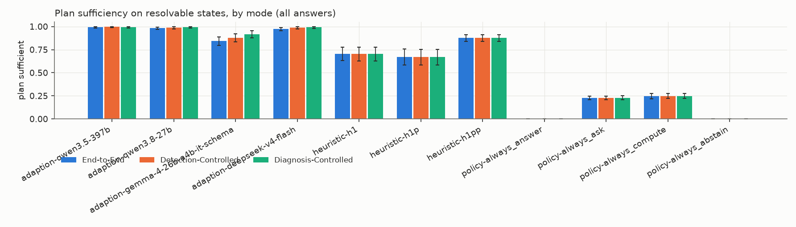
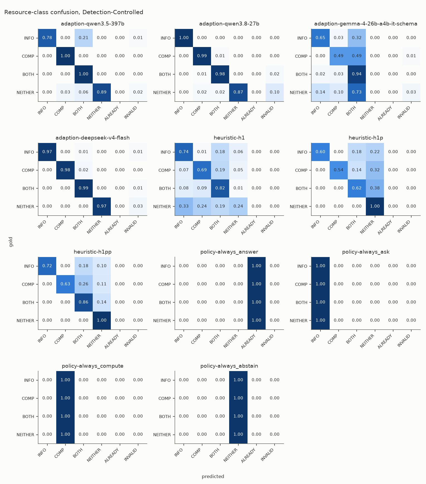

# Model results: pilot_test

> `heuristic-*` rows are real deterministic baselines (no language model, text only); `policy-*` rows are fixed visible-only intervention policies (always answer / ask everything / compute everything / abstain). `mock-*` rows are synthetic fixtures.

Split(s): test · families: 63 · generated from `summary.json` by `msep.eval.report`.

Every number names its mode. End-to-End mixes detection with planning and is never read as a planning failure. Intervals are 95% family-clustered bootstrap.

## Plan sufficiency by mode (resolvable states)

Two bases, the same in every mode. **All answers:** an unparsed or truncated answer counts as a failure. **Parsed only:** unparsed answers are left out; the number left out is shown as `unparsed/n`. A gap between the two means output-format or truncation failures, not planning failures.

| Agent / model | E2E all | E2E parsed | DC all | DC parsed | DxC all | DxC parsed | unparsed/n (E2E, DC, DxC) |
|---|---|---|---|---|---|---|---|
| adaption-qwen3.5-397b | 0.99 [0.99, 1.00] | 1.00 [0.99, 1.00] | 1.00 [0.99, 1.00] | 1.00 [1.00, 1.00] | 0.99 [0.98, 1.00] | 0.99 [0.99, 1.00] | 1/342, 1/342, 1/342 |
| adaption-qwen3.8-27b | 0.98 [0.97, 0.99] | 1.00 [0.99, 1.00] | 0.99 [0.97, 1.00] | 1.00 [0.99, 1.00] | 0.99 [0.99, 1.00] | 1.00 [1.00, 1.00] | 5/342, 3/342, 2/342 |
| adaption-gemma-4-26b-a4b-it-schema | 0.84 [0.79, 0.89] | 0.85 [0.80, 0.89] | 0.88 [0.83, 0.92] | 0.88 [0.84, 0.92] | 0.92 [0.88, 0.95] | 0.92 [0.88, 0.96] | 2/341, 1/341, 1/340 |
| adaption-deepseek-v4-flash | 0.97 [0.96, 0.99] | 1.00 [1.00, 1.00] | 0.99 [0.98, 1.00] | 1.00 [0.99, 1.00] | 0.99 [0.98, 1.00] | 1.00 [1.00, 1.00] | 9/342, 3/342, 3/342 |
| heuristic-h1 | 0.70 [0.63, 0.78] | 0.70 [0.63, 0.78] | 0.70 [0.63, 0.78] | 0.70 [0.63, 0.78] | 0.70 [0.63, 0.78] | 0.70 [0.63, 0.78] | 0/342, 0/342, 0/342 |
| heuristic-h1p | 0.67 [0.58, 0.76] | 0.67 [0.58, 0.76] | 0.67 [0.59, 0.75] | 0.67 [0.59, 0.75] | 0.67 [0.58, 0.75] | 0.67 [0.58, 0.75] | 0/342, 0/342, 0/342 |
| heuristic-h1pp | 0.88 [0.84, 0.91] | 0.88 [0.84, 0.91] | 0.88 [0.84, 0.91] | 0.88 [0.84, 0.91] | 0.88 [0.84, 0.91] | 0.88 [0.84, 0.91] | 0/342, 0/342, 0/342 |
| policy-always_answer | 0.00 [0.00, 0.00] | 0.00 [0.00, 0.00] | 0.00 [0.00, 0.00] | 0.00 [0.00, 0.00] | 0.00 [0.00, 0.00] | 0.00 [0.00, 0.00] | 0/342, 0/342, 0/342 |
| policy-always_ask | 0.23 [0.21, 0.25] | 0.23 [0.21, 0.25] | 0.23 [0.21, 0.25] | 0.23 [0.21, 0.25] | 0.23 [0.21, 0.25] | 0.23 [0.21, 0.25] | 0/342, 0/342, 0/342 |
| policy-always_compute | 0.25 [0.22, 0.27] | 0.25 [0.22, 0.27] | 0.25 [0.22, 0.27] | 0.25 [0.22, 0.27] | 0.25 [0.22, 0.27] | 0.25 [0.22, 0.27] | 0/342, 0/342, 0/342 |
| policy-always_abstain | 0.00 [0.00, 0.00] | 0.00 [0.00, 0.00] | 0.00 [0.00, 0.00] | 0.00 [0.00, 0.00] | 0.00 [0.00, 0.00] | 0.00 [0.00, 0.00] | 0/342, 0/342, 0/342 |

## Diagnosis vs planning (H2), Detection-Controlled

| Agent / model | Class correct | Plan sufficient | Plan sufficient given class correct | McNemar p |
|---|---|---|---|---|
| adaption-qwen3.5-397b | 0.95 [0.93, 0.97] | 1.00 [0.99, 1.00] | 1.00 [1.00, 1.00] | 3.05e-05 |
| adaption-qwen3.8-27b | 0.99 [0.97, 1.00] | 0.99 [0.97, 1.00] | 1.00 [1.00, 1.00] | 1 |
| adaption-gemma-4-26b-a4b-it-schema | 0.77 [0.72, 0.81] | 0.88 [0.83, 0.92] | 0.90 [0.86, 0.94] | 7.66e-05 |
| adaption-deepseek-v4-flash | 0.98 [0.97, 1.00] | 0.99 [0.98, 1.00] | 1.00 [0.99, 1.00] | 0.625 |
| heuristic-h1 | 0.77 [0.71, 0.83] | 0.70 [0.63, 0.78] | 0.81 [0.75, 0.87] | 0.0154 |
| heuristic-h1p | 0.59 [0.51, 0.67] | 0.67 [0.59, 0.75] | 1.00 [1.00, 1.00] | 2.98e-08 |
| heuristic-h1pp | 0.77 [0.72, 0.82] | 0.88 [0.84, 0.91] | 1.00 [1.00, 1.00] | 2.91e-11 |
| policy-always_answer | 0.00 [0.00, 0.00] | 0.00 [0.00, 0.00] | – | 1 |
| policy-always_ask | 0.23 [0.21, 0.25] | 0.23 [0.21, 0.25] | 1.00 [1.00, 1.00] | 1 |
| policy-always_compute | 0.25 [0.22, 0.27] | 0.25 [0.22, 0.27] | 1.00 [1.00, 1.00] | 1 |
| policy-always_abstain | 0.00 [0.00, 0.00] | 0.00 [0.00, 0.00] | – | 1 |

## E3 Resource diagnosis

| Agent / model | Mode | Accuracy | Macro-F1 | Balanced acc. | Surface-feature baseline (all counts) |
|---|---|---|---|---|---|
| adaption-qwen3.5-397b | Detection-Controlled | 0.94 [0.92, 0.96] | 0.94 [0.91, 0.96] | 0.92 [0.89, 0.95] | 0.45 |
| adaption-qwen3.5-397b | End-to-End | 0.96 [0.94, 0.98] | 0.96 [0.95, 0.98] | 0.95 [0.92, 0.97] | 0.45 |
| adaption-qwen3.8-27b | Detection-Controlled | 0.97 [0.95, 0.98] | 0.97 [0.96, 0.99] | 0.96 [0.94, 0.98] | 0.45 |
| adaption-qwen3.8-27b | End-to-End | 0.97 [0.95, 0.98] | 0.98 [0.96, 0.99] | 0.96 [0.94, 0.98] | 0.45 |
| adaption-gemma-4-26b-a4b-it-schema | Detection-Controlled | 0.65 [0.61, 0.69] | 0.51 [0.48, 0.55] | 0.52 [0.49, 0.56] | 0.45 |
| adaption-gemma-4-26b-a4b-it-schema | End-to-End | 0.61 [0.57, 0.66] | 0.49 [0.45, 0.53] | 0.49 [0.46, 0.54] | 0.45 |
| adaption-deepseek-v4-flash | Detection-Controlled | 0.98 [0.96, 0.99] | 0.99 [0.97, 1.00] | 0.98 [0.96, 0.99] | 0.45 |
| adaption-deepseek-v4-flash | End-to-End | 0.96 [0.94, 0.98] | 0.98 [0.96, 0.99] | 0.96 [0.93, 0.98] | 0.45 |
| heuristic-h1 | Detection-Controlled | 0.69 [0.63, 0.73] | 0.61 [0.56, 0.66] | 0.62 [0.57, 0.67] | 0.45 |
| heuristic-h1 | End-to-End | 0.69 [0.63, 0.74] | 0.61 [0.56, 0.67] | 0.62 [0.57, 0.67] | 0.45 |
| heuristic-h1p | Detection-Controlled | 0.66 [0.59, 0.73] | 0.67 [0.61, 0.73] | 0.69 [0.63, 0.75] | 0.45 |
| heuristic-h1p | End-to-End | 0.66 [0.59, 0.73] | 0.67 [0.61, 0.73] | 0.69 [0.63, 0.75] | 0.45 |
| heuristic-h1pp | Detection-Controlled | 0.81 [0.77, 0.85] | 0.80 [0.76, 0.84] | 0.80 [0.76, 0.84] | 0.45 |
| heuristic-h1pp | End-to-End | 0.81 [0.77, 0.85] | 0.80 [0.75, 0.84] | 0.80 [0.76, 0.84] | 0.45 |
| policy-always_answer | Detection-Controlled | 0.00 [0.00, 0.00] | 0.00 [0.00, 0.00] | 0.00 [0.00, 0.00] | 0.45 |
| policy-always_answer | End-to-End | 0.00 [0.00, 0.00] | 0.00 [0.00, 0.00] | 0.00 [0.00, 0.00] | 0.45 |
| policy-always_ask | Detection-Controlled | 0.19 [0.18, 0.21] | 0.08 [0.08, 0.09] | 0.25 [0.25, 0.25] | 0.45 |
| policy-always_ask | End-to-End | 0.19 [0.18, 0.21] | 0.08 [0.07, 0.09] | 0.25 [0.25, 0.25] | 0.45 |
| policy-always_compute | Detection-Controlled | 0.21 [0.18, 0.23] | 0.09 [0.08, 0.09] | 0.25 [0.25, 0.25] | 0.45 |
| policy-always_compute | End-to-End | 0.21 [0.19, 0.23] | 0.09 [0.08, 0.09] | 0.25 [0.25, 0.25] | 0.45 |
| policy-always_abstain | Detection-Controlled | 0.16 [0.15, 0.16] | 0.07 [0.07, 0.07] | 0.25 [0.25, 0.25] | 0.45 |
| policy-always_abstain | End-to-End | 0.16 [0.15, 0.16] | 0.07 [0.07, 0.07] | 0.25 [0.25, 0.25] | 0.45 |

## E7 BOTH vs single-resource (Detection-Controlled)

| Agent / model | INFORMATION_ONLY | COMPUTATION_ONLY | BOTH | BOTH plans using one resource |
|---|---|---|---|---|
| adaption-qwen3.5-397b | 0.98 [0.95, 1.00] | 1.00 [1.00, 1.00] | 1.00 [1.00, 1.00] | 0.00 [0.00, 0.00] |
| adaption-qwen3.8-27b | 1.00 [1.00, 1.00] | 1.00 [1.00, 1.00] | 0.97 [0.92, 1.00] | 0.02 [0.00, 0.05] |
| adaption-gemma-4-26b-a4b-it-schema | 0.97 [0.92, 1.00] | 0.95 [0.89, 1.00] | 0.86 [0.76, 0.94] | 0.08 [0.02, 0.16] |
| adaption-deepseek-v4-flash | 0.98 [0.95, 1.00] | 1.00 [1.00, 1.00] | 0.98 [0.95, 1.00] | 0.00 [0.00, 0.00] |
| heuristic-h1 | 0.84 [0.75, 0.92] | 0.73 [0.60, 0.84] | 0.68 [0.57, 0.79] | 0.16 [0.08, 0.25] |
| heuristic-h1p | 0.78 [0.67, 0.87] | 0.65 [0.52, 0.76] | 0.67 [0.54, 0.78] | 0.00 [0.00, 0.00] |
| heuristic-h1pp | 0.89 [0.81, 0.97] | 0.90 [0.83, 0.97] | 0.87 [0.78, 0.95] | 0.00 [0.00, 0.00] |
| policy-always_answer | 0.00 [0.00, 0.00] | 0.00 [0.00, 0.00] | 0.00 [0.00, 0.00] | 0.00 [0.00, 0.00] |
| policy-always_ask | 1.00 [1.00, 1.00] | 0.00 [0.00, 0.00] | 0.00 [0.00, 0.00] | 1.00 [1.00, 1.00] |
| policy-always_compute | 0.00 [0.00, 0.00] | 1.00 [1.00, 1.00] | 0.00 [0.00, 0.00] | 1.00 [1.00, 1.00] |
| policy-always_abstain | 0.00 [0.00, 0.00] | 0.00 [0.00, 0.00] | 0.00 [0.00, 0.00] | 0.00 [0.00, 0.00] |

## E5 Relevance vs sufficiency (judgments)

| Agent / model | Accuracy, sufficient plans | Accuracy, relevant-insufficient plans | Pairs both correct | McNemar p |
|---|---|---|---|---|
| adaption-qwen3.5-397b | 0.97 [0.94, 0.99] | 1.00 [1.00, 1.00] | 0.98 [0.96, 0.99] | 0.00781 |
| adaption-qwen3.8-27b | 1.00 [1.00, 1.00] | 0.97 [0.95, 0.99] | 0.97 [0.95, 0.99] | 0.00195 |
| adaption-gemma-4-26b-a4b-it-schema | 0.60 [0.53, 0.68] | 0.91 [0.87, 0.95] | 0.57 [0.50, 0.65] | 6.16e-14 |
| adaption-deepseek-v4-flash | 0.99 [0.98, 1.00] | 0.98 [0.97, 0.99] | 0.98 [0.96, 0.99] | 0.125 |
| heuristic-h1 | 0.70 [0.62, 0.78] | 0.88 [0.84, 0.92] | 0.65 [0.57, 0.73] | 0.000189 |
| heuristic-h1p | 0.47 [0.37, 0.57] | 1.00 [1.00, 1.00] | 0.49 [0.38, 0.60] | 1.04e-53 |
| heuristic-h1pp | 0.61 [0.53, 0.69] | 1.00 [1.00, 1.00] | 0.67 [0.58, 0.75] | 2.41e-35 |
| policy-always_answer | 1.00 [1.00, 1.00] | 0.00 [0.00, 0.00] | 0.00 [0.00, 0.00] | 1.74e-105 |
| policy-always_ask | 0.93 [0.89, 0.96] | 0.34 [0.29, 0.39] | 0.32 [0.27, 0.37] | 1.07e-55 |
| policy-always_compute | 0.96 [0.93, 0.98] | 0.38 [0.34, 0.42] | 0.36 [0.32, 0.40] | 1.47e-54 |
| policy-always_abstain | 0.00 [0.00, 0.00] | 1.00 [1.00, 1.00] | 0.00 [0.00, 0.00] | 1.74e-105 |

## E1, E2, E4, E6, E8, E9

| Agent / model | E1 base decision acc. | E2 detection acc. (E2E) | E2 over-answering | E4 exact match (DxC) | E6 optimal given sufficient (DC) | E8 correct defer (DC) | E9 premature stop (DC) | E9 continued after ex-post sufficiency (DC; compare with oracle) |
|---|---|---|---|---|---|---|---|---|
| adaption-qwen3.5-397b | 1.00 [1.00, 1.00] | 0.97 [0.96, 0.99] | 0.00 [0.00, 0.01] | 0.97 [0.95, 0.99] | 0.94 [0.91, 0.96] | 0.89 [0.81, 0.97] | 0.00 [0.00, 0.00] | 0.21 [0.15, 0.27] |
| adaption-qwen3.8-27b | 1.00 [1.00, 1.00] | 0.97 [0.96, 0.99] | 0.00 [0.00, 0.01] | 0.99 [0.99, 1.00] | 0.99 [0.99, 1.00] | 0.87 [0.79, 0.95] | 0.00 [0.00, 0.01] | 0.16 [0.11, 0.21] |
| adaption-gemma-4-26b-a4b-it-schema | 0.61 [0.48, 0.74] | 0.90 [0.89, 0.92] | 0.00 [0.00, 0.01] | 0.44 [0.38, 0.50] | 0.48 [0.42, 0.54] | 0.00 [0.00, 0.00] | 0.07 [0.03, 0.11] | 0.29 [0.22, 0.36] |
| adaption-deepseek-v4-flash | 0.98 [0.95, 1.00] | 0.97 [0.96, 0.99] | 0.00 [0.00, 0.00] | 0.99 [0.98, 1.00] | 0.99 [0.98, 1.00] | 0.97 [0.92, 1.00] | 0.00 [0.00, 0.00] | 0.17 [0.11, 0.22] |
| heuristic-h1 | 0.73 [0.62, 0.84] | 0.93 [0.91, 0.94] | 0.00 [0.00, 0.00] | 0.51 [0.44, 0.58] | 0.73 [0.65, 0.80] | 0.24 [0.14, 0.35] | 0.24 [0.17, 0.31] | 0.16 [0.10, 0.22] |
| heuristic-h1p | 0.73 [0.62, 0.84] | 0.93 [0.91, 0.94] | 0.00 [0.00, 0.00] | 0.48 [0.41, 0.56] | 0.72 [0.64, 0.80] | 1.00 [1.00, 1.00] | 0.00 [0.00, 0.00] | 0.18 [0.12, 0.24] |
| heuristic-h1pp | 0.75 [0.63, 0.86] | 0.93 [0.91, 0.95] | 0.00 [0.00, 0.00] | 0.61 [0.54, 0.67] | 0.69 [0.62, 0.76] | 1.00 [1.00, 1.00] | 0.00 [0.00, 0.00] | 0.27 [0.20, 0.35] |
| policy-always_answer | 0.51 [0.38, 0.63] | 0.13 [0.13, 0.14] | 1.00 [1.00, 1.00] | 0.00 [0.00, 0.00] | – | 0.00 [0.00, 0.00] | 1.00 [1.00, 1.00] | 0.00 [0.00, 0.00] |
| policy-always_ask | 0.51 [0.38, 0.63] | 0.87 [0.86, 0.87] | 0.00 [0.00, 0.00] | 0.01 [0.00, 0.02] | 0.04 [0.00, 0.10] | 0.00 [0.00, 0.00] | 0.67 [0.61, 0.73] | 0.29 [0.24, 0.34] |
| policy-always_compute | 0.51 [0.38, 0.63] | 0.87 [0.86, 0.87] | 0.00 [0.00, 0.00] | 0.01 [0.00, 0.02] | 0.05 [0.01, 0.10] | 0.00 [0.00, 0.00] | 0.67 [0.61, 0.73] | 0.29 [0.23, 0.36] |
| policy-always_abstain | 0.49 [0.37, 0.62] | 0.87 [0.86, 0.87] | 0.00 [0.00, 0.00] | 0.00 [0.00, 0.00] | – | 1.00 [1.00, 1.00] | 0.00 [0.00, 0.00] | 0.00 [0.00, 0.00] |

## Mode decomposition (same instances across modes; resolvable states)

An End-to-End failure that disappears in Detection-Controlled is attributed to detection/framing; a Detection-Controlled failure that disappears in Diagnosis-Controlled to diagnosis; only failures in all three modes are planning failures. Only instances whose answers parsed in all three modes are used; the number excluded is in the last column.

| Agent / model | e2e_success | e2e_fail_detection_wrong | e2e_fail_but_dc_success | dc_fail_but_dxc_success (diagnosis-attributable) | fail_in_all_modes (planning) | excluded (unparsed in some mode) |
|---|---|---|---|---|---|---|
| adaption-qwen3.5-397b | 0.97 [0.95, 0.99] | 0.00 [0.00, 0.01] | 0.01 [0.00, 0.03] | 0.05 [0.03, 0.07] | 0.00 [0.00, 0.00] | 3 |
| adaption-qwen3.8-27b | 0.99 [0.98, 1.00] | 0.00 [0.00, 0.01] | 0.00 [0.00, 0.01] | 0.01 [0.00, 0.02] | 0.00 [0.00, 0.00] | 8 |
| adaption-gemma-4-26b-a4b-it-schema | 0.67 [0.62, 0.72] | 0.00 [0.00, 0.00] | 0.07 [0.04, 0.10] | 0.24 [0.20, 0.29] | 0.07 [0.04, 0.11] | 4 |
| adaption-deepseek-v4-flash | 0.99 [0.98, 1.00] | 0.00 [0.00, 0.00] | 0.00 [0.00, 0.01] | 0.01 [0.00, 0.02] | 0.00 [0.00, 0.00] | 15 |
| heuristic-h1 | 0.63 [0.55, 0.70] | 0.00 [0.00, 0.00] | 0.00 [0.00, 0.00] | 0.08 [0.05, 0.11] | 0.30 [0.22, 0.37] | 0 |
| heuristic-h1p | 0.59 [0.51, 0.67] | 0.00 [0.00, 0.00] | 0.00 [0.00, 0.00] | 0.08 [0.05, 0.11] | 0.33 [0.25, 0.42] | 0 |
| heuristic-h1pp | 0.77 [0.72, 0.82] | 0.00 [0.00, 0.00] | 0.00 [0.00, 0.00] | 0.11 [0.07, 0.14] | 0.12 [0.09, 0.16] | 0 |
| policy-always_answer | 0.00 [0.00, 0.00] | 1.00 [1.00, 1.00] | 0.00 [0.00, 0.00] | 0.00 [0.00, 0.00] | 1.00 [1.00, 1.00] | 0 |
| policy-always_ask | 0.23 [0.21, 0.25] | 0.00 [0.00, 0.00] | 0.00 [0.00, 0.00] | 0.00 [0.00, 0.00] | 0.77 [0.75, 0.79] | 0 |
| policy-always_compute | 0.25 [0.22, 0.27] | 0.00 [0.00, 0.00] | 0.00 [0.00, 0.00] | 0.00 [0.00, 0.00] | 0.75 [0.73, 0.78] | 0 |
| policy-always_abstain | 0.00 [0.00, 0.00] | 0.00 [0.00, 0.00] | 0.00 [0.00, 0.00] | 0.00 [0.00, 0.00] | 1.00 [1.00, 1.00] | 0 |

## Instruction compliance and hierarchical metrics

| Agent / model | DC: claims sufficient (contradicts prompt) | DxC: class differs from given | A_D | A_G | A_P (DC) | A_P' (DxC) | A_S | A_E2E |
|---|---|---|---|---|---|---|---|---|
| adaption-qwen3.5-397b | 0.00 [0.00, 0.00] | 0.02 [0.01, 0.04] | 0.97 [0.96, 0.99] | 0.94 [0.92, 0.96] | 0.98 [0.97, 0.99] | 0.96 [0.95, 0.98] | 0.98 [0.96, 0.99] | 0.94 [0.92, 0.96] |
| adaption-qwen3.8-27b | 0.00 [0.00, 0.00] | 0.00 [0.00, 0.00] | 0.97 [0.96, 0.99] | 0.97 [0.95, 0.98] | 1.00 [0.99, 1.00] | 0.99 [0.98, 1.00] | 0.97 [0.95, 0.99] | 0.97 [0.95, 0.98] |
| adaption-gemma-4-26b-a4b-it-schema | 0.00 [0.00, 0.00] | 0.18 [0.14, 0.22] | 0.90 [0.89, 0.92] | 0.65 [0.61, 0.69] | 0.54 [0.47, 0.61] | 0.44 [0.38, 0.49] | 0.57 [0.50, 0.65] | 0.29 [0.25, 0.34] |
| adaption-deepseek-v4-flash | 0.00 [0.00, 0.00] | 0.00 [0.00, 0.00] | 0.97 [0.96, 0.99] | 0.98 [0.96, 0.99] | 1.00 [0.99, 1.00] | 0.98 [0.97, 0.99] | 0.98 [0.96, 0.99] | 0.97 [0.95, 0.98] |
| heuristic-h1 | 0.00 [0.00, 0.00] | 0.23 [0.18, 0.29] | 0.93 [0.91, 0.94] | 0.69 [0.63, 0.73] | 0.67 [0.59, 0.74] | 0.51 [0.44, 0.58] | 0.65 [0.57, 0.73] | 0.47 [0.40, 0.52] |
| heuristic-h1p | 0.00 [0.00, 0.00] | 0.41 [0.33, 0.49] | 0.93 [0.91, 0.94] | 0.66 [0.59, 0.73] | 0.81 [0.74, 0.89] | 0.48 [0.41, 0.56] | 0.49 [0.38, 0.60] | 0.55 [0.49, 0.61] |
| heuristic-h1pp | 0.00 [0.00, 0.00] | 0.23 [0.18, 0.27] | 0.93 [0.91, 0.95] | 0.81 [0.77, 0.85] | 0.78 [0.71, 0.85] | 0.61 [0.54, 0.67] | 0.67 [0.58, 0.75] | 0.64 [0.59, 0.69] |
| policy-always_answer | 1.00 [1.00, 1.00] | 1.00 [1.00, 1.00] | 0.13 [0.13, 0.14] | 0.00 [0.00, 0.00] | – | 0.00 [0.00, 0.00] | 0.00 [0.00, 0.00] | 0.07 [0.05, 0.09] |
| policy-always_ask | 0.00 [0.00, 0.00] | 0.77 [0.75, 0.79] | 0.87 [0.86, 0.87] | 0.19 [0.18, 0.21] | 0.04 [0.00, 0.10] | 0.01 [0.00, 0.02] | 0.32 [0.27, 0.37] | 0.01 [0.00, 0.02] |
| policy-always_compute | 0.00 [0.00, 0.00] | 0.75 [0.73, 0.78] | 0.87 [0.86, 0.87] | 0.21 [0.18, 0.23] | 0.05 [0.01, 0.10] | 0.01 [0.00, 0.02] | 0.36 [0.32, 0.40] | 0.01 [0.00, 0.02] |
| policy-always_abstain | 0.00 [0.00, 0.00] | 1.00 [1.00, 1.00] | 0.87 [0.86, 0.87] | 0.16 [0.15, 0.16] | – | 0.00 [0.00, 0.00] | 0.00 [0.00, 0.00] | 0.13 [0.13, 0.14] |

## Strata: shallow-heuristic difficulty and template

`heuristic_hard` = instances where the text-only h1pp baseline fails. A model's advantage over shallow reading shows only there.

| Agent / model | Stratum | Instances | DC class correct | DC plan sufficient | DC plan optimal |
|---|---|---|---|---|---|
| adaption-qwen3.5-397b | heuristic_easy | 300 | 0.94 [0.91, 0.97] | 1.00 [0.98, 1.00] | 0.96 [0.93, 0.98] |
| adaption-qwen3.5-397b | heuristic_hard | 168 | 0.93 [0.89, 0.97] | 1.00 [1.00, 1.00] | 0.90 [0.84, 0.95] |
| adaption-qwen3.5-397b | v3 | 468 | 0.94 [0.92, 0.96] | 1.00 [0.99, 1.00] | 0.93 [0.90, 0.96] |
| adaption-qwen3.8-27b | heuristic_easy | 300 | 0.96 [0.93, 0.98] | 0.99 [0.96, 1.00] | 0.99 [0.96, 1.00] |
| adaption-qwen3.8-27b | heuristic_hard | 168 | 0.99 [0.96, 1.00] | 0.99 [0.98, 1.00] | 0.98 [0.95, 1.00] |
| adaption-qwen3.8-27b | v3 | 468 | 0.97 [0.95, 0.98] | 0.99 [0.97, 1.00] | 0.98 [0.97, 1.00] |
| adaption-gemma-4-26b-a4b-it-schema | heuristic_easy | 300 | 0.67 [0.62, 0.71] | 0.86 [0.80, 0.92] | 0.55 [0.48, 0.63] |
| adaption-gemma-4-26b-a4b-it-schema | heuristic_hard | 168 | 0.61 [0.52, 0.69] | 0.91 [0.85, 0.97] | 0.22 [0.14, 0.31] |
| adaption-gemma-4-26b-a4b-it-schema | v3 | 468 | 0.65 [0.61, 0.69] | 0.88 [0.83, 0.92] | 0.42 [0.36, 0.48] |
| adaption-deepseek-v4-flash | heuristic_easy | 300 | 0.99 [0.97, 1.00] | 0.99 [0.98, 1.00] | 0.99 [0.98, 1.00] |
| adaption-deepseek-v4-flash | heuristic_hard | 168 | 0.96 [0.92, 0.99] | 0.99 [0.96, 1.00] | 0.96 [0.92, 0.99] |
| adaption-deepseek-v4-flash | v3 | 468 | 0.98 [0.96, 0.99] | 0.99 [0.98, 1.00] | 0.98 [0.96, 0.99] |
| heuristic-h1 | heuristic_easy | 300 | 0.75 [0.69, 0.80] | 0.79 [0.71, 0.87] | 0.76 [0.68, 0.84] |
| heuristic-h1 | heuristic_hard | 168 | 0.56 [0.46, 0.66] | 0.57 [0.46, 0.68] | 0.13 [0.06, 0.20] |
| heuristic-h1 | v3 | 468 | 0.69 [0.63, 0.73] | 0.70 [0.63, 0.78] | 0.51 [0.44, 0.58] |
| heuristic-h1p | heuristic_easy | 300 | 0.84 [0.77, 0.90] | 0.80 [0.70, 0.88] | 0.80 [0.70, 0.88] |
| heuristic-h1p | heuristic_hard | 168 | 0.28 [0.17, 0.40] | 0.47 [0.35, 0.60] | 0.00 [0.00, 0.00] |
| heuristic-h1p | v3 | 468 | 0.66 [0.59, 0.73] | 0.67 [0.59, 0.75] | 0.48 [0.40, 0.56] |
| heuristic-h1pp | heuristic_easy | 300 | 1.00 [1.00, 1.00] | 1.00 [1.00, 1.00] | 1.00 [1.00, 1.00] |
| heuristic-h1pp | heuristic_hard | 168 | 0.42 [0.33, 0.52] | 0.69 [0.60, 0.77] | 0.00 [0.00, 0.00] |
| heuristic-h1pp | v3 | 468 | 0.81 [0.77, 0.85] | 0.88 [0.84, 0.91] | 0.61 [0.54, 0.67] |
| policy-always_answer | heuristic_easy | 300 | 0.00 [0.00, 0.00] | 0.00 [0.00, 0.00] | 0.00 [0.00, 0.00] |
| policy-always_answer | heuristic_hard | 168 | 0.00 [0.00, 0.00] | 0.00 [0.00, 0.00] | 0.00 [0.00, 0.00] |
| policy-always_answer | v3 | 468 | 0.00 [0.00, 0.00] | 0.00 [0.00, 0.00] | 0.00 [0.00, 0.00] |
| policy-always_ask | heuristic_easy | 300 | 0.17 [0.14, 0.20] | 0.23 [0.19, 0.27] | 0.01 [0.00, 0.03] |
| policy-always_ask | heuristic_hard | 168 | 0.23 [0.17, 0.30] | 0.23 [0.17, 0.30] | 0.01 [0.00, 0.02] |
| policy-always_ask | v3 | 468 | 0.19 [0.18, 0.21] | 0.23 [0.21, 0.25] | 0.01 [0.00, 0.02] |
| policy-always_compute | heuristic_easy | 300 | 0.14 [0.11, 0.18] | 0.19 [0.15, 0.24] | 0.01 [0.00, 0.02] |
| policy-always_compute | heuristic_hard | 168 | 0.33 [0.26, 0.42] | 0.33 [0.26, 0.42] | 0.01 [0.00, 0.04] |
| policy-always_compute | v3 | 468 | 0.21 [0.18, 0.23] | 0.25 [0.22, 0.27] | 0.01 [0.00, 0.02] |
| policy-always_abstain | heuristic_easy | 300 | 0.23 [0.22, 0.25] | 0.00 [0.00, 0.00] | 0.00 [0.00, 0.00] |
| policy-always_abstain | heuristic_hard | 168 | 0.00 [0.00, 0.00] | 0.00 [0.00, 0.00] | 0.00 [0.00, 0.00] |
| policy-always_abstain | v3 | 468 | 0.16 [0.15, 0.16] | 0.00 [0.00, 0.00] | 0.00 [0.00, 0.00] |

## Calibration (stated confidence vs plan sufficiency)

| Agent / model | Mode | n | Brier | ECE |
|---|---|---|---|---|
| adaption-qwen3.5-397b | End-to-End | 466 | 0.17 | 0.17 |
| adaption-qwen3.5-397b | Detection-Controlled | 403 | 0.24 | 0.24 |
| adaption-qwen3.5-397b | Diagnosis-Controlled | 341 | 0.12 | 0.12 |
| adaption-qwen3.8-27b | End-to-End | 458 | 0.22 | 0.24 |
| adaption-qwen3.8-27b | Detection-Controlled | 396 | 0.36 | 0.38 |
| adaption-qwen3.8-27b | Diagnosis-Controlled | 340 | 0.36 | 0.43 |
| adaption-gemma-4-26b-a4b-it-schema | End-to-End | 461 | 0.34 | 0.34 |
| adaption-gemma-4-26b-a4b-it-schema | Detection-Controlled | 401 | 0.26 | 0.26 |
| adaption-gemma-4-26b-a4b-it-schema | Diagnosis-Controlled | 339 | 0.11 | 0.11 |
| adaption-deepseek-v4-flash | End-to-End | 455 | 0.61 | 0.61 |
| adaption-deepseek-v4-flash | Detection-Controlled | 400 | 0.78 | 0.78 |
| adaption-deepseek-v4-flash | Diagnosis-Controlled | 339 | 0.87 | 0.88 |
| heuristic-h1 | End-to-End | 468 | 0.25 | 0.07 |
| heuristic-h1 | Detection-Controlled | 405 | 0.25 | 0.10 |
| heuristic-h1 | Diagnosis-Controlled | 342 | 0.25 | 0.20 |
| heuristic-h1p | End-to-End | 468 | 0.25 | 0.05 |
| heuristic-h1p | Detection-Controlled | 405 | 0.25 | 0.07 |
| heuristic-h1p | Diagnosis-Controlled | 342 | 0.25 | 0.17 |
| heuristic-h1pp | End-to-End | 468 | 0.25 | 0.21 |
| heuristic-h1pp | Detection-Controlled | 405 | 0.25 | 0.24 |
| heuristic-h1pp | Diagnosis-Controlled | 342 | 0.25 | 0.38 |
| policy-always_answer | End-to-End | 468 | 0.25 | 0.37 |
| policy-always_answer | Detection-Controlled | 405 | 0.25 | 0.50 |
| policy-always_answer | Diagnosis-Controlled | 342 | 0.25 | 0.50 |
| policy-always_ask | End-to-End | 468 | 0.25 | 0.33 |
| policy-always_ask | Detection-Controlled | 405 | 0.25 | 0.31 |
| policy-always_ask | Diagnosis-Controlled | 342 | 0.25 | 0.27 |
| policy-always_compute | End-to-End | 468 | 0.25 | 0.32 |
| policy-always_compute | Detection-Controlled | 405 | 0.25 | 0.29 |
| policy-always_compute | Diagnosis-Controlled | 342 | 0.25 | 0.25 |
| policy-always_abstain | End-to-End | 468 | 0.25 | 0.50 |
| policy-always_abstain | Detection-Controlled | 405 | 0.25 | 0.50 |
| policy-always_abstain | Diagnosis-Controlled | 342 | 0.25 | 0.50 |

## Model vs shallow heuristic h1pp (same instances, plan optimal on resolvable states)

| Model | Mode | Model minus h1pp [CI] | McNemar p |
|---|---|---|---|
| adaption-qwen3.5-397b | Detection-Controlled | 0.33 [0.26, 0.39] | 3.49e-26 |
| adaption-qwen3.5-397b | Diagnosis-Controlled | 0.36 [0.29, 0.43] | 8.88e-33 |
| adaption-qwen3.5-397b | End-to-End | 0.35 [0.28, 0.42] | 2.42e-29 |
| adaption-qwen3.8-27b | Detection-Controlled | 0.38 [0.31, 0.44] | 1.88e-35 |
| adaption-qwen3.8-27b | Diagnosis-Controlled | 0.38 [0.32, 0.44] | 4.22e-37 |
| adaption-qwen3.8-27b | End-to-End | 0.37 [0.31, 0.44] | 6.26e-34 |
| adaption-gemma-4-26b-a4b-it-schema | Detection-Controlled | -0.18 [-0.25, -0.12] | 1.65e-08 |
| adaption-gemma-4-26b-a4b-it-schema | Diagnosis-Controlled | -0.16 [-0.23, -0.09] | 3.18e-07 |
| adaption-gemma-4-26b-a4b-it-schema | End-to-End | -0.21 [-0.28, -0.13] | 2.47e-10 |
| adaption-deepseek-v4-flash | Detection-Controlled | 0.37 [0.31, 0.44] | 3.22e-36 |
| adaption-deepseek-v4-flash | Diagnosis-Controlled | 0.38 [0.31, 0.44] | 1.64e-36 |
| adaption-deepseek-v4-flash | End-to-End | 0.36 [0.30, 0.43] | 1.89e-31 |

## Breakdown: stratum x mode x resource class (plan optimal on resolvable states)

Full v3 is primary; heuristic_hard is a pre-registered stress test (it contains no NEITHER items, so compare within class).

| Agent / model | Stratum | Mode | Class | n | Class correct | Plan sufficient | Plan optimal |
|---|---|---|---|---|---|---|---|
| adaption-qwen3.5-397b | all | End-to-End | ALL | 468 | 0.95 [0.93, 0.97] | 0.99 [0.99, 1.00] | 0.95 [0.93, 0.97] |
| adaption-qwen3.5-397b | all | End-to-End | ALREADY_SUFFICIENT | 63 | 0.87 [0.78, 0.95] | – | – |
| adaption-qwen3.5-397b | all | End-to-End | INFORMATION_ONLY | 78 | 0.86 [0.79, 0.93] | 0.99 [0.96, 1.00] | 0.86 [0.79, 0.93] |
| adaption-qwen3.5-397b | all | End-to-End | COMPUTATION_ONLY | 84 | 1.00 [1.00, 1.00] | 1.00 [1.00, 1.00] | 0.99 [0.96, 1.00] |
| adaption-qwen3.5-397b | all | End-to-End | BOTH | 180 | 0.99 [0.98, 1.00] | 0.99 [0.98, 1.00] | 0.98 [0.96, 0.99] |
| adaption-qwen3.5-397b | all | End-to-End | NEITHER | 63 | 0.94 [0.87, 0.98] | – | – |
| adaption-qwen3.5-397b | all | Detection-Controlled | ALL | 405 | 0.94 [0.92, 0.96] | 1.00 [0.99, 1.00] | 0.93 [0.90, 0.96] |
| adaption-qwen3.5-397b | all | Detection-Controlled | INFORMATION_ONLY | 78 | 0.78 [0.68, 0.87] | 0.99 [0.96, 1.00] | 0.78 [0.68, 0.87] |
| adaption-qwen3.5-397b | all | Detection-Controlled | COMPUTATION_ONLY | 84 | 1.00 [1.00, 1.00] | 1.00 [1.00, 1.00] | 0.98 [0.94, 1.00] |
| adaption-qwen3.5-397b | all | Detection-Controlled | BOTH | 180 | 1.00 [1.00, 1.00] | 1.00 [1.00, 1.00] | 0.98 [0.96, 0.99] |
| adaption-qwen3.5-397b | all | Detection-Controlled | NEITHER | 63 | 0.89 [0.81, 0.97] | – | – |
| adaption-qwen3.5-397b | all | Diagnosis-Controlled | ALL | 342 | 0.97 [0.96, 0.99] | 0.99 [0.98, 1.00] | 0.96 [0.95, 0.98] |
| adaption-qwen3.5-397b | all | Diagnosis-Controlled | INFORMATION_ONLY | 78 | 0.90 [0.83, 0.95] | 0.97 [0.94, 1.00] | 0.90 [0.83, 0.95] |
| adaption-qwen3.5-397b | all | Diagnosis-Controlled | COMPUTATION_ONLY | 84 | 1.00 [1.00, 1.00] | 1.00 [1.00, 1.00] | 0.98 [0.94, 1.00] |
| adaption-qwen3.5-397b | all | Diagnosis-Controlled | BOTH | 180 | 0.99 [0.98, 1.00] | 0.99 [0.98, 1.00] | 0.99 [0.97, 1.00] |
| adaption-qwen3.5-397b | heuristic_hard | End-to-End | ALL | 168 | 0.95 [0.92, 0.98] | 1.00 [1.00, 1.00] | 0.93 [0.89, 0.97] |
| adaption-qwen3.5-397b | heuristic_hard | End-to-End | ALREADY_SUFFICIENT | 33 | 0.91 [0.79, 1.00] | – | – |
| adaption-qwen3.5-397b | heuristic_hard | End-to-End | INFORMATION_ONLY | 31 | 0.84 [0.71, 0.96] | 1.00 [1.00, 1.00] | 0.84 [0.71, 0.96] |
| adaption-qwen3.5-397b | heuristic_hard | End-to-End | COMPUTATION_ONLY | 45 | 1.00 [1.00, 1.00] | 1.00 [1.00, 1.00] | 0.98 [0.93, 1.00] |
| adaption-qwen3.5-397b | heuristic_hard | End-to-End | BOTH | 59 | 1.00 [1.00, 1.00] | 1.00 [1.00, 1.00] | 0.95 [0.88, 1.00] |
| adaption-qwen3.5-397b | heuristic_hard | Detection-Controlled | ALL | 135 | 0.93 [0.89, 0.97] | 1.00 [1.00, 1.00] | 0.90 [0.84, 0.95] |
| adaption-qwen3.5-397b | heuristic_hard | Detection-Controlled | INFORMATION_ONLY | 31 | 0.71 [0.53, 0.87] | 1.00 [1.00, 1.00] | 0.71 [0.53, 0.87] |
| adaption-qwen3.5-397b | heuristic_hard | Detection-Controlled | COMPUTATION_ONLY | 45 | 1.00 [1.00, 1.00] | 1.00 [1.00, 1.00] | 0.96 [0.89, 1.00] |
| adaption-qwen3.5-397b | heuristic_hard | Detection-Controlled | BOTH | 59 | 1.00 [1.00, 1.00] | 1.00 [1.00, 1.00] | 0.95 [0.89, 1.00] |
| adaption-qwen3.5-397b | heuristic_hard | Diagnosis-Controlled | ALL | 135 | 0.96 [0.92, 0.99] | 0.99 [0.96, 1.00] | 0.94 [0.89, 0.98] |
| adaption-qwen3.5-397b | heuristic_hard | Diagnosis-Controlled | INFORMATION_ONLY | 31 | 0.87 [0.74, 0.97] | 0.97 [0.90, 1.00] | 0.87 [0.74, 0.97] |
| adaption-qwen3.5-397b | heuristic_hard | Diagnosis-Controlled | COMPUTATION_ONLY | 45 | 1.00 [1.00, 1.00] | 1.00 [1.00, 1.00] | 0.96 [0.88, 1.00] |
| adaption-qwen3.5-397b | heuristic_hard | Diagnosis-Controlled | BOTH | 59 | 0.98 [0.94, 1.00] | 0.98 [0.94, 1.00] | 0.97 [0.92, 1.00] |
| adaption-qwen3.5-397b | heuristic_easy | End-to-End | ALL | 300 | 0.95 [0.92, 0.97] | 0.99 [0.98, 1.00] | 0.97 [0.94, 0.99] |
| adaption-qwen3.5-397b | heuristic_easy | End-to-End | ALREADY_SUFFICIENT | 30 | 0.83 [0.70, 0.97] | – | – |
| adaption-qwen3.5-397b | heuristic_easy | End-to-End | INFORMATION_ONLY | 47 | 0.87 [0.78, 0.96] | 0.98 [0.94, 1.00] | 0.87 [0.78, 0.96] |
| adaption-qwen3.5-397b | heuristic_easy | End-to-End | COMPUTATION_ONLY | 39 | 1.00 [1.00, 1.00] | 1.00 [1.00, 1.00] | 1.00 [1.00, 1.00] |
| adaption-qwen3.5-397b | heuristic_easy | End-to-End | BOTH | 121 | 0.99 [0.97, 1.00] | 0.99 [0.97, 1.00] | 0.99 [0.97, 1.00] |
| adaption-qwen3.5-397b | heuristic_easy | End-to-End | NEITHER | 63 | 0.94 [0.87, 0.98] | – | – |
| adaption-qwen3.5-397b | heuristic_easy | Detection-Controlled | ALL | 270 | 0.94 [0.91, 0.97] | 1.00 [0.98, 1.00] | 0.96 [0.93, 0.98] |
| adaption-qwen3.5-397b | heuristic_easy | Detection-Controlled | INFORMATION_ONLY | 47 | 0.83 [0.71, 0.93] | 0.98 [0.93, 1.00] | 0.83 [0.71, 0.93] |
| adaption-qwen3.5-397b | heuristic_easy | Detection-Controlled | COMPUTATION_ONLY | 39 | 1.00 [1.00, 1.00] | 1.00 [1.00, 1.00] | 1.00 [1.00, 1.00] |
| adaption-qwen3.5-397b | heuristic_easy | Detection-Controlled | BOTH | 121 | 1.00 [1.00, 1.00] | 1.00 [1.00, 1.00] | 0.99 [0.97, 1.00] |
| adaption-qwen3.5-397b | heuristic_easy | Detection-Controlled | NEITHER | 63 | 0.89 [0.81, 0.97] | – | – |
| adaption-qwen3.5-397b | heuristic_easy | Diagnosis-Controlled | ALL | 207 | 0.98 [0.96, 1.00] | 1.00 [0.98, 1.00] | 0.98 [0.96, 1.00] |
| adaption-qwen3.5-397b | heuristic_easy | Diagnosis-Controlled | INFORMATION_ONLY | 47 | 0.91 [0.83, 0.98] | 0.98 [0.94, 1.00] | 0.91 [0.83, 0.98] |
| adaption-qwen3.5-397b | heuristic_easy | Diagnosis-Controlled | COMPUTATION_ONLY | 39 | 1.00 [1.00, 1.00] | 1.00 [1.00, 1.00] | 1.00 [1.00, 1.00] |
| adaption-qwen3.5-397b | heuristic_easy | Diagnosis-Controlled | BOTH | 121 | 1.00 [1.00, 1.00] | 1.00 [1.00, 1.00] | 1.00 [1.00, 1.00] |
| adaption-qwen3.8-27b | all | End-to-End | ALL | 468 | 0.97 [0.95, 0.98] | 0.98 [0.97, 0.99] | 0.98 [0.96, 0.99] |
| adaption-qwen3.8-27b | all | End-to-End | ALREADY_SUFFICIENT | 63 | 1.00 [1.00, 1.00] | – | – |
| adaption-qwen3.8-27b | all | End-to-End | INFORMATION_ONLY | 78 | 1.00 [1.00, 1.00] | 1.00 [1.00, 1.00] | 0.99 [0.96, 1.00] |
| adaption-qwen3.8-27b | all | End-to-End | COMPUTATION_ONLY | 84 | 0.98 [0.94, 1.00] | 0.99 [0.96, 1.00] | 0.98 [0.94, 1.00] |
| adaption-qwen3.8-27b | all | End-to-End | BOTH | 180 | 0.97 [0.95, 0.99] | 0.97 [0.95, 0.99] | 0.97 [0.95, 0.99] |
| adaption-qwen3.8-27b | all | End-to-End | NEITHER | 63 | 0.89 [0.81, 0.95] | – | – |
| adaption-qwen3.8-27b | all | Detection-Controlled | ALL | 405 | 0.97 [0.95, 0.98] | 0.99 [0.97, 1.00] | 0.98 [0.97, 1.00] |
| adaption-qwen3.8-27b | all | Detection-Controlled | INFORMATION_ONLY | 78 | 1.00 [1.00, 1.00] | 1.00 [1.00, 1.00] | 0.99 [0.96, 1.00] |
| adaption-qwen3.8-27b | all | Detection-Controlled | COMPUTATION_ONLY | 84 | 0.99 [0.96, 1.00] | 1.00 [1.00, 1.00] | 0.99 [0.96, 1.00] |
| adaption-qwen3.8-27b | all | Detection-Controlled | BOTH | 180 | 0.98 [0.95, 1.00] | 0.98 [0.95, 1.00] | 0.98 [0.95, 1.00] |
| adaption-qwen3.8-27b | all | Detection-Controlled | NEITHER | 63 | 0.87 [0.79, 0.95] | – | – |
| adaption-qwen3.8-27b | all | Diagnosis-Controlled | ALL | 342 | 0.99 [0.99, 1.00] | 0.99 [0.99, 1.00] | 0.99 [0.98, 1.00] |
| adaption-qwen3.8-27b | all | Diagnosis-Controlled | INFORMATION_ONLY | 78 | 1.00 [1.00, 1.00] | 1.00 [1.00, 1.00] | 0.99 [0.96, 1.00] |
| adaption-qwen3.8-27b | all | Diagnosis-Controlled | COMPUTATION_ONLY | 84 | 1.00 [1.00, 1.00] | 1.00 [1.00, 1.00] | 1.00 [1.00, 1.00] |
| adaption-qwen3.8-27b | all | Diagnosis-Controlled | BOTH | 180 | 0.99 [0.97, 1.00] | 0.99 [0.97, 1.00] | 0.98 [0.96, 1.00] |
| adaption-qwen3.8-27b | heuristic_hard | End-to-End | ALL | 168 | 0.98 [0.96, 1.00] | 0.99 [0.96, 1.00] | 0.97 [0.94, 0.99] |
| adaption-qwen3.8-27b | heuristic_hard | End-to-End | ALREADY_SUFFICIENT | 33 | 1.00 [1.00, 1.00] | – | – |
| adaption-qwen3.8-27b | heuristic_hard | End-to-End | INFORMATION_ONLY | 31 | 1.00 [1.00, 1.00] | 1.00 [1.00, 1.00] | 0.97 [0.90, 1.00] |
| adaption-qwen3.8-27b | heuristic_hard | End-to-End | COMPUTATION_ONLY | 45 | 0.98 [0.93, 1.00] | 1.00 [1.00, 1.00] | 0.98 [0.93, 1.00] |
| adaption-qwen3.8-27b | heuristic_hard | End-to-End | BOTH | 59 | 0.97 [0.91, 1.00] | 0.97 [0.91, 1.00] | 0.97 [0.91, 1.00] |
| adaption-qwen3.8-27b | heuristic_hard | Detection-Controlled | ALL | 135 | 0.99 [0.96, 1.00] | 0.99 [0.98, 1.00] | 0.98 [0.95, 1.00] |
| adaption-qwen3.8-27b | heuristic_hard | Detection-Controlled | INFORMATION_ONLY | 31 | 1.00 [1.00, 1.00] | 1.00 [1.00, 1.00] | 0.97 [0.90, 1.00] |
| adaption-qwen3.8-27b | heuristic_hard | Detection-Controlled | COMPUTATION_ONLY | 45 | 0.98 [0.93, 1.00] | 1.00 [1.00, 1.00] | 0.98 [0.93, 1.00] |
| adaption-qwen3.8-27b | heuristic_hard | Detection-Controlled | BOTH | 59 | 0.98 [0.95, 1.00] | 0.98 [0.95, 1.00] | 0.98 [0.95, 1.00] |
| adaption-qwen3.8-27b | heuristic_hard | Diagnosis-Controlled | ALL | 135 | 1.00 [1.00, 1.00] | 1.00 [1.00, 1.00] | 0.99 [0.96, 1.00] |
| adaption-qwen3.8-27b | heuristic_hard | Diagnosis-Controlled | INFORMATION_ONLY | 31 | 1.00 [1.00, 1.00] | 1.00 [1.00, 1.00] | 0.97 [0.90, 1.00] |
| adaption-qwen3.8-27b | heuristic_hard | Diagnosis-Controlled | COMPUTATION_ONLY | 45 | 1.00 [1.00, 1.00] | 1.00 [1.00, 1.00] | 1.00 [1.00, 1.00] |
| adaption-qwen3.8-27b | heuristic_hard | Diagnosis-Controlled | BOTH | 59 | 1.00 [1.00, 1.00] | 1.00 [1.00, 1.00] | 0.98 [0.94, 1.00] |
| adaption-qwen3.8-27b | heuristic_easy | End-to-End | ALL | 300 | 0.96 [0.94, 0.98] | 0.98 [0.96, 1.00] | 0.98 [0.96, 1.00] |
| adaption-qwen3.8-27b | heuristic_easy | End-to-End | ALREADY_SUFFICIENT | 30 | 1.00 [1.00, 1.00] | – | – |
| adaption-qwen3.8-27b | heuristic_easy | End-to-End | INFORMATION_ONLY | 47 | 1.00 [1.00, 1.00] | 1.00 [1.00, 1.00] | 1.00 [1.00, 1.00] |
| adaption-qwen3.8-27b | heuristic_easy | End-to-End | COMPUTATION_ONLY | 39 | 0.97 [0.92, 1.00] | 0.97 [0.92, 1.00] | 0.97 [0.92, 1.00] |
| adaption-qwen3.8-27b | heuristic_easy | End-to-End | BOTH | 121 | 0.98 [0.95, 1.00] | 0.98 [0.95, 1.00] | 0.98 [0.95, 1.00] |
| adaption-qwen3.8-27b | heuristic_easy | End-to-End | NEITHER | 63 | 0.89 [0.81, 0.95] | – | – |
| adaption-qwen3.8-27b | heuristic_easy | Detection-Controlled | ALL | 270 | 0.96 [0.93, 0.98] | 0.99 [0.96, 1.00] | 0.99 [0.96, 1.00] |
| adaption-qwen3.8-27b | heuristic_easy | Detection-Controlled | INFORMATION_ONLY | 47 | 1.00 [1.00, 1.00] | 1.00 [1.00, 1.00] | 1.00 [1.00, 1.00] |
| adaption-qwen3.8-27b | heuristic_easy | Detection-Controlled | COMPUTATION_ONLY | 39 | 1.00 [1.00, 1.00] | 1.00 [1.00, 1.00] | 1.00 [1.00, 1.00] |
| adaption-qwen3.8-27b | heuristic_easy | Detection-Controlled | BOTH | 121 | 0.98 [0.94, 1.00] | 0.98 [0.94, 1.00] | 0.98 [0.94, 1.00] |
| adaption-qwen3.8-27b | heuristic_easy | Detection-Controlled | NEITHER | 63 | 0.87 [0.79, 0.95] | – | – |
| adaption-qwen3.8-27b | heuristic_easy | Diagnosis-Controlled | ALL | 207 | 0.99 [0.98, 1.00] | 0.99 [0.98, 1.00] | 0.99 [0.98, 1.00] |
| adaption-qwen3.8-27b | heuristic_easy | Diagnosis-Controlled | INFORMATION_ONLY | 47 | 1.00 [1.00, 1.00] | 1.00 [1.00, 1.00] | 1.00 [1.00, 1.00] |
| adaption-qwen3.8-27b | heuristic_easy | Diagnosis-Controlled | COMPUTATION_ONLY | 39 | 1.00 [1.00, 1.00] | 1.00 [1.00, 1.00] | 1.00 [1.00, 1.00] |
| adaption-qwen3.8-27b | heuristic_easy | Diagnosis-Controlled | BOTH | 121 | 0.98 [0.96, 1.00] | 0.98 [0.96, 1.00] | 0.98 [0.96, 1.00] |
| adaption-gemma-4-26b-a4b-it-schema | all | End-to-End | ALL | 467 | 0.58 [0.54, 0.62] | 0.84 [0.79, 0.89] | 0.40 [0.34, 0.46] |
| adaption-gemma-4-26b-a4b-it-schema | all | End-to-End | ALREADY_SUFFICIENT | 63 | 0.33 [0.22, 0.44] | – | – |
| adaption-gemma-4-26b-a4b-it-schema | all | End-to-End | INFORMATION_ONLY | 78 | 0.56 [0.45, 0.67] | 0.90 [0.82, 0.96] | 0.47 [0.36, 0.59] |
| adaption-gemma-4-26b-a4b-it-schema | all | End-to-End | COMPUTATION_ONLY | 84 | 0.50 [0.38, 0.62] | 0.86 [0.78, 0.93] | 0.35 [0.24, 0.46] |
| adaption-gemma-4-26b-a4b-it-schema | all | End-to-End | BOTH | 179 | 0.91 [0.86, 0.95] | 0.82 [0.75, 0.88] | 0.39 [0.31, 0.47] |
| adaption-gemma-4-26b-a4b-it-schema | all | End-to-End | NEITHER | 63 | 0.00 [0.00, 0.00] | – | – |
| adaption-gemma-4-26b-a4b-it-schema | all | Detection-Controlled | ALL | 404 | 0.65 [0.61, 0.69] | 0.88 [0.83, 0.92] | 0.42 [0.36, 0.48] |
| adaption-gemma-4-26b-a4b-it-schema | all | Detection-Controlled | INFORMATION_ONLY | 78 | 0.65 [0.55, 0.76] | 0.96 [0.90, 1.00] | 0.59 [0.48, 0.70] |
| adaption-gemma-4-26b-a4b-it-schema | all | Detection-Controlled | COMPUTATION_ONLY | 83 | 0.49 [0.39, 0.61] | 0.94 [0.89, 0.99] | 0.31 [0.22, 0.42] |
| adaption-gemma-4-26b-a4b-it-schema | all | Detection-Controlled | BOTH | 180 | 0.94 [0.90, 0.98] | 0.82 [0.74, 0.88] | 0.40 [0.31, 0.49] |
| adaption-gemma-4-26b-a4b-it-schema | all | Detection-Controlled | NEITHER | 63 | 0.00 [0.00, 0.00] | – | – |
| adaption-gemma-4-26b-a4b-it-schema | all | Diagnosis-Controlled | ALL | 340 | 0.82 [0.78, 0.86] | 0.92 [0.88, 0.95] | 0.44 [0.38, 0.49] |
| adaption-gemma-4-26b-a4b-it-schema | all | Diagnosis-Controlled | INFORMATION_ONLY | 78 | 0.65 [0.54, 0.76] | 0.92 [0.84, 0.99] | 0.56 [0.45, 0.68] |
| adaption-gemma-4-26b-a4b-it-schema | all | Diagnosis-Controlled | COMPUTATION_ONLY | 84 | 0.65 [0.55, 0.77] | 0.94 [0.89, 0.99] | 0.33 [0.23, 0.45] |
| adaption-gemma-4-26b-a4b-it-schema | all | Diagnosis-Controlled | BOTH | 178 | 0.97 [0.95, 0.99] | 0.90 [0.84, 0.95] | 0.43 [0.36, 0.51] |
| adaption-gemma-4-26b-a4b-it-schema | heuristic_hard | End-to-End | ALL | 168 | 0.51 [0.44, 0.58] | 0.85 [0.77, 0.92] | 0.21 [0.12, 0.31] |
| adaption-gemma-4-26b-a4b-it-schema | heuristic_hard | End-to-End | ALREADY_SUFFICIENT | 33 | 0.06 [0.00, 0.15] | – | – |
| adaption-gemma-4-26b-a4b-it-schema | heuristic_hard | End-to-End | INFORMATION_ONLY | 31 | 0.35 [0.17, 0.55] | 0.90 [0.80, 1.00] | 0.19 [0.06, 0.34] |
| adaption-gemma-4-26b-a4b-it-schema | heuristic_hard | End-to-End | COMPUTATION_ONLY | 45 | 0.36 [0.20, 0.53] | 0.84 [0.72, 0.95] | 0.18 [0.07, 0.31] |
| adaption-gemma-4-26b-a4b-it-schema | heuristic_hard | End-to-End | BOTH | 59 | 0.97 [0.92, 1.00] | 0.83 [0.70, 0.94] | 0.25 [0.13, 0.39] |
| adaption-gemma-4-26b-a4b-it-schema | heuristic_hard | Detection-Controlled | ALL | 135 | 0.61 [0.52, 0.69] | 0.91 [0.85, 0.97] | 0.22 [0.14, 0.31] |
| adaption-gemma-4-26b-a4b-it-schema | heuristic_hard | Detection-Controlled | INFORMATION_ONLY | 31 | 0.39 [0.21, 0.58] | 1.00 [1.00, 1.00] | 0.29 [0.13, 0.47] |
| adaption-gemma-4-26b-a4b-it-schema | heuristic_hard | Detection-Controlled | COMPUTATION_ONLY | 45 | 0.24 [0.12, 0.37] | 0.96 [0.89, 1.00] | 0.13 [0.05, 0.24] |
| adaption-gemma-4-26b-a4b-it-schema | heuristic_hard | Detection-Controlled | BOTH | 59 | 1.00 [1.00, 1.00] | 0.83 [0.70, 0.94] | 0.25 [0.12, 0.39] |
| adaption-gemma-4-26b-a4b-it-schema | heuristic_hard | Diagnosis-Controlled | ALL | 135 | 0.69 [0.60, 0.77] | 0.93 [0.87, 0.98] | 0.24 [0.15, 0.32] |
| adaption-gemma-4-26b-a4b-it-schema | heuristic_hard | Diagnosis-Controlled | INFORMATION_ONLY | 31 | 0.39 [0.21, 0.57] | 0.94 [0.81, 1.00] | 0.26 [0.12, 0.42] |
| adaption-gemma-4-26b-a4b-it-schema | heuristic_hard | Diagnosis-Controlled | COMPUTATION_ONLY | 45 | 0.49 [0.33, 0.65] | 0.96 [0.89, 1.00] | 0.13 [0.04, 0.26] |
| adaption-gemma-4-26b-a4b-it-schema | heuristic_hard | Diagnosis-Controlled | BOTH | 59 | 1.00 [1.00, 1.00] | 0.90 [0.80, 0.97] | 0.31 [0.19, 0.44] |
| adaption-gemma-4-26b-a4b-it-schema | heuristic_easy | End-to-End | ALL | 299 | 0.61 [0.56, 0.66] | 0.84 [0.78, 0.90] | 0.51 [0.44, 0.59] |
| adaption-gemma-4-26b-a4b-it-schema | heuristic_easy | End-to-End | ALREADY_SUFFICIENT | 30 | 0.63 [0.47, 0.80] | – | – |
| adaption-gemma-4-26b-a4b-it-schema | heuristic_easy | End-to-End | INFORMATION_ONLY | 47 | 0.70 [0.56, 0.84] | 0.89 [0.78, 0.98] | 0.66 [0.50, 0.80] |
| adaption-gemma-4-26b-a4b-it-schema | heuristic_easy | End-to-End | COMPUTATION_ONLY | 39 | 0.67 [0.50, 0.81] | 0.87 [0.75, 0.97] | 0.54 [0.37, 0.71] |
| adaption-gemma-4-26b-a4b-it-schema | heuristic_easy | End-to-End | BOTH | 120 | 0.88 [0.81, 0.94] | 0.81 [0.73, 0.88] | 0.45 [0.35, 0.55] |
| adaption-gemma-4-26b-a4b-it-schema | heuristic_easy | End-to-End | NEITHER | 63 | 0.00 [0.00, 0.00] | – | – |
| adaption-gemma-4-26b-a4b-it-schema | heuristic_easy | Detection-Controlled | ALL | 269 | 0.67 [0.62, 0.71] | 0.86 [0.80, 0.92] | 0.55 [0.48, 0.63] |
| adaption-gemma-4-26b-a4b-it-schema | heuristic_easy | Detection-Controlled | INFORMATION_ONLY | 47 | 0.83 [0.71, 0.93] | 0.94 [0.84, 1.00] | 0.79 [0.65, 0.91] |
| adaption-gemma-4-26b-a4b-it-schema | heuristic_easy | Detection-Controlled | COMPUTATION_ONLY | 38 | 0.79 [0.64, 0.92] | 0.92 [0.83, 1.00] | 0.53 [0.36, 0.70] |
| adaption-gemma-4-26b-a4b-it-schema | heuristic_easy | Detection-Controlled | BOTH | 121 | 0.92 [0.85, 0.97] | 0.81 [0.72, 0.89] | 0.47 [0.37, 0.57] |
| adaption-gemma-4-26b-a4b-it-schema | heuristic_easy | Detection-Controlled | NEITHER | 63 | 0.00 [0.00, 0.00] | – | – |
| adaption-gemma-4-26b-a4b-it-schema | heuristic_easy | Diagnosis-Controlled | ALL | 205 | 0.91 [0.86, 0.95] | 0.91 [0.87, 0.95] | 0.57 [0.49, 0.65] |
| adaption-gemma-4-26b-a4b-it-schema | heuristic_easy | Diagnosis-Controlled | INFORMATION_ONLY | 47 | 0.83 [0.71, 0.94] | 0.91 [0.82, 1.00] | 0.77 [0.64, 0.89] |
| adaption-gemma-4-26b-a4b-it-schema | heuristic_easy | Diagnosis-Controlled | COMPUTATION_ONLY | 39 | 0.85 [0.72, 0.95] | 0.92 [0.84, 1.00] | 0.56 [0.40, 0.75] |
| adaption-gemma-4-26b-a4b-it-schema | heuristic_easy | Diagnosis-Controlled | BOTH | 119 | 0.96 [0.92, 0.99] | 0.91 [0.85, 0.96] | 0.50 [0.40, 0.58] |
| adaption-deepseek-v4-flash | all | End-to-End | ALL | 468 | 0.97 [0.95, 0.98] | 0.97 [0.96, 0.99] | 0.97 [0.95, 0.99] |
| adaption-deepseek-v4-flash | all | End-to-End | ALREADY_SUFFICIENT | 63 | 1.00 [1.00, 1.00] | – | – |
| adaption-deepseek-v4-flash | all | End-to-End | INFORMATION_ONLY | 78 | 0.96 [0.91, 1.00] | 0.96 [0.91, 1.00] | 0.96 [0.91, 1.00] |
| adaption-deepseek-v4-flash | all | End-to-End | COMPUTATION_ONLY | 84 | 0.96 [0.92, 1.00] | 0.99 [0.96, 1.00] | 0.96 [0.92, 1.00] |
| adaption-deepseek-v4-flash | all | End-to-End | BOTH | 180 | 0.97 [0.95, 0.99] | 0.97 [0.95, 0.99] | 0.97 [0.95, 0.99] |
| adaption-deepseek-v4-flash | all | End-to-End | NEITHER | 63 | 0.94 [0.87, 0.98] | – | – |
| adaption-deepseek-v4-flash | all | Detection-Controlled | ALL | 405 | 0.98 [0.96, 0.99] | 0.99 [0.98, 1.00] | 0.98 [0.96, 0.99] |
| adaption-deepseek-v4-flash | all | Detection-Controlled | INFORMATION_ONLY | 78 | 0.97 [0.93, 1.00] | 0.99 [0.96, 1.00] | 0.97 [0.93, 1.00] |
| adaption-deepseek-v4-flash | all | Detection-Controlled | COMPUTATION_ONLY | 84 | 0.98 [0.92, 1.00] | 1.00 [1.00, 1.00] | 0.98 [0.92, 1.00] |
| adaption-deepseek-v4-flash | all | Detection-Controlled | BOTH | 180 | 0.99 [0.97, 1.00] | 0.98 [0.96, 1.00] | 0.98 [0.96, 1.00] |
| adaption-deepseek-v4-flash | all | Detection-Controlled | NEITHER | 63 | 0.97 [0.92, 1.00] | – | – |
| adaption-deepseek-v4-flash | all | Diagnosis-Controlled | ALL | 342 | 0.99 [0.98, 1.00] | 0.99 [0.98, 1.00] | 0.98 [0.97, 0.99] |
| adaption-deepseek-v4-flash | all | Diagnosis-Controlled | INFORMATION_ONLY | 78 | 1.00 [1.00, 1.00] | 1.00 [1.00, 1.00] | 0.99 [0.96, 1.00] |
| adaption-deepseek-v4-flash | all | Diagnosis-Controlled | COMPUTATION_ONLY | 84 | 1.00 [1.00, 1.00] | 1.00 [1.00, 1.00] | 1.00 [1.00, 1.00] |
| adaption-deepseek-v4-flash | all | Diagnosis-Controlled | BOTH | 180 | 0.98 [0.96, 1.00] | 0.98 [0.96, 1.00] | 0.97 [0.95, 0.99] |
| adaption-deepseek-v4-flash | heuristic_hard | End-to-End | ALL | 168 | 0.97 [0.95, 0.99] | 0.98 [0.95, 1.00] | 0.96 [0.93, 0.99] |
| adaption-deepseek-v4-flash | heuristic_hard | End-to-End | ALREADY_SUFFICIENT | 33 | 1.00 [1.00, 1.00] | – | – |
| adaption-deepseek-v4-flash | heuristic_hard | End-to-End | INFORMATION_ONLY | 31 | 0.94 [0.83, 1.00] | 0.94 [0.83, 1.00] | 0.94 [0.83, 1.00] |
| adaption-deepseek-v4-flash | heuristic_hard | End-to-End | COMPUTATION_ONLY | 45 | 0.96 [0.89, 1.00] | 1.00 [1.00, 1.00] | 0.96 [0.89, 1.00] |
| adaption-deepseek-v4-flash | heuristic_hard | End-to-End | BOTH | 59 | 0.98 [0.95, 1.00] | 0.98 [0.95, 1.00] | 0.98 [0.95, 1.00] |
| adaption-deepseek-v4-flash | heuristic_hard | Detection-Controlled | ALL | 135 | 0.96 [0.92, 0.99] | 0.99 [0.96, 1.00] | 0.96 [0.92, 0.99] |
| adaption-deepseek-v4-flash | heuristic_hard | Detection-Controlled | INFORMATION_ONLY | 31 | 0.94 [0.83, 1.00] | 0.97 [0.90, 1.00] | 0.94 [0.83, 1.00] |
| adaption-deepseek-v4-flash | heuristic_hard | Detection-Controlled | COMPUTATION_ONLY | 45 | 0.96 [0.86, 1.00] | 1.00 [1.00, 1.00] | 0.96 [0.86, 1.00] |
| adaption-deepseek-v4-flash | heuristic_hard | Detection-Controlled | BOTH | 59 | 0.98 [0.95, 1.00] | 0.98 [0.95, 1.00] | 0.98 [0.95, 1.00] |
| adaption-deepseek-v4-flash | heuristic_hard | Diagnosis-Controlled | ALL | 135 | 0.99 [0.98, 1.00] | 0.99 [0.98, 1.00] | 0.97 [0.94, 0.99] |
| adaption-deepseek-v4-flash | heuristic_hard | Diagnosis-Controlled | INFORMATION_ONLY | 31 | 1.00 [1.00, 1.00] | 1.00 [1.00, 1.00] | 0.97 [0.90, 1.00] |
| adaption-deepseek-v4-flash | heuristic_hard | Diagnosis-Controlled | COMPUTATION_ONLY | 45 | 1.00 [1.00, 1.00] | 1.00 [1.00, 1.00] | 1.00 [1.00, 1.00] |
| adaption-deepseek-v4-flash | heuristic_hard | Diagnosis-Controlled | BOTH | 59 | 0.98 [0.94, 1.00] | 0.98 [0.94, 1.00] | 0.95 [0.88, 1.00] |
| adaption-deepseek-v4-flash | heuristic_easy | End-to-End | ALL | 300 | 0.97 [0.94, 0.99] | 0.97 [0.95, 0.99] | 0.97 [0.95, 0.99] |
| adaption-deepseek-v4-flash | heuristic_easy | End-to-End | ALREADY_SUFFICIENT | 30 | 1.00 [1.00, 1.00] | – | – |
| adaption-deepseek-v4-flash | heuristic_easy | End-to-End | INFORMATION_ONLY | 47 | 0.98 [0.93, 1.00] | 0.98 [0.93, 1.00] | 0.98 [0.93, 1.00] |
| adaption-deepseek-v4-flash | heuristic_easy | End-to-End | COMPUTATION_ONLY | 39 | 0.97 [0.92, 1.00] | 0.97 [0.92, 1.00] | 0.97 [0.92, 1.00] |
| adaption-deepseek-v4-flash | heuristic_easy | End-to-End | BOTH | 121 | 0.97 [0.93, 0.99] | 0.97 [0.93, 0.99] | 0.97 [0.93, 0.99] |
| adaption-deepseek-v4-flash | heuristic_easy | End-to-End | NEITHER | 63 | 0.94 [0.87, 0.98] | – | – |
| adaption-deepseek-v4-flash | heuristic_easy | Detection-Controlled | ALL | 270 | 0.99 [0.97, 1.00] | 0.99 [0.98, 1.00] | 0.99 [0.98, 1.00] |
| adaption-deepseek-v4-flash | heuristic_easy | Detection-Controlled | INFORMATION_ONLY | 47 | 1.00 [1.00, 1.00] | 1.00 [1.00, 1.00] | 1.00 [1.00, 1.00] |
| adaption-deepseek-v4-flash | heuristic_easy | Detection-Controlled | COMPUTATION_ONLY | 39 | 1.00 [1.00, 1.00] | 1.00 [1.00, 1.00] | 1.00 [1.00, 1.00] |
| adaption-deepseek-v4-flash | heuristic_easy | Detection-Controlled | BOTH | 121 | 0.99 [0.97, 1.00] | 0.98 [0.96, 1.00] | 0.98 [0.96, 1.00] |
| adaption-deepseek-v4-flash | heuristic_easy | Detection-Controlled | NEITHER | 63 | 0.97 [0.92, 1.00] | – | – |
| adaption-deepseek-v4-flash | heuristic_easy | Diagnosis-Controlled | ALL | 207 | 0.99 [0.98, 1.00] | 0.99 [0.98, 1.00] | 0.99 [0.98, 1.00] |
| adaption-deepseek-v4-flash | heuristic_easy | Diagnosis-Controlled | INFORMATION_ONLY | 47 | 1.00 [1.00, 1.00] | 1.00 [1.00, 1.00] | 1.00 [1.00, 1.00] |
| adaption-deepseek-v4-flash | heuristic_easy | Diagnosis-Controlled | COMPUTATION_ONLY | 39 | 1.00 [1.00, 1.00] | 1.00 [1.00, 1.00] | 1.00 [1.00, 1.00] |
| adaption-deepseek-v4-flash | heuristic_easy | Diagnosis-Controlled | BOTH | 121 | 0.98 [0.96, 1.00] | 0.98 [0.96, 1.00] | 0.98 [0.96, 1.00] |
| heuristic-h1 | all | End-to-End | ALL | 468 | 0.65 [0.60, 0.70] | 0.70 [0.63, 0.78] | 0.51 [0.44, 0.58] |
| heuristic-h1 | all | End-to-End | ALREADY_SUFFICIENT | 63 | 0.44 [0.33, 0.56] | – | – |
| heuristic-h1 | all | End-to-End | INFORMATION_ONLY | 78 | 0.74 [0.65, 0.84] | 0.83 [0.74, 0.92] | 0.56 [0.45, 0.68] |
| heuristic-h1 | all | End-to-End | COMPUTATION_ONLY | 84 | 0.69 [0.57, 0.80] | 0.73 [0.62, 0.83] | 0.46 [0.35, 0.58] |
| heuristic-h1 | all | End-to-End | BOTH | 180 | 0.82 [0.74, 0.89] | 0.64 [0.54, 0.74] | 0.51 [0.42, 0.62] |
| heuristic-h1 | all | End-to-End | NEITHER | 63 | 0.24 [0.14, 0.35] | – | – |
| heuristic-h1 | all | Detection-Controlled | ALL | 405 | 0.69 [0.63, 0.73] | 0.70 [0.63, 0.78] | 0.51 [0.44, 0.58] |
| heuristic-h1 | all | Detection-Controlled | INFORMATION_ONLY | 78 | 0.74 [0.65, 0.84] | 0.83 [0.74, 0.92] | 0.56 [0.45, 0.67] |
| heuristic-h1 | all | Detection-Controlled | COMPUTATION_ONLY | 84 | 0.69 [0.58, 0.80] | 0.73 [0.62, 0.83] | 0.46 [0.35, 0.58] |
| heuristic-h1 | all | Detection-Controlled | BOTH | 180 | 0.82 [0.73, 0.89] | 0.64 [0.54, 0.74] | 0.51 [0.41, 0.61] |
| heuristic-h1 | all | Detection-Controlled | NEITHER | 63 | 0.24 [0.14, 0.35] | – | – |
| heuristic-h1 | all | Diagnosis-Controlled | ALL | 342 | 0.77 [0.71, 0.82] | 0.70 [0.63, 0.78] | 0.51 [0.44, 0.58] |
| heuristic-h1 | all | Diagnosis-Controlled | INFORMATION_ONLY | 78 | 0.74 [0.65, 0.84] | 0.83 [0.74, 0.92] | 0.56 [0.45, 0.68] |
| heuristic-h1 | all | Diagnosis-Controlled | COMPUTATION_ONLY | 84 | 0.69 [0.57, 0.80] | 0.73 [0.63, 0.82] | 0.46 [0.35, 0.58] |
| heuristic-h1 | all | Diagnosis-Controlled | BOTH | 180 | 0.82 [0.73, 0.89] | 0.64 [0.53, 0.73] | 0.51 [0.41, 0.61] |
| heuristic-h1 | heuristic_hard | End-to-End | ALL | 168 | 0.45 [0.36, 0.54] | 0.57 [0.47, 0.68] | 0.13 [0.06, 0.20] |
| heuristic-h1 | heuristic_hard | End-to-End | ALREADY_SUFFICIENT | 33 | 0.00 [0.00, 0.00] | – | – |
| heuristic-h1 | heuristic_hard | End-to-End | INFORMATION_ONLY | 31 | 0.42 [0.25, 0.61] | 0.84 [0.70, 0.97] | 0.16 [0.04, 0.29] |
| heuristic-h1 | heuristic_hard | End-to-End | COMPUTATION_ONLY | 45 | 0.49 [0.32, 0.67] | 0.60 [0.45, 0.75] | 0.11 [0.02, 0.21] |
| heuristic-h1 | heuristic_hard | End-to-End | BOTH | 59 | 0.69 [0.55, 0.82] | 0.41 [0.25, 0.56] | 0.12 [0.03, 0.22] |
| heuristic-h1 | heuristic_hard | Detection-Controlled | ALL | 135 | 0.56 [0.46, 0.66] | 0.57 [0.46, 0.68] | 0.13 [0.06, 0.20] |
| heuristic-h1 | heuristic_hard | Detection-Controlled | INFORMATION_ONLY | 31 | 0.42 [0.24, 0.60] | 0.84 [0.70, 0.97] | 0.16 [0.04, 0.30] |
| heuristic-h1 | heuristic_hard | Detection-Controlled | COMPUTATION_ONLY | 45 | 0.49 [0.33, 0.64] | 0.60 [0.45, 0.74] | 0.11 [0.02, 0.21] |
| heuristic-h1 | heuristic_hard | Detection-Controlled | BOTH | 59 | 0.69 [0.55, 0.83] | 0.41 [0.25, 0.56] | 0.12 [0.03, 0.22] |
| heuristic-h1 | heuristic_hard | Diagnosis-Controlled | ALL | 135 | 0.56 [0.46, 0.66] | 0.57 [0.47, 0.68] | 0.13 [0.06, 0.20] |
| heuristic-h1 | heuristic_hard | Diagnosis-Controlled | INFORMATION_ONLY | 31 | 0.42 [0.24, 0.61] | 0.84 [0.70, 0.96] | 0.16 [0.03, 0.29] |
| heuristic-h1 | heuristic_hard | Diagnosis-Controlled | COMPUTATION_ONLY | 45 | 0.49 [0.33, 0.66] | 0.60 [0.45, 0.75] | 0.11 [0.02, 0.21] |
| heuristic-h1 | heuristic_hard | Diagnosis-Controlled | BOTH | 59 | 0.69 [0.56, 0.83] | 0.41 [0.25, 0.56] | 0.12 [0.04, 0.22] |
| heuristic-h1 | heuristic_easy | End-to-End | ALL | 300 | 0.77 [0.71, 0.81] | 0.79 [0.71, 0.87] | 0.76 [0.68, 0.85] |
| heuristic-h1 | heuristic_easy | End-to-End | ALREADY_SUFFICIENT | 30 | 0.93 [0.83, 1.00] | – | – |
| heuristic-h1 | heuristic_easy | End-to-End | INFORMATION_ONLY | 47 | 0.96 [0.89, 1.00] | 0.83 [0.71, 0.94] | 0.83 [0.71, 0.94] |
| heuristic-h1 | heuristic_easy | End-to-End | COMPUTATION_ONLY | 39 | 0.92 [0.83, 1.00] | 0.87 [0.74, 0.97] | 0.87 [0.74, 0.97] |
| heuristic-h1 | heuristic_easy | End-to-End | BOTH | 121 | 0.88 [0.79, 0.94] | 0.75 [0.64, 0.85] | 0.70 [0.59, 0.81] |
| heuristic-h1 | heuristic_easy | End-to-End | NEITHER | 63 | 0.24 [0.14, 0.35] | – | – |
| heuristic-h1 | heuristic_easy | Detection-Controlled | ALL | 270 | 0.75 [0.69, 0.80] | 0.79 [0.71, 0.87] | 0.76 [0.68, 0.84] |
| heuristic-h1 | heuristic_easy | Detection-Controlled | INFORMATION_ONLY | 47 | 0.96 [0.89, 1.00] | 0.83 [0.71, 0.94] | 0.83 [0.71, 0.94] |
| heuristic-h1 | heuristic_easy | Detection-Controlled | COMPUTATION_ONLY | 39 | 0.92 [0.84, 1.00] | 0.87 [0.74, 0.97] | 0.87 [0.74, 0.97] |
| heuristic-h1 | heuristic_easy | Detection-Controlled | BOTH | 121 | 0.88 [0.80, 0.94] | 0.75 [0.64, 0.85] | 0.70 [0.59, 0.81] |
| heuristic-h1 | heuristic_easy | Detection-Controlled | NEITHER | 63 | 0.24 [0.14, 0.35] | – | – |
| heuristic-h1 | heuristic_easy | Diagnosis-Controlled | ALL | 207 | 0.90 [0.84, 0.95] | 0.79 [0.71, 0.87] | 0.76 [0.67, 0.85] |
| heuristic-h1 | heuristic_easy | Diagnosis-Controlled | INFORMATION_ONLY | 47 | 0.96 [0.89, 1.00] | 0.83 [0.71, 0.94] | 0.83 [0.71, 0.94] |
| heuristic-h1 | heuristic_easy | Diagnosis-Controlled | COMPUTATION_ONLY | 39 | 0.92 [0.83, 1.00] | 0.87 [0.75, 0.97] | 0.87 [0.75, 0.97] |
| heuristic-h1 | heuristic_easy | Diagnosis-Controlled | BOTH | 121 | 0.88 [0.80, 0.94] | 0.75 [0.63, 0.85] | 0.70 [0.58, 0.80] |
| heuristic-h1p | all | End-to-End | ALL | 468 | 0.63 [0.57, 0.69] | 0.67 [0.58, 0.76] | 0.48 [0.41, 0.56] |
| heuristic-h1p | all | End-to-End | ALREADY_SUFFICIENT | 63 | 0.44 [0.32, 0.57] | – | – |
| heuristic-h1p | all | End-to-End | INFORMATION_ONLY | 78 | 0.60 [0.49, 0.71] | 0.78 [0.69, 0.87] | 0.51 [0.40, 0.63] |
| heuristic-h1p | all | End-to-End | COMPUTATION_ONLY | 84 | 0.54 [0.42, 0.64] | 0.68 [0.58, 0.78] | 0.40 [0.30, 0.51] |
| heuristic-h1p | all | End-to-End | BOTH | 180 | 0.62 [0.50, 0.73] | 0.62 [0.50, 0.73] | 0.51 [0.39, 0.61] |
| heuristic-h1p | all | End-to-End | NEITHER | 63 | 1.00 [1.00, 1.00] | – | – |
| heuristic-h1p | all | Detection-Controlled | ALL | 405 | 0.66 [0.59, 0.73] | 0.67 [0.59, 0.75] | 0.48 [0.40, 0.56] |
| heuristic-h1p | all | Detection-Controlled | INFORMATION_ONLY | 78 | 0.60 [0.50, 0.71] | 0.78 [0.68, 0.87] | 0.51 [0.41, 0.62] |
| heuristic-h1p | all | Detection-Controlled | COMPUTATION_ONLY | 84 | 0.54 [0.43, 0.65] | 0.68 [0.57, 0.77] | 0.40 [0.30, 0.52] |
| heuristic-h1p | all | Detection-Controlled | BOTH | 180 | 0.62 [0.51, 0.72] | 0.62 [0.51, 0.72] | 0.51 [0.40, 0.61] |
| heuristic-h1p | all | Detection-Controlled | NEITHER | 63 | 1.00 [1.00, 1.00] | – | – |
| heuristic-h1p | all | Diagnosis-Controlled | ALL | 342 | 0.59 [0.51, 0.67] | 0.67 [0.58, 0.75] | 0.48 [0.41, 0.56] |
| heuristic-h1p | all | Diagnosis-Controlled | INFORMATION_ONLY | 78 | 0.60 [0.50, 0.71] | 0.78 [0.69, 0.87] | 0.51 [0.41, 0.62] |
| heuristic-h1p | all | Diagnosis-Controlled | COMPUTATION_ONLY | 84 | 0.54 [0.43, 0.65] | 0.68 [0.58, 0.78] | 0.40 [0.29, 0.52] |
| heuristic-h1p | all | Diagnosis-Controlled | BOTH | 180 | 0.62 [0.50, 0.73] | 0.62 [0.50, 0.73] | 0.51 [0.40, 0.61] |
| heuristic-h1p | heuristic_hard | End-to-End | ALL | 168 | 0.23 [0.13, 0.32] | 0.47 [0.35, 0.59] | 0.00 [0.00, 0.00] |
| heuristic-h1p | heuristic_hard | End-to-End | ALREADY_SUFFICIENT | 33 | 0.00 [0.00, 0.00] | – | – |
| heuristic-h1p | heuristic_hard | End-to-End | INFORMATION_ONLY | 31 | 0.23 [0.07, 0.40] | 0.68 [0.50, 0.83] | 0.00 [0.00, 0.00] |
| heuristic-h1p | heuristic_hard | End-to-End | COMPUTATION_ONLY | 45 | 0.24 [0.12, 0.38] | 0.51 [0.36, 0.66] | 0.00 [0.00, 0.00] |
| heuristic-h1p | heuristic_hard | End-to-End | BOTH | 59 | 0.34 [0.18, 0.51] | 0.34 [0.18, 0.51] | 0.00 [0.00, 0.00] |
| heuristic-h1p | heuristic_hard | Detection-Controlled | ALL | 135 | 0.28 [0.17, 0.40] | 0.47 [0.35, 0.60] | 0.00 [0.00, 0.00] |
| heuristic-h1p | heuristic_hard | Detection-Controlled | INFORMATION_ONLY | 31 | 0.23 [0.07, 0.40] | 0.68 [0.50, 0.84] | 0.00 [0.00, 0.00] |
| heuristic-h1p | heuristic_hard | Detection-Controlled | COMPUTATION_ONLY | 45 | 0.24 [0.12, 0.40] | 0.51 [0.36, 0.67] | 0.00 [0.00, 0.00] |
| heuristic-h1p | heuristic_hard | Detection-Controlled | BOTH | 59 | 0.34 [0.18, 0.52] | 0.34 [0.18, 0.52] | 0.00 [0.00, 0.00] |
| heuristic-h1p | heuristic_hard | Diagnosis-Controlled | ALL | 135 | 0.28 [0.18, 0.39] | 0.47 [0.36, 0.59] | 0.00 [0.00, 0.00] |
| heuristic-h1p | heuristic_hard | Diagnosis-Controlled | INFORMATION_ONLY | 31 | 0.23 [0.07, 0.40] | 0.68 [0.50, 0.84] | 0.00 [0.00, 0.00] |
| heuristic-h1p | heuristic_hard | Diagnosis-Controlled | COMPUTATION_ONLY | 45 | 0.24 [0.11, 0.39] | 0.51 [0.36, 0.67] | 0.00 [0.00, 0.00] |
| heuristic-h1p | heuristic_hard | Diagnosis-Controlled | BOTH | 59 | 0.34 [0.17, 0.51] | 0.34 [0.17, 0.51] | 0.00 [0.00, 0.00] |
| heuristic-h1p | heuristic_easy | End-to-End | ALL | 300 | 0.85 [0.80, 0.91] | 0.80 [0.70, 0.88] | 0.80 [0.70, 0.88] |
| heuristic-h1p | heuristic_easy | End-to-End | ALREADY_SUFFICIENT | 30 | 0.93 [0.83, 1.00] | – | – |
| heuristic-h1p | heuristic_easy | End-to-End | INFORMATION_ONLY | 47 | 0.85 [0.74, 0.94] | 0.85 [0.74, 0.94] | 0.85 [0.74, 0.94] |
| heuristic-h1p | heuristic_easy | End-to-End | COMPUTATION_ONLY | 39 | 0.87 [0.76, 0.97] | 0.87 [0.76, 0.97] | 0.87 [0.76, 0.97] |
| heuristic-h1p | heuristic_easy | End-to-End | BOTH | 121 | 0.75 [0.64, 0.85] | 0.75 [0.64, 0.85] | 0.75 [0.64, 0.85] |
| heuristic-h1p | heuristic_easy | End-to-End | NEITHER | 63 | 1.00 [1.00, 1.00] | – | – |
| heuristic-h1p | heuristic_easy | Detection-Controlled | ALL | 270 | 0.84 [0.77, 0.90] | 0.80 [0.70, 0.88] | 0.80 [0.70, 0.88] |
| heuristic-h1p | heuristic_easy | Detection-Controlled | INFORMATION_ONLY | 47 | 0.85 [0.74, 0.94] | 0.85 [0.74, 0.94] | 0.85 [0.74, 0.94] |
| heuristic-h1p | heuristic_easy | Detection-Controlled | COMPUTATION_ONLY | 39 | 0.87 [0.76, 0.97] | 0.87 [0.76, 0.97] | 0.87 [0.76, 0.97] |
| heuristic-h1p | heuristic_easy | Detection-Controlled | BOTH | 121 | 0.75 [0.64, 0.86] | 0.75 [0.64, 0.86] | 0.75 [0.64, 0.86] |
| heuristic-h1p | heuristic_easy | Detection-Controlled | NEITHER | 63 | 1.00 [1.00, 1.00] | – | – |
| heuristic-h1p | heuristic_easy | Diagnosis-Controlled | ALL | 207 | 0.80 [0.71, 0.88] | 0.80 [0.71, 0.88] | 0.80 [0.71, 0.88] |
| heuristic-h1p | heuristic_easy | Diagnosis-Controlled | INFORMATION_ONLY | 47 | 0.85 [0.74, 0.94] | 0.85 [0.74, 0.94] | 0.85 [0.74, 0.94] |
| heuristic-h1p | heuristic_easy | Diagnosis-Controlled | COMPUTATION_ONLY | 39 | 0.87 [0.75, 0.97] | 0.87 [0.75, 0.97] | 0.87 [0.75, 0.97] |
| heuristic-h1p | heuristic_easy | Diagnosis-Controlled | BOTH | 121 | 0.75 [0.64, 0.85] | 0.75 [0.64, 0.85] | 0.75 [0.64, 0.85] |
| heuristic-h1pp | all | End-to-End | ALL | 468 | 0.76 [0.72, 0.80] | 0.88 [0.84, 0.91] | 0.61 [0.54, 0.67] |
| heuristic-h1pp | all | End-to-End | ALREADY_SUFFICIENT | 63 | 0.48 [0.35, 0.60] | – | – |
| heuristic-h1pp | all | End-to-End | INFORMATION_ONLY | 78 | 0.72 [0.61, 0.81] | 0.90 [0.83, 0.96] | 0.60 [0.49, 0.71] |
| heuristic-h1pp | all | End-to-End | COMPUTATION_ONLY | 84 | 0.63 [0.52, 0.74] | 0.89 [0.82, 0.96] | 0.46 [0.35, 0.58] |
| heuristic-h1pp | all | End-to-End | BOTH | 180 | 0.86 [0.80, 0.92] | 0.86 [0.80, 0.92] | 0.67 [0.59, 0.76] |
| heuristic-h1pp | all | End-to-End | NEITHER | 63 | 1.00 [1.00, 1.00] | – | – |
| heuristic-h1pp | all | Detection-Controlled | ALL | 405 | 0.81 [0.77, 0.85] | 0.88 [0.84, 0.91] | 0.61 [0.54, 0.67] |
| heuristic-h1pp | all | Detection-Controlled | INFORMATION_ONLY | 78 | 0.72 [0.62, 0.82] | 0.90 [0.83, 0.96] | 0.60 [0.49, 0.71] |
| heuristic-h1pp | all | Detection-Controlled | COMPUTATION_ONLY | 84 | 0.63 [0.52, 0.75] | 0.89 [0.82, 0.96] | 0.46 [0.35, 0.58] |
| heuristic-h1pp | all | Detection-Controlled | BOTH | 180 | 0.86 [0.80, 0.92] | 0.86 [0.80, 0.92] | 0.67 [0.59, 0.76] |
| heuristic-h1pp | all | Detection-Controlled | NEITHER | 63 | 1.00 [1.00, 1.00] | – | – |
| heuristic-h1pp | all | Diagnosis-Controlled | ALL | 342 | 0.77 [0.73, 0.82] | 0.88 [0.84, 0.91] | 0.61 [0.54, 0.67] |
| heuristic-h1pp | all | Diagnosis-Controlled | INFORMATION_ONLY | 78 | 0.72 [0.62, 0.82] | 0.90 [0.83, 0.96] | 0.60 [0.49, 0.71] |
| heuristic-h1pp | all | Diagnosis-Controlled | COMPUTATION_ONLY | 84 | 0.63 [0.52, 0.74] | 0.89 [0.82, 0.95] | 0.46 [0.35, 0.58] |
| heuristic-h1pp | all | Diagnosis-Controlled | BOTH | 180 | 0.86 [0.80, 0.91] | 0.86 [0.80, 0.91] | 0.67 [0.58, 0.76] |
| heuristic-h1pp | heuristic_hard | End-to-End | ALL | 168 | 0.34 [0.26, 0.42] | 0.69 [0.60, 0.77] | 0.00 [0.00, 0.00] |
| heuristic-h1pp | heuristic_hard | End-to-End | ALREADY_SUFFICIENT | 33 | 0.00 [0.00, 0.00] | – | – |
| heuristic-h1pp | heuristic_hard | End-to-End | INFORMATION_ONLY | 31 | 0.29 [0.13, 0.47] | 0.74 [0.59, 0.89] | 0.00 [0.00, 0.00] |
| heuristic-h1pp | heuristic_hard | End-to-End | COMPUTATION_ONLY | 45 | 0.31 [0.17, 0.46] | 0.80 [0.67, 0.92] | 0.00 [0.00, 0.00] |
| heuristic-h1pp | heuristic_hard | End-to-End | BOTH | 59 | 0.58 [0.44, 0.71] | 0.58 [0.44, 0.71] | 0.00 [0.00, 0.00] |
| heuristic-h1pp | heuristic_hard | Detection-Controlled | ALL | 135 | 0.42 [0.33, 0.52] | 0.69 [0.60, 0.77] | 0.00 [0.00, 0.00] |
| heuristic-h1pp | heuristic_hard | Detection-Controlled | INFORMATION_ONLY | 31 | 0.29 [0.13, 0.48] | 0.74 [0.59, 0.88] | 0.00 [0.00, 0.00] |
| heuristic-h1pp | heuristic_hard | Detection-Controlled | COMPUTATION_ONLY | 45 | 0.31 [0.17, 0.46] | 0.80 [0.67, 0.91] | 0.00 [0.00, 0.00] |
| heuristic-h1pp | heuristic_hard | Detection-Controlled | BOTH | 59 | 0.58 [0.45, 0.71] | 0.58 [0.45, 0.71] | 0.00 [0.00, 0.00] |
| heuristic-h1pp | heuristic_hard | Diagnosis-Controlled | ALL | 135 | 0.42 [0.32, 0.52] | 0.69 [0.60, 0.77] | 0.00 [0.00, 0.00] |
| heuristic-h1pp | heuristic_hard | Diagnosis-Controlled | INFORMATION_ONLY | 31 | 0.29 [0.12, 0.48] | 0.74 [0.58, 0.90] | 0.00 [0.00, 0.00] |
| heuristic-h1pp | heuristic_hard | Diagnosis-Controlled | COMPUTATION_ONLY | 45 | 0.31 [0.17, 0.47] | 0.80 [0.67, 0.93] | 0.00 [0.00, 0.00] |
| heuristic-h1pp | heuristic_hard | Diagnosis-Controlled | BOTH | 59 | 0.58 [0.44, 0.70] | 0.58 [0.44, 0.70] | 0.00 [0.00, 0.00] |
| heuristic-h1pp | heuristic_easy | End-to-End | ALL | 300 | 1.00 [1.00, 1.00] | 1.00 [1.00, 1.00] | 1.00 [1.00, 1.00] |
| heuristic-h1pp | heuristic_easy | End-to-End | ALREADY_SUFFICIENT | 30 | 1.00 [1.00, 1.00] | – | – |
| heuristic-h1pp | heuristic_easy | End-to-End | INFORMATION_ONLY | 47 | 1.00 [1.00, 1.00] | 1.00 [1.00, 1.00] | 1.00 [1.00, 1.00] |
| heuristic-h1pp | heuristic_easy | End-to-End | COMPUTATION_ONLY | 39 | 1.00 [1.00, 1.00] | 1.00 [1.00, 1.00] | 1.00 [1.00, 1.00] |
| heuristic-h1pp | heuristic_easy | End-to-End | BOTH | 121 | 1.00 [1.00, 1.00] | 1.00 [1.00, 1.00] | 1.00 [1.00, 1.00] |
| heuristic-h1pp | heuristic_easy | End-to-End | NEITHER | 63 | 1.00 [1.00, 1.00] | – | – |
| heuristic-h1pp | heuristic_easy | Detection-Controlled | ALL | 270 | 1.00 [1.00, 1.00] | 1.00 [1.00, 1.00] | 1.00 [1.00, 1.00] |
| heuristic-h1pp | heuristic_easy | Detection-Controlled | INFORMATION_ONLY | 47 | 1.00 [1.00, 1.00] | 1.00 [1.00, 1.00] | 1.00 [1.00, 1.00] |
| heuristic-h1pp | heuristic_easy | Detection-Controlled | COMPUTATION_ONLY | 39 | 1.00 [1.00, 1.00] | 1.00 [1.00, 1.00] | 1.00 [1.00, 1.00] |
| heuristic-h1pp | heuristic_easy | Detection-Controlled | BOTH | 121 | 1.00 [1.00, 1.00] | 1.00 [1.00, 1.00] | 1.00 [1.00, 1.00] |
| heuristic-h1pp | heuristic_easy | Detection-Controlled | NEITHER | 63 | 1.00 [1.00, 1.00] | – | – |
| heuristic-h1pp | heuristic_easy | Diagnosis-Controlled | ALL | 207 | 1.00 [1.00, 1.00] | 1.00 [1.00, 1.00] | 1.00 [1.00, 1.00] |
| heuristic-h1pp | heuristic_easy | Diagnosis-Controlled | INFORMATION_ONLY | 47 | 1.00 [1.00, 1.00] | 1.00 [1.00, 1.00] | 1.00 [1.00, 1.00] |
| heuristic-h1pp | heuristic_easy | Diagnosis-Controlled | COMPUTATION_ONLY | 39 | 1.00 [1.00, 1.00] | 1.00 [1.00, 1.00] | 1.00 [1.00, 1.00] |
| heuristic-h1pp | heuristic_easy | Diagnosis-Controlled | BOTH | 121 | 1.00 [1.00, 1.00] | 1.00 [1.00, 1.00] | 1.00 [1.00, 1.00] |
| policy-always_answer | all | End-to-End | ALL | 468 | 0.13 [0.13, 0.14] | 0.00 [0.00, 0.00] | 0.00 [0.00, 0.00] |
| policy-always_answer | all | End-to-End | ALREADY_SUFFICIENT | 63 | 1.00 [1.00, 1.00] | – | – |
| policy-always_answer | all | End-to-End | INFORMATION_ONLY | 78 | 0.00 [0.00, 0.00] | 0.00 [0.00, 0.00] | 0.00 [0.00, 0.00] |
| policy-always_answer | all | End-to-End | COMPUTATION_ONLY | 84 | 0.00 [0.00, 0.00] | 0.00 [0.00, 0.00] | 0.00 [0.00, 0.00] |
| policy-always_answer | all | End-to-End | BOTH | 180 | 0.00 [0.00, 0.00] | 0.00 [0.00, 0.00] | 0.00 [0.00, 0.00] |
| policy-always_answer | all | End-to-End | NEITHER | 63 | 0.00 [0.00, 0.00] | – | – |
| policy-always_answer | all | Detection-Controlled | ALL | 405 | 0.00 [0.00, 0.00] | 0.00 [0.00, 0.00] | 0.00 [0.00, 0.00] |
| policy-always_answer | all | Detection-Controlled | INFORMATION_ONLY | 78 | 0.00 [0.00, 0.00] | 0.00 [0.00, 0.00] | 0.00 [0.00, 0.00] |
| policy-always_answer | all | Detection-Controlled | COMPUTATION_ONLY | 84 | 0.00 [0.00, 0.00] | 0.00 [0.00, 0.00] | 0.00 [0.00, 0.00] |
| policy-always_answer | all | Detection-Controlled | BOTH | 180 | 0.00 [0.00, 0.00] | 0.00 [0.00, 0.00] | 0.00 [0.00, 0.00] |
| policy-always_answer | all | Detection-Controlled | NEITHER | 63 | 0.00 [0.00, 0.00] | – | – |
| policy-always_answer | all | Diagnosis-Controlled | ALL | 342 | 0.00 [0.00, 0.00] | 0.00 [0.00, 0.00] | 0.00 [0.00, 0.00] |
| policy-always_answer | all | Diagnosis-Controlled | INFORMATION_ONLY | 78 | 0.00 [0.00, 0.00] | 0.00 [0.00, 0.00] | 0.00 [0.00, 0.00] |
| policy-always_answer | all | Diagnosis-Controlled | COMPUTATION_ONLY | 84 | 0.00 [0.00, 0.00] | 0.00 [0.00, 0.00] | 0.00 [0.00, 0.00] |
| policy-always_answer | all | Diagnosis-Controlled | BOTH | 180 | 0.00 [0.00, 0.00] | 0.00 [0.00, 0.00] | 0.00 [0.00, 0.00] |
| policy-always_answer | heuristic_hard | End-to-End | ALL | 168 | 0.20 [0.15, 0.24] | 0.00 [0.00, 0.00] | 0.00 [0.00, 0.00] |
| policy-always_answer | heuristic_hard | End-to-End | ALREADY_SUFFICIENT | 33 | 1.00 [1.00, 1.00] | – | – |
| policy-always_answer | heuristic_hard | End-to-End | INFORMATION_ONLY | 31 | 0.00 [0.00, 0.00] | 0.00 [0.00, 0.00] | 0.00 [0.00, 0.00] |
| policy-always_answer | heuristic_hard | End-to-End | COMPUTATION_ONLY | 45 | 0.00 [0.00, 0.00] | 0.00 [0.00, 0.00] | 0.00 [0.00, 0.00] |
| policy-always_answer | heuristic_hard | End-to-End | BOTH | 59 | 0.00 [0.00, 0.00] | 0.00 [0.00, 0.00] | 0.00 [0.00, 0.00] |
| policy-always_answer | heuristic_hard | Detection-Controlled | ALL | 135 | 0.00 [0.00, 0.00] | 0.00 [0.00, 0.00] | 0.00 [0.00, 0.00] |
| policy-always_answer | heuristic_hard | Detection-Controlled | INFORMATION_ONLY | 31 | 0.00 [0.00, 0.00] | 0.00 [0.00, 0.00] | 0.00 [0.00, 0.00] |
| policy-always_answer | heuristic_hard | Detection-Controlled | COMPUTATION_ONLY | 45 | 0.00 [0.00, 0.00] | 0.00 [0.00, 0.00] | 0.00 [0.00, 0.00] |
| policy-always_answer | heuristic_hard | Detection-Controlled | BOTH | 59 | 0.00 [0.00, 0.00] | 0.00 [0.00, 0.00] | 0.00 [0.00, 0.00] |
| policy-always_answer | heuristic_hard | Diagnosis-Controlled | ALL | 135 | 0.00 [0.00, 0.00] | 0.00 [0.00, 0.00] | 0.00 [0.00, 0.00] |
| policy-always_answer | heuristic_hard | Diagnosis-Controlled | INFORMATION_ONLY | 31 | 0.00 [0.00, 0.00] | 0.00 [0.00, 0.00] | 0.00 [0.00, 0.00] |
| policy-always_answer | heuristic_hard | Diagnosis-Controlled | COMPUTATION_ONLY | 45 | 0.00 [0.00, 0.00] | 0.00 [0.00, 0.00] | 0.00 [0.00, 0.00] |
| policy-always_answer | heuristic_hard | Diagnosis-Controlled | BOTH | 59 | 0.00 [0.00, 0.00] | 0.00 [0.00, 0.00] | 0.00 [0.00, 0.00] |
| policy-always_answer | heuristic_easy | End-to-End | ALL | 300 | 0.10 [0.08, 0.12] | 0.00 [0.00, 0.00] | 0.00 [0.00, 0.00] |
| policy-always_answer | heuristic_easy | End-to-End | ALREADY_SUFFICIENT | 30 | 1.00 [1.00, 1.00] | – | – |
| policy-always_answer | heuristic_easy | End-to-End | INFORMATION_ONLY | 47 | 0.00 [0.00, 0.00] | 0.00 [0.00, 0.00] | 0.00 [0.00, 0.00] |
| policy-always_answer | heuristic_easy | End-to-End | COMPUTATION_ONLY | 39 | 0.00 [0.00, 0.00] | 0.00 [0.00, 0.00] | 0.00 [0.00, 0.00] |
| policy-always_answer | heuristic_easy | End-to-End | BOTH | 121 | 0.00 [0.00, 0.00] | 0.00 [0.00, 0.00] | 0.00 [0.00, 0.00] |
| policy-always_answer | heuristic_easy | End-to-End | NEITHER | 63 | 0.00 [0.00, 0.00] | – | – |
| policy-always_answer | heuristic_easy | Detection-Controlled | ALL | 270 | 0.00 [0.00, 0.00] | 0.00 [0.00, 0.00] | 0.00 [0.00, 0.00] |
| policy-always_answer | heuristic_easy | Detection-Controlled | INFORMATION_ONLY | 47 | 0.00 [0.00, 0.00] | 0.00 [0.00, 0.00] | 0.00 [0.00, 0.00] |
| policy-always_answer | heuristic_easy | Detection-Controlled | COMPUTATION_ONLY | 39 | 0.00 [0.00, 0.00] | 0.00 [0.00, 0.00] | 0.00 [0.00, 0.00] |
| policy-always_answer | heuristic_easy | Detection-Controlled | BOTH | 121 | 0.00 [0.00, 0.00] | 0.00 [0.00, 0.00] | 0.00 [0.00, 0.00] |
| policy-always_answer | heuristic_easy | Detection-Controlled | NEITHER | 63 | 0.00 [0.00, 0.00] | – | – |
| policy-always_answer | heuristic_easy | Diagnosis-Controlled | ALL | 207 | 0.00 [0.00, 0.00] | 0.00 [0.00, 0.00] | 0.00 [0.00, 0.00] |
| policy-always_answer | heuristic_easy | Diagnosis-Controlled | INFORMATION_ONLY | 47 | 0.00 [0.00, 0.00] | 0.00 [0.00, 0.00] | 0.00 [0.00, 0.00] |
| policy-always_answer | heuristic_easy | Diagnosis-Controlled | COMPUTATION_ONLY | 39 | 0.00 [0.00, 0.00] | 0.00 [0.00, 0.00] | 0.00 [0.00, 0.00] |
| policy-always_answer | heuristic_easy | Diagnosis-Controlled | BOTH | 121 | 0.00 [0.00, 0.00] | 0.00 [0.00, 0.00] | 0.00 [0.00, 0.00] |
| policy-always_ask | all | End-to-End | ALL | 468 | 0.17 [0.15, 0.18] | 0.23 [0.21, 0.25] | 0.01 [0.00, 0.02] |
| policy-always_ask | all | End-to-End | ALREADY_SUFFICIENT | 63 | 0.00 [0.00, 0.00] | – | – |
| policy-always_ask | all | End-to-End | INFORMATION_ONLY | 78 | 1.00 [1.00, 1.00] | 1.00 [1.00, 1.00] | 0.04 [0.00, 0.10] |
| policy-always_ask | all | End-to-End | COMPUTATION_ONLY | 84 | 0.00 [0.00, 0.00] | 0.00 [0.00, 0.00] | 0.00 [0.00, 0.00] |
| policy-always_ask | all | End-to-End | BOTH | 180 | 0.00 [0.00, 0.00] | 0.00 [0.00, 0.00] | 0.00 [0.00, 0.00] |
| policy-always_ask | all | End-to-End | NEITHER | 63 | 0.00 [0.00, 0.00] | – | – |
| policy-always_ask | all | Detection-Controlled | ALL | 405 | 0.19 [0.18, 0.21] | 0.23 [0.21, 0.25] | 0.01 [0.00, 0.02] |
| policy-always_ask | all | Detection-Controlled | INFORMATION_ONLY | 78 | 1.00 [1.00, 1.00] | 1.00 [1.00, 1.00] | 0.04 [0.00, 0.10] |
| policy-always_ask | all | Detection-Controlled | COMPUTATION_ONLY | 84 | 0.00 [0.00, 0.00] | 0.00 [0.00, 0.00] | 0.00 [0.00, 0.00] |
| policy-always_ask | all | Detection-Controlled | BOTH | 180 | 0.00 [0.00, 0.00] | 0.00 [0.00, 0.00] | 0.00 [0.00, 0.00] |
| policy-always_ask | all | Detection-Controlled | NEITHER | 63 | 0.00 [0.00, 0.00] | – | – |
| policy-always_ask | all | Diagnosis-Controlled | ALL | 342 | 0.23 [0.21, 0.25] | 0.23 [0.21, 0.25] | 0.01 [0.00, 0.02] |
| policy-always_ask | all | Diagnosis-Controlled | INFORMATION_ONLY | 78 | 1.00 [1.00, 1.00] | 1.00 [1.00, 1.00] | 0.04 [0.00, 0.10] |
| policy-always_ask | all | Diagnosis-Controlled | COMPUTATION_ONLY | 84 | 0.00 [0.00, 0.00] | 0.00 [0.00, 0.00] | 0.00 [0.00, 0.00] |
| policy-always_ask | all | Diagnosis-Controlled | BOTH | 180 | 0.00 [0.00, 0.00] | 0.00 [0.00, 0.00] | 0.00 [0.00, 0.00] |
| policy-always_ask | heuristic_hard | End-to-End | ALL | 168 | 0.18 [0.14, 0.24] | 0.23 [0.17, 0.29] | 0.01 [0.00, 0.02] |
| policy-always_ask | heuristic_hard | End-to-End | ALREADY_SUFFICIENT | 33 | 0.00 [0.00, 0.00] | – | – |
| policy-always_ask | heuristic_hard | End-to-End | INFORMATION_ONLY | 31 | 1.00 [1.00, 1.00] | 1.00 [1.00, 1.00] | 0.03 [0.00, 0.10] |
| policy-always_ask | heuristic_hard | End-to-End | COMPUTATION_ONLY | 45 | 0.00 [0.00, 0.00] | 0.00 [0.00, 0.00] | 0.00 [0.00, 0.00] |
| policy-always_ask | heuristic_hard | End-to-End | BOTH | 59 | 0.00 [0.00, 0.00] | 0.00 [0.00, 0.00] | 0.00 [0.00, 0.00] |
| policy-always_ask | heuristic_hard | Detection-Controlled | ALL | 135 | 0.23 [0.17, 0.30] | 0.23 [0.17, 0.30] | 0.01 [0.00, 0.02] |
| policy-always_ask | heuristic_hard | Detection-Controlled | INFORMATION_ONLY | 31 | 1.00 [1.00, 1.00] | 1.00 [1.00, 1.00] | 0.03 [0.00, 0.09] |
| policy-always_ask | heuristic_hard | Detection-Controlled | COMPUTATION_ONLY | 45 | 0.00 [0.00, 0.00] | 0.00 [0.00, 0.00] | 0.00 [0.00, 0.00] |
| policy-always_ask | heuristic_hard | Detection-Controlled | BOTH | 59 | 0.00 [0.00, 0.00] | 0.00 [0.00, 0.00] | 0.00 [0.00, 0.00] |
| policy-always_ask | heuristic_hard | Diagnosis-Controlled | ALL | 135 | 0.23 [0.17, 0.29] | 0.23 [0.17, 0.29] | 0.01 [0.00, 0.02] |
| policy-always_ask | heuristic_hard | Diagnosis-Controlled | INFORMATION_ONLY | 31 | 1.00 [1.00, 1.00] | 1.00 [1.00, 1.00] | 0.03 [0.00, 0.10] |
| policy-always_ask | heuristic_hard | Diagnosis-Controlled | COMPUTATION_ONLY | 45 | 0.00 [0.00, 0.00] | 0.00 [0.00, 0.00] | 0.00 [0.00, 0.00] |
| policy-always_ask | heuristic_hard | Diagnosis-Controlled | BOTH | 59 | 0.00 [0.00, 0.00] | 0.00 [0.00, 0.00] | 0.00 [0.00, 0.00] |
| policy-always_ask | heuristic_easy | End-to-End | ALL | 300 | 0.16 [0.13, 0.18] | 0.23 [0.19, 0.26] | 0.01 [0.00, 0.03] |
| policy-always_ask | heuristic_easy | End-to-End | ALREADY_SUFFICIENT | 30 | 0.00 [0.00, 0.00] | – | – |
| policy-always_ask | heuristic_easy | End-to-End | INFORMATION_ONLY | 47 | 1.00 [1.00, 1.00] | 1.00 [1.00, 1.00] | 0.04 [0.00, 0.13] |
| policy-always_ask | heuristic_easy | End-to-End | COMPUTATION_ONLY | 39 | 0.00 [0.00, 0.00] | 0.00 [0.00, 0.00] | 0.00 [0.00, 0.00] |
| policy-always_ask | heuristic_easy | End-to-End | BOTH | 121 | 0.00 [0.00, 0.00] | 0.00 [0.00, 0.00] | 0.00 [0.00, 0.00] |
| policy-always_ask | heuristic_easy | End-to-End | NEITHER | 63 | 0.00 [0.00, 0.00] | – | – |
| policy-always_ask | heuristic_easy | Detection-Controlled | ALL | 270 | 0.17 [0.14, 0.20] | 0.23 [0.19, 0.27] | 0.01 [0.00, 0.03] |
| policy-always_ask | heuristic_easy | Detection-Controlled | INFORMATION_ONLY | 47 | 1.00 [1.00, 1.00] | 1.00 [1.00, 1.00] | 0.04 [0.00, 0.13] |
| policy-always_ask | heuristic_easy | Detection-Controlled | COMPUTATION_ONLY | 39 | 0.00 [0.00, 0.00] | 0.00 [0.00, 0.00] | 0.00 [0.00, 0.00] |
| policy-always_ask | heuristic_easy | Detection-Controlled | BOTH | 121 | 0.00 [0.00, 0.00] | 0.00 [0.00, 0.00] | 0.00 [0.00, 0.00] |
| policy-always_ask | heuristic_easy | Detection-Controlled | NEITHER | 63 | 0.00 [0.00, 0.00] | – | – |
| policy-always_ask | heuristic_easy | Diagnosis-Controlled | ALL | 207 | 0.23 [0.19, 0.27] | 0.23 [0.19, 0.27] | 0.01 [0.00, 0.03] |
| policy-always_ask | heuristic_easy | Diagnosis-Controlled | INFORMATION_ONLY | 47 | 1.00 [1.00, 1.00] | 1.00 [1.00, 1.00] | 0.04 [0.00, 0.13] |
| policy-always_ask | heuristic_easy | Diagnosis-Controlled | COMPUTATION_ONLY | 39 | 0.00 [0.00, 0.00] | 0.00 [0.00, 0.00] | 0.00 [0.00, 0.00] |
| policy-always_ask | heuristic_easy | Diagnosis-Controlled | BOTH | 121 | 0.00 [0.00, 0.00] | 0.00 [0.00, 0.00] | 0.00 [0.00, 0.00] |
| policy-always_compute | all | End-to-End | ALL | 468 | 0.18 [0.16, 0.20] | 0.25 [0.22, 0.27] | 0.01 [0.00, 0.02] |
| policy-always_compute | all | End-to-End | ALREADY_SUFFICIENT | 63 | 0.00 [0.00, 0.00] | – | – |
| policy-always_compute | all | End-to-End | INFORMATION_ONLY | 78 | 0.00 [0.00, 0.00] | 0.00 [0.00, 0.00] | 0.00 [0.00, 0.00] |
| policy-always_compute | all | End-to-End | COMPUTATION_ONLY | 84 | 1.00 [1.00, 1.00] | 1.00 [1.00, 1.00] | 0.05 [0.01, 0.10] |
| policy-always_compute | all | End-to-End | BOTH | 180 | 0.00 [0.00, 0.00] | 0.00 [0.00, 0.00] | 0.00 [0.00, 0.00] |
| policy-always_compute | all | End-to-End | NEITHER | 63 | 0.00 [0.00, 0.00] | – | – |
| policy-always_compute | all | Detection-Controlled | ALL | 405 | 0.21 [0.18, 0.23] | 0.25 [0.22, 0.27] | 0.01 [0.00, 0.02] |
| policy-always_compute | all | Detection-Controlled | INFORMATION_ONLY | 78 | 0.00 [0.00, 0.00] | 0.00 [0.00, 0.00] | 0.00 [0.00, 0.00] |
| policy-always_compute | all | Detection-Controlled | COMPUTATION_ONLY | 84 | 1.00 [1.00, 1.00] | 1.00 [1.00, 1.00] | 0.05 [0.01, 0.10] |
| policy-always_compute | all | Detection-Controlled | BOTH | 180 | 0.00 [0.00, 0.00] | 0.00 [0.00, 0.00] | 0.00 [0.00, 0.00] |
| policy-always_compute | all | Detection-Controlled | NEITHER | 63 | 0.00 [0.00, 0.00] | – | – |
| policy-always_compute | all | Diagnosis-Controlled | ALL | 342 | 0.25 [0.22, 0.27] | 0.25 [0.22, 0.27] | 0.01 [0.00, 0.02] |
| policy-always_compute | all | Diagnosis-Controlled | INFORMATION_ONLY | 78 | 0.00 [0.00, 0.00] | 0.00 [0.00, 0.00] | 0.00 [0.00, 0.00] |
| policy-always_compute | all | Diagnosis-Controlled | COMPUTATION_ONLY | 84 | 1.00 [1.00, 1.00] | 1.00 [1.00, 1.00] | 0.05 [0.01, 0.10] |
| policy-always_compute | all | Diagnosis-Controlled | BOTH | 180 | 0.00 [0.00, 0.00] | 0.00 [0.00, 0.00] | 0.00 [0.00, 0.00] |
| policy-always_compute | heuristic_hard | End-to-End | ALL | 168 | 0.27 [0.21, 0.33] | 0.33 [0.26, 0.41] | 0.01 [0.00, 0.04] |
| policy-always_compute | heuristic_hard | End-to-End | ALREADY_SUFFICIENT | 33 | 0.00 [0.00, 0.00] | – | – |
| policy-always_compute | heuristic_hard | End-to-End | INFORMATION_ONLY | 31 | 0.00 [0.00, 0.00] | 0.00 [0.00, 0.00] | 0.00 [0.00, 0.00] |
| policy-always_compute | heuristic_hard | End-to-End | COMPUTATION_ONLY | 45 | 1.00 [1.00, 1.00] | 1.00 [1.00, 1.00] | 0.04 [0.00, 0.11] |
| policy-always_compute | heuristic_hard | End-to-End | BOTH | 59 | 0.00 [0.00, 0.00] | 0.00 [0.00, 0.00] | 0.00 [0.00, 0.00] |
| policy-always_compute | heuristic_hard | Detection-Controlled | ALL | 135 | 0.33 [0.26, 0.42] | 0.33 [0.26, 0.42] | 0.01 [0.00, 0.04] |
| policy-always_compute | heuristic_hard | Detection-Controlled | INFORMATION_ONLY | 31 | 0.00 [0.00, 0.00] | 0.00 [0.00, 0.00] | 0.00 [0.00, 0.00] |
| policy-always_compute | heuristic_hard | Detection-Controlled | COMPUTATION_ONLY | 45 | 1.00 [1.00, 1.00] | 1.00 [1.00, 1.00] | 0.04 [0.00, 0.11] |
| policy-always_compute | heuristic_hard | Detection-Controlled | BOTH | 59 | 0.00 [0.00, 0.00] | 0.00 [0.00, 0.00] | 0.00 [0.00, 0.00] |
| policy-always_compute | heuristic_hard | Diagnosis-Controlled | ALL | 135 | 0.33 [0.26, 0.41] | 0.33 [0.26, 0.41] | 0.01 [0.00, 0.04] |
| policy-always_compute | heuristic_hard | Diagnosis-Controlled | INFORMATION_ONLY | 31 | 0.00 [0.00, 0.00] | 0.00 [0.00, 0.00] | 0.00 [0.00, 0.00] |
| policy-always_compute | heuristic_hard | Diagnosis-Controlled | COMPUTATION_ONLY | 45 | 1.00 [1.00, 1.00] | 1.00 [1.00, 1.00] | 0.04 [0.00, 0.12] |
| policy-always_compute | heuristic_hard | Diagnosis-Controlled | BOTH | 59 | 0.00 [0.00, 0.00] | 0.00 [0.00, 0.00] | 0.00 [0.00, 0.00] |
| policy-always_compute | heuristic_easy | End-to-End | ALL | 300 | 0.13 [0.10, 0.16] | 0.19 [0.15, 0.23] | 0.01 [0.00, 0.02] |
| policy-always_compute | heuristic_easy | End-to-End | ALREADY_SUFFICIENT | 30 | 0.00 [0.00, 0.00] | – | – |
| policy-always_compute | heuristic_easy | End-to-End | INFORMATION_ONLY | 47 | 0.00 [0.00, 0.00] | 0.00 [0.00, 0.00] | 0.00 [0.00, 0.00] |
| policy-always_compute | heuristic_easy | End-to-End | COMPUTATION_ONLY | 39 | 1.00 [1.00, 1.00] | 1.00 [1.00, 1.00] | 0.05 [0.00, 0.14] |
| policy-always_compute | heuristic_easy | End-to-End | BOTH | 121 | 0.00 [0.00, 0.00] | 0.00 [0.00, 0.00] | 0.00 [0.00, 0.00] |
| policy-always_compute | heuristic_easy | End-to-End | NEITHER | 63 | 0.00 [0.00, 0.00] | – | – |
| policy-always_compute | heuristic_easy | Detection-Controlled | ALL | 270 | 0.14 [0.11, 0.18] | 0.19 [0.15, 0.24] | 0.01 [0.00, 0.02] |
| policy-always_compute | heuristic_easy | Detection-Controlled | INFORMATION_ONLY | 47 | 0.00 [0.00, 0.00] | 0.00 [0.00, 0.00] | 0.00 [0.00, 0.00] |
| policy-always_compute | heuristic_easy | Detection-Controlled | COMPUTATION_ONLY | 39 | 1.00 [1.00, 1.00] | 1.00 [1.00, 1.00] | 0.05 [0.00, 0.14] |
| policy-always_compute | heuristic_easy | Detection-Controlled | BOTH | 121 | 0.00 [0.00, 0.00] | 0.00 [0.00, 0.00] | 0.00 [0.00, 0.00] |
| policy-always_compute | heuristic_easy | Detection-Controlled | NEITHER | 63 | 0.00 [0.00, 0.00] | – | – |
| policy-always_compute | heuristic_easy | Diagnosis-Controlled | ALL | 207 | 0.19 [0.14, 0.23] | 0.19 [0.14, 0.23] | 0.01 [0.00, 0.03] |
| policy-always_compute | heuristic_easy | Diagnosis-Controlled | INFORMATION_ONLY | 47 | 0.00 [0.00, 0.00] | 0.00 [0.00, 0.00] | 0.00 [0.00, 0.00] |
| policy-always_compute | heuristic_easy | Diagnosis-Controlled | COMPUTATION_ONLY | 39 | 1.00 [1.00, 1.00] | 1.00 [1.00, 1.00] | 0.05 [0.00, 0.14] |
| policy-always_compute | heuristic_easy | Diagnosis-Controlled | BOTH | 121 | 0.00 [0.00, 0.00] | 0.00 [0.00, 0.00] | 0.00 [0.00, 0.00] |
| policy-always_abstain | all | End-to-End | ALL | 468 | 0.13 [0.13, 0.14] | 0.00 [0.00, 0.00] | 0.00 [0.00, 0.00] |
| policy-always_abstain | all | End-to-End | ALREADY_SUFFICIENT | 63 | 0.00 [0.00, 0.00] | – | – |
| policy-always_abstain | all | End-to-End | INFORMATION_ONLY | 78 | 0.00 [0.00, 0.00] | 0.00 [0.00, 0.00] | 0.00 [0.00, 0.00] |
| policy-always_abstain | all | End-to-End | COMPUTATION_ONLY | 84 | 0.00 [0.00, 0.00] | 0.00 [0.00, 0.00] | 0.00 [0.00, 0.00] |
| policy-always_abstain | all | End-to-End | BOTH | 180 | 0.00 [0.00, 0.00] | 0.00 [0.00, 0.00] | 0.00 [0.00, 0.00] |
| policy-always_abstain | all | End-to-End | NEITHER | 63 | 1.00 [1.00, 1.00] | – | – |
| policy-always_abstain | all | Detection-Controlled | ALL | 405 | 0.16 [0.15, 0.16] | 0.00 [0.00, 0.00] | 0.00 [0.00, 0.00] |
| policy-always_abstain | all | Detection-Controlled | INFORMATION_ONLY | 78 | 0.00 [0.00, 0.00] | 0.00 [0.00, 0.00] | 0.00 [0.00, 0.00] |
| policy-always_abstain | all | Detection-Controlled | COMPUTATION_ONLY | 84 | 0.00 [0.00, 0.00] | 0.00 [0.00, 0.00] | 0.00 [0.00, 0.00] |
| policy-always_abstain | all | Detection-Controlled | BOTH | 180 | 0.00 [0.00, 0.00] | 0.00 [0.00, 0.00] | 0.00 [0.00, 0.00] |
| policy-always_abstain | all | Detection-Controlled | NEITHER | 63 | 1.00 [1.00, 1.00] | – | – |
| policy-always_abstain | all | Diagnosis-Controlled | ALL | 342 | 0.00 [0.00, 0.00] | 0.00 [0.00, 0.00] | 0.00 [0.00, 0.00] |
| policy-always_abstain | all | Diagnosis-Controlled | INFORMATION_ONLY | 78 | 0.00 [0.00, 0.00] | 0.00 [0.00, 0.00] | 0.00 [0.00, 0.00] |
| policy-always_abstain | all | Diagnosis-Controlled | COMPUTATION_ONLY | 84 | 0.00 [0.00, 0.00] | 0.00 [0.00, 0.00] | 0.00 [0.00, 0.00] |
| policy-always_abstain | all | Diagnosis-Controlled | BOTH | 180 | 0.00 [0.00, 0.00] | 0.00 [0.00, 0.00] | 0.00 [0.00, 0.00] |
| policy-always_abstain | heuristic_hard | End-to-End | ALL | 168 | 0.00 [0.00, 0.00] | 0.00 [0.00, 0.00] | 0.00 [0.00, 0.00] |
| policy-always_abstain | heuristic_hard | End-to-End | ALREADY_SUFFICIENT | 33 | 0.00 [0.00, 0.00] | – | – |
| policy-always_abstain | heuristic_hard | End-to-End | INFORMATION_ONLY | 31 | 0.00 [0.00, 0.00] | 0.00 [0.00, 0.00] | 0.00 [0.00, 0.00] |
| policy-always_abstain | heuristic_hard | End-to-End | COMPUTATION_ONLY | 45 | 0.00 [0.00, 0.00] | 0.00 [0.00, 0.00] | 0.00 [0.00, 0.00] |
| policy-always_abstain | heuristic_hard | End-to-End | BOTH | 59 | 0.00 [0.00, 0.00] | 0.00 [0.00, 0.00] | 0.00 [0.00, 0.00] |
| policy-always_abstain | heuristic_hard | Detection-Controlled | ALL | 135 | 0.00 [0.00, 0.00] | 0.00 [0.00, 0.00] | 0.00 [0.00, 0.00] |
| policy-always_abstain | heuristic_hard | Detection-Controlled | INFORMATION_ONLY | 31 | 0.00 [0.00, 0.00] | 0.00 [0.00, 0.00] | 0.00 [0.00, 0.00] |
| policy-always_abstain | heuristic_hard | Detection-Controlled | COMPUTATION_ONLY | 45 | 0.00 [0.00, 0.00] | 0.00 [0.00, 0.00] | 0.00 [0.00, 0.00] |
| policy-always_abstain | heuristic_hard | Detection-Controlled | BOTH | 59 | 0.00 [0.00, 0.00] | 0.00 [0.00, 0.00] | 0.00 [0.00, 0.00] |
| policy-always_abstain | heuristic_hard | Diagnosis-Controlled | ALL | 135 | 0.00 [0.00, 0.00] | 0.00 [0.00, 0.00] | 0.00 [0.00, 0.00] |
| policy-always_abstain | heuristic_hard | Diagnosis-Controlled | INFORMATION_ONLY | 31 | 0.00 [0.00, 0.00] | 0.00 [0.00, 0.00] | 0.00 [0.00, 0.00] |
| policy-always_abstain | heuristic_hard | Diagnosis-Controlled | COMPUTATION_ONLY | 45 | 0.00 [0.00, 0.00] | 0.00 [0.00, 0.00] | 0.00 [0.00, 0.00] |
| policy-always_abstain | heuristic_hard | Diagnosis-Controlled | BOTH | 59 | 0.00 [0.00, 0.00] | 0.00 [0.00, 0.00] | 0.00 [0.00, 0.00] |
| policy-always_abstain | heuristic_easy | End-to-End | ALL | 300 | 0.21 [0.20, 0.23] | 0.00 [0.00, 0.00] | 0.00 [0.00, 0.00] |
| policy-always_abstain | heuristic_easy | End-to-End | ALREADY_SUFFICIENT | 30 | 0.00 [0.00, 0.00] | – | – |
| policy-always_abstain | heuristic_easy | End-to-End | INFORMATION_ONLY | 47 | 0.00 [0.00, 0.00] | 0.00 [0.00, 0.00] | 0.00 [0.00, 0.00] |
| policy-always_abstain | heuristic_easy | End-to-End | COMPUTATION_ONLY | 39 | 0.00 [0.00, 0.00] | 0.00 [0.00, 0.00] | 0.00 [0.00, 0.00] |
| policy-always_abstain | heuristic_easy | End-to-End | BOTH | 121 | 0.00 [0.00, 0.00] | 0.00 [0.00, 0.00] | 0.00 [0.00, 0.00] |
| policy-always_abstain | heuristic_easy | End-to-End | NEITHER | 63 | 1.00 [1.00, 1.00] | – | – |
| policy-always_abstain | heuristic_easy | Detection-Controlled | ALL | 270 | 0.23 [0.22, 0.25] | 0.00 [0.00, 0.00] | 0.00 [0.00, 0.00] |
| policy-always_abstain | heuristic_easy | Detection-Controlled | INFORMATION_ONLY | 47 | 0.00 [0.00, 0.00] | 0.00 [0.00, 0.00] | 0.00 [0.00, 0.00] |
| policy-always_abstain | heuristic_easy | Detection-Controlled | COMPUTATION_ONLY | 39 | 0.00 [0.00, 0.00] | 0.00 [0.00, 0.00] | 0.00 [0.00, 0.00] |
| policy-always_abstain | heuristic_easy | Detection-Controlled | BOTH | 121 | 0.00 [0.00, 0.00] | 0.00 [0.00, 0.00] | 0.00 [0.00, 0.00] |
| policy-always_abstain | heuristic_easy | Detection-Controlled | NEITHER | 63 | 1.00 [1.00, 1.00] | – | – |
| policy-always_abstain | heuristic_easy | Diagnosis-Controlled | ALL | 207 | 0.00 [0.00, 0.00] | 0.00 [0.00, 0.00] | 0.00 [0.00, 0.00] |
| policy-always_abstain | heuristic_easy | Diagnosis-Controlled | INFORMATION_ONLY | 47 | 0.00 [0.00, 0.00] | 0.00 [0.00, 0.00] | 0.00 [0.00, 0.00] |
| policy-always_abstain | heuristic_easy | Diagnosis-Controlled | COMPUTATION_ONLY | 39 | 0.00 [0.00, 0.00] | 0.00 [0.00, 0.00] | 0.00 [0.00, 0.00] |
| policy-always_abstain | heuristic_easy | Diagnosis-Controlled | BOTH | 121 | 0.00 [0.00, 0.00] | 0.00 [0.00, 0.00] | 0.00 [0.00, 0.00] |

## Confirmatory tests (Holm-adjusted; see PROTOCOL.md §4)

| Agent / model | Test | p | Holm p |
|---|---|---|---|
| adaption-qwen3.5-397b | H2_diagnosis_vs_plan_sufficiency_DC | 3.05e-05 | 0.000122 |
| adaption-qwen3.5-397b | H3_relevance_vs_sufficiency_judgment | 0.00781 | 0.0234 |
| adaption-qwen3.5-397b | H4_INFO_vs_BOTH_DC | 1 | 1 |
| adaption-qwen3.5-397b | H4_COMP_vs_BOTH_DC | 1 | 1 |
| adaption-qwen3.8-27b | H2_diagnosis_vs_plan_sufficiency_DC | 1 | 1 |
| adaption-qwen3.8-27b | H3_relevance_vs_sufficiency_judgment | 0.00195 | 0.00781 |
| adaption-qwen3.8-27b | H4_INFO_vs_BOTH_DC | 0.5 | 1 |
| adaption-qwen3.8-27b | H4_COMP_vs_BOTH_DC | 0.5 | 1 |
| adaption-gemma-4-26b-a4b-it-schema | H2_diagnosis_vs_plan_sufficiency_DC | 7.66e-05 | 0.00023 |
| adaption-gemma-4-26b-a4b-it-schema | H3_relevance_vs_sufficiency_judgment | 6.16e-14 | 2.46e-13 |
| adaption-gemma-4-26b-a4b-it-schema | H4_INFO_vs_BOTH_DC | 0.0391 | 0.0781 |
| adaption-gemma-4-26b-a4b-it-schema | H4_COMP_vs_BOTH_DC | 0.146 | 0.146 |
| adaption-deepseek-v4-flash | H2_diagnosis_vs_plan_sufficiency_DC | 0.625 | 1 |
| adaption-deepseek-v4-flash | H3_relevance_vs_sufficiency_judgment | 0.125 | 0.5 |
| adaption-deepseek-v4-flash | H4_INFO_vs_BOTH_DC | 1 | 1 |
| adaption-deepseek-v4-flash | H4_COMP_vs_BOTH_DC | 1 | 1 |
| heuristic-h1 | H2_diagnosis_vs_plan_sufficiency_DC | 0.0154 | 0.0463 |
| heuristic-h1 | H3_relevance_vs_sufficiency_judgment | 0.000189 | 0.000757 |
| heuristic-h1 | H4_INFO_vs_BOTH_DC | 0.0309 | 0.0618 |
| heuristic-h1 | H4_COMP_vs_BOTH_DC | 0.648 | 0.648 |
| heuristic-h1p | H2_diagnosis_vs_plan_sufficiency_DC | 2.98e-08 | 8.94e-08 |
| heuristic-h1p | H3_relevance_vs_sufficiency_judgment | 1.04e-53 | 4.18e-53 |
| heuristic-h1p | H4_INFO_vs_BOTH_DC | 0.118 | 0.237 |
| heuristic-h1p | H4_COMP_vs_BOTH_DC | 1 | 1 |
| heuristic-h1pp | H2_diagnosis_vs_plan_sufficiency_DC | 2.91e-11 | 8.73e-11 |
| heuristic-h1pp | H3_relevance_vs_sufficiency_judgment | 2.41e-35 | 9.63e-35 |
| heuristic-h1pp | H4_INFO_vs_BOTH_DC | 1 | 1 |
| heuristic-h1pp | H4_COMP_vs_BOTH_DC | 0.774 | 1 |
| policy-always_answer | H2_diagnosis_vs_plan_sufficiency_DC | 1 | 1 |
| policy-always_answer | H3_relevance_vs_sufficiency_judgment | 1.74e-105 | 6.98e-105 |
| policy-always_answer | H4_INFO_vs_BOTH_DC | 1 | 1 |
| policy-always_answer | H4_COMP_vs_BOTH_DC | 1 | 1 |
| policy-always_ask | H2_diagnosis_vs_plan_sufficiency_DC | 1 | 1 |
| policy-always_ask | H3_relevance_vs_sufficiency_judgment | 1.07e-55 | 4.28e-55 |
| policy-always_ask | H4_INFO_vs_BOTH_DC | 2.17e-19 | 6.51e-19 |
| policy-always_ask | H4_COMP_vs_BOTH_DC | 1 | 1 |
| policy-always_compute | H2_diagnosis_vs_plan_sufficiency_DC | 1 | 1 |
| policy-always_compute | H3_relevance_vs_sufficiency_judgment | 1.47e-54 | 5.88e-54 |
| policy-always_compute | H4_INFO_vs_BOTH_DC | 1 | 1 |
| policy-always_compute | H4_COMP_vs_BOTH_DC | 2.17e-19 | 6.51e-19 |
| policy-always_abstain | H2_diagnosis_vs_plan_sufficiency_DC | 1 | 1 |
| policy-always_abstain | H3_relevance_vs_sufficiency_judgment | 1.74e-105 | 6.98e-105 |
| policy-always_abstain | H4_INFO_vs_BOTH_DC | 1 | 1 |
| policy-always_abstain | H4_COMP_vs_BOTH_DC | 1 | 1 |

## Error taxonomy (first failing stage)

- adaption-qwen3.5-397b: {'end_to_end': {'correct': 439, 'detection': 10, 'diagnosis': 12, 'minimality': 4, 'stopping': 1, 'invalid': 2}, 'detection_controlled': {'correct': 375, 'diagnosis': 22, 'minimality': 6, 'invalid': 2}, 'diagnosis_controlled': {'correct': 330, 'diagnosis': 8, 'minimality': 3, 'invalid': 1}}
- adaption-qwen3.8-27b: {'end_to_end': {'correct': 453, 'invalid': 10, 'diagnosis': 2, 'minimality': 1, 'detection': 2}, 'detection_controlled': {'correct': 391, 'invalid': 9, 'diagnosis': 4, 'minimality': 1}, 'diagnosis_controlled': {'correct': 338, 'minimality': 2, 'invalid': 2}}
- adaption-gemma-4-26b-a4b-it-schema: {'end_to_end': {'diagnosis': 154, 'correct': 110, 'stopping': 32, 'minimality': 94, 'detection': 39, 'targeting': 20, 'sufficiency': 12, 'invalid': 6}, 'detection_controlled': {'diagnosis': 139, 'correct': 124, 'invalid': 3, 'stopping': 10, 'minimality': 90, 'targeting': 24, 'sufficiency': 14}, 'diagnosis_controlled': {'correct': 119, 'minimality': 113, 'targeting': 21, 'stopping': 19, 'diagnosis': 60, 'sufficiency': 7, 'invalid': 1}}
- adaption-deepseek-v4-flash: {'end_to_end': {'correct': 453, 'invalid': 13, 'diagnosis': 2}, 'detection_controlled': {'correct': 396, 'invalid': 5, 'diagnosis': 3, 'targeting': 1}, 'diagnosis_controlled': {'correct': 336, 'invalid': 3, 'minimality': 3}}
- heuristic-h1: {'end_to_end': {'correct': 218, 'diagnosis': 127, 'minimality': 39, 'sufficiency': 43, 'detection': 35, 'targeting': 6}, 'detection_controlled': {'correct': 190, 'diagnosis': 127, 'sufficiency': 43, 'minimality': 39, 'targeting': 6}, 'diagnosis_controlled': {'sufficiency': 43, 'correct': 175, 'diagnosis': 79, 'minimality': 39, 'targeting': 6}}
- heuristic-h1p: {'end_to_end': {'correct': 256, 'diagnosis': 139, 'detection': 35, 'minimality': 38}, 'detection_controlled': {'diagnosis': 139, 'correct': 228, 'minimality': 38}, 'diagnosis_controlled': {'diagnosis': 139, 'correct': 165, 'minimality': 38}}
- heuristic-h1pp: {'end_to_end': {'correct': 300, 'diagnosis': 78, 'detection': 33, 'minimality': 57}, 'detection_controlled': {'correct': 270, 'minimality': 57, 'diagnosis': 78}, 'diagnosis_controlled': {'correct': 207, 'diagnosis': 78, 'minimality': 57}}
- policy-always_answer: {'end_to_end': {'correct': 63, 'detection': 405}, 'detection_controlled': {'detection': 405}, 'diagnosis_controlled': {'detection': 342}}
- policy-always_ask: {'end_to_end': {'diagnosis': 327, 'minimality': 75, 'detection': 63, 'correct': 3}, 'detection_controlled': {'diagnosis': 327, 'minimality': 75, 'correct': 3}, 'diagnosis_controlled': {'diagnosis': 264, 'minimality': 75, 'correct': 3}}
- policy-always_compute: {'end_to_end': {'diagnosis': 321, 'minimality': 80, 'detection': 63, 'correct': 4}, 'detection_controlled': {'diagnosis': 321, 'minimality': 80, 'correct': 4}, 'diagnosis_controlled': {'diagnosis': 258, 'minimality': 80, 'correct': 4}}
- policy-always_abstain: {'end_to_end': {'diagnosis': 342, 'detection': 63, 'correct': 63}, 'detection_controlled': {'diagnosis': 342, 'correct': 63}, 'diagnosis_controlled': {'diagnosis': 342}}

## Ceiling / floor flags

- adaption-qwen3.5-397b: E1 base decision accuracy ceiling (1.00), E3 detection_controlled plan sufficient (resolvable) ceiling (1.00), E3 end_to_end class accuracy ceiling (0.96), E3 end_to_end plan sufficient (resolvable) ceiling (0.99), E5 judgment accuracy, sufficient plans ceiling (0.97), E5 judgment accuracy, relevant-insufficient plans ceiling (1.00), E7 detection_controlled INFORMATION_ONLY plan sufficient ceiling (0.98), E7 detection_controlled COMPUTATION_ONLY plan sufficient ceiling (1.00), E7 detection_controlled BOTH plan sufficient ceiling (1.00), E7 diagnosis_controlled INFORMATION_ONLY plan sufficient ceiling (0.98), E7 diagnosis_controlled COMPUTATION_ONLY plan sufficient ceiling (1.00), E7 diagnosis_controlled BOTH plan sufficient ceiling (0.98), E7 end_to_end INFORMATION_ONLY plan sufficient ceiling (1.00), E7 end_to_end COMPUTATION_ONLY plan sufficient ceiling (1.00), E7 end_to_end BOTH plan sufficient ceiling (0.98)
- adaption-qwen3.8-27b: E1 base decision accuracy ceiling (1.00), E3 detection_controlled class accuracy ceiling (0.97), E3 detection_controlled plan sufficient (resolvable) ceiling (0.99), E3 end_to_end class accuracy ceiling (0.97), E3 end_to_end plan sufficient (resolvable) ceiling (0.98), E5 judgment accuracy, sufficient plans ceiling (1.00), E5 judgment accuracy, relevant-insufficient plans ceiling (0.97), E7 detection_controlled INFORMATION_ONLY plan sufficient ceiling (1.00), E7 detection_controlled COMPUTATION_ONLY plan sufficient ceiling (1.00), E7 detection_controlled BOTH plan sufficient ceiling (0.97), E7 diagnosis_controlled INFORMATION_ONLY plan sufficient ceiling (1.00), E7 diagnosis_controlled COMPUTATION_ONLY plan sufficient ceiling (1.00), E7 diagnosis_controlled BOTH plan sufficient ceiling (1.00), E7 end_to_end INFORMATION_ONLY plan sufficient ceiling (1.00), E7 end_to_end COMPUTATION_ONLY plan sufficient ceiling (0.98), E7 end_to_end BOTH plan sufficient ceiling (0.98)
- adaption-gemma-4-26b-a4b-it-schema: E7 detection_controlled INFORMATION_ONLY plan sufficient ceiling (0.97), E7 detection_controlled COMPUTATION_ONLY plan sufficient ceiling (0.95)
- adaption-deepseek-v4-flash: E1 base decision accuracy ceiling (0.98), E3 detection_controlled class accuracy ceiling (0.98), E3 detection_controlled plan sufficient (resolvable) ceiling (0.99), E3 end_to_end class accuracy ceiling (0.96), E3 end_to_end plan sufficient (resolvable) ceiling (0.97), E5 judgment accuracy, sufficient plans ceiling (0.99), E5 judgment accuracy, relevant-insufficient plans ceiling (0.98), E7 detection_controlled INFORMATION_ONLY plan sufficient ceiling (0.98), E7 detection_controlled COMPUTATION_ONLY plan sufficient ceiling (1.00), E7 detection_controlled BOTH plan sufficient ceiling (0.98), E7 diagnosis_controlled INFORMATION_ONLY plan sufficient ceiling (1.00), E7 diagnosis_controlled COMPUTATION_ONLY plan sufficient ceiling (1.00), E7 diagnosis_controlled BOTH plan sufficient ceiling (1.00), E7 end_to_end INFORMATION_ONLY plan sufficient ceiling (0.95), E7 end_to_end COMPUTATION_ONLY plan sufficient ceiling (0.98), E7 end_to_end BOTH plan sufficient ceiling (0.97)
- heuristic-h1: none
- heuristic-h1p: E5 judgment accuracy, relevant-insufficient plans ceiling (1.00)
- heuristic-h1pp: E5 judgment accuracy, relevant-insufficient plans ceiling (1.00)
- policy-always_answer: E3 detection_controlled class accuracy floor (0.00), E3 detection_controlled plan sufficient (resolvable) floor (0.00), E3 end_to_end class accuracy floor (0.00), E3 end_to_end plan sufficient (resolvable) floor (0.00), E5 judgment accuracy, sufficient plans ceiling (1.00), E5 judgment accuracy, relevant-insufficient plans floor (0.00), E7 detection_controlled INFORMATION_ONLY plan sufficient floor (0.00), E7 detection_controlled COMPUTATION_ONLY plan sufficient floor (0.00), E7 detection_controlled BOTH plan sufficient floor (0.00), E7 diagnosis_controlled INFORMATION_ONLY plan sufficient floor (0.00), E7 diagnosis_controlled COMPUTATION_ONLY plan sufficient floor (0.00), E7 diagnosis_controlled BOTH plan sufficient floor (0.00), E7 end_to_end INFORMATION_ONLY plan sufficient floor (0.00), E7 end_to_end COMPUTATION_ONLY plan sufficient floor (0.00), E7 end_to_end BOTH plan sufficient floor (0.00)
- policy-always_ask: E7 detection_controlled INFORMATION_ONLY plan sufficient ceiling (1.00), E7 detection_controlled COMPUTATION_ONLY plan sufficient floor (0.00), E7 detection_controlled BOTH plan sufficient floor (0.00), E7 diagnosis_controlled INFORMATION_ONLY plan sufficient ceiling (1.00), E7 diagnosis_controlled COMPUTATION_ONLY plan sufficient floor (0.00), E7 diagnosis_controlled BOTH plan sufficient floor (0.00), E7 end_to_end INFORMATION_ONLY plan sufficient ceiling (1.00), E7 end_to_end COMPUTATION_ONLY plan sufficient floor (0.00), E7 end_to_end BOTH plan sufficient floor (0.00)
- policy-always_compute: E5 judgment accuracy, sufficient plans ceiling (0.96), E7 detection_controlled INFORMATION_ONLY plan sufficient floor (0.00), E7 detection_controlled COMPUTATION_ONLY plan sufficient ceiling (1.00), E7 detection_controlled BOTH plan sufficient floor (0.00), E7 diagnosis_controlled INFORMATION_ONLY plan sufficient floor (0.00), E7 diagnosis_controlled COMPUTATION_ONLY plan sufficient ceiling (1.00), E7 diagnosis_controlled BOTH plan sufficient floor (0.00), E7 end_to_end INFORMATION_ONLY plan sufficient floor (0.00), E7 end_to_end COMPUTATION_ONLY plan sufficient ceiling (1.00), E7 end_to_end BOTH plan sufficient floor (0.00)
- policy-always_abstain: E3 detection_controlled plan sufficient (resolvable) floor (0.00), E3 end_to_end plan sufficient (resolvable) floor (0.00), E5 judgment accuracy, sufficient plans floor (0.00), E5 judgment accuracy, relevant-insufficient plans ceiling (1.00), E7 detection_controlled INFORMATION_ONLY plan sufficient floor (0.00), E7 detection_controlled COMPUTATION_ONLY plan sufficient floor (0.00), E7 detection_controlled BOTH plan sufficient floor (0.00), E7 diagnosis_controlled INFORMATION_ONLY plan sufficient floor (0.00), E7 diagnosis_controlled COMPUTATION_ONLY plan sufficient floor (0.00), E7 diagnosis_controlled BOTH plan sufficient floor (0.00), E7 end_to_end INFORMATION_ONLY plan sufficient floor (0.00), E7 end_to_end COMPUTATION_ONLY plan sufficient floor (0.00), E7 end_to_end BOTH plan sufficient floor (0.00)

## Usage

- adaption-qwen3.5-397b: 1814 requests, parse errors 0.00, refusals 0.00, truncations 0.00, cost 44.0523 credits; served models {'qwen3.5-397b-a17b-nvfp4': 1814}
- adaption-qwen3.8-27b: 1814 requests, parse errors 0.02, refusals 0.00, truncations 0.02, cost 8.8796 credits; served models {'qwen3.8-27b': 1814}
- adaption-gemma-4-26b-a4b-it-schema: 1809 requests, parse errors 0.01, refusals 0.00, truncations 0.01, cost 0.5394 credits; served models {'gemma-4-26b-a4b-it': 1809}
- adaption-deepseek-v4-flash: 1814 requests, parse errors 0.01, refusals 0.00, truncations 0.01, cost 0.8097 credits; served models {'deepseek-v4-flash': 1814}
- heuristic-h1: 1814 requests, parse errors 0.00, refusals 0.00, truncations 0.00, cost $0.0000; served models {'mock:h1': 1814}
- heuristic-h1p: 1814 requests, parse errors 0.00, refusals 0.00, truncations 0.00, cost $0.0000; served models {'mock:h1p': 1814}
- heuristic-h1pp: 1814 requests, parse errors 0.00, refusals 0.00, truncations 0.00, cost $0.0000; served models {'mock:h1pp': 1814}
- policy-always_answer: 1814 requests, parse errors 0.00, refusals 0.00, truncations 0.00, cost $0.0000; served models {'mock:always_answer': 1814}
- policy-always_ask: 1814 requests, parse errors 0.00, refusals 0.00, truncations 0.00, cost $0.0000; served models {'mock:always_ask': 1814}
- policy-always_compute: 1814 requests, parse errors 0.00, refusals 0.00, truncations 0.00, cost $0.0000; served models {'mock:always_compute': 1814}
- policy-always_abstain: 1814 requests, parse errors 0.00, refusals 0.00, truncations 0.00, cost $0.0000; served models {'mock:always_abstain': 1814}
