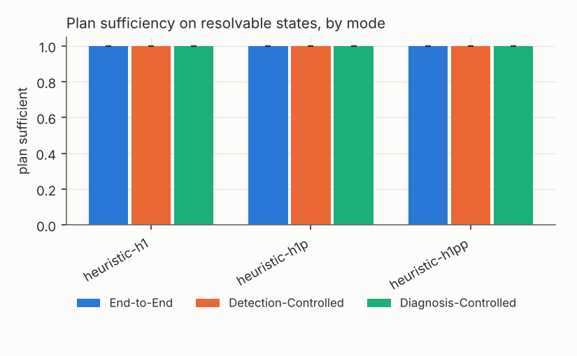
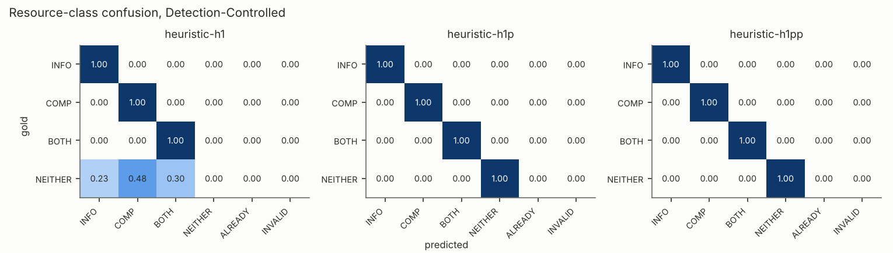
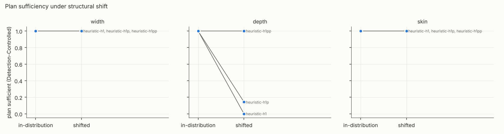

# Shallow heuristic baselines (deterministic, no language model)

> `heuristic-*` rows are real deterministic baselines (no language model, text only). `mock-*` rows are synthetic fixtures.

Split(s): dev · families: 61 · generated from `summary.json` by `msep.eval.report`.

Every number names its mode. End-to-End mixes detection with planning and is never read as a planning failure. Intervals are 95% family-clustered bootstrap.

## Agents

- `h1`: HEURISTIC baseline: act on unknown variables in the rule defining Q (text only)
- `h1p`: HEURISTIC baseline: h1 + aliases + NEITHER when an action is missing (text only)
- `h1pp`: HEURISTIC baseline: h1p + one level of definition expansion (text only)

## Plan sufficiency by mode (resolvable states)

| Agent / model | End-to-End | Detection-Controlled | Diagnosis-Controlled |
|---|---|---|---|
| heuristic-h1 | 1.00 [1.00, 1.00] | 1.00 [1.00, 1.00] | 1.00 [1.00, 1.00] |
| heuristic-h1p | 1.00 [1.00, 1.00] | 1.00 [1.00, 1.00] | 1.00 [1.00, 1.00] |
| heuristic-h1pp | 1.00 [1.00, 1.00] | 1.00 [1.00, 1.00] | 1.00 [1.00, 1.00] |

## Diagnosis vs planning (H2), Detection-Controlled

| Agent / model | Class correct | Plan sufficient | Plan sufficient given class correct | McNemar p |
|---|---|---|---|---|
| heuristic-h1 | 1.00 [1.00, 1.00] | 1.00 [1.00, 1.00] | 1.00 [1.00, 1.00] | 1 |
| heuristic-h1p | 1.00 [1.00, 1.00] | 1.00 [1.00, 1.00] | 1.00 [1.00, 1.00] | 1 |
| heuristic-h1pp | 1.00 [1.00, 1.00] | 1.00 [1.00, 1.00] | 1.00 [1.00, 1.00] | 1 |

## E3 Resource diagnosis

| Agent / model | Mode | Accuracy | Macro-F1 | Balanced acc. | Surface-feature baseline (all counts) |
|---|---|---|---|---|---|
| heuristic-h1 | Detection-Controlled | 0.90 [0.90, 0.90] | 0.70 [0.70, 0.70] | 0.75 [0.75, 0.75] | 0.58 |
| heuristic-h1 | End-to-End | 0.90 [0.90, 0.90] | 0.70 [0.70, 0.70] | 0.75 [0.75, 0.75] | 0.58 |
| heuristic-h1p | Detection-Controlled | 1.00 [1.00, 1.00] | 1.00 [1.00, 1.00] | 1.00 [1.00, 1.00] | 0.58 |
| heuristic-h1p | End-to-End | 1.00 [1.00, 1.00] | 1.00 [1.00, 1.00] | 1.00 [1.00, 1.00] | 0.58 |
| heuristic-h1pp | Detection-Controlled | 1.00 [1.00, 1.00] | 1.00 [1.00, 1.00] | 1.00 [1.00, 1.00] | 0.58 |
| heuristic-h1pp | End-to-End | 1.00 [1.00, 1.00] | 1.00 [1.00, 1.00] | 1.00 [1.00, 1.00] | 0.58 |

## E7 BOTH vs single-resource (Detection-Controlled)

| Agent / model | INFORMATION_ONLY | COMPUTATION_ONLY | BOTH | BOTH plans using one resource |
|---|---|---|---|---|
| heuristic-h1 | 1.00 [1.00, 1.00] | 1.00 [1.00, 1.00] | 1.00 [1.00, 1.00] | 0.00 [0.00, 0.00] |
| heuristic-h1p | 1.00 [1.00, 1.00] | 1.00 [1.00, 1.00] | 1.00 [1.00, 1.00] | 0.00 [0.00, 0.00] |
| heuristic-h1pp | 1.00 [1.00, 1.00] | 1.00 [1.00, 1.00] | 1.00 [1.00, 1.00] | 0.00 [0.00, 0.00] |

## E5 Relevance vs sufficiency (judgments)

| Agent / model | Accuracy, sufficient plans | Accuracy, relevant-insufficient plans | Pairs both correct | McNemar p |
|---|---|---|---|---|
| heuristic-h1 | 1.00 [1.00, 1.00] | 1.00 [1.00, 1.00] | 1.00 [1.00, 1.00] | 1 |
| heuristic-h1p | 1.00 [1.00, 1.00] | 1.00 [1.00, 1.00] | 1.00 [1.00, 1.00] | 1 |
| heuristic-h1pp | 1.00 [1.00, 1.00] | 1.00 [1.00, 1.00] | 1.00 [1.00, 1.00] | 1 |

## E1, E2, E4, E6, E8, E9

| Agent / model | E1 base decision acc. | E2 detection acc. (E2E) | E2 over-answering | E4 exact match (DxC) | E6 optimal given sufficient (DC) | E8 correct defer (DC) | E9 premature stop (DC) | E9 continued after ex-post sufficiency (DC; compare with oracle) |
|---|---|---|---|---|---|---|---|---|
| heuristic-h1 | 1.00 [1.00, 1.00] | 1.00 [1.00, 1.00] | 0.00 [0.00, 0.00] | 0.95 [0.94, 0.97] | 0.95 [0.94, 0.97] | 0.00 [0.00, 0.00] | 0.00 [0.00, 0.00] | 0.10 [0.06, 0.15] |
| heuristic-h1p | 1.00 [1.00, 1.00] | 1.00 [1.00, 1.00] | 0.00 [0.00, 0.00] | 1.00 [1.00, 1.00] | 1.00 [1.00, 1.00] | 1.00 [1.00, 1.00] | 0.00 [0.00, 0.00] | 0.10 [0.06, 0.15] |
| heuristic-h1pp | 1.00 [1.00, 1.00] | 1.00 [1.00, 1.00] | 0.00 [0.00, 0.00] | 1.00 [1.00, 1.00] | 1.00 [1.00, 1.00] | 1.00 [1.00, 1.00] | 0.00 [0.00, 0.00] | 0.10 [0.06, 0.15] |

## E10 Cost sensitivity (Detection-Controlled)

Oracle expectation: the swept action is chosen when it is cheaper than its rival, not when dearer.

| Agent / model | Optimal rate | Chose swept action: below / equal / above | Sweeps optimal at every cost |
|---|---|---|---|
| heuristic-h1 | 0.66 [0.64, 0.68] | 0.00 / 0.00 / 0.00 | 0.00 |
| heuristic-h1p | 0.83 [0.82, 0.84] | 0.50 / 0.00 / 0.00 | 0.50 |
| heuristic-h1pp | 0.83 [0.82, 0.84] | 0.50 / 0.00 / 0.00 | 0.50 |

## E11 Risk sensitivity (End-to-End; posterior-threshold stress test, not core benchmark)

| Agent / model | tau | Oracle: answering justified | Agent answers | Detection correct |
|---|---|---|---|---|
| heuristic-h1 | 1 | 0.20 | 0.20 | 1.00 |
| heuristic-h1 | 19/20 | 0.21 | 0.20 | 0.99 |
| heuristic-h1 | 3/5 | 0.47 | 0.20 | 0.73 |
| heuristic-h1 | 4/5 | 0.31 | 0.20 | 0.89 |
| heuristic-h1p | 1 | 0.20 | 0.20 | 1.00 |
| heuristic-h1p | 19/20 | 0.21 | 0.20 | 0.99 |
| heuristic-h1p | 3/5 | 0.47 | 0.20 | 0.73 |
| heuristic-h1p | 4/5 | 0.31 | 0.20 | 0.89 |
| heuristic-h1pp | 1 | 0.20 | 0.20 | 1.00 |
| heuristic-h1pp | 19/20 | 0.21 | 0.20 | 0.99 |
| heuristic-h1pp | 3/5 | 0.47 | 0.20 | 0.73 |
| heuristic-h1pp | 4/5 | 0.31 | 0.20 | 0.89 |

## E12 Structural shift (Detection-Controlled, resolvable states)

| Agent / model | Axis | Pairs | In-distribution plan sufficient | Shifted | Paired drop [CI] | McNemar p |
|---|---|---|---|---|---|---|
| heuristic-h1 | width | 549 | 1.00 | 1.00 | 0.00 [0.00, 0.00] | 1 |
| heuristic-h1 | depth | 427 | 1.00 | 0.00 | 1.00 [1.00, 1.00] | 5.77e-129 |
| heuristic-h1 | skin | 549 | 1.00 | 1.00 | 0.00 [0.00, 0.00] | 1 |
| heuristic-h1p | width | 549 | 1.00 | 1.00 | 0.00 [0.00, 0.00] | 1 |
| heuristic-h1p | depth | 427 | 1.00 | 0.14 | 0.86 [0.86, 0.86] | 1.33e-110 |
| heuristic-h1p | skin | 549 | 1.00 | 1.00 | 0.00 [0.00, 0.00] | 1 |
| heuristic-h1pp | width | 549 | 1.00 | 1.00 | 0.00 [0.00, 0.00] | 1 |
| heuristic-h1pp | depth | 427 | 1.00 | 1.00 | 0.00 [0.00, 0.00] | 1 |
| heuristic-h1pp | skin | 549 | 1.00 | 1.00 | 0.00 [0.00, 0.00] | 1 |

## Mode decomposition (same instances across modes; resolvable states)

An End-to-End failure that disappears in Detection-Controlled is attributed to detection/framing; a Detection-Controlled failure that disappears in Diagnosis-Controlled to diagnosis; only failures in all three modes are planning failures.

| Agent / model | e2e_success | e2e_fail_detection_wrong | e2e_fail_but_dc_success | dc_fail_but_dxc_success (diagnosis-attributable) | fail_in_all_modes (planning) |
|---|---|---|---|---|---|
| heuristic-h1 | 1.00 [1.00, 1.00] | 0.00 [0.00, 0.00] | 0.00 [0.00, 0.00] | 0.00 [0.00, 0.00] | 0.00 [0.00, 0.00] |
| heuristic-h1p | 1.00 [1.00, 1.00] | 0.00 [0.00, 0.00] | 0.00 [0.00, 0.00] | 0.00 [0.00, 0.00] | 0.00 [0.00, 0.00] |
| heuristic-h1pp | 1.00 [1.00, 1.00] | 0.00 [0.00, 0.00] | 0.00 [0.00, 0.00] | 0.00 [0.00, 0.00] | 0.00 [0.00, 0.00] |

## Instruction compliance and hierarchical metrics

| Agent / model | DC: claims sufficient (contradicts prompt) | DxC: class differs from given | A_D | A_G | A_P (DC) | A_P' (DxC) | A_S | A_E2E |
|---|---|---|---|---|---|---|---|---|
| heuristic-h1 | 0.00 [0.00, 0.00] | 0.00 [0.00, 0.00] | 1.00 [1.00, 1.00] | 0.90 [0.90, 0.90] | 0.95 [0.94, 0.97] | 0.95 [0.94, 0.97] | 1.00 [1.00, 1.00] | 0.87 [0.86, 0.88] |
| heuristic-h1p | 0.00 [0.00, 0.00] | 0.00 [0.00, 0.00] | 1.00 [1.00, 1.00] | 1.00 [1.00, 1.00] | 1.00 [1.00, 1.00] | 1.00 [1.00, 1.00] | 1.00 [1.00, 1.00] | 1.00 [1.00, 1.00] |
| heuristic-h1pp | 0.00 [0.00, 0.00] | 0.00 [0.00, 0.00] | 1.00 [1.00, 1.00] | 1.00 [1.00, 1.00] | 1.00 [1.00, 1.00] | 1.00 [1.00, 1.00] | 1.00 [1.00, 1.00] | 1.00 [1.00, 1.00] |

## Strata: shallow-heuristic difficulty and template

`heuristic_hard` = instances where the text-only h1pp baseline fails. A model's advantage over shallow reading shows only there.

| Agent / model | Stratum | Instances | DC class correct | DC plan sufficient | DC plan optimal |
|---|---|---|---|---|---|
| heuristic-h1 | heuristic_easy | 671 | 0.90 [0.90, 0.90] | 1.00 [1.00, 1.00] | 0.95 [0.94, 0.97] |
| heuristic-h1 | v2 | 671 | 0.90 [0.90, 0.90] | 1.00 [1.00, 1.00] | 0.95 [0.94, 0.97] |
| heuristic-h1p | heuristic_easy | 671 | 1.00 [1.00, 1.00] | 1.00 [1.00, 1.00] | 1.00 [1.00, 1.00] |
| heuristic-h1p | v2 | 671 | 1.00 [1.00, 1.00] | 1.00 [1.00, 1.00] | 1.00 [1.00, 1.00] |
| heuristic-h1pp | heuristic_easy | 671 | 1.00 [1.00, 1.00] | 1.00 [1.00, 1.00] | 1.00 [1.00, 1.00] |
| heuristic-h1pp | v2 | 671 | 1.00 [1.00, 1.00] | 1.00 [1.00, 1.00] | 1.00 [1.00, 1.00] |

## Calibration (stated confidence vs plan sufficiency)

| Agent / model | Mode | n | Brier | ECE |
|---|---|---|---|---|
| heuristic-h1 | End-to-End | 671 | 0.25 | 0.41 |
| heuristic-h1 | Detection-Controlled | 610 | 0.25 | 0.40 |
| heuristic-h1 | Diagnosis-Controlled | 549 | 0.25 | 0.50 |
| heuristic-h1p | End-to-End | 671 | 0.25 | 0.41 |
| heuristic-h1p | Detection-Controlled | 610 | 0.25 | 0.40 |
| heuristic-h1p | Diagnosis-Controlled | 549 | 0.25 | 0.50 |
| heuristic-h1pp | End-to-End | 671 | 0.25 | 0.41 |
| heuristic-h1pp | Detection-Controlled | 610 | 0.25 | 0.40 |
| heuristic-h1pp | Diagnosis-Controlled | 549 | 0.25 | 0.50 |

## Confirmatory tests (Holm-adjusted; see PROTOCOL.md §4)

| Agent / model | Test | p | Holm p |
|---|---|---|---|
| heuristic-h1 | H2_diagnosis_vs_plan_sufficiency_DC | 1 | 1 |
| heuristic-h1 | H3_relevance_vs_sufficiency_judgment | 1 | 1 |
| heuristic-h1 | H4_INFO_vs_BOTH_DC | 1 | 1 |
| heuristic-h1 | H4_COMP_vs_BOTH_DC | 1 | 1 |
| heuristic-h1p | H2_diagnosis_vs_plan_sufficiency_DC | 1 | 1 |
| heuristic-h1p | H3_relevance_vs_sufficiency_judgment | 1 | 1 |
| heuristic-h1p | H4_INFO_vs_BOTH_DC | 1 | 1 |
| heuristic-h1p | H4_COMP_vs_BOTH_DC | 1 | 1 |
| heuristic-h1pp | H2_diagnosis_vs_plan_sufficiency_DC | 1 | 1 |
| heuristic-h1pp | H3_relevance_vs_sufficiency_judgment | 1 | 1 |
| heuristic-h1pp | H4_INFO_vs_BOTH_DC | 1 | 1 |
| heuristic-h1pp | H4_COMP_vs_BOTH_DC | 1 | 1 |

## Error taxonomy (first failing stage)

- heuristic-h1: {'end_to_end': {'minimality': 25, 'correct': 585, 'diagnosis': 61}, 'detection_controlled': {'correct': 524, 'diagnosis': 61, 'minimality': 25}, 'diagnosis_controlled': {'correct': 524, 'minimality': 25}}
- heuristic-h1p: {'end_to_end': {'correct': 671}, 'detection_controlled': {'correct': 610}, 'diagnosis_controlled': {'correct': 549}}
- heuristic-h1pp: {'end_to_end': {'correct': 671}, 'detection_controlled': {'correct': 610}, 'diagnosis_controlled': {'correct': 549}}

## Ceiling / floor flags

- heuristic-h1: E1 base decision accuracy ceiling (1.00), E3 detection_controlled plan sufficient (resolvable) ceiling (1.00), E3 end_to_end plan sufficient (resolvable) ceiling (1.00), E5 judgment accuracy, sufficient plans ceiling (1.00), E5 judgment accuracy, relevant-insufficient plans ceiling (1.00), E7 detection_controlled INFORMATION_ONLY plan sufficient ceiling (1.00), E7 detection_controlled COMPUTATION_ONLY plan sufficient ceiling (1.00), E7 detection_controlled BOTH plan sufficient ceiling (1.00), E7 diagnosis_controlled INFORMATION_ONLY plan sufficient ceiling (1.00), E7 diagnosis_controlled COMPUTATION_ONLY plan sufficient ceiling (1.00), E7 diagnosis_controlled BOTH plan sufficient ceiling (1.00), E7 end_to_end INFORMATION_ONLY plan sufficient ceiling (1.00), E7 end_to_end COMPUTATION_ONLY plan sufficient ceiling (1.00), E7 end_to_end BOTH plan sufficient ceiling (1.00)
- heuristic-h1p: E1 base decision accuracy ceiling (1.00), E3 detection_controlled class accuracy ceiling (1.00), E3 detection_controlled plan sufficient (resolvable) ceiling (1.00), E3 end_to_end class accuracy ceiling (1.00), E3 end_to_end plan sufficient (resolvable) ceiling (1.00), E5 judgment accuracy, sufficient plans ceiling (1.00), E5 judgment accuracy, relevant-insufficient plans ceiling (1.00), E7 detection_controlled INFORMATION_ONLY plan sufficient ceiling (1.00), E7 detection_controlled COMPUTATION_ONLY plan sufficient ceiling (1.00), E7 detection_controlled BOTH plan sufficient ceiling (1.00), E7 diagnosis_controlled INFORMATION_ONLY plan sufficient ceiling (1.00), E7 diagnosis_controlled COMPUTATION_ONLY plan sufficient ceiling (1.00), E7 diagnosis_controlled BOTH plan sufficient ceiling (1.00), E7 end_to_end INFORMATION_ONLY plan sufficient ceiling (1.00), E7 end_to_end COMPUTATION_ONLY plan sufficient ceiling (1.00), E7 end_to_end BOTH plan sufficient ceiling (1.00)
- heuristic-h1pp: E1 base decision accuracy ceiling (1.00), E3 detection_controlled class accuracy ceiling (1.00), E3 detection_controlled plan sufficient (resolvable) ceiling (1.00), E3 end_to_end class accuracy ceiling (1.00), E3 end_to_end plan sufficient (resolvable) ceiling (1.00), E5 judgment accuracy, sufficient plans ceiling (1.00), E5 judgment accuracy, relevant-insufficient plans ceiling (1.00), E7 detection_controlled INFORMATION_ONLY plan sufficient ceiling (1.00), E7 detection_controlled COMPUTATION_ONLY plan sufficient ceiling (1.00), E7 detection_controlled BOTH plan sufficient ceiling (1.00), E7 diagnosis_controlled INFORMATION_ONLY plan sufficient ceiling (1.00), E7 diagnosis_controlled COMPUTATION_ONLY plan sufficient ceiling (1.00), E7 diagnosis_controlled BOTH plan sufficient ceiling (1.00), E7 end_to_end INFORMATION_ONLY plan sufficient ceiling (1.00), E7 end_to_end COMPUTATION_ONLY plan sufficient ceiling (1.00), E7 end_to_end BOTH plan sufficient ceiling (1.00)

## Usage

- heuristic-h1: 9207 requests, parse errors 0.00, refusals 0.00, truncations 0.00, cost $0.0000
- heuristic-h1p: 9207 requests, parse errors 0.00, refusals 0.00, truncations 0.00, cost $0.0000
- heuristic-h1pp: 9207 requests, parse errors 0.00, refusals 0.00, truncations 0.00, cost $0.0000
