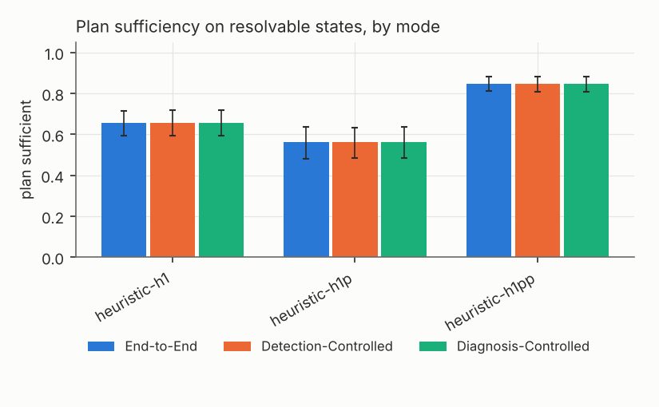
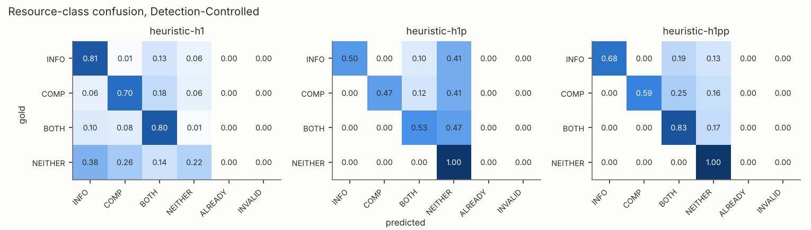
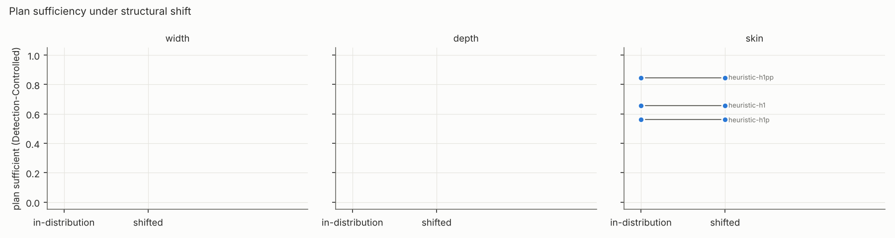

# Shallow heuristic baselines (deterministic, no language model)

> `heuristic-*` rows are real deterministic baselines (no language model, text only). `mock-*` rows are synthetic fixtures.

Split(s): dev · families: 72 · generated from `summary.json` by `msep.eval.report`.

Every number names its mode. End-to-End mixes detection with planning and is never read as a planning failure. Intervals are 95% family-clustered bootstrap.

## Agents

- `h1`: HEURISTIC baseline: act on unknown variables in the rule defining Q (text only)
- `h1p`: HEURISTIC baseline: h1 + aliases + NEITHER when an action is missing (text only)
- `h1pp`: HEURISTIC baseline: h1p + one level of definition expansion (text only)

## Plan sufficiency by mode (resolvable states)

| Agent / model | End-to-End | Detection-Controlled | Diagnosis-Controlled |
|---|---|---|---|
| heuristic-h1 | 0.66 [0.59, 0.72] | 0.66 [0.59, 0.72] | 0.66 [0.59, 0.72] |
| heuristic-h1p | 0.56 [0.48, 0.64] | 0.56 [0.49, 0.63] | 0.56 [0.49, 0.64] |
| heuristic-h1pp | 0.85 [0.81, 0.88] | 0.85 [0.81, 0.88] | 0.85 [0.81, 0.88] |

## Diagnosis vs planning (H2), Detection-Controlled

| Agent / model | Class correct | Plan sufficient | Plan sufficient given class correct | McNemar p |
|---|---|---|---|---|
| heuristic-h1 | 0.78 [0.73, 0.83] | 0.66 [0.59, 0.72] | 0.75 [0.69, 0.81] | 2.35e-06 |
| heuristic-h1p | 0.51 [0.44, 0.58] | 0.56 [0.49, 0.63] | 1.00 [1.00, 1.00] | 4.77e-07 |
| heuristic-h1pp | 0.74 [0.69, 0.78] | 0.85 [0.81, 0.88] | 1.00 [1.00, 1.00] | 1.14e-13 |

## E3 Resource diagnosis

| Agent / model | Mode | Accuracy | Macro-F1 | Balanced acc. | Surface-feature baseline (all counts) |
|---|---|---|---|---|---|
| heuristic-h1 | Detection-Controlled | 0.69 [0.65, 0.74] | 0.62 [0.57, 0.67] | 0.63 [0.59, 0.68] | 0.42 |
| heuristic-h1 | End-to-End | 0.69 [0.64, 0.74] | 0.62 [0.56, 0.67] | 0.63 [0.58, 0.68] | 0.42 |
| heuristic-h1p | Detection-Controlled | 0.58 [0.52, 0.64] | 0.60 [0.54, 0.65] | 0.62 [0.57, 0.67] | 0.42 |
| heuristic-h1p | End-to-End | 0.58 [0.52, 0.64] | 0.60 [0.54, 0.65] | 0.62 [0.57, 0.68] | 0.42 |
| heuristic-h1pp | Detection-Controlled | 0.78 [0.73, 0.81] | 0.77 [0.72, 0.81] | 0.78 [0.74, 0.82] | 0.42 |
| heuristic-h1pp | End-to-End | 0.78 [0.74, 0.82] | 0.77 [0.72, 0.81] | 0.78 [0.74, 0.82] | 0.42 |

## E7 BOTH vs single-resource (Detection-Controlled)

| Agent / model | INFORMATION_ONLY | COMPUTATION_ONLY | BOTH | BOTH plans using one resource |
|---|---|---|---|---|
| heuristic-h1 | 0.79 [0.69, 0.89] | 0.74 [0.62, 0.83] | 0.56 [0.44, 0.67] | 0.24 [0.14, 0.33] |
| heuristic-h1p | 0.64 [0.54, 0.75] | 0.61 [0.50, 0.72] | 0.54 [0.43, 0.65] | 0.00 [0.00, 0.00] |
| heuristic-h1pp | 0.92 [0.85, 0.97] | 0.86 [0.78, 0.93] | 0.81 [0.72, 0.89] | 0.00 [0.00, 0.00] |

## E5 Relevance vs sufficiency (judgments)

| Agent / model | Accuracy, sufficient plans | Accuracy, relevant-insufficient plans | Pairs both correct | McNemar p |
|---|---|---|---|---|
| heuristic-h1 | 0.69 [0.61, 0.76] | 0.86 [0.82, 0.90] | 0.62 [0.56, 0.69] | 0.000446 |
| heuristic-h1p | 0.35 [0.27, 0.44] | 1.00 [1.00, 1.00] | 0.37 [0.28, 0.46] | 1.38e-76 |
| heuristic-h1pp | 0.54 [0.47, 0.63] | 1.00 [1.00, 1.00] | 0.61 [0.52, 0.69] | 2.19e-47 |

## E1, E2, E4, E6, E8, E9

| Agent / model | E1 base decision acc. | E2 detection acc. (E2E) | E2 over-answering | E4 exact match (DxC) | E6 optimal given sufficient (DC) | E8 correct defer (DC) | E9 premature stop (DC) | E9 continued after ex-post sufficiency (DC; compare with oracle) |
|---|---|---|---|---|---|---|---|---|
| heuristic-h1 | 0.78 [0.68, 0.88] | 0.94 [0.92, 0.95] | 0.00 [0.00, 0.00] | 0.50 [0.43, 0.57] | 0.76 [0.68, 0.84] | 0.22 [0.14, 0.32] | 0.19 [0.14, 0.25] | 0.15 [0.10, 0.22] |
| heuristic-h1p | 0.78 [0.68, 0.88] | 0.94 [0.92, 0.95] | 0.00 [0.00, 0.00] | 0.42 [0.35, 0.49] | 0.75 [0.66, 0.83] | 1.00 [1.00, 1.00] | 0.00 [0.00, 0.00] | 0.15 [0.09, 0.21] |
| heuristic-h1pp | 0.78 [0.68, 0.88] | 0.94 [0.93, 0.96] | 0.00 [0.00, 0.00] | 0.59 [0.52, 0.65] | 0.69 [0.62, 0.76] | 1.00 [1.00, 1.00] | 0.00 [0.00, 0.00] | 0.29 [0.22, 0.36] |

## E10 Cost sensitivity (Detection-Controlled)

Oracle expectation: the swept action is chosen when it is cheaper than its rival, not when dearer.

| Agent / model | Optimal rate | Chose swept action: below / equal / above | Sweeps optimal at every cost |
|---|---|---|---|
| heuristic-h1 | 0.38 [0.29, 0.45] | 0.03 / 0.04 / 0.04 | 0.06 |
| heuristic-h1p | 0.35 [0.28, 0.43] | 0.02 / 0.01 / 0.01 | 0.08 |
| heuristic-h1pp | 0.52 [0.45, 0.59] | 0.06 / 0.05 / 0.04 | 0.09 |

## E11 Risk sensitivity (End-to-End; posterior-threshold stress test, not core benchmark)

| Agent / model | tau | Oracle: answering justified | Agent answers | Detection correct |
|---|---|---|---|---|
| heuristic-h1 | 1 | 0.20 | 0.10 | 0.90 |
| heuristic-h1 | 19/20 | 0.20 | 0.10 | 0.90 |
| heuristic-h1 | 3/5 | 0.42 | 0.10 | 0.69 |
| heuristic-h1 | 4/5 | 0.24 | 0.10 | 0.87 |
| heuristic-h1p | 1 | 0.20 | 0.10 | 0.90 |
| heuristic-h1p | 19/20 | 0.20 | 0.10 | 0.90 |
| heuristic-h1p | 3/5 | 0.42 | 0.10 | 0.69 |
| heuristic-h1p | 4/5 | 0.24 | 0.10 | 0.87 |
| heuristic-h1pp | 1 | 0.20 | 0.11 | 0.91 |
| heuristic-h1pp | 19/20 | 0.20 | 0.11 | 0.91 |
| heuristic-h1pp | 3/5 | 0.42 | 0.11 | 0.69 |
| heuristic-h1pp | 4/5 | 0.24 | 0.11 | 0.87 |

## E12 Structural shift (Detection-Controlled, resolvable states)

| Agent / model | Axis | Pairs | In-distribution plan sufficient | Shifted | Paired drop [CI] | McNemar p |
|---|---|---|---|---|---|---|
| heuristic-h1 | width | 0 | – | – | – | 1 |
| heuristic-h1 | depth | 0 | – | – | – | 1 |
| heuristic-h1 | skin | 401 | 0.66 | 0.66 | 0.00 [0.00, 0.00] | 1 |
| heuristic-h1p | width | 0 | – | – | – | 1 |
| heuristic-h1p | depth | 0 | – | – | – | 1 |
| heuristic-h1p | skin | 401 | 0.56 | 0.56 | 0.00 [0.00, 0.00] | 1 |
| heuristic-h1pp | width | 0 | – | – | – | 1 |
| heuristic-h1pp | depth | 0 | – | – | – | 1 |
| heuristic-h1pp | skin | 401 | 0.85 | 0.85 | 0.00 [0.00, 0.00] | 1 |

## Mode decomposition (same instances across modes; resolvable states)

An End-to-End failure that disappears in Detection-Controlled is attributed to detection/framing; a Detection-Controlled failure that disappears in Diagnosis-Controlled to diagnosis; only failures in all three modes are planning failures.

| Agent / model | e2e_success | e2e_fail_detection_wrong | e2e_fail_but_dc_success | dc_fail_but_dxc_success (diagnosis-attributable) | fail_in_all_modes (planning) |
|---|---|---|---|---|---|
| heuristic-h1 | 0.58 [0.52, 0.65] | 0.00 [0.00, 0.00] | 0.00 [0.00, 0.00] | 0.07 [0.04, 0.10] | 0.34 [0.28, 0.41] |
| heuristic-h1p | 0.51 [0.43, 0.58] | 0.00 [0.00, 0.00] | 0.00 [0.00, 0.00] | 0.05 [0.03, 0.08] | 0.44 [0.36, 0.52] |
| heuristic-h1pp | 0.74 [0.69, 0.78] | 0.00 [0.00, 0.00] | 0.00 [0.00, 0.00] | 0.11 [0.08, 0.14] | 0.15 [0.12, 0.19] |

## Instruction compliance and hierarchical metrics

| Agent / model | DC: claims sufficient (contradicts prompt) | DxC: class differs from given | A_D | A_G | A_P (DC) | A_P' (DxC) | A_S | A_E2E |
|---|---|---|---|---|---|---|---|---|
| heuristic-h1 | 0.00 [0.00, 0.00] | 0.22 [0.17, 0.27] | 0.94 [0.92, 0.95] | 0.69 [0.65, 0.74] | 0.64 [0.58, 0.71] | 0.50 [0.43, 0.57] | 0.62 [0.56, 0.69] | 0.47 [0.41, 0.52] |
| heuristic-h1p | 0.00 [0.00, 0.00] | 0.49 [0.42, 0.56] | 0.94 [0.92, 0.95] | 0.58 [0.52, 0.64] | 0.83 [0.75, 0.91] | 0.42 [0.35, 0.49] | 0.37 [0.28, 0.46] | 0.51 [0.46, 0.57] |
| heuristic-h1pp | 0.00 [0.00, 0.00] | 0.26 [0.22, 0.31] | 0.94 [0.93, 0.96] | 0.78 [0.73, 0.81] | 0.80 [0.73, 0.86] | 0.59 [0.52, 0.65] | 0.61 [0.52, 0.69] | 0.63 [0.58, 0.68] |

## Strata: shallow-heuristic difficulty and template

`heuristic_hard` = instances where the text-only h1pp baseline fails. A model's advantage over shallow reading shows only there.

| Agent / model | Stratum | Instances | DC class correct | DC plan sufficient | DC plan optimal |
|---|---|---|---|---|---|
| heuristic-h1 | heuristic_easy | 347 | 0.75 [0.70, 0.79] | 0.74 [0.65, 0.82] | 0.73 [0.64, 0.81] |
| heuristic-h1 | heuristic_hard | 198 | 0.60 [0.52, 0.68] | 0.54 [0.43, 0.64] | 0.18 [0.09, 0.28] |
| heuristic-h1 | v3 | 545 | 0.69 [0.65, 0.74] | 0.66 [0.59, 0.72] | 0.50 [0.43, 0.57] |
| heuristic-h1p | heuristic_easy | 347 | 0.79 [0.71, 0.85] | 0.72 [0.62, 0.81] | 0.72 [0.62, 0.81] |
| heuristic-h1p | heuristic_hard | 198 | 0.20 [0.12, 0.29] | 0.34 [0.23, 0.44] | 0.00 [0.00, 0.00] |
| heuristic-h1p | v3 | 545 | 0.58 [0.52, 0.64] | 0.56 [0.49, 0.63] | 0.42 [0.35, 0.49] |
| heuristic-h1pp | heuristic_easy | 347 | 1.00 [1.00, 1.00] | 1.00 [1.00, 1.00] | 1.00 [1.00, 1.00] |
| heuristic-h1pp | heuristic_hard | 198 | 0.36 [0.28, 0.45] | 0.63 [0.55, 0.70] | 0.00 [0.00, 0.00] |
| heuristic-h1pp | v3 | 545 | 0.78 [0.73, 0.81] | 0.85 [0.81, 0.88] | 0.59 [0.52, 0.66] |

## Calibration (stated confidence vs plan sufficiency)

| Agent / model | Mode | n | Brier | ECE |
|---|---|---|---|---|
| heuristic-h1 | End-to-End | 545 | 0.25 | 0.05 |
| heuristic-h1 | Detection-Controlled | 473 | 0.25 | 0.06 |
| heuristic-h1 | Diagnosis-Controlled | 401 | 0.25 | 0.16 |
| heuristic-h1p | End-to-End | 545 | 0.25 | 0.02 |
| heuristic-h1p | Detection-Controlled | 473 | 0.25 | 0.02 |
| heuristic-h1p | Diagnosis-Controlled | 401 | 0.25 | 0.06 |
| heuristic-h1pp | End-to-End | 545 | 0.25 | 0.20 |
| heuristic-h1pp | Detection-Controlled | 473 | 0.25 | 0.22 |
| heuristic-h1pp | Diagnosis-Controlled | 401 | 0.25 | 0.35 |

## Breakdown: stratum x mode x resource class (plan optimal on resolvable states)

Full v3 is primary; heuristic_hard is a pre-registered stress test (it contains no NEITHER items, so compare within class).

| Agent / model | Stratum | Mode | Class | n | Class correct | Plan sufficient | Plan optimal |
|---|---|---|---|---|---|---|---|
| heuristic-h1 | all | End-to-End | ALL | 545 | 0.67 [0.63, 0.71] | 0.66 [0.59, 0.72] | 0.50 [0.44, 0.57] |
| heuristic-h1 | all | End-to-End | ALREADY_SUFFICIENT | 72 | 0.51 [0.40, 0.62] | – | – |
| heuristic-h1 | all | End-to-End | INFORMATION_ONLY | 103 | 0.81 [0.72, 0.89] | 0.74 [0.62, 0.85] | 0.56 [0.45, 0.68] |
| heuristic-h1 | all | End-to-End | COMPUTATION_ONLY | 96 | 0.70 [0.59, 0.80] | 0.73 [0.63, 0.83] | 0.52 [0.41, 0.64] |
| heuristic-h1 | all | End-to-End | BOTH | 202 | 0.80 [0.73, 0.87] | 0.58 [0.49, 0.67] | 0.46 [0.38, 0.54] |
| heuristic-h1 | all | End-to-End | NEITHER | 72 | 0.22 [0.12, 0.32] | – | – |
| heuristic-h1 | all | Detection-Controlled | ALL | 473 | 0.69 [0.65, 0.74] | 0.66 [0.59, 0.72] | 0.50 [0.43, 0.57] |
| heuristic-h1 | all | Detection-Controlled | INFORMATION_ONLY | 103 | 0.81 [0.71, 0.89] | 0.74 [0.62, 0.84] | 0.56 [0.45, 0.68] |
| heuristic-h1 | all | Detection-Controlled | COMPUTATION_ONLY | 96 | 0.70 [0.58, 0.80] | 0.73 [0.62, 0.83] | 0.52 [0.40, 0.65] |
| heuristic-h1 | all | Detection-Controlled | BOTH | 202 | 0.80 [0.73, 0.87] | 0.58 [0.49, 0.66] | 0.46 [0.38, 0.54] |
| heuristic-h1 | all | Detection-Controlled | NEITHER | 72 | 0.22 [0.14, 0.32] | – | – |
| heuristic-h1 | all | Diagnosis-Controlled | ALL | 401 | 0.78 [0.73, 0.83] | 0.66 [0.59, 0.72] | 0.50 [0.43, 0.57] |
| heuristic-h1 | all | Diagnosis-Controlled | INFORMATION_ONLY | 103 | 0.81 [0.71, 0.88] | 0.74 [0.62, 0.85] | 0.56 [0.44, 0.68] |
| heuristic-h1 | all | Diagnosis-Controlled | COMPUTATION_ONLY | 96 | 0.70 [0.59, 0.80] | 0.73 [0.62, 0.82] | 0.52 [0.41, 0.63] |
| heuristic-h1 | all | Diagnosis-Controlled | BOTH | 202 | 0.80 [0.73, 0.87] | 0.58 [0.49, 0.67] | 0.46 [0.38, 0.54] |
| heuristic-h1 | heuristic_hard | End-to-End | ALL | 198 | 0.50 [0.43, 0.57] | 0.54 [0.43, 0.64] | 0.18 [0.10, 0.28] |
| heuristic-h1 | heuristic_hard | End-to-End | ALREADY_SUFFICIENT | 32 | 0.00 [0.00, 0.00] | – | – |
| heuristic-h1 | heuristic_hard | End-to-End | INFORMATION_ONLY | 44 | 0.61 [0.44, 0.78] | 0.61 [0.44, 0.78] | 0.20 [0.07, 0.36] |
| heuristic-h1 | heuristic_hard | End-to-End | COMPUTATION_ONLY | 48 | 0.40 [0.24, 0.56] | 0.60 [0.44, 0.76] | 0.19 [0.07, 0.33] |
| heuristic-h1 | heuristic_hard | End-to-End | BOTH | 74 | 0.72 [0.60, 0.82] | 0.45 [0.30, 0.59] | 0.16 [0.05, 0.29] |
| heuristic-h1 | heuristic_hard | Detection-Controlled | ALL | 166 | 0.60 [0.52, 0.68] | 0.54 [0.43, 0.64] | 0.18 [0.09, 0.28] |
| heuristic-h1 | heuristic_hard | Detection-Controlled | INFORMATION_ONLY | 44 | 0.61 [0.44, 0.78] | 0.61 [0.43, 0.79] | 0.20 [0.07, 0.36] |
| heuristic-h1 | heuristic_hard | Detection-Controlled | COMPUTATION_ONLY | 48 | 0.40 [0.25, 0.56] | 0.60 [0.43, 0.76] | 0.19 [0.08, 0.33] |
| heuristic-h1 | heuristic_hard | Detection-Controlled | BOTH | 74 | 0.72 [0.61, 0.82] | 0.45 [0.30, 0.59] | 0.16 [0.06, 0.29] |
| heuristic-h1 | heuristic_hard | Diagnosis-Controlled | ALL | 166 | 0.60 [0.51, 0.67] | 0.54 [0.44, 0.64] | 0.18 [0.10, 0.28] |
| heuristic-h1 | heuristic_hard | Diagnosis-Controlled | INFORMATION_ONLY | 44 | 0.61 [0.44, 0.77] | 0.61 [0.44, 0.79] | 0.20 [0.07, 0.36] |
| heuristic-h1 | heuristic_hard | Diagnosis-Controlled | COMPUTATION_ONLY | 48 | 0.40 [0.24, 0.55] | 0.60 [0.44, 0.77] | 0.19 [0.08, 0.33] |
| heuristic-h1 | heuristic_hard | Diagnosis-Controlled | BOTH | 74 | 0.72 [0.60, 0.83] | 0.45 [0.30, 0.60] | 0.16 [0.06, 0.29] |
| heuristic-h1 | heuristic_easy | End-to-End | ALL | 347 | 0.77 [0.72, 0.80] | 0.74 [0.66, 0.82] | 0.73 [0.64, 0.81] |
| heuristic-h1 | heuristic_easy | End-to-End | ALREADY_SUFFICIENT | 40 | 0.93 [0.82, 1.00] | – | – |
| heuristic-h1 | heuristic_easy | End-to-End | INFORMATION_ONLY | 59 | 0.95 [0.88, 1.00] | 0.83 [0.71, 0.93] | 0.83 [0.71, 0.93] |
| heuristic-h1 | heuristic_easy | End-to-End | COMPUTATION_ONLY | 48 | 1.00 [1.00, 1.00] | 0.85 [0.75, 0.96] | 0.85 [0.75, 0.96] |
| heuristic-h1 | heuristic_easy | End-to-End | BOTH | 128 | 0.85 [0.76, 0.93] | 0.66 [0.54, 0.76] | 0.63 [0.52, 0.74] |
| heuristic-h1 | heuristic_easy | End-to-End | NEITHER | 72 | 0.22 [0.12, 0.32] | – | – |
| heuristic-h1 | heuristic_easy | Detection-Controlled | ALL | 307 | 0.75 [0.70, 0.79] | 0.74 [0.65, 0.82] | 0.73 [0.64, 0.81] |
| heuristic-h1 | heuristic_easy | Detection-Controlled | INFORMATION_ONLY | 59 | 0.95 [0.88, 1.00] | 0.83 [0.71, 0.93] | 0.83 [0.71, 0.93] |
| heuristic-h1 | heuristic_easy | Detection-Controlled | COMPUTATION_ONLY | 48 | 1.00 [1.00, 1.00] | 0.85 [0.74, 0.96] | 0.85 [0.74, 0.96] |
| heuristic-h1 | heuristic_easy | Detection-Controlled | BOTH | 128 | 0.85 [0.76, 0.93] | 0.66 [0.54, 0.77] | 0.63 [0.52, 0.74] |
| heuristic-h1 | heuristic_easy | Detection-Controlled | NEITHER | 72 | 0.22 [0.14, 0.32] | – | – |
| heuristic-h1 | heuristic_easy | Diagnosis-Controlled | ALL | 235 | 0.91 [0.85, 0.95] | 0.74 [0.66, 0.81] | 0.73 [0.65, 0.80] |
| heuristic-h1 | heuristic_easy | Diagnosis-Controlled | INFORMATION_ONLY | 59 | 0.95 [0.89, 1.00] | 0.83 [0.72, 0.92] | 0.83 [0.72, 0.92] |
| heuristic-h1 | heuristic_easy | Diagnosis-Controlled | COMPUTATION_ONLY | 48 | 1.00 [1.00, 1.00] | 0.85 [0.74, 0.96] | 0.85 [0.74, 0.96] |
| heuristic-h1 | heuristic_easy | Diagnosis-Controlled | BOTH | 128 | 0.85 [0.77, 0.92] | 0.66 [0.55, 0.76] | 0.63 [0.53, 0.74] |
| heuristic-h1p | all | End-to-End | ALL | 545 | 0.57 [0.52, 0.63] | 0.56 [0.48, 0.64] | 0.42 [0.35, 0.49] |
| heuristic-h1p | all | End-to-End | ALREADY_SUFFICIENT | 72 | 0.51 [0.39, 0.62] | – | – |
| heuristic-h1p | all | End-to-End | INFORMATION_ONLY | 103 | 0.50 [0.38, 0.61] | 0.59 [0.48, 0.70] | 0.44 [0.33, 0.55] |
| heuristic-h1p | all | End-to-End | COMPUTATION_ONLY | 96 | 0.47 [0.37, 0.57] | 0.59 [0.49, 0.69] | 0.40 [0.30, 0.50] |
| heuristic-h1p | all | End-to-End | BOTH | 202 | 0.53 [0.44, 0.62] | 0.53 [0.44, 0.62] | 0.43 [0.34, 0.51] |
| heuristic-h1p | all | End-to-End | NEITHER | 72 | 1.00 [1.00, 1.00] | – | – |
| heuristic-h1p | all | Detection-Controlled | ALL | 473 | 0.58 [0.52, 0.64] | 0.56 [0.49, 0.63] | 0.42 [0.35, 0.49] |
| heuristic-h1p | all | Detection-Controlled | INFORMATION_ONLY | 103 | 0.50 [0.38, 0.61] | 0.59 [0.48, 0.70] | 0.44 [0.33, 0.55] |
| heuristic-h1p | all | Detection-Controlled | COMPUTATION_ONLY | 96 | 0.47 [0.36, 0.57] | 0.59 [0.49, 0.70] | 0.40 [0.29, 0.51] |
| heuristic-h1p | all | Detection-Controlled | BOTH | 202 | 0.53 [0.44, 0.62] | 0.53 [0.44, 0.62] | 0.43 [0.34, 0.50] |
| heuristic-h1p | all | Detection-Controlled | NEITHER | 72 | 1.00 [1.00, 1.00] | – | – |
| heuristic-h1p | all | Diagnosis-Controlled | ALL | 401 | 0.51 [0.44, 0.58] | 0.56 [0.49, 0.64] | 0.42 [0.35, 0.49] |
| heuristic-h1p | all | Diagnosis-Controlled | INFORMATION_ONLY | 103 | 0.50 [0.39, 0.61] | 0.59 [0.49, 0.70] | 0.44 [0.33, 0.55] |
| heuristic-h1p | all | Diagnosis-Controlled | COMPUTATION_ONLY | 96 | 0.47 [0.37, 0.57] | 0.59 [0.49, 0.70] | 0.40 [0.30, 0.51] |
| heuristic-h1p | all | Diagnosis-Controlled | BOTH | 202 | 0.53 [0.44, 0.62] | 0.53 [0.44, 0.62] | 0.43 [0.34, 0.51] |
| heuristic-h1p | heuristic_hard | End-to-End | ALL | 198 | 0.17 [0.10, 0.25] | 0.34 [0.24, 0.45] | 0.00 [0.00, 0.00] |
| heuristic-h1p | heuristic_hard | End-to-End | ALREADY_SUFFICIENT | 32 | 0.00 [0.00, 0.00] | – | – |
| heuristic-h1p | heuristic_hard | End-to-End | INFORMATION_ONLY | 44 | 0.14 [0.02, 0.27] | 0.36 [0.21, 0.51] | 0.00 [0.00, 0.00] |
| heuristic-h1p | heuristic_hard | End-to-End | COMPUTATION_ONLY | 48 | 0.15 [0.02, 0.28] | 0.40 [0.24, 0.56] | 0.00 [0.00, 0.00] |
| heuristic-h1p | heuristic_hard | End-to-End | BOTH | 74 | 0.28 [0.17, 0.42] | 0.28 [0.17, 0.42] | 0.00 [0.00, 0.00] |
| heuristic-h1p | heuristic_hard | Detection-Controlled | ALL | 166 | 0.20 [0.12, 0.29] | 0.34 [0.23, 0.44] | 0.00 [0.00, 0.00] |
| heuristic-h1p | heuristic_hard | Detection-Controlled | INFORMATION_ONLY | 44 | 0.14 [0.02, 0.28] | 0.36 [0.22, 0.53] | 0.00 [0.00, 0.00] |
| heuristic-h1p | heuristic_hard | Detection-Controlled | COMPUTATION_ONLY | 48 | 0.15 [0.02, 0.28] | 0.40 [0.23, 0.56] | 0.00 [0.00, 0.00] |
| heuristic-h1p | heuristic_hard | Detection-Controlled | BOTH | 74 | 0.28 [0.16, 0.41] | 0.28 [0.16, 0.41] | 0.00 [0.00, 0.00] |
| heuristic-h1p | heuristic_hard | Diagnosis-Controlled | ALL | 166 | 0.20 [0.12, 0.29] | 0.34 [0.23, 0.44] | 0.00 [0.00, 0.00] |
| heuristic-h1p | heuristic_hard | Diagnosis-Controlled | INFORMATION_ONLY | 44 | 0.14 [0.04, 0.28] | 0.36 [0.21, 0.52] | 0.00 [0.00, 0.00] |
| heuristic-h1p | heuristic_hard | Diagnosis-Controlled | COMPUTATION_ONLY | 48 | 0.15 [0.02, 0.29] | 0.40 [0.23, 0.56] | 0.00 [0.00, 0.00] |
| heuristic-h1p | heuristic_hard | Diagnosis-Controlled | BOTH | 74 | 0.28 [0.16, 0.41] | 0.28 [0.16, 0.41] | 0.00 [0.00, 0.00] |
| heuristic-h1p | heuristic_easy | End-to-End | ALL | 347 | 0.80 [0.74, 0.86] | 0.72 [0.62, 0.81] | 0.72 [0.62, 0.81] |
| heuristic-h1p | heuristic_easy | End-to-End | ALREADY_SUFFICIENT | 40 | 0.93 [0.82, 1.00] | – | – |
| heuristic-h1p | heuristic_easy | End-to-End | INFORMATION_ONLY | 59 | 0.76 [0.64, 0.88] | 0.76 [0.64, 0.88] | 0.76 [0.64, 0.88] |
| heuristic-h1p | heuristic_easy | End-to-End | COMPUTATION_ONLY | 48 | 0.79 [0.66, 0.91] | 0.79 [0.66, 0.91] | 0.79 [0.66, 0.91] |
| heuristic-h1p | heuristic_easy | End-to-End | BOTH | 128 | 0.67 [0.55, 0.77] | 0.67 [0.55, 0.77] | 0.67 [0.55, 0.77] |
| heuristic-h1p | heuristic_easy | End-to-End | NEITHER | 72 | 1.00 [1.00, 1.00] | – | – |
| heuristic-h1p | heuristic_easy | Detection-Controlled | ALL | 307 | 0.79 [0.71, 0.85] | 0.72 [0.62, 0.81] | 0.72 [0.62, 0.81] |
| heuristic-h1p | heuristic_easy | Detection-Controlled | INFORMATION_ONLY | 59 | 0.76 [0.64, 0.87] | 0.76 [0.64, 0.87] | 0.76 [0.64, 0.87] |
| heuristic-h1p | heuristic_easy | Detection-Controlled | COMPUTATION_ONLY | 48 | 0.79 [0.67, 0.91] | 0.79 [0.67, 0.91] | 0.79 [0.67, 0.91] |
| heuristic-h1p | heuristic_easy | Detection-Controlled | BOTH | 128 | 0.67 [0.56, 0.78] | 0.67 [0.56, 0.78] | 0.67 [0.56, 0.78] |
| heuristic-h1p | heuristic_easy | Detection-Controlled | NEITHER | 72 | 1.00 [1.00, 1.00] | – | – |
| heuristic-h1p | heuristic_easy | Diagnosis-Controlled | ALL | 235 | 0.72 [0.62, 0.81] | 0.72 [0.62, 0.81] | 0.72 [0.62, 0.81] |
| heuristic-h1p | heuristic_easy | Diagnosis-Controlled | INFORMATION_ONLY | 59 | 0.76 [0.64, 0.87] | 0.76 [0.64, 0.87] | 0.76 [0.64, 0.87] |
| heuristic-h1p | heuristic_easy | Diagnosis-Controlled | COMPUTATION_ONLY | 48 | 0.79 [0.67, 0.91] | 0.79 [0.67, 0.91] | 0.79 [0.67, 0.91] |
| heuristic-h1p | heuristic_easy | Diagnosis-Controlled | BOTH | 128 | 0.67 [0.55, 0.78] | 0.67 [0.55, 0.78] | 0.67 [0.55, 0.78] |
| heuristic-h1pp | all | End-to-End | ALL | 545 | 0.75 [0.71, 0.78] | 0.85 [0.81, 0.88] | 0.59 [0.52, 0.65] |
| heuristic-h1pp | all | End-to-End | ALREADY_SUFFICIENT | 72 | 0.56 [0.43, 0.67] | – | – |
| heuristic-h1pp | all | End-to-End | INFORMATION_ONLY | 103 | 0.68 [0.59, 0.77] | 0.87 [0.81, 0.94] | 0.57 [0.47, 0.67] |
| heuristic-h1pp | all | End-to-End | COMPUTATION_ONLY | 96 | 0.59 [0.49, 0.70] | 0.84 [0.77, 0.91] | 0.50 [0.39, 0.61] |
| heuristic-h1pp | all | End-to-End | BOTH | 202 | 0.83 [0.78, 0.88] | 0.83 [0.78, 0.88] | 0.63 [0.56, 0.71] |
| heuristic-h1pp | all | End-to-End | NEITHER | 72 | 1.00 [1.00, 1.00] | – | – |
| heuristic-h1pp | all | Detection-Controlled | ALL | 473 | 0.78 [0.73, 0.81] | 0.85 [0.81, 0.88] | 0.59 [0.52, 0.66] |
| heuristic-h1pp | all | Detection-Controlled | INFORMATION_ONLY | 103 | 0.68 [0.58, 0.77] | 0.87 [0.81, 0.93] | 0.57 [0.47, 0.68] |
| heuristic-h1pp | all | Detection-Controlled | COMPUTATION_ONLY | 96 | 0.59 [0.49, 0.70] | 0.84 [0.77, 0.91] | 0.50 [0.39, 0.61] |
| heuristic-h1pp | all | Detection-Controlled | BOTH | 202 | 0.83 [0.78, 0.88] | 0.83 [0.78, 0.88] | 0.63 [0.56, 0.71] |
| heuristic-h1pp | all | Detection-Controlled | NEITHER | 72 | 1.00 [1.00, 1.00] | – | – |
| heuristic-h1pp | all | Diagnosis-Controlled | ALL | 401 | 0.74 [0.69, 0.78] | 0.85 [0.81, 0.88] | 0.59 [0.52, 0.65] |
| heuristic-h1pp | all | Diagnosis-Controlled | INFORMATION_ONLY | 103 | 0.68 [0.58, 0.77] | 0.87 [0.81, 0.93] | 0.57 [0.48, 0.67] |
| heuristic-h1pp | all | Diagnosis-Controlled | COMPUTATION_ONLY | 96 | 0.59 [0.49, 0.69] | 0.84 [0.76, 0.91] | 0.50 [0.39, 0.61] |
| heuristic-h1pp | all | Diagnosis-Controlled | BOTH | 202 | 0.83 [0.78, 0.89] | 0.83 [0.78, 0.89] | 0.63 [0.56, 0.71] |
| heuristic-h1pp | heuristic_hard | End-to-End | ALL | 198 | 0.30 [0.23, 0.38] | 0.63 [0.55, 0.70] | 0.00 [0.00, 0.00] |
| heuristic-h1pp | heuristic_hard | End-to-End | ALREADY_SUFFICIENT | 32 | 0.00 [0.00, 0.00] | – | – |
| heuristic-h1pp | heuristic_hard | End-to-End | INFORMATION_ONLY | 44 | 0.25 [0.10, 0.42] | 0.70 [0.56, 0.84] | 0.00 [0.00, 0.00] |
| heuristic-h1pp | heuristic_hard | End-to-End | COMPUTATION_ONLY | 48 | 0.19 [0.06, 0.33] | 0.69 [0.55, 0.82] | 0.00 [0.00, 0.00] |
| heuristic-h1pp | heuristic_hard | End-to-End | BOTH | 74 | 0.54 [0.42, 0.66] | 0.54 [0.42, 0.66] | 0.00 [0.00, 0.00] |
| heuristic-h1pp | heuristic_hard | Detection-Controlled | ALL | 166 | 0.36 [0.28, 0.45] | 0.63 [0.55, 0.70] | 0.00 [0.00, 0.00] |
| heuristic-h1pp | heuristic_hard | Detection-Controlled | INFORMATION_ONLY | 44 | 0.25 [0.10, 0.41] | 0.70 [0.56, 0.84] | 0.00 [0.00, 0.00] |
| heuristic-h1pp | heuristic_hard | Detection-Controlled | COMPUTATION_ONLY | 48 | 0.19 [0.06, 0.32] | 0.69 [0.55, 0.81] | 0.00 [0.00, 0.00] |
| heuristic-h1pp | heuristic_hard | Detection-Controlled | BOTH | 74 | 0.54 [0.41, 0.66] | 0.54 [0.41, 0.66] | 0.00 [0.00, 0.00] |
| heuristic-h1pp | heuristic_hard | Diagnosis-Controlled | ALL | 166 | 0.36 [0.28, 0.45] | 0.63 [0.55, 0.70] | 0.00 [0.00, 0.00] |
| heuristic-h1pp | heuristic_hard | Diagnosis-Controlled | INFORMATION_ONLY | 44 | 0.25 [0.10, 0.43] | 0.70 [0.56, 0.84] | 0.00 [0.00, 0.00] |
| heuristic-h1pp | heuristic_hard | Diagnosis-Controlled | COMPUTATION_ONLY | 48 | 0.19 [0.06, 0.31] | 0.69 [0.56, 0.81] | 0.00 [0.00, 0.00] |
| heuristic-h1pp | heuristic_hard | Diagnosis-Controlled | BOTH | 74 | 0.54 [0.42, 0.65] | 0.54 [0.42, 0.65] | 0.00 [0.00, 0.00] |
| heuristic-h1pp | heuristic_easy | End-to-End | ALL | 347 | 1.00 [1.00, 1.00] | 1.00 [1.00, 1.00] | 1.00 [1.00, 1.00] |
| heuristic-h1pp | heuristic_easy | End-to-End | ALREADY_SUFFICIENT | 40 | 1.00 [1.00, 1.00] | – | – |
| heuristic-h1pp | heuristic_easy | End-to-End | INFORMATION_ONLY | 59 | 1.00 [1.00, 1.00] | 1.00 [1.00, 1.00] | 1.00 [1.00, 1.00] |
| heuristic-h1pp | heuristic_easy | End-to-End | COMPUTATION_ONLY | 48 | 1.00 [1.00, 1.00] | 1.00 [1.00, 1.00] | 1.00 [1.00, 1.00] |
| heuristic-h1pp | heuristic_easy | End-to-End | BOTH | 128 | 1.00 [1.00, 1.00] | 1.00 [1.00, 1.00] | 1.00 [1.00, 1.00] |
| heuristic-h1pp | heuristic_easy | End-to-End | NEITHER | 72 | 1.00 [1.00, 1.00] | – | – |
| heuristic-h1pp | heuristic_easy | Detection-Controlled | ALL | 307 | 1.00 [1.00, 1.00] | 1.00 [1.00, 1.00] | 1.00 [1.00, 1.00] |
| heuristic-h1pp | heuristic_easy | Detection-Controlled | INFORMATION_ONLY | 59 | 1.00 [1.00, 1.00] | 1.00 [1.00, 1.00] | 1.00 [1.00, 1.00] |
| heuristic-h1pp | heuristic_easy | Detection-Controlled | COMPUTATION_ONLY | 48 | 1.00 [1.00, 1.00] | 1.00 [1.00, 1.00] | 1.00 [1.00, 1.00] |
| heuristic-h1pp | heuristic_easy | Detection-Controlled | BOTH | 128 | 1.00 [1.00, 1.00] | 1.00 [1.00, 1.00] | 1.00 [1.00, 1.00] |
| heuristic-h1pp | heuristic_easy | Detection-Controlled | NEITHER | 72 | 1.00 [1.00, 1.00] | – | – |
| heuristic-h1pp | heuristic_easy | Diagnosis-Controlled | ALL | 235 | 1.00 [1.00, 1.00] | 1.00 [1.00, 1.00] | 1.00 [1.00, 1.00] |
| heuristic-h1pp | heuristic_easy | Diagnosis-Controlled | INFORMATION_ONLY | 59 | 1.00 [1.00, 1.00] | 1.00 [1.00, 1.00] | 1.00 [1.00, 1.00] |
| heuristic-h1pp | heuristic_easy | Diagnosis-Controlled | COMPUTATION_ONLY | 48 | 1.00 [1.00, 1.00] | 1.00 [1.00, 1.00] | 1.00 [1.00, 1.00] |
| heuristic-h1pp | heuristic_easy | Diagnosis-Controlled | BOTH | 128 | 1.00 [1.00, 1.00] | 1.00 [1.00, 1.00] | 1.00 [1.00, 1.00] |

## Confirmatory tests (Holm-adjusted; see PROTOCOL.md §4)

| Agent / model | Test | p | Holm p |
|---|---|---|---|
| heuristic-h1 | H2_diagnosis_vs_plan_sufficiency_DC | 2.35e-06 | 9.41e-06 |
| heuristic-h1 | H3_relevance_vs_sufficiency_judgment | 0.000446 | 0.00134 |
| heuristic-h1 | H4_INFO_vs_BOTH_DC | 0.00232 | 0.00463 |
| heuristic-h1 | H4_COMP_vs_BOTH_DC | 0.0192 | 0.0192 |
| heuristic-h1p | H2_diagnosis_vs_plan_sufficiency_DC | 4.77e-07 | 1.43e-06 |
| heuristic-h1p | H3_relevance_vs_sufficiency_judgment | 1.38e-76 | 5.53e-76 |
| heuristic-h1p | H4_INFO_vs_BOTH_DC | 0.21 | 0.42 |
| heuristic-h1p | H4_COMP_vs_BOTH_DC | 0.405 | 0.42 |
| heuristic-h1pp | H2_diagnosis_vs_plan_sufficiency_DC | 1.14e-13 | 3.41e-13 |
| heuristic-h1pp | H3_relevance_vs_sufficiency_judgment | 2.19e-47 | 8.76e-47 |
| heuristic-h1pp | H4_INFO_vs_BOTH_DC | 0.115 | 0.231 |
| heuristic-h1pp | H4_COMP_vs_BOTH_DC | 0.503 | 0.503 |

## Error taxonomy (first failing stage)

- heuristic-h1: {'end_to_end': {'correct': 254, 'diagnosis': 145, 'sufficiency': 72, 'minimality': 33, 'detection': 35, 'targeting': 6}, 'detection_controlled': {'correct': 217, 'diagnosis': 145, 'targeting': 6, 'sufficiency': 72, 'minimality': 33}, 'diagnosis_controlled': {'correct': 201, 'sufficiency': 72, 'diagnosis': 89, 'minimality': 33, 'targeting': 6}}
- heuristic-h1p: {'end_to_end': {'correct': 278, 'diagnosis': 198, 'minimality': 34, 'detection': 35}, 'detection_controlled': {'diagnosis': 198, 'correct': 241, 'minimality': 34}, 'diagnosis_controlled': {'diagnosis': 198, 'minimality': 34, 'correct': 169}}
- heuristic-h1pp: {'end_to_end': {'correct': 347, 'diagnosis': 106, 'detection': 32, 'minimality': 60}, 'detection_controlled': {'correct': 307, 'diagnosis': 106, 'minimality': 60}, 'diagnosis_controlled': {'minimality': 60, 'correct': 235, 'diagnosis': 106}}

## Ceiling / floor flags

- heuristic-h1: none
- heuristic-h1p: E5 judgment accuracy, relevant-insufficient plans ceiling (1.00)
- heuristic-h1pp: E5 judgment accuracy, relevant-insufficient plans ceiling (1.00)

## Usage

- heuristic-h1: 6963 requests, parse errors 0.00, refusals 0.00, truncations 0.00, cost $0.0000
- heuristic-h1p: 6963 requests, parse errors 0.00, refusals 0.00, truncations 0.00, cost $0.0000
- heuristic-h1pp: 6963 requests, parse errors 0.00, refusals 0.00, truncations 0.00, cost $0.0000
