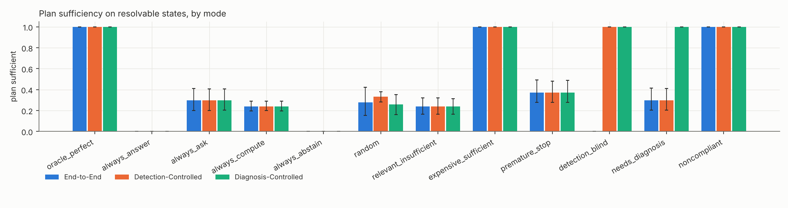
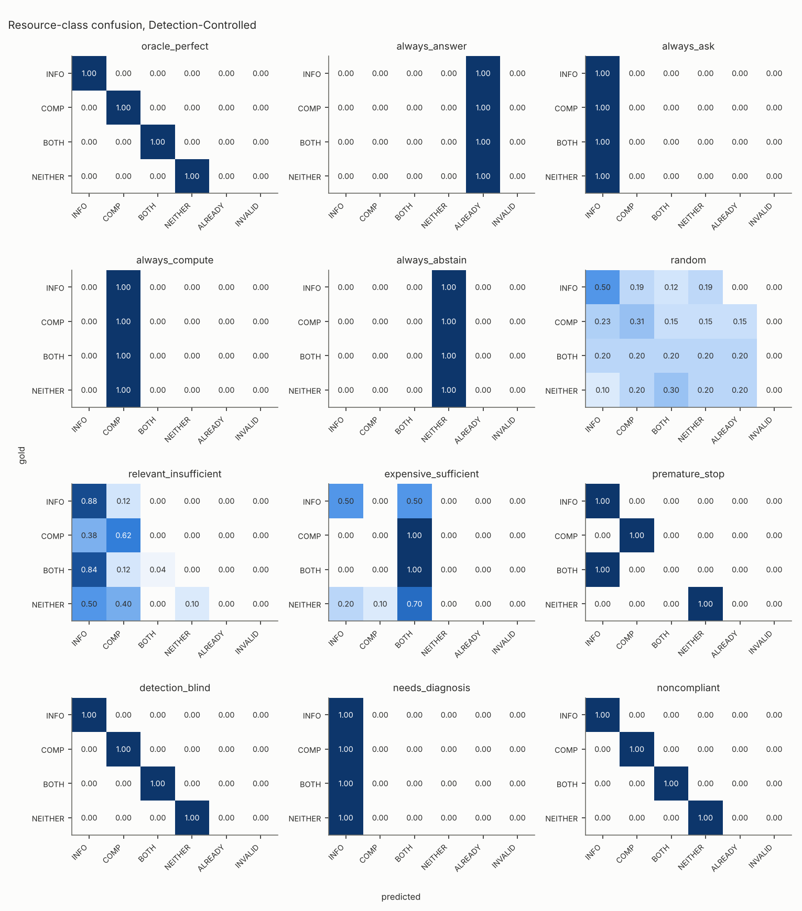
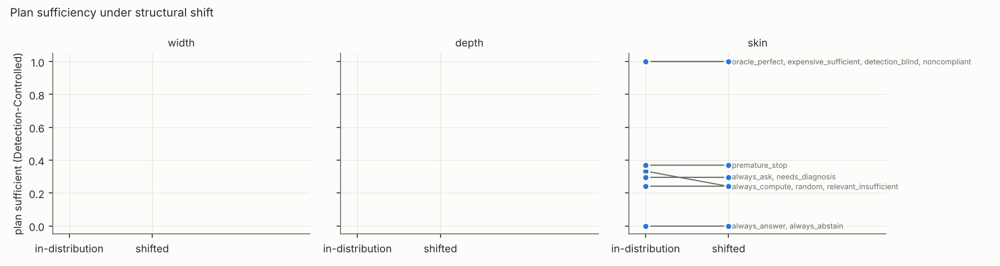

# SYNTHETIC offline run (mock agents)

> **SYNTHETIC.** These numbers come from deterministic mock agents used as test fixtures. They test the pipeline and say nothing about any language model.

Split(s): dev · families: 10 · generated from `summary.json` by `msep.eval.report`.

Every number names its mode. End-to-End mixes detection with planning and is never read as a planning failure. Intervals are 95% family-clustered bootstrap.

## Agents

- `oracle_perfect`: reads the oracle labels and answers them (upper bound; uses oracle)
- `always_answer`: always claims the state is sufficient and answers 'true' (visible-only)
- `always_ask`: always proposes every offered ASK action (visible-only)
- `always_compute`: always proposes every offered computation action (visible-only)
- `always_abstain`: always says NEITHER, no plan, defer (visible-only)
- `random`: seeded random class, plan subset and decision (visible-only)
- `relevant_insufficient`: proposes a relevant but insufficient plan where one exists (uses oracle roles)
- `expensive_sufficient`: proposes every action that reveals an unknown variable (visible-only)
- `premature_stop`: proposes only the first action of an optimal plan and stops (uses oracle)
- `detection_blind`: End-to-End: always claims sufficiency and answers; controlled modes: oracle (uses oracle)
- `needs_diagnosis`: Diagnosis-Controlled: oracle; otherwise behaves like always_ask (uses oracle)
- `noncompliant`: controlled modes: contradicts the given facts by claiming sufficiency, plan from oracle (uses oracle)

## Plan sufficiency by mode (resolvable states)

| Agent / model | End-to-End | Detection-Controlled | Diagnosis-Controlled |
|---|---|---|---|
| mock-oracle_perfect | 1.00 [1.00, 1.00] | 1.00 [1.00, 1.00] | 1.00 [1.00, 1.00] |
| mock-always_answer | 0.00 [0.00, 0.00] | 0.00 [0.00, 0.00] | 0.00 [0.00, 0.00] |
| mock-always_ask | 0.30 [0.20, 0.41] | 0.30 [0.20, 0.41] | 0.30 [0.20, 0.41] |
| mock-always_compute | 0.24 [0.20, 0.29] | 0.24 [0.20, 0.29] | 0.24 [0.20, 0.29] |
| mock-always_abstain | 0.00 [0.00, 0.00] | 0.00 [0.00, 0.00] | 0.00 [0.00, 0.00] |
| mock-random | 0.28 [0.15, 0.42] | 0.33 [0.28, 0.38] | 0.26 [0.16, 0.35] |
| mock-relevant_insufficient | 0.24 [0.16, 0.32] | 0.24 [0.16, 0.32] | 0.24 [0.16, 0.31] |
| mock-expensive_sufficient | 1.00 [1.00, 1.00] | 1.00 [1.00, 1.00] | 1.00 [1.00, 1.00] |
| mock-premature_stop | 0.37 [0.28, 0.49] | 0.37 [0.28, 0.48] | 0.37 [0.28, 0.49] |
| mock-detection_blind | 0.00 [0.00, 0.00] | 1.00 [1.00, 1.00] | 1.00 [1.00, 1.00] |
| mock-needs_diagnosis | 0.30 [0.20, 0.41] | 0.30 [0.20, 0.41] | 1.00 [1.00, 1.00] |
| mock-noncompliant | 1.00 [1.00, 1.00] | 1.00 [1.00, 1.00] | 1.00 [1.00, 1.00] |

## Diagnosis vs planning (H2), Detection-Controlled

| Agent / model | Class correct | Plan sufficient | Plan sufficient given class correct | McNemar p |
|---|---|---|---|---|
| mock-oracle_perfect | 1.00 [1.00, 1.00] | 1.00 [1.00, 1.00] | 1.00 [1.00, 1.00] | 1 |
| mock-always_answer | 0.00 [0.00, 0.00] | 0.00 [0.00, 0.00] | – | 1 |
| mock-always_ask | 0.30 [0.20, 0.41] | 0.30 [0.20, 0.41] | 1.00 [1.00, 1.00] | 1 |
| mock-always_compute | 0.24 [0.20, 0.29] | 0.24 [0.20, 0.29] | 1.00 [1.00, 1.00] | 1 |
| mock-always_abstain | 0.00 [0.00, 0.00] | 0.00 [0.00, 0.00] | – | 1 |
| mock-random | 0.31 [0.16, 0.48] | 0.33 [0.28, 0.38] | 0.35 [0.20, 0.58] | 1 |
| mock-relevant_insufficient | 0.43 [0.35, 0.52] | 0.24 [0.16, 0.32] | 0.57 [0.38, 0.76] | 0.00195 |
| mock-expensive_sufficient | 0.61 [0.50, 0.72] | 1.00 [1.00, 1.00] | 1.00 [1.00, 1.00] | 9.54e-07 |
| mock-premature_stop | 0.54 [0.44, 0.64] | 0.37 [0.28, 0.48] | 0.69 [0.52, 0.86] | 0.00391 |
| mock-detection_blind | 1.00 [1.00, 1.00] | 1.00 [1.00, 1.00] | 1.00 [1.00, 1.00] | 1 |
| mock-needs_diagnosis | 0.30 [0.20, 0.41] | 0.30 [0.20, 0.41] | 1.00 [1.00, 1.00] | 1 |
| mock-noncompliant | 1.00 [1.00, 1.00] | 1.00 [1.00, 1.00] | 1.00 [1.00, 1.00] | 1 |

## E3 Resource diagnosis

| Agent / model | Mode | Accuracy | Macro-F1 | Balanced acc. | Surface-feature baseline (all counts) |
|---|---|---|---|---|---|
| mock-oracle_perfect | Detection-Controlled | 1.00 [1.00, 1.00] | 1.00 [1.00, 1.00] | 1.00 [1.00, 1.00] | 0.41 |
| mock-oracle_perfect | End-to-End | 1.00 [1.00, 1.00] | 1.00 [1.00, 1.00] | 1.00 [1.00, 1.00] | 0.41 |
| mock-always_answer | Detection-Controlled | 0.00 [0.00, 0.00] | 0.00 [0.00, 0.00] | 0.00 [0.00, 0.00] | 0.41 |
| mock-always_answer | End-to-End | 0.00 [0.00, 0.00] | 0.00 [0.00, 0.00] | 0.00 [0.00, 0.00] | 0.41 |
| mock-always_ask | Detection-Controlled | 0.25 [0.17, 0.34] | 0.10 [0.07, 0.13] | 0.25 [0.25, 0.25] | 0.41 |
| mock-always_ask | End-to-End | 0.25 [0.17, 0.34] | 0.10 [0.07, 0.13] | 0.25 [0.25, 0.25] | 0.41 |
| mock-always_compute | Detection-Controlled | 0.20 [0.17, 0.25] | 0.08 [0.07, 0.10] | 0.25 [0.25, 0.25] | 0.41 |
| mock-always_compute | End-to-End | 0.20 [0.16, 0.25] | 0.08 [0.07, 0.10] | 0.25 [0.25, 0.25] | 0.41 |
| mock-always_abstain | Detection-Controlled | 0.16 [0.14, 0.17] | 0.07 [0.06, 0.07] | 0.25 [0.25, 0.25] | 0.41 |
| mock-always_abstain | End-to-End | 0.16 [0.14, 0.17] | 0.07 [0.06, 0.07] | 0.25 [0.25, 0.25] | 0.41 |
| mock-random | Detection-Controlled | 0.30 [0.15, 0.45] | 0.31 [0.16, 0.45] | 0.30 [0.16, 0.44] | 0.41 |
| mock-random | End-to-End | 0.23 [0.14, 0.33] | 0.26 [0.14, 0.37] | 0.23 [0.13, 0.33] | 0.41 |
| mock-relevant_insufficient | Detection-Controlled | 0.38 [0.31, 0.45] | 0.31 [0.22, 0.41] | 0.41 [0.32, 0.51] | 0.41 |
| mock-relevant_insufficient | End-to-End | 0.38 [0.30, 0.45] | 0.31 [0.23, 0.40] | 0.41 [0.32, 0.51] | 0.41 |
| mock-expensive_sufficient | Detection-Controlled | 0.52 [0.42, 0.61] | 0.31 [0.25, 0.38] | 0.38 [0.32, 0.45] | 0.41 |
| mock-expensive_sufficient | End-to-End | 0.52 [0.42, 0.60] | 0.31 [0.24, 0.38] | 0.38 [0.32, 0.45] | 0.41 |
| mock-premature_stop | Detection-Controlled | 0.61 [0.53, 0.70] | 0.64 [0.61, 0.67] | 0.75 [0.75, 0.75] | 0.41 |
| mock-premature_stop | End-to-End | 0.61 [0.53, 0.70] | 0.64 [0.61, 0.67] | 0.75 [0.75, 0.75] | 0.41 |
| mock-detection_blind | Detection-Controlled | 1.00 [1.00, 1.00] | 1.00 [1.00, 1.00] | 1.00 [1.00, 1.00] | 0.41 |
| mock-detection_blind | End-to-End | 0.00 [0.00, 0.00] | 0.00 [0.00, 0.00] | 0.00 [0.00, 0.00] | 0.41 |
| mock-needs_diagnosis | Detection-Controlled | 0.25 [0.17, 0.35] | 0.10 [0.07, 0.13] | 0.25 [0.25, 0.25] | 0.41 |
| mock-needs_diagnosis | End-to-End | 0.25 [0.17, 0.35] | 0.10 [0.07, 0.13] | 0.25 [0.25, 0.25] | 0.41 |
| mock-noncompliant | Detection-Controlled | 1.00 [1.00, 1.00] | 1.00 [1.00, 1.00] | 1.00 [1.00, 1.00] | 0.41 |
| mock-noncompliant | End-to-End | 1.00 [1.00, 1.00] | 1.00 [1.00, 1.00] | 1.00 [1.00, 1.00] | 0.41 |

## E7 BOTH vs single-resource (Detection-Controlled)

| Agent / model | INFORMATION_ONLY | COMPUTATION_ONLY | BOTH | BOTH plans using one resource |
|---|---|---|---|---|
| mock-oracle_perfect | 1.00 [1.00, 1.00] | 1.00 [1.00, 1.00] | 1.00 [1.00, 1.00] | 0.00 [0.00, 0.00] |
| mock-always_answer | 0.00 [0.00, 0.00] | 0.00 [0.00, 0.00] | 0.00 [0.00, 0.00] | 0.00 [0.00, 0.00] |
| mock-always_ask | 1.00 [1.00, 1.00] | 0.00 [0.00, 0.00] | 0.00 [0.00, 0.00] | 1.00 [1.00, 1.00] |
| mock-always_compute | 0.00 [0.00, 0.00] | 1.00 [1.00, 1.00] | 0.00 [0.00, 0.00] | 1.00 [1.00, 1.00] |
| mock-always_abstain | 0.00 [0.00, 0.00] | 0.00 [0.00, 0.00] | 0.00 [0.00, 0.00] | 0.00 [0.00, 0.00] |
| mock-random | 0.40 [0.10, 0.70] | 0.50 [0.20, 0.80] | 0.40 [0.10, 0.70] | 0.20 [0.00, 0.50] |
| mock-relevant_insufficient | 0.50 [0.20, 0.80] | 0.60 [0.30, 0.90] | 0.00 [0.00, 0.00] | 1.00 [1.00, 1.00] |
| mock-expensive_sufficient | 1.00 [1.00, 1.00] | 1.00 [1.00, 1.00] | 1.00 [1.00, 1.00] | 0.00 [0.00, 0.00] |
| mock-premature_stop | 0.60 [0.30, 0.90] | 0.80 [0.50, 1.00] | 0.00 [0.00, 0.00] | 1.00 [1.00, 1.00] |
| mock-detection_blind | 1.00 [1.00, 1.00] | 1.00 [1.00, 1.00] | 1.00 [1.00, 1.00] | 0.00 [0.00, 0.00] |
| mock-needs_diagnosis | 1.00 [1.00, 1.00] | 0.00 [0.00, 0.00] | 0.00 [0.00, 0.00] | 1.00 [1.00, 1.00] |
| mock-noncompliant | 1.00 [1.00, 1.00] | 1.00 [1.00, 1.00] | 1.00 [1.00, 1.00] | 0.00 [0.00, 0.00] |

## E5 Relevance vs sufficiency (judgments)

| Agent / model | Accuracy, sufficient plans | Accuracy, relevant-insufficient plans | Pairs both correct | McNemar p |
|---|---|---|---|---|
| mock-oracle_perfect | 1.00 [1.00, 1.00] | 1.00 [1.00, 1.00] | 1.00 [1.00, 1.00] | 1 |
| mock-always_answer | 1.00 [1.00, 1.00] | 0.00 [0.00, 0.00] | 0.00 [0.00, 0.00] | 3.55e-15 |
| mock-always_ask | 0.93 [0.83, 1.00] | 0.27 [0.13, 0.41] | 0.27 [0.13, 0.42] | 1.16e-10 |
| mock-always_compute | 0.81 [0.61, 0.97] | 0.53 [0.46, 0.61] | 0.43 [0.33, 0.51] | 0.00249 |
| mock-always_abstain | 0.00 [0.00, 0.00] | 1.00 [1.00, 1.00] | 0.00 [0.00, 0.00] | 3.55e-15 |
| mock-random | 0.48 [0.33, 0.67] | 0.41 [0.26, 0.59] | 0.18 [0.07, 0.31] | 1 |
| mock-relevant_insufficient | 1.00 [1.00, 1.00] | 0.00 [0.00, 0.00] | 0.00 [0.00, 0.00] | 3.55e-15 |
| mock-expensive_sufficient | 1.00 [1.00, 1.00] | 1.00 [1.00, 1.00] | 1.00 [1.00, 1.00] | 1 |
| mock-premature_stop | 1.00 [1.00, 1.00] | 0.00 [0.00, 0.00] | 0.00 [0.00, 0.00] | 3.55e-15 |
| mock-detection_blind | 1.00 [1.00, 1.00] | 1.00 [1.00, 1.00] | 1.00 [1.00, 1.00] | 1 |
| mock-needs_diagnosis | 1.00 [1.00, 1.00] | 1.00 [1.00, 1.00] | 1.00 [1.00, 1.00] | 1 |
| mock-noncompliant | 1.00 [1.00, 1.00] | 1.00 [1.00, 1.00] | 1.00 [1.00, 1.00] | 1 |

## E1, E2, E4, E6, E8, E9

| Agent / model | E1 base decision acc. | E2 detection acc. (E2E) | E2 over-answering | E4 exact match (DxC) | E6 optimal given sufficient (DC) | E8 correct defer (DC) | E9 premature stop (DC) | E9 continued after ex-post sufficiency (DC; compare with oracle) |
|---|---|---|---|---|---|---|---|---|
| mock-oracle_perfect | 1.00 [1.00, 1.00] | 1.00 [1.00, 1.00] | 0.00 [0.00, 0.00] | 1.00 [1.00, 1.00] | 1.00 [1.00, 1.00] | 1.00 [1.00, 1.00] | 0.00 [0.00, 0.00] | 0.20 [0.06, 0.37] |
| mock-always_answer | 0.60 [0.30, 0.90] | 0.14 [0.13, 0.14] | 1.00 [1.00, 1.00] | 0.00 [0.00, 0.00] | – | 0.00 [0.00, 0.00] | 1.00 [1.00, 1.00] | 0.00 [0.00, 0.00] |
| mock-always_ask | 0.60 [0.30, 0.90] | 0.86 [0.86, 0.87] | 0.00 [0.00, 0.00] | 0.00 [0.00, 0.00] | 0.00 [0.00, 0.00] | 0.00 [0.00, 0.00] | 0.52 [0.33, 0.67] | 0.44 [0.30, 0.62] |
| mock-always_compute | 0.60 [0.30, 0.90] | 0.86 [0.86, 0.87] | 0.00 [0.00, 0.00] | 0.02 [0.00, 0.06] | 0.08 [0.00, 0.25] | 0.00 [0.00, 0.00] | 0.69 [0.57, 0.78] | 0.30 [0.19, 0.42] |
| mock-always_abstain | 0.40 [0.10, 0.70] | 0.86 [0.86, 0.87] | 0.00 [0.00, 0.00] | 0.00 [0.00, 0.00] | – | 1.00 [1.00, 1.00] | 0.00 [0.00, 0.00] | 0.00 [0.00, 0.00] |
| mock-random | 0.50 [0.20, 0.80] | 0.76 [0.66, 0.85] | 0.75 [0.60, 0.88] | 0.04 [0.00, 0.09] | 0.06 [0.00, 0.18] | 0.00 [0.00, 0.00] | 0.52 [0.38, 0.65] | 0.28 [0.18, 0.38] |
| mock-relevant_insufficient | 0.60 [0.30, 0.90] | 0.86 [0.86, 0.87] | 0.00 [0.00, 0.00] | 0.24 [0.16, 0.31] | 1.00 [1.00, 1.00] | 0.10 [0.00, 0.30] | 0.56 [0.39, 0.70] | 0.00 [0.00, 0.00] |
| mock-expensive_sufficient | 0.60 [0.30, 0.90] | 0.86 [0.86, 0.87] | 0.00 [0.00, 0.00] | 0.02 [0.00, 0.06] | 0.02 [0.00, 0.06] | 0.00 [0.00, 0.00] | 0.00 [0.00, 0.00] | 0.83 [0.67, 0.98] |
| mock-premature_stop | 0.60 [0.30, 0.90] | 1.00 [1.00, 1.00] | 0.16 [0.14, 0.17] | 0.37 [0.28, 0.49] | 1.00 [1.00, 1.00] | 0.00 [0.00, 0.00] | 0.50 [0.38, 0.61] | 0.00 [0.00, 0.00] |
| mock-detection_blind | 1.00 [1.00, 1.00] | 0.14 [0.13, 0.14] | 1.00 [1.00, 1.00] | 1.00 [1.00, 1.00] | 1.00 [1.00, 1.00] | 1.00 [1.00, 1.00] | 0.00 [0.00, 0.00] | 0.20 [0.06, 0.37] |
| mock-needs_diagnosis | 1.00 [1.00, 1.00] | 0.86 [0.86, 0.87] | 0.00 [0.00, 0.00] | 1.00 [1.00, 1.00] | 0.00 [0.00, 0.00] | 0.00 [0.00, 0.00] | 0.52 [0.33, 0.68] | 0.44 [0.29, 0.62] |
| mock-noncompliant | 1.00 [1.00, 1.00] | 1.00 [1.00, 1.00] | 0.00 [0.00, 0.00] | 1.00 [1.00, 1.00] | 1.00 [1.00, 1.00] | 1.00 [1.00, 1.00] | 0.00 [0.00, 0.00] | 0.20 [0.06, 0.37] |

## E10 Cost sensitivity (Detection-Controlled)

Oracle expectation: the swept action is chosen when it is cheaper than its rival, not when dearer.

| Agent / model | Optimal rate | Chose swept action: below / equal / above | Sweeps optimal at every cost |
|---|---|---|---|
| mock-oracle_perfect | 1.00 [1.00, 1.00] | 1.00 / 0.94 / 0.00 | 1.00 |
| mock-always_answer | 0.00 [0.00, 0.00] | 0.00 / 0.00 / 0.00 | 0.00 |
| mock-always_ask | 0.00 [0.00, 0.00] | 0.62 / 0.61 / 0.59 | 0.00 |
| mock-always_compute | 0.00 [0.00, 0.00] | 0.38 / 0.39 / 0.41 | 0.00 |
| mock-always_abstain | 0.00 [0.00, 0.00] | 0.00 / 0.00 / 0.00 | 0.00 |
| mock-random | 0.02 [0.00, 0.04] | 0.15 / 0.67 / 0.38 | 0.00 |
| mock-relevant_insufficient | 0.25 [0.03, 0.49] | 0.46 / 0.44 / 0.00 | 0.20 |
| mock-expensive_sufficient | 0.00 [0.00, 0.00] | 1.00 / 1.00 / 1.00 | 0.00 |
| mock-premature_stop | 0.28 [0.06, 0.51] | 0.69 / 0.67 / 0.00 | 0.20 |
| mock-detection_blind | 1.00 [1.00, 1.00] | 1.00 / 0.94 / 0.00 | 1.00 |
| mock-needs_diagnosis | 0.00 [0.00, 0.00] | 0.62 / 0.61 / 0.59 | 0.00 |
| mock-noncompliant | 1.00 [1.00, 1.00] | 1.00 / 0.94 / 0.00 | 1.00 |

## E11 Risk sensitivity (End-to-End; posterior-threshold stress test, not core benchmark)

| Agent / model | tau | Oracle: answering justified | Agent answers | Detection correct |
|---|---|---|---|---|
| mock-oracle_perfect | 1 | 0.20 | 0.20 | 1.00 |
| mock-oracle_perfect | 19/20 | 0.20 | 0.20 | 1.00 |
| mock-oracle_perfect | 3/5 | 0.43 | 0.43 | 1.00 |
| mock-oracle_perfect | 4/5 | 0.28 | 0.28 | 1.00 |
| mock-always_answer | 1 | 0.20 | 1.00 | 0.20 |
| mock-always_answer | 19/20 | 0.20 | 1.00 | 0.20 |
| mock-always_answer | 3/5 | 0.43 | 1.00 | 0.43 |
| mock-always_answer | 4/5 | 0.28 | 1.00 | 0.28 |
| mock-always_ask | 1 | 0.20 | 0.00 | 0.80 |
| mock-always_ask | 19/20 | 0.20 | 0.00 | 0.80 |
| mock-always_ask | 3/5 | 0.43 | 0.00 | 0.57 |
| mock-always_ask | 4/5 | 0.28 | 0.00 | 0.72 |
| mock-always_compute | 1 | 0.20 | 0.00 | 0.80 |
| mock-always_compute | 19/20 | 0.20 | 0.00 | 0.80 |
| mock-always_compute | 3/5 | 0.43 | 0.00 | 0.57 |
| mock-always_compute | 4/5 | 0.28 | 0.00 | 0.72 |
| mock-always_abstain | 1 | 0.20 | 0.00 | 0.80 |
| mock-always_abstain | 19/20 | 0.20 | 0.00 | 0.80 |
| mock-always_abstain | 3/5 | 0.43 | 0.00 | 0.57 |
| mock-always_abstain | 4/5 | 0.28 | 0.00 | 0.72 |
| mock-random | 1 | 0.20 | 0.66 | 0.70 |
| mock-random | 19/20 | 0.20 | 0.68 | 0.68 |
| mock-random | 3/5 | 0.43 | 0.63 | 0.51 |
| mock-random | 4/5 | 0.28 | 0.62 | 0.60 |
| mock-relevant_insufficient | 1 | 0.20 | 0.00 | 0.80 |
| mock-relevant_insufficient | 19/20 | 0.20 | 0.00 | 0.80 |
| mock-relevant_insufficient | 3/5 | 0.43 | 0.00 | 0.57 |
| mock-relevant_insufficient | 4/5 | 0.28 | 0.00 | 0.72 |
| mock-expensive_sufficient | 1 | 0.20 | 0.00 | 0.80 |
| mock-expensive_sufficient | 19/20 | 0.20 | 0.00 | 0.80 |
| mock-expensive_sufficient | 3/5 | 0.43 | 0.00 | 0.57 |
| mock-expensive_sufficient | 4/5 | 0.28 | 0.00 | 0.72 |
| mock-premature_stop | 1 | 0.20 | 0.40 | 1.00 |
| mock-premature_stop | 19/20 | 0.20 | 0.40 | 1.00 |
| mock-premature_stop | 3/5 | 0.43 | 0.57 | 1.00 |
| mock-premature_stop | 4/5 | 0.28 | 0.44 | 1.00 |
| mock-detection_blind | 1 | 0.20 | 1.00 | 0.20 |
| mock-detection_blind | 19/20 | 0.20 | 1.00 | 0.20 |
| mock-detection_blind | 3/5 | 0.43 | 1.00 | 0.43 |
| mock-detection_blind | 4/5 | 0.28 | 1.00 | 0.28 |
| mock-needs_diagnosis | 1 | 0.20 | 0.00 | 0.80 |
| mock-needs_diagnosis | 19/20 | 0.20 | 0.00 | 0.80 |
| mock-needs_diagnosis | 3/5 | 0.43 | 0.00 | 0.57 |
| mock-needs_diagnosis | 4/5 | 0.28 | 0.00 | 0.72 |
| mock-noncompliant | 1 | 0.20 | 0.20 | 1.00 |
| mock-noncompliant | 19/20 | 0.20 | 0.20 | 1.00 |
| mock-noncompliant | 3/5 | 0.43 | 0.43 | 1.00 |
| mock-noncompliant | 4/5 | 0.28 | 0.28 | 1.00 |

## E12 Structural shift (Detection-Controlled, resolvable states)

| Agent / model | Axis | Pairs | In-distribution plan sufficient | Shifted | Paired drop [CI] | McNemar p |
|---|---|---|---|---|---|---|
| mock-oracle_perfect | width | 0 | – | – | – | 1 |
| mock-oracle_perfect | depth | 0 | – | – | – | 1 |
| mock-oracle_perfect | skin | 54 | 1.00 | 1.00 | 0.00 [0.00, 0.00] | 1 |
| mock-always_answer | width | 0 | – | – | – | 1 |
| mock-always_answer | depth | 0 | – | – | – | 1 |
| mock-always_answer | skin | 54 | 0.00 | 0.00 | 0.00 [0.00, 0.00] | 1 |
| mock-always_ask | width | 0 | – | – | – | 1 |
| mock-always_ask | depth | 0 | – | – | – | 1 |
| mock-always_ask | skin | 54 | 0.30 | 0.30 | 0.00 [0.00, 0.00] | 1 |
| mock-always_compute | width | 0 | – | – | – | 1 |
| mock-always_compute | depth | 0 | – | – | – | 1 |
| mock-always_compute | skin | 54 | 0.24 | 0.24 | 0.00 [0.00, 0.00] | 1 |
| mock-always_abstain | width | 0 | – | – | – | 1 |
| mock-always_abstain | depth | 0 | – | – | – | 1 |
| mock-always_abstain | skin | 54 | 0.00 | 0.00 | 0.00 [0.00, 0.00] | 1 |
| mock-random | width | 0 | – | – | – | 1 |
| mock-random | depth | 0 | – | – | – | 1 |
| mock-random | skin | 54 | 0.33 | 0.24 | 0.09 [-0.02, 0.21] | 0.383 |
| mock-relevant_insufficient | width | 0 | – | – | – | 1 |
| mock-relevant_insufficient | depth | 0 | – | – | – | 1 |
| mock-relevant_insufficient | skin | 54 | 0.24 | 0.24 | 0.00 [0.00, 0.00] | 1 |
| mock-expensive_sufficient | width | 0 | – | – | – | 1 |
| mock-expensive_sufficient | depth | 0 | – | – | – | 1 |
| mock-expensive_sufficient | skin | 54 | 1.00 | 1.00 | 0.00 [0.00, 0.00] | 1 |
| mock-premature_stop | width | 0 | – | – | – | 1 |
| mock-premature_stop | depth | 0 | – | – | – | 1 |
| mock-premature_stop | skin | 54 | 0.37 | 0.37 | 0.00 [0.00, 0.00] | 1 |
| mock-detection_blind | width | 0 | – | – | – | 1 |
| mock-detection_blind | depth | 0 | – | – | – | 1 |
| mock-detection_blind | skin | 54 | 1.00 | 1.00 | 0.00 [0.00, 0.00] | 1 |
| mock-needs_diagnosis | width | 0 | – | – | – | 1 |
| mock-needs_diagnosis | depth | 0 | – | – | – | 1 |
| mock-needs_diagnosis | skin | 54 | 0.30 | 0.30 | 0.00 [0.00, 0.00] | 1 |
| mock-noncompliant | width | 0 | – | – | – | 1 |
| mock-noncompliant | depth | 0 | – | – | – | 1 |
| mock-noncompliant | skin | 54 | 1.00 | 1.00 | 0.00 [0.00, 0.00] | 1 |

## Mode decomposition (same instances across modes; resolvable states)

An End-to-End failure that disappears in Detection-Controlled is attributed to detection/framing; a Detection-Controlled failure that disappears in Diagnosis-Controlled to diagnosis; only failures in all three modes are planning failures.

| Agent / model | e2e_success | e2e_fail_detection_wrong | e2e_fail_but_dc_success | dc_fail_but_dxc_success (diagnosis-attributable) | fail_in_all_modes (planning) |
|---|---|---|---|---|---|
| mock-oracle_perfect | 1.00 [1.00, 1.00] | 0.00 [0.00, 0.00] | 0.00 [0.00, 0.00] | 0.00 [0.00, 0.00] | 0.00 [0.00, 0.00] |
| mock-always_answer | 0.00 [0.00, 0.00] | 1.00 [1.00, 1.00] | 0.00 [0.00, 0.00] | 0.00 [0.00, 0.00] | 1.00 [1.00, 1.00] |
| mock-always_ask | 0.30 [0.20, 0.41] | 0.00 [0.00, 0.00] | 0.00 [0.00, 0.00] | 0.00 [0.00, 0.00] | 0.70 [0.59, 0.80] |
| mock-always_compute | 0.24 [0.20, 0.29] | 0.00 [0.00, 0.00] | 0.00 [0.00, 0.00] | 0.00 [0.00, 0.00] | 0.76 [0.71, 0.80] |
| mock-always_abstain | 0.00 [0.00, 0.00] | 0.00 [0.00, 0.00] | 0.00 [0.00, 0.00] | 0.00 [0.00, 0.00] | 1.00 [1.00, 1.00] |
| mock-random | 0.09 [0.02, 0.18] | 0.19 [0.09, 0.28] | 0.11 [0.05, 0.18] | 0.24 [0.14, 0.32] | 0.57 [0.48, 0.66] |
| mock-relevant_insufficient | 0.24 [0.16, 0.32] | 0.00 [0.00, 0.00] | 0.00 [0.00, 0.00] | 0.00 [0.00, 0.00] | 0.76 [0.68, 0.84] |
| mock-expensive_sufficient | 0.61 [0.50, 0.71] | 0.00 [0.00, 0.00] | 0.00 [0.00, 0.00] | 0.39 [0.29, 0.50] | 0.00 [0.00, 0.00] |
| mock-premature_stop | 0.37 [0.28, 0.49] | 0.00 [0.00, 0.00] | 0.00 [0.00, 0.00] | 0.00 [0.00, 0.00] | 0.63 [0.51, 0.72] |
| mock-detection_blind | 0.00 [0.00, 0.00] | 1.00 [1.00, 1.00] | 1.00 [1.00, 1.00] | 0.00 [0.00, 0.00] | 0.00 [0.00, 0.00] |
| mock-needs_diagnosis | 0.30 [0.20, 0.42] | 0.00 [0.00, 0.00] | 0.00 [0.00, 0.00] | 0.70 [0.58, 0.80] | 0.00 [0.00, 0.00] |
| mock-noncompliant | 1.00 [1.00, 1.00] | 0.00 [0.00, 0.00] | 0.00 [0.00, 0.00] | 0.00 [0.00, 0.00] | 0.00 [0.00, 0.00] |

## Instruction compliance and hierarchical metrics

| Agent / model | DC: claims sufficient (contradicts prompt) | DxC: class differs from given | A_D | A_G | A_P (DC) | A_P' (DxC) | A_S | A_E2E |
|---|---|---|---|---|---|---|---|---|
| mock-oracle_perfect | 0.00 [0.00, 0.00] | 0.00 [0.00, 0.00] | 1.00 [1.00, 1.00] | 1.00 [1.00, 1.00] | 1.00 [1.00, 1.00] | 1.00 [1.00, 1.00] | 1.00 [1.00, 1.00] | 1.00 [1.00, 1.00] |
| mock-always_answer | 1.00 [1.00, 1.00] | 1.00 [1.00, 1.00] | 0.14 [0.13, 0.14] | 0.00 [0.00, 0.00] | – | 0.00 [0.00, 0.00] | 0.00 [0.00, 0.00] | 0.08 [0.04, 0.12] |
| mock-always_ask | 0.00 [0.00, 0.00] | 0.70 [0.59, 0.80] | 0.86 [0.86, 0.87] | 0.25 [0.17, 0.34] | 0.00 [0.00, 0.00] | 0.00 [0.00, 0.00] | 0.27 [0.13, 0.42] | 0.00 [0.00, 0.00] |
| mock-always_compute | 0.00 [0.00, 0.00] | 0.76 [0.71, 0.80] | 0.86 [0.86, 0.87] | 0.20 [0.17, 0.25] | 0.08 [0.00, 0.25] | 0.02 [0.00, 0.06] | 0.43 [0.33, 0.51] | 0.01 [0.00, 0.04] |
| mock-always_abstain | 0.00 [0.00, 0.00] | 1.00 [1.00, 1.00] | 0.86 [0.86, 0.87] | 0.16 [0.14, 0.17] | – | 0.00 [0.00, 0.00] | 0.00 [0.00, 0.00] | 0.14 [0.13, 0.14] |
| mock-random | 0.14 [0.06, 0.25] | 0.81 [0.70, 0.92] | 0.76 [0.66, 0.85] | 0.30 [0.15, 0.45] | 0.06 [0.00, 0.18] | 0.04 [0.00, 0.09] | 0.18 [0.07, 0.31] | 0.00 [0.00, 0.00] |
| mock-relevant_insufficient | 0.00 [0.00, 0.00] | 0.57 [0.48, 0.66] | 0.86 [0.86, 0.87] | 0.38 [0.31, 0.45] | 0.57 [0.38, 0.76] | 0.24 [0.16, 0.31] | 0.00 [0.00, 0.00] | 0.19 [0.12, 0.26] |
| mock-expensive_sufficient | 0.00 [0.00, 0.00] | 0.39 [0.29, 0.50] | 0.86 [0.86, 0.87] | 0.52 [0.42, 0.61] | 0.03 [0.00, 0.09] | 0.02 [0.00, 0.06] | 1.00 [1.00, 1.00] | 0.01 [0.00, 0.04] |
| mock-premature_stop | 0.00 [0.00, 0.00] | 0.46 [0.36, 0.56] | 1.00 [1.00, 1.00] | 0.61 [0.53, 0.70] | 0.69 [0.52, 0.86] | 0.37 [0.28, 0.49] | 0.00 [0.00, 0.00] | 0.41 [0.34, 0.49] |
| mock-detection_blind | 0.00 [0.00, 0.00] | 0.00 [0.00, 0.00] | 0.14 [0.13, 0.14] | 1.00 [1.00, 1.00] | 1.00 [1.00, 1.00] | 1.00 [1.00, 1.00] | 1.00 [1.00, 1.00] | 0.08 [0.04, 0.13] |
| mock-needs_diagnosis | 0.00 [0.00, 0.00] | 0.00 [0.00, 0.00] | 0.86 [0.86, 0.87] | 0.25 [0.17, 0.35] | 0.00 [0.00, 0.00] | 1.00 [1.00, 1.00] | 1.00 [1.00, 1.00] | 0.00 [0.00, 0.00] |
| mock-noncompliant | 1.00 [1.00, 1.00] | 0.00 [0.00, 0.00] | 1.00 [1.00, 1.00] | 1.00 [1.00, 1.00] | 1.00 [1.00, 1.00] | 1.00 [1.00, 1.00] | 1.00 [1.00, 1.00] | 1.00 [1.00, 1.00] |

## Strata: shallow-heuristic difficulty and template

`heuristic_hard` = instances where the text-only h1pp baseline fails. A model's advantage over shallow reading shows only there.

| Agent / model | Stratum | Instances | DC class correct | DC plan sufficient | DC plan optimal |
|---|---|---|---|---|---|
| mock-oracle_perfect | heuristic_easy | 45 | 1.00 [1.00, 1.00] | 1.00 [1.00, 1.00] | 1.00 [1.00, 1.00] |
| mock-oracle_perfect | heuristic_hard | 29 | 1.00 [1.00, 1.00] | 1.00 [1.00, 1.00] | 1.00 [1.00, 1.00] |
| mock-oracle_perfect | v3 | 74 | 1.00 [1.00, 1.00] | 1.00 [1.00, 1.00] | 1.00 [1.00, 1.00] |
| mock-always_answer | heuristic_easy | 45 | 0.00 [0.00, 0.00] | 0.00 [0.00, 0.00] | 0.00 [0.00, 0.00] |
| mock-always_answer | heuristic_hard | 29 | 0.00 [0.00, 0.00] | 0.00 [0.00, 0.00] | 0.00 [0.00, 0.00] |
| mock-always_answer | v3 | 74 | 0.00 [0.00, 0.00] | 0.00 [0.00, 0.00] | 0.00 [0.00, 0.00] |
| mock-always_ask | heuristic_easy | 45 | 0.19 [0.12, 0.27] | 0.25 [0.16, 0.38] | 0.00 [0.00, 0.00] |
| mock-always_ask | heuristic_hard | 29 | 0.36 [0.18, 0.54] | 0.36 [0.18, 0.54] | 0.00 [0.00, 0.00] |
| mock-always_ask | v3 | 74 | 0.25 [0.17, 0.34] | 0.30 [0.20, 0.41] | 0.00 [0.00, 0.00] |
| mock-always_compute | heuristic_easy | 45 | 0.17 [0.10, 0.23] | 0.22 [0.14, 0.32] | 0.03 [0.00, 0.10] |
| mock-always_compute | heuristic_hard | 29 | 0.27 [0.09, 0.48] | 0.27 [0.09, 0.48] | 0.00 [0.00, 0.00] |
| mock-always_compute | v3 | 74 | 0.20 [0.17, 0.25] | 0.24 [0.20, 0.29] | 0.02 [0.00, 0.06] |
| mock-always_abstain | heuristic_easy | 45 | 0.24 [0.19, 0.31] | 0.00 [0.00, 0.00] | 0.00 [0.00, 0.00] |
| mock-always_abstain | heuristic_hard | 29 | 0.00 [0.00, 0.00] | 0.00 [0.00, 0.00] | 0.00 [0.00, 0.00] |
| mock-always_abstain | v3 | 74 | 0.16 [0.14, 0.17] | 0.00 [0.00, 0.00] | 0.00 [0.00, 0.00] |
| mock-random | heuristic_easy | 45 | 0.21 [0.09, 0.36] | 0.34 [0.26, 0.43] | 0.03 [0.00, 0.10] |
| mock-random | heuristic_hard | 29 | 0.45 [0.17, 0.69] | 0.32 [0.18, 0.47] | 0.00 [0.00, 0.00] |
| mock-random | v3 | 74 | 0.30 [0.15, 0.45] | 0.33 [0.28, 0.38] | 0.02 [0.00, 0.06] |
| mock-relevant_insufficient | heuristic_easy | 45 | 0.33 [0.21, 0.44] | 0.25 [0.14, 0.39] | 0.25 [0.14, 0.39] |
| mock-relevant_insufficient | heuristic_hard | 29 | 0.45 [0.21, 0.75] | 0.23 [0.07, 0.44] | 0.23 [0.07, 0.44] |
| mock-relevant_insufficient | v3 | 74 | 0.38 [0.31, 0.45] | 0.24 [0.16, 0.32] | 0.24 [0.16, 0.32] |
| mock-expensive_sufficient | heuristic_easy | 45 | 0.52 [0.34, 0.64] | 1.00 [1.00, 1.00] | 0.03 [0.00, 0.08] |
| mock-expensive_sufficient | heuristic_hard | 29 | 0.50 [0.29, 0.74] | 1.00 [1.00, 1.00] | 0.00 [0.00, 0.00] |
| mock-expensive_sufficient | v3 | 74 | 0.52 [0.42, 0.61] | 1.00 [1.00, 1.00] | 0.02 [0.00, 0.06] |
| mock-premature_stop | heuristic_easy | 45 | 0.60 [0.50, 0.75] | 0.28 [0.15, 0.48] | 0.28 [0.15, 0.48] |
| mock-premature_stop | heuristic_hard | 29 | 0.64 [0.44, 0.82] | 0.50 [0.35, 0.69] | 0.50 [0.35, 0.69] |
| mock-premature_stop | v3 | 74 | 0.61 [0.53, 0.70] | 0.37 [0.28, 0.48] | 0.37 [0.28, 0.48] |
| mock-detection_blind | heuristic_easy | 45 | 1.00 [1.00, 1.00] | 1.00 [1.00, 1.00] | 1.00 [1.00, 1.00] |
| mock-detection_blind | heuristic_hard | 29 | 1.00 [1.00, 1.00] | 1.00 [1.00, 1.00] | 1.00 [1.00, 1.00] |
| mock-detection_blind | v3 | 74 | 1.00 [1.00, 1.00] | 1.00 [1.00, 1.00] | 1.00 [1.00, 1.00] |
| mock-needs_diagnosis | heuristic_easy | 45 | 0.19 [0.12, 0.27] | 0.25 [0.16, 0.38] | 0.00 [0.00, 0.00] |
| mock-needs_diagnosis | heuristic_hard | 29 | 0.36 [0.19, 0.56] | 0.36 [0.19, 0.56] | 0.00 [0.00, 0.00] |
| mock-needs_diagnosis | v3 | 74 | 0.25 [0.17, 0.35] | 0.30 [0.20, 0.41] | 0.00 [0.00, 0.00] |
| mock-noncompliant | heuristic_easy | 45 | 1.00 [1.00, 1.00] | 1.00 [1.00, 1.00] | 1.00 [1.00, 1.00] |
| mock-noncompliant | heuristic_hard | 29 | 1.00 [1.00, 1.00] | 1.00 [1.00, 1.00] | 1.00 [1.00, 1.00] |
| mock-noncompliant | v3 | 74 | 1.00 [1.00, 1.00] | 1.00 [1.00, 1.00] | 1.00 [1.00, 1.00] |

## Calibration (stated confidence vs plan sufficiency)

| Agent / model | Mode | n | Brier | ECE |
|---|---|---|---|---|
| mock-oracle_perfect | End-to-End | 74 | 0.25 | 0.36 |
| mock-oracle_perfect | Detection-Controlled | 64 | 0.25 | 0.34 |
| mock-oracle_perfect | Diagnosis-Controlled | 54 | 0.25 | 0.50 |
| mock-always_answer | End-to-End | 74 | 0.25 | 0.36 |
| mock-always_answer | Detection-Controlled | 64 | 0.25 | 0.50 |
| mock-always_answer | Diagnosis-Controlled | 54 | 0.25 | 0.50 |
| mock-always_ask | End-to-End | 74 | 0.25 | 0.28 |
| mock-always_ask | Detection-Controlled | 64 | 0.25 | 0.25 |
| mock-always_ask | Diagnosis-Controlled | 54 | 0.25 | 0.20 |
| mock-always_compute | End-to-End | 74 | 0.25 | 0.32 |
| mock-always_compute | Detection-Controlled | 64 | 0.25 | 0.30 |
| mock-always_compute | Diagnosis-Controlled | 54 | 0.25 | 0.26 |
| mock-always_abstain | End-to-End | 74 | 0.25 | 0.50 |
| mock-always_abstain | Detection-Controlled | 64 | 0.25 | 0.50 |
| mock-always_abstain | Diagnosis-Controlled | 54 | 0.25 | 0.50 |
| mock-random | End-to-End | 74 | 0.25 | 0.24 |
| mock-random | Detection-Controlled | 64 | 0.25 | 0.22 |
| mock-random | Diagnosis-Controlled | 54 | 0.25 | 0.24 |
| mock-relevant_insufficient | End-to-End | 74 | 0.25 | 0.32 |
| mock-relevant_insufficient | Detection-Controlled | 64 | 0.25 | 0.30 |
| mock-relevant_insufficient | Diagnosis-Controlled | 54 | 0.25 | 0.26 |
| mock-expensive_sufficient | End-to-End | 74 | 0.25 | 0.23 |
| mock-expensive_sufficient | Detection-Controlled | 64 | 0.25 | 0.34 |
| mock-expensive_sufficient | Diagnosis-Controlled | 54 | 0.25 | 0.50 |
| mock-premature_stop | End-to-End | 74 | 0.25 | 0.09 |
| mock-premature_stop | Detection-Controlled | 64 | 0.25 | 0.19 |
| mock-premature_stop | Diagnosis-Controlled | 54 | 0.25 | 0.13 |
| mock-detection_blind | End-to-End | 74 | 0.25 | 0.36 |
| mock-detection_blind | Detection-Controlled | 64 | 0.25 | 0.34 |
| mock-detection_blind | Diagnosis-Controlled | 54 | 0.25 | 0.50 |
| mock-needs_diagnosis | End-to-End | 74 | 0.25 | 0.28 |
| mock-needs_diagnosis | Detection-Controlled | 64 | 0.25 | 0.25 |
| mock-needs_diagnosis | Diagnosis-Controlled | 54 | 0.25 | 0.50 |
| mock-noncompliant | End-to-End | 74 | 0.25 | 0.36 |
| mock-noncompliant | Detection-Controlled | 64 | 0.25 | 0.34 |
| mock-noncompliant | Diagnosis-Controlled | 54 | 0.25 | 0.50 |

## Breakdown: stratum x mode x resource class (plan optimal on resolvable states)

Full v3 is primary; heuristic_hard is a pre-registered stress test (it contains no NEITHER items, so compare within class).

| Agent / model | Stratum | Mode | Class | n | Class correct | Plan sufficient | Plan optimal |
|---|---|---|---|---|---|---|---|
| mock-oracle_perfect | all | End-to-End | ALL | 74 | 1.00 [1.00, 1.00] | 1.00 [1.00, 1.00] | 1.00 [1.00, 1.00] |
| mock-oracle_perfect | all | End-to-End | ALREADY_SUFFICIENT | 10 | 1.00 [1.00, 1.00] | – | – |
| mock-oracle_perfect | all | End-to-End | INFORMATION_ONLY | 16 | 1.00 [1.00, 1.00] | 1.00 [1.00, 1.00] | 1.00 [1.00, 1.00] |
| mock-oracle_perfect | all | End-to-End | COMPUTATION_ONLY | 13 | 1.00 [1.00, 1.00] | 1.00 [1.00, 1.00] | 1.00 [1.00, 1.00] |
| mock-oracle_perfect | all | End-to-End | BOTH | 25 | 1.00 [1.00, 1.00] | 1.00 [1.00, 1.00] | 1.00 [1.00, 1.00] |
| mock-oracle_perfect | all | End-to-End | NEITHER | 10 | 1.00 [1.00, 1.00] | – | – |
| mock-oracle_perfect | all | Detection-Controlled | ALL | 64 | 1.00 [1.00, 1.00] | 1.00 [1.00, 1.00] | 1.00 [1.00, 1.00] |
| mock-oracle_perfect | all | Detection-Controlled | INFORMATION_ONLY | 16 | 1.00 [1.00, 1.00] | 1.00 [1.00, 1.00] | 1.00 [1.00, 1.00] |
| mock-oracle_perfect | all | Detection-Controlled | COMPUTATION_ONLY | 13 | 1.00 [1.00, 1.00] | 1.00 [1.00, 1.00] | 1.00 [1.00, 1.00] |
| mock-oracle_perfect | all | Detection-Controlled | BOTH | 25 | 1.00 [1.00, 1.00] | 1.00 [1.00, 1.00] | 1.00 [1.00, 1.00] |
| mock-oracle_perfect | all | Detection-Controlled | NEITHER | 10 | 1.00 [1.00, 1.00] | – | – |
| mock-oracle_perfect | all | Diagnosis-Controlled | ALL | 54 | 1.00 [1.00, 1.00] | 1.00 [1.00, 1.00] | 1.00 [1.00, 1.00] |
| mock-oracle_perfect | all | Diagnosis-Controlled | INFORMATION_ONLY | 16 | 1.00 [1.00, 1.00] | 1.00 [1.00, 1.00] | 1.00 [1.00, 1.00] |
| mock-oracle_perfect | all | Diagnosis-Controlled | COMPUTATION_ONLY | 13 | 1.00 [1.00, 1.00] | 1.00 [1.00, 1.00] | 1.00 [1.00, 1.00] |
| mock-oracle_perfect | all | Diagnosis-Controlled | BOTH | 25 | 1.00 [1.00, 1.00] | 1.00 [1.00, 1.00] | 1.00 [1.00, 1.00] |
| mock-oracle_perfect | heuristic_hard | End-to-End | ALL | 29 | 1.00 [1.00, 1.00] | 1.00 [1.00, 1.00] | 1.00 [1.00, 1.00] |
| mock-oracle_perfect | heuristic_hard | End-to-End | ALREADY_SUFFICIENT | 7 | 1.00 [1.00, 1.00] | – | – |
| mock-oracle_perfect | heuristic_hard | End-to-End | INFORMATION_ONLY | 8 | 1.00 [1.00, 1.00] | 1.00 [1.00, 1.00] | 1.00 [1.00, 1.00] |
| mock-oracle_perfect | heuristic_hard | End-to-End | COMPUTATION_ONLY | 6 | 1.00 [1.00, 1.00] | 1.00 [1.00, 1.00] | 1.00 [1.00, 1.00] |
| mock-oracle_perfect | heuristic_hard | End-to-End | BOTH | 8 | 1.00 [1.00, 1.00] | 1.00 [1.00, 1.00] | 1.00 [1.00, 1.00] |
| mock-oracle_perfect | heuristic_hard | Detection-Controlled | ALL | 22 | 1.00 [1.00, 1.00] | 1.00 [1.00, 1.00] | 1.00 [1.00, 1.00] |
| mock-oracle_perfect | heuristic_hard | Detection-Controlled | INFORMATION_ONLY | 8 | 1.00 [1.00, 1.00] | 1.00 [1.00, 1.00] | 1.00 [1.00, 1.00] |
| mock-oracle_perfect | heuristic_hard | Detection-Controlled | COMPUTATION_ONLY | 6 | 1.00 [1.00, 1.00] | 1.00 [1.00, 1.00] | 1.00 [1.00, 1.00] |
| mock-oracle_perfect | heuristic_hard | Detection-Controlled | BOTH | 8 | 1.00 [1.00, 1.00] | 1.00 [1.00, 1.00] | 1.00 [1.00, 1.00] |
| mock-oracle_perfect | heuristic_hard | Diagnosis-Controlled | ALL | 22 | 1.00 [1.00, 1.00] | 1.00 [1.00, 1.00] | 1.00 [1.00, 1.00] |
| mock-oracle_perfect | heuristic_hard | Diagnosis-Controlled | INFORMATION_ONLY | 8 | 1.00 [1.00, 1.00] | 1.00 [1.00, 1.00] | 1.00 [1.00, 1.00] |
| mock-oracle_perfect | heuristic_hard | Diagnosis-Controlled | COMPUTATION_ONLY | 6 | 1.00 [1.00, 1.00] | 1.00 [1.00, 1.00] | 1.00 [1.00, 1.00] |
| mock-oracle_perfect | heuristic_hard | Diagnosis-Controlled | BOTH | 8 | 1.00 [1.00, 1.00] | 1.00 [1.00, 1.00] | 1.00 [1.00, 1.00] |
| mock-oracle_perfect | heuristic_easy | End-to-End | ALL | 45 | 1.00 [1.00, 1.00] | 1.00 [1.00, 1.00] | 1.00 [1.00, 1.00] |
| mock-oracle_perfect | heuristic_easy | End-to-End | ALREADY_SUFFICIENT | 3 | 1.00 [1.00, 1.00] | – | – |
| mock-oracle_perfect | heuristic_easy | End-to-End | INFORMATION_ONLY | 8 | 1.00 [1.00, 1.00] | 1.00 [1.00, 1.00] | 1.00 [1.00, 1.00] |
| mock-oracle_perfect | heuristic_easy | End-to-End | COMPUTATION_ONLY | 7 | 1.00 [1.00, 1.00] | 1.00 [1.00, 1.00] | 1.00 [1.00, 1.00] |
| mock-oracle_perfect | heuristic_easy | End-to-End | BOTH | 17 | 1.00 [1.00, 1.00] | 1.00 [1.00, 1.00] | 1.00 [1.00, 1.00] |
| mock-oracle_perfect | heuristic_easy | End-to-End | NEITHER | 10 | 1.00 [1.00, 1.00] | – | – |
| mock-oracle_perfect | heuristic_easy | Detection-Controlled | ALL | 42 | 1.00 [1.00, 1.00] | 1.00 [1.00, 1.00] | 1.00 [1.00, 1.00] |
| mock-oracle_perfect | heuristic_easy | Detection-Controlled | INFORMATION_ONLY | 8 | 1.00 [1.00, 1.00] | 1.00 [1.00, 1.00] | 1.00 [1.00, 1.00] |
| mock-oracle_perfect | heuristic_easy | Detection-Controlled | COMPUTATION_ONLY | 7 | 1.00 [1.00, 1.00] | 1.00 [1.00, 1.00] | 1.00 [1.00, 1.00] |
| mock-oracle_perfect | heuristic_easy | Detection-Controlled | BOTH | 17 | 1.00 [1.00, 1.00] | 1.00 [1.00, 1.00] | 1.00 [1.00, 1.00] |
| mock-oracle_perfect | heuristic_easy | Detection-Controlled | NEITHER | 10 | 1.00 [1.00, 1.00] | – | – |
| mock-oracle_perfect | heuristic_easy | Diagnosis-Controlled | ALL | 32 | 1.00 [1.00, 1.00] | 1.00 [1.00, 1.00] | 1.00 [1.00, 1.00] |
| mock-oracle_perfect | heuristic_easy | Diagnosis-Controlled | INFORMATION_ONLY | 8 | 1.00 [1.00, 1.00] | 1.00 [1.00, 1.00] | 1.00 [1.00, 1.00] |
| mock-oracle_perfect | heuristic_easy | Diagnosis-Controlled | COMPUTATION_ONLY | 7 | 1.00 [1.00, 1.00] | 1.00 [1.00, 1.00] | 1.00 [1.00, 1.00] |
| mock-oracle_perfect | heuristic_easy | Diagnosis-Controlled | BOTH | 17 | 1.00 [1.00, 1.00] | 1.00 [1.00, 1.00] | 1.00 [1.00, 1.00] |
| mock-always_answer | all | End-to-End | ALL | 74 | 0.14 [0.13, 0.14] | 0.00 [0.00, 0.00] | 0.00 [0.00, 0.00] |
| mock-always_answer | all | End-to-End | ALREADY_SUFFICIENT | 10 | 1.00 [1.00, 1.00] | – | – |
| mock-always_answer | all | End-to-End | INFORMATION_ONLY | 16 | 0.00 [0.00, 0.00] | 0.00 [0.00, 0.00] | 0.00 [0.00, 0.00] |
| mock-always_answer | all | End-to-End | COMPUTATION_ONLY | 13 | 0.00 [0.00, 0.00] | 0.00 [0.00, 0.00] | 0.00 [0.00, 0.00] |
| mock-always_answer | all | End-to-End | BOTH | 25 | 0.00 [0.00, 0.00] | 0.00 [0.00, 0.00] | 0.00 [0.00, 0.00] |
| mock-always_answer | all | End-to-End | NEITHER | 10 | 0.00 [0.00, 0.00] | – | – |
| mock-always_answer | all | Detection-Controlled | ALL | 64 | 0.00 [0.00, 0.00] | 0.00 [0.00, 0.00] | 0.00 [0.00, 0.00] |
| mock-always_answer | all | Detection-Controlled | INFORMATION_ONLY | 16 | 0.00 [0.00, 0.00] | 0.00 [0.00, 0.00] | 0.00 [0.00, 0.00] |
| mock-always_answer | all | Detection-Controlled | COMPUTATION_ONLY | 13 | 0.00 [0.00, 0.00] | 0.00 [0.00, 0.00] | 0.00 [0.00, 0.00] |
| mock-always_answer | all | Detection-Controlled | BOTH | 25 | 0.00 [0.00, 0.00] | 0.00 [0.00, 0.00] | 0.00 [0.00, 0.00] |
| mock-always_answer | all | Detection-Controlled | NEITHER | 10 | 0.00 [0.00, 0.00] | – | – |
| mock-always_answer | all | Diagnosis-Controlled | ALL | 54 | 0.00 [0.00, 0.00] | 0.00 [0.00, 0.00] | 0.00 [0.00, 0.00] |
| mock-always_answer | all | Diagnosis-Controlled | INFORMATION_ONLY | 16 | 0.00 [0.00, 0.00] | 0.00 [0.00, 0.00] | 0.00 [0.00, 0.00] |
| mock-always_answer | all | Diagnosis-Controlled | COMPUTATION_ONLY | 13 | 0.00 [0.00, 0.00] | 0.00 [0.00, 0.00] | 0.00 [0.00, 0.00] |
| mock-always_answer | all | Diagnosis-Controlled | BOTH | 25 | 0.00 [0.00, 0.00] | 0.00 [0.00, 0.00] | 0.00 [0.00, 0.00] |
| mock-always_answer | heuristic_hard | End-to-End | ALL | 29 | 0.24 [0.16, 0.35] | 0.00 [0.00, 0.00] | 0.00 [0.00, 0.00] |
| mock-always_answer | heuristic_hard | End-to-End | ALREADY_SUFFICIENT | 7 | 1.00 [1.00, 1.00] | – | – |
| mock-always_answer | heuristic_hard | End-to-End | INFORMATION_ONLY | 8 | 0.00 [0.00, 0.00] | 0.00 [0.00, 0.00] | 0.00 [0.00, 0.00] |
| mock-always_answer | heuristic_hard | End-to-End | COMPUTATION_ONLY | 6 | 0.00 [0.00, 0.00] | 0.00 [0.00, 0.00] | 0.00 [0.00, 0.00] |
| mock-always_answer | heuristic_hard | End-to-End | BOTH | 8 | 0.00 [0.00, 0.00] | 0.00 [0.00, 0.00] | 0.00 [0.00, 0.00] |
| mock-always_answer | heuristic_hard | Detection-Controlled | ALL | 22 | 0.00 [0.00, 0.00] | 0.00 [0.00, 0.00] | 0.00 [0.00, 0.00] |
| mock-always_answer | heuristic_hard | Detection-Controlled | INFORMATION_ONLY | 8 | 0.00 [0.00, 0.00] | 0.00 [0.00, 0.00] | 0.00 [0.00, 0.00] |
| mock-always_answer | heuristic_hard | Detection-Controlled | COMPUTATION_ONLY | 6 | 0.00 [0.00, 0.00] | 0.00 [0.00, 0.00] | 0.00 [0.00, 0.00] |
| mock-always_answer | heuristic_hard | Detection-Controlled | BOTH | 8 | 0.00 [0.00, 0.00] | 0.00 [0.00, 0.00] | 0.00 [0.00, 0.00] |
| mock-always_answer | heuristic_hard | Diagnosis-Controlled | ALL | 22 | 0.00 [0.00, 0.00] | 0.00 [0.00, 0.00] | 0.00 [0.00, 0.00] |
| mock-always_answer | heuristic_hard | Diagnosis-Controlled | INFORMATION_ONLY | 8 | 0.00 [0.00, 0.00] | 0.00 [0.00, 0.00] | 0.00 [0.00, 0.00] |
| mock-always_answer | heuristic_hard | Diagnosis-Controlled | COMPUTATION_ONLY | 6 | 0.00 [0.00, 0.00] | 0.00 [0.00, 0.00] | 0.00 [0.00, 0.00] |
| mock-always_answer | heuristic_hard | Diagnosis-Controlled | BOTH | 8 | 0.00 [0.00, 0.00] | 0.00 [0.00, 0.00] | 0.00 [0.00, 0.00] |
| mock-always_answer | heuristic_easy | End-to-End | ALL | 45 | 0.07 [0.00, 0.12] | 0.00 [0.00, 0.00] | 0.00 [0.00, 0.00] |
| mock-always_answer | heuristic_easy | End-to-End | ALREADY_SUFFICIENT | 3 | 1.00 [1.00, 1.00] | – | – |
| mock-always_answer | heuristic_easy | End-to-End | INFORMATION_ONLY | 8 | 0.00 [0.00, 0.00] | 0.00 [0.00, 0.00] | 0.00 [0.00, 0.00] |
| mock-always_answer | heuristic_easy | End-to-End | COMPUTATION_ONLY | 7 | 0.00 [0.00, 0.00] | 0.00 [0.00, 0.00] | 0.00 [0.00, 0.00] |
| mock-always_answer | heuristic_easy | End-to-End | BOTH | 17 | 0.00 [0.00, 0.00] | 0.00 [0.00, 0.00] | 0.00 [0.00, 0.00] |
| mock-always_answer | heuristic_easy | End-to-End | NEITHER | 10 | 0.00 [0.00, 0.00] | – | – |
| mock-always_answer | heuristic_easy | Detection-Controlled | ALL | 42 | 0.00 [0.00, 0.00] | 0.00 [0.00, 0.00] | 0.00 [0.00, 0.00] |
| mock-always_answer | heuristic_easy | Detection-Controlled | INFORMATION_ONLY | 8 | 0.00 [0.00, 0.00] | 0.00 [0.00, 0.00] | 0.00 [0.00, 0.00] |
| mock-always_answer | heuristic_easy | Detection-Controlled | COMPUTATION_ONLY | 7 | 0.00 [0.00, 0.00] | 0.00 [0.00, 0.00] | 0.00 [0.00, 0.00] |
| mock-always_answer | heuristic_easy | Detection-Controlled | BOTH | 17 | 0.00 [0.00, 0.00] | 0.00 [0.00, 0.00] | 0.00 [0.00, 0.00] |
| mock-always_answer | heuristic_easy | Detection-Controlled | NEITHER | 10 | 0.00 [0.00, 0.00] | – | – |
| mock-always_answer | heuristic_easy | Diagnosis-Controlled | ALL | 32 | 0.00 [0.00, 0.00] | 0.00 [0.00, 0.00] | 0.00 [0.00, 0.00] |
| mock-always_answer | heuristic_easy | Diagnosis-Controlled | INFORMATION_ONLY | 8 | 0.00 [0.00, 0.00] | 0.00 [0.00, 0.00] | 0.00 [0.00, 0.00] |
| mock-always_answer | heuristic_easy | Diagnosis-Controlled | COMPUTATION_ONLY | 7 | 0.00 [0.00, 0.00] | 0.00 [0.00, 0.00] | 0.00 [0.00, 0.00] |
| mock-always_answer | heuristic_easy | Diagnosis-Controlled | BOTH | 17 | 0.00 [0.00, 0.00] | 0.00 [0.00, 0.00] | 0.00 [0.00, 0.00] |
| mock-always_ask | all | End-to-End | ALL | 74 | 0.22 [0.15, 0.30] | 0.30 [0.20, 0.41] | 0.00 [0.00, 0.00] |
| mock-always_ask | all | End-to-End | ALREADY_SUFFICIENT | 10 | 0.00 [0.00, 0.00] | – | – |
| mock-always_ask | all | End-to-End | INFORMATION_ONLY | 16 | 1.00 [1.00, 1.00] | 1.00 [1.00, 1.00] | 0.00 [0.00, 0.00] |
| mock-always_ask | all | End-to-End | COMPUTATION_ONLY | 13 | 0.00 [0.00, 0.00] | 0.00 [0.00, 0.00] | 0.00 [0.00, 0.00] |
| mock-always_ask | all | End-to-End | BOTH | 25 | 0.00 [0.00, 0.00] | 0.00 [0.00, 0.00] | 0.00 [0.00, 0.00] |
| mock-always_ask | all | End-to-End | NEITHER | 10 | 0.00 [0.00, 0.00] | – | – |
| mock-always_ask | all | Detection-Controlled | ALL | 64 | 0.25 [0.17, 0.34] | 0.30 [0.20, 0.41] | 0.00 [0.00, 0.00] |
| mock-always_ask | all | Detection-Controlled | INFORMATION_ONLY | 16 | 1.00 [1.00, 1.00] | 1.00 [1.00, 1.00] | 0.00 [0.00, 0.00] |
| mock-always_ask | all | Detection-Controlled | COMPUTATION_ONLY | 13 | 0.00 [0.00, 0.00] | 0.00 [0.00, 0.00] | 0.00 [0.00, 0.00] |
| mock-always_ask | all | Detection-Controlled | BOTH | 25 | 0.00 [0.00, 0.00] | 0.00 [0.00, 0.00] | 0.00 [0.00, 0.00] |
| mock-always_ask | all | Detection-Controlled | NEITHER | 10 | 0.00 [0.00, 0.00] | – | – |
| mock-always_ask | all | Diagnosis-Controlled | ALL | 54 | 0.30 [0.20, 0.41] | 0.30 [0.20, 0.41] | 0.00 [0.00, 0.00] |
| mock-always_ask | all | Diagnosis-Controlled | INFORMATION_ONLY | 16 | 1.00 [1.00, 1.00] | 1.00 [1.00, 1.00] | 0.00 [0.00, 0.00] |
| mock-always_ask | all | Diagnosis-Controlled | COMPUTATION_ONLY | 13 | 0.00 [0.00, 0.00] | 0.00 [0.00, 0.00] | 0.00 [0.00, 0.00] |
| mock-always_ask | all | Diagnosis-Controlled | BOTH | 25 | 0.00 [0.00, 0.00] | 0.00 [0.00, 0.00] | 0.00 [0.00, 0.00] |
| mock-always_ask | heuristic_hard | End-to-End | ALL | 29 | 0.28 [0.12, 0.42] | 0.36 [0.18, 0.55] | 0.00 [0.00, 0.00] |
| mock-always_ask | heuristic_hard | End-to-End | ALREADY_SUFFICIENT | 7 | 0.00 [0.00, 0.00] | – | – |
| mock-always_ask | heuristic_hard | End-to-End | INFORMATION_ONLY | 8 | 1.00 [1.00, 1.00] | 1.00 [1.00, 1.00] | 0.00 [0.00, 0.00] |
| mock-always_ask | heuristic_hard | End-to-End | COMPUTATION_ONLY | 6 | 0.00 [0.00, 0.00] | 0.00 [0.00, 0.00] | 0.00 [0.00, 0.00] |
| mock-always_ask | heuristic_hard | End-to-End | BOTH | 8 | 0.00 [0.00, 0.00] | 0.00 [0.00, 0.00] | 0.00 [0.00, 0.00] |
| mock-always_ask | heuristic_hard | Detection-Controlled | ALL | 22 | 0.36 [0.18, 0.54] | 0.36 [0.18, 0.54] | 0.00 [0.00, 0.00] |
| mock-always_ask | heuristic_hard | Detection-Controlled | INFORMATION_ONLY | 8 | 1.00 [1.00, 1.00] | 1.00 [1.00, 1.00] | 0.00 [0.00, 0.00] |
| mock-always_ask | heuristic_hard | Detection-Controlled | COMPUTATION_ONLY | 6 | 0.00 [0.00, 0.00] | 0.00 [0.00, 0.00] | 0.00 [0.00, 0.00] |
| mock-always_ask | heuristic_hard | Detection-Controlled | BOTH | 8 | 0.00 [0.00, 0.00] | 0.00 [0.00, 0.00] | 0.00 [0.00, 0.00] |
| mock-always_ask | heuristic_hard | Diagnosis-Controlled | ALL | 22 | 0.36 [0.19, 0.56] | 0.36 [0.19, 0.56] | 0.00 [0.00, 0.00] |
| mock-always_ask | heuristic_hard | Diagnosis-Controlled | INFORMATION_ONLY | 8 | 1.00 [1.00, 1.00] | 1.00 [1.00, 1.00] | 0.00 [0.00, 0.00] |
| mock-always_ask | heuristic_hard | Diagnosis-Controlled | COMPUTATION_ONLY | 6 | 0.00 [0.00, 0.00] | 0.00 [0.00, 0.00] | 0.00 [0.00, 0.00] |
| mock-always_ask | heuristic_hard | Diagnosis-Controlled | BOTH | 8 | 0.00 [0.00, 0.00] | 0.00 [0.00, 0.00] | 0.00 [0.00, 0.00] |
| mock-always_ask | heuristic_easy | End-to-End | ALL | 45 | 0.18 [0.12, 0.26] | 0.25 [0.16, 0.39] | 0.00 [0.00, 0.00] |
| mock-always_ask | heuristic_easy | End-to-End | ALREADY_SUFFICIENT | 3 | 0.00 [0.00, 0.00] | – | – |
| mock-always_ask | heuristic_easy | End-to-End | INFORMATION_ONLY | 8 | 1.00 [1.00, 1.00] | 1.00 [1.00, 1.00] | 0.00 [0.00, 0.00] |
| mock-always_ask | heuristic_easy | End-to-End | COMPUTATION_ONLY | 7 | 0.00 [0.00, 0.00] | 0.00 [0.00, 0.00] | 0.00 [0.00, 0.00] |
| mock-always_ask | heuristic_easy | End-to-End | BOTH | 17 | 0.00 [0.00, 0.00] | 0.00 [0.00, 0.00] | 0.00 [0.00, 0.00] |
| mock-always_ask | heuristic_easy | End-to-End | NEITHER | 10 | 0.00 [0.00, 0.00] | – | – |
| mock-always_ask | heuristic_easy | Detection-Controlled | ALL | 42 | 0.19 [0.12, 0.27] | 0.25 [0.16, 0.38] | 0.00 [0.00, 0.00] |
| mock-always_ask | heuristic_easy | Detection-Controlled | INFORMATION_ONLY | 8 | 1.00 [1.00, 1.00] | 1.00 [1.00, 1.00] | 0.00 [0.00, 0.00] |
| mock-always_ask | heuristic_easy | Detection-Controlled | COMPUTATION_ONLY | 7 | 0.00 [0.00, 0.00] | 0.00 [0.00, 0.00] | 0.00 [0.00, 0.00] |
| mock-always_ask | heuristic_easy | Detection-Controlled | BOTH | 17 | 0.00 [0.00, 0.00] | 0.00 [0.00, 0.00] | 0.00 [0.00, 0.00] |
| mock-always_ask | heuristic_easy | Detection-Controlled | NEITHER | 10 | 0.00 [0.00, 0.00] | – | – |
| mock-always_ask | heuristic_easy | Diagnosis-Controlled | ALL | 32 | 0.25 [0.16, 0.38] | 0.25 [0.16, 0.38] | 0.00 [0.00, 0.00] |
| mock-always_ask | heuristic_easy | Diagnosis-Controlled | INFORMATION_ONLY | 8 | 1.00 [1.00, 1.00] | 1.00 [1.00, 1.00] | 0.00 [0.00, 0.00] |
| mock-always_ask | heuristic_easy | Diagnosis-Controlled | COMPUTATION_ONLY | 7 | 0.00 [0.00, 0.00] | 0.00 [0.00, 0.00] | 0.00 [0.00, 0.00] |
| mock-always_ask | heuristic_easy | Diagnosis-Controlled | BOTH | 17 | 0.00 [0.00, 0.00] | 0.00 [0.00, 0.00] | 0.00 [0.00, 0.00] |
| mock-always_compute | all | End-to-End | ALL | 74 | 0.18 [0.14, 0.21] | 0.24 [0.20, 0.29] | 0.02 [0.00, 0.06] |
| mock-always_compute | all | End-to-End | ALREADY_SUFFICIENT | 10 | 0.00 [0.00, 0.00] | – | – |
| mock-always_compute | all | End-to-End | INFORMATION_ONLY | 16 | 0.00 [0.00, 0.00] | 0.00 [0.00, 0.00] | 0.00 [0.00, 0.00] |
| mock-always_compute | all | End-to-End | COMPUTATION_ONLY | 13 | 1.00 [1.00, 1.00] | 1.00 [1.00, 1.00] | 0.08 [0.00, 0.27] |
| mock-always_compute | all | End-to-End | BOTH | 25 | 0.00 [0.00, 0.00] | 0.00 [0.00, 0.00] | 0.00 [0.00, 0.00] |
| mock-always_compute | all | End-to-End | NEITHER | 10 | 0.00 [0.00, 0.00] | – | – |
| mock-always_compute | all | Detection-Controlled | ALL | 64 | 0.20 [0.17, 0.25] | 0.24 [0.20, 0.29] | 0.02 [0.00, 0.06] |
| mock-always_compute | all | Detection-Controlled | INFORMATION_ONLY | 16 | 0.00 [0.00, 0.00] | 0.00 [0.00, 0.00] | 0.00 [0.00, 0.00] |
| mock-always_compute | all | Detection-Controlled | COMPUTATION_ONLY | 13 | 1.00 [1.00, 1.00] | 1.00 [1.00, 1.00] | 0.08 [0.00, 0.25] |
| mock-always_compute | all | Detection-Controlled | BOTH | 25 | 0.00 [0.00, 0.00] | 0.00 [0.00, 0.00] | 0.00 [0.00, 0.00] |
| mock-always_compute | all | Detection-Controlled | NEITHER | 10 | 0.00 [0.00, 0.00] | – | – |
| mock-always_compute | all | Diagnosis-Controlled | ALL | 54 | 0.24 [0.20, 0.29] | 0.24 [0.20, 0.29] | 0.02 [0.00, 0.06] |
| mock-always_compute | all | Diagnosis-Controlled | INFORMATION_ONLY | 16 | 0.00 [0.00, 0.00] | 0.00 [0.00, 0.00] | 0.00 [0.00, 0.00] |
| mock-always_compute | all | Diagnosis-Controlled | COMPUTATION_ONLY | 13 | 1.00 [1.00, 1.00] | 1.00 [1.00, 1.00] | 0.08 [0.00, 0.25] |
| mock-always_compute | all | Diagnosis-Controlled | BOTH | 25 | 0.00 [0.00, 0.00] | 0.00 [0.00, 0.00] | 0.00 [0.00, 0.00] |
| mock-always_compute | heuristic_hard | End-to-End | ALL | 29 | 0.21 [0.06, 0.35] | 0.27 [0.09, 0.48] | 0.00 [0.00, 0.00] |
| mock-always_compute | heuristic_hard | End-to-End | ALREADY_SUFFICIENT | 7 | 0.00 [0.00, 0.00] | – | – |
| mock-always_compute | heuristic_hard | End-to-End | INFORMATION_ONLY | 8 | 0.00 [0.00, 0.00] | 0.00 [0.00, 0.00] | 0.00 [0.00, 0.00] |
| mock-always_compute | heuristic_hard | End-to-End | COMPUTATION_ONLY | 6 | 1.00 [1.00, 1.00] | 1.00 [1.00, 1.00] | 0.00 [0.00, 0.00] |
| mock-always_compute | heuristic_hard | End-to-End | BOTH | 8 | 0.00 [0.00, 0.00] | 0.00 [0.00, 0.00] | 0.00 [0.00, 0.00] |
| mock-always_compute | heuristic_hard | Detection-Controlled | ALL | 22 | 0.27 [0.09, 0.48] | 0.27 [0.09, 0.48] | 0.00 [0.00, 0.00] |
| mock-always_compute | heuristic_hard | Detection-Controlled | INFORMATION_ONLY | 8 | 0.00 [0.00, 0.00] | 0.00 [0.00, 0.00] | 0.00 [0.00, 0.00] |
| mock-always_compute | heuristic_hard | Detection-Controlled | COMPUTATION_ONLY | 6 | 1.00 [1.00, 1.00] | 1.00 [1.00, 1.00] | 0.00 [0.00, 0.00] |
| mock-always_compute | heuristic_hard | Detection-Controlled | BOTH | 8 | 0.00 [0.00, 0.00] | 0.00 [0.00, 0.00] | 0.00 [0.00, 0.00] |
| mock-always_compute | heuristic_hard | Diagnosis-Controlled | ALL | 22 | 0.27 [0.08, 0.50] | 0.27 [0.08, 0.50] | 0.00 [0.00, 0.00] |
| mock-always_compute | heuristic_hard | Diagnosis-Controlled | INFORMATION_ONLY | 8 | 0.00 [0.00, 0.00] | 0.00 [0.00, 0.00] | 0.00 [0.00, 0.00] |
| mock-always_compute | heuristic_hard | Diagnosis-Controlled | COMPUTATION_ONLY | 6 | 1.00 [1.00, 1.00] | 1.00 [1.00, 1.00] | 0.00 [0.00, 0.00] |
| mock-always_compute | heuristic_hard | Diagnosis-Controlled | BOTH | 8 | 0.00 [0.00, 0.00] | 0.00 [0.00, 0.00] | 0.00 [0.00, 0.00] |
| mock-always_compute | heuristic_easy | End-to-End | ALL | 45 | 0.16 [0.10, 0.22] | 0.22 [0.14, 0.32] | 0.03 [0.00, 0.10] |
| mock-always_compute | heuristic_easy | End-to-End | ALREADY_SUFFICIENT | 3 | 0.00 [0.00, 0.00] | – | – |
| mock-always_compute | heuristic_easy | End-to-End | INFORMATION_ONLY | 8 | 0.00 [0.00, 0.00] | 0.00 [0.00, 0.00] | 0.00 [0.00, 0.00] |
| mock-always_compute | heuristic_easy | End-to-End | COMPUTATION_ONLY | 7 | 1.00 [1.00, 1.00] | 1.00 [1.00, 1.00] | 0.14 [0.00, 0.43] |
| mock-always_compute | heuristic_easy | End-to-End | BOTH | 17 | 0.00 [0.00, 0.00] | 0.00 [0.00, 0.00] | 0.00 [0.00, 0.00] |
| mock-always_compute | heuristic_easy | End-to-End | NEITHER | 10 | 0.00 [0.00, 0.00] | – | – |
| mock-always_compute | heuristic_easy | Detection-Controlled | ALL | 42 | 0.17 [0.10, 0.23] | 0.22 [0.14, 0.32] | 0.03 [0.00, 0.10] |
| mock-always_compute | heuristic_easy | Detection-Controlled | INFORMATION_ONLY | 8 | 0.00 [0.00, 0.00] | 0.00 [0.00, 0.00] | 0.00 [0.00, 0.00] |
| mock-always_compute | heuristic_easy | Detection-Controlled | COMPUTATION_ONLY | 7 | 1.00 [1.00, 1.00] | 1.00 [1.00, 1.00] | 0.14 [0.00, 0.43] |
| mock-always_compute | heuristic_easy | Detection-Controlled | BOTH | 17 | 0.00 [0.00, 0.00] | 0.00 [0.00, 0.00] | 0.00 [0.00, 0.00] |
| mock-always_compute | heuristic_easy | Detection-Controlled | NEITHER | 10 | 0.00 [0.00, 0.00] | – | – |
| mock-always_compute | heuristic_easy | Diagnosis-Controlled | ALL | 32 | 0.22 [0.13, 0.32] | 0.22 [0.13, 0.32] | 0.03 [0.00, 0.10] |
| mock-always_compute | heuristic_easy | Diagnosis-Controlled | INFORMATION_ONLY | 8 | 0.00 [0.00, 0.00] | 0.00 [0.00, 0.00] | 0.00 [0.00, 0.00] |
| mock-always_compute | heuristic_easy | Diagnosis-Controlled | COMPUTATION_ONLY | 7 | 1.00 [1.00, 1.00] | 1.00 [1.00, 1.00] | 0.14 [0.00, 0.43] |
| mock-always_compute | heuristic_easy | Diagnosis-Controlled | BOTH | 17 | 0.00 [0.00, 0.00] | 0.00 [0.00, 0.00] | 0.00 [0.00, 0.00] |
| mock-always_abstain | all | End-to-End | ALL | 74 | 0.14 [0.13, 0.14] | 0.00 [0.00, 0.00] | 0.00 [0.00, 0.00] |
| mock-always_abstain | all | End-to-End | ALREADY_SUFFICIENT | 10 | 0.00 [0.00, 0.00] | – | – |
| mock-always_abstain | all | End-to-End | INFORMATION_ONLY | 16 | 0.00 [0.00, 0.00] | 0.00 [0.00, 0.00] | 0.00 [0.00, 0.00] |
| mock-always_abstain | all | End-to-End | COMPUTATION_ONLY | 13 | 0.00 [0.00, 0.00] | 0.00 [0.00, 0.00] | 0.00 [0.00, 0.00] |
| mock-always_abstain | all | End-to-End | BOTH | 25 | 0.00 [0.00, 0.00] | 0.00 [0.00, 0.00] | 0.00 [0.00, 0.00] |
| mock-always_abstain | all | End-to-End | NEITHER | 10 | 1.00 [1.00, 1.00] | – | – |
| mock-always_abstain | all | Detection-Controlled | ALL | 64 | 0.16 [0.14, 0.17] | 0.00 [0.00, 0.00] | 0.00 [0.00, 0.00] |
| mock-always_abstain | all | Detection-Controlled | INFORMATION_ONLY | 16 | 0.00 [0.00, 0.00] | 0.00 [0.00, 0.00] | 0.00 [0.00, 0.00] |
| mock-always_abstain | all | Detection-Controlled | COMPUTATION_ONLY | 13 | 0.00 [0.00, 0.00] | 0.00 [0.00, 0.00] | 0.00 [0.00, 0.00] |
| mock-always_abstain | all | Detection-Controlled | BOTH | 25 | 0.00 [0.00, 0.00] | 0.00 [0.00, 0.00] | 0.00 [0.00, 0.00] |
| mock-always_abstain | all | Detection-Controlled | NEITHER | 10 | 1.00 [1.00, 1.00] | – | – |
| mock-always_abstain | all | Diagnosis-Controlled | ALL | 54 | 0.00 [0.00, 0.00] | 0.00 [0.00, 0.00] | 0.00 [0.00, 0.00] |
| mock-always_abstain | all | Diagnosis-Controlled | INFORMATION_ONLY | 16 | 0.00 [0.00, 0.00] | 0.00 [0.00, 0.00] | 0.00 [0.00, 0.00] |
| mock-always_abstain | all | Diagnosis-Controlled | COMPUTATION_ONLY | 13 | 0.00 [0.00, 0.00] | 0.00 [0.00, 0.00] | 0.00 [0.00, 0.00] |
| mock-always_abstain | all | Diagnosis-Controlled | BOTH | 25 | 0.00 [0.00, 0.00] | 0.00 [0.00, 0.00] | 0.00 [0.00, 0.00] |
| mock-always_abstain | heuristic_hard | End-to-End | ALL | 29 | 0.00 [0.00, 0.00] | 0.00 [0.00, 0.00] | 0.00 [0.00, 0.00] |
| mock-always_abstain | heuristic_hard | End-to-End | ALREADY_SUFFICIENT | 7 | 0.00 [0.00, 0.00] | – | – |
| mock-always_abstain | heuristic_hard | End-to-End | INFORMATION_ONLY | 8 | 0.00 [0.00, 0.00] | 0.00 [0.00, 0.00] | 0.00 [0.00, 0.00] |
| mock-always_abstain | heuristic_hard | End-to-End | COMPUTATION_ONLY | 6 | 0.00 [0.00, 0.00] | 0.00 [0.00, 0.00] | 0.00 [0.00, 0.00] |
| mock-always_abstain | heuristic_hard | End-to-End | BOTH | 8 | 0.00 [0.00, 0.00] | 0.00 [0.00, 0.00] | 0.00 [0.00, 0.00] |
| mock-always_abstain | heuristic_hard | Detection-Controlled | ALL | 22 | 0.00 [0.00, 0.00] | 0.00 [0.00, 0.00] | 0.00 [0.00, 0.00] |
| mock-always_abstain | heuristic_hard | Detection-Controlled | INFORMATION_ONLY | 8 | 0.00 [0.00, 0.00] | 0.00 [0.00, 0.00] | 0.00 [0.00, 0.00] |
| mock-always_abstain | heuristic_hard | Detection-Controlled | COMPUTATION_ONLY | 6 | 0.00 [0.00, 0.00] | 0.00 [0.00, 0.00] | 0.00 [0.00, 0.00] |
| mock-always_abstain | heuristic_hard | Detection-Controlled | BOTH | 8 | 0.00 [0.00, 0.00] | 0.00 [0.00, 0.00] | 0.00 [0.00, 0.00] |
| mock-always_abstain | heuristic_hard | Diagnosis-Controlled | ALL | 22 | 0.00 [0.00, 0.00] | 0.00 [0.00, 0.00] | 0.00 [0.00, 0.00] |
| mock-always_abstain | heuristic_hard | Diagnosis-Controlled | INFORMATION_ONLY | 8 | 0.00 [0.00, 0.00] | 0.00 [0.00, 0.00] | 0.00 [0.00, 0.00] |
| mock-always_abstain | heuristic_hard | Diagnosis-Controlled | COMPUTATION_ONLY | 6 | 0.00 [0.00, 0.00] | 0.00 [0.00, 0.00] | 0.00 [0.00, 0.00] |
| mock-always_abstain | heuristic_hard | Diagnosis-Controlled | BOTH | 8 | 0.00 [0.00, 0.00] | 0.00 [0.00, 0.00] | 0.00 [0.00, 0.00] |
| mock-always_abstain | heuristic_easy | End-to-End | ALL | 45 | 0.22 [0.18, 0.30] | 0.00 [0.00, 0.00] | 0.00 [0.00, 0.00] |
| mock-always_abstain | heuristic_easy | End-to-End | ALREADY_SUFFICIENT | 3 | 0.00 [0.00, 0.00] | – | – |
| mock-always_abstain | heuristic_easy | End-to-End | INFORMATION_ONLY | 8 | 0.00 [0.00, 0.00] | 0.00 [0.00, 0.00] | 0.00 [0.00, 0.00] |
| mock-always_abstain | heuristic_easy | End-to-End | COMPUTATION_ONLY | 7 | 0.00 [0.00, 0.00] | 0.00 [0.00, 0.00] | 0.00 [0.00, 0.00] |
| mock-always_abstain | heuristic_easy | End-to-End | BOTH | 17 | 0.00 [0.00, 0.00] | 0.00 [0.00, 0.00] | 0.00 [0.00, 0.00] |
| mock-always_abstain | heuristic_easy | End-to-End | NEITHER | 10 | 1.00 [1.00, 1.00] | – | – |
| mock-always_abstain | heuristic_easy | Detection-Controlled | ALL | 42 | 0.24 [0.19, 0.31] | 0.00 [0.00, 0.00] | 0.00 [0.00, 0.00] |
| mock-always_abstain | heuristic_easy | Detection-Controlled | INFORMATION_ONLY | 8 | 0.00 [0.00, 0.00] | 0.00 [0.00, 0.00] | 0.00 [0.00, 0.00] |
| mock-always_abstain | heuristic_easy | Detection-Controlled | COMPUTATION_ONLY | 7 | 0.00 [0.00, 0.00] | 0.00 [0.00, 0.00] | 0.00 [0.00, 0.00] |
| mock-always_abstain | heuristic_easy | Detection-Controlled | BOTH | 17 | 0.00 [0.00, 0.00] | 0.00 [0.00, 0.00] | 0.00 [0.00, 0.00] |
| mock-always_abstain | heuristic_easy | Detection-Controlled | NEITHER | 10 | 1.00 [1.00, 1.00] | – | – |
| mock-always_abstain | heuristic_easy | Diagnosis-Controlled | ALL | 32 | 0.00 [0.00, 0.00] | 0.00 [0.00, 0.00] | 0.00 [0.00, 0.00] |
| mock-always_abstain | heuristic_easy | Diagnosis-Controlled | INFORMATION_ONLY | 8 | 0.00 [0.00, 0.00] | 0.00 [0.00, 0.00] | 0.00 [0.00, 0.00] |
| mock-always_abstain | heuristic_easy | Diagnosis-Controlled | COMPUTATION_ONLY | 7 | 0.00 [0.00, 0.00] | 0.00 [0.00, 0.00] | 0.00 [0.00, 0.00] |
| mock-always_abstain | heuristic_easy | Diagnosis-Controlled | BOTH | 17 | 0.00 [0.00, 0.00] | 0.00 [0.00, 0.00] | 0.00 [0.00, 0.00] |
| mock-random | all | End-to-End | ALL | 74 | 0.26 [0.17, 0.34] | 0.28 [0.15, 0.42] | 0.02 [0.00, 0.06] |
| mock-random | all | End-to-End | ALREADY_SUFFICIENT | 10 | 0.40 [0.10, 0.70] | – | – |
| mock-random | all | End-to-End | INFORMATION_ONLY | 16 | 0.19 [0.00, 0.43] | 0.50 [0.33, 0.73] | 0.06 [0.00, 0.23] |
| mock-random | all | End-to-End | COMPUTATION_ONLY | 13 | 0.31 [0.08, 0.54] | 0.31 [0.07, 0.58] | 0.00 [0.00, 0.00] |
| mock-random | all | End-to-End | BOTH | 25 | 0.24 [0.11, 0.41] | 0.12 [0.00, 0.28] | 0.00 [0.00, 0.00] |
| mock-random | all | End-to-End | NEITHER | 10 | 0.20 [0.00, 0.50] | – | – |
| mock-random | all | Detection-Controlled | ALL | 64 | 0.30 [0.15, 0.45] | 0.33 [0.28, 0.38] | 0.02 [0.00, 0.06] |
| mock-random | all | Detection-Controlled | INFORMATION_ONLY | 16 | 0.50 [0.15, 0.75] | 0.44 [0.27, 0.67] | 0.06 [0.00, 0.19] |
| mock-random | all | Detection-Controlled | COMPUTATION_ONLY | 13 | 0.31 [0.00, 0.64] | 0.38 [0.14, 0.70] | 0.00 [0.00, 0.00] |
| mock-random | all | Detection-Controlled | BOTH | 25 | 0.20 [0.08, 0.33] | 0.24 [0.05, 0.40] | 0.00 [0.00, 0.00] |
| mock-random | all | Detection-Controlled | NEITHER | 10 | 0.20 [0.00, 0.50] | – | – |
| mock-random | all | Diagnosis-Controlled | ALL | 54 | 0.19 [0.08, 0.30] | 0.26 [0.16, 0.35] | 0.04 [0.00, 0.09] |
| mock-random | all | Diagnosis-Controlled | INFORMATION_ONLY | 16 | 0.00 [0.00, 0.00] | 0.31 [0.08, 0.59] | 0.12 [0.00, 0.31] |
| mock-random | all | Diagnosis-Controlled | COMPUTATION_ONLY | 13 | 0.31 [0.00, 0.64] | 0.62 [0.29, 0.92] | 0.00 [0.00, 0.00] |
| mock-random | all | Diagnosis-Controlled | BOTH | 25 | 0.24 [0.14, 0.35] | 0.04 [0.00, 0.11] | 0.00 [0.00, 0.00] |
| mock-random | heuristic_hard | End-to-End | ALL | 29 | 0.34 [0.21, 0.44] | 0.27 [0.06, 0.45] | 0.00 [0.00, 0.00] |
| mock-random | heuristic_hard | End-to-End | ALREADY_SUFFICIENT | 7 | 0.29 [0.00, 0.57] | – | – |
| mock-random | heuristic_hard | End-to-End | INFORMATION_ONLY | 8 | 0.25 [0.00, 0.67] | 0.38 [0.12, 0.67] | 0.00 [0.00, 0.00] |
| mock-random | heuristic_hard | End-to-End | COMPUTATION_ONLY | 6 | 0.33 [0.00, 0.75] | 0.33 [0.00, 0.75] | 0.00 [0.00, 0.00] |
| mock-random | heuristic_hard | End-to-End | BOTH | 8 | 0.50 [0.22, 0.83] | 0.12 [0.00, 0.33] | 0.00 [0.00, 0.00] |
| mock-random | heuristic_hard | Detection-Controlled | ALL | 22 | 0.45 [0.17, 0.69] | 0.32 [0.18, 0.47] | 0.00 [0.00, 0.00] |
| mock-random | heuristic_hard | Detection-Controlled | INFORMATION_ONLY | 8 | 0.62 [0.17, 0.92] | 0.50 [0.20, 0.83] | 0.00 [0.00, 0.00] |
| mock-random | heuristic_hard | Detection-Controlled | COMPUTATION_ONLY | 6 | 0.33 [0.00, 1.00] | 0.17 [0.00, 0.43] | 0.00 [0.00, 0.00] |
| mock-random | heuristic_hard | Detection-Controlled | BOTH | 8 | 0.38 [0.17, 0.50] | 0.25 [0.00, 0.57] | 0.00 [0.00, 0.00] |
| mock-random | heuristic_hard | Diagnosis-Controlled | ALL | 22 | 0.23 [0.04, 0.44] | 0.18 [0.00, 0.47] | 0.00 [0.00, 0.00] |
| mock-random | heuristic_hard | Diagnosis-Controlled | INFORMATION_ONLY | 8 | 0.00 [0.00, 0.00] | 0.12 [0.00, 0.50] | 0.00 [0.00, 0.00] |
| mock-random | heuristic_hard | Diagnosis-Controlled | COMPUTATION_ONLY | 6 | 0.50 [0.00, 1.00] | 0.50 [0.00, 1.00] | 0.00 [0.00, 0.00] |
| mock-random | heuristic_hard | Diagnosis-Controlled | BOTH | 8 | 0.25 [0.00, 0.57] | 0.00 [0.00, 0.00] | 0.00 [0.00, 0.00] |
| mock-random | heuristic_easy | End-to-End | ALL | 45 | 0.20 [0.10, 0.29] | 0.28 [0.11, 0.47] | 0.03 [0.00, 0.09] |
| mock-random | heuristic_easy | End-to-End | ALREADY_SUFFICIENT | 3 | 0.67 [0.00, 1.00] | – | – |
| mock-random | heuristic_easy | End-to-End | INFORMATION_ONLY | 8 | 0.12 [0.00, 0.38] | 0.62 [0.25, 1.00] | 0.12 [0.00, 0.38] |
| mock-random | heuristic_easy | End-to-End | COMPUTATION_ONLY | 7 | 0.29 [0.00, 0.57] | 0.29 [0.00, 0.57] | 0.00 [0.00, 0.00] |
| mock-random | heuristic_easy | End-to-End | BOTH | 17 | 0.12 [0.00, 0.22] | 0.12 [0.00, 0.32] | 0.00 [0.00, 0.00] |
| mock-random | heuristic_easy | End-to-End | NEITHER | 10 | 0.20 [0.00, 0.50] | – | – |
| mock-random | heuristic_easy | Detection-Controlled | ALL | 42 | 0.21 [0.09, 0.36] | 0.34 [0.26, 0.43] | 0.03 [0.00, 0.10] |
| mock-random | heuristic_easy | Detection-Controlled | INFORMATION_ONLY | 8 | 0.38 [0.00, 0.75] | 0.38 [0.12, 0.75] | 0.12 [0.00, 0.38] |
| mock-random | heuristic_easy | Detection-Controlled | COMPUTATION_ONLY | 7 | 0.29 [0.00, 0.57] | 0.57 [0.14, 0.86] | 0.00 [0.00, 0.00] |
| mock-random | heuristic_easy | Detection-Controlled | BOTH | 17 | 0.12 [0.00, 0.29] | 0.24 [0.06, 0.42] | 0.00 [0.00, 0.00] |
| mock-random | heuristic_easy | Detection-Controlled | NEITHER | 10 | 0.20 [0.00, 0.50] | – | – |
| mock-random | heuristic_easy | Diagnosis-Controlled | ALL | 32 | 0.16 [0.05, 0.26] | 0.31 [0.23, 0.44] | 0.06 [0.00, 0.16] |
| mock-random | heuristic_easy | Diagnosis-Controlled | INFORMATION_ONLY | 8 | 0.00 [0.00, 0.00] | 0.50 [0.12, 0.88] | 0.25 [0.00, 0.62] |
| mock-random | heuristic_easy | Diagnosis-Controlled | COMPUTATION_ONLY | 7 | 0.14 [0.00, 0.43] | 0.71 [0.43, 1.00] | 0.00 [0.00, 0.00] |
| mock-random | heuristic_easy | Diagnosis-Controlled | BOTH | 17 | 0.24 [0.13, 0.32] | 0.06 [0.00, 0.16] | 0.00 [0.00, 0.00] |
| mock-relevant_insufficient | all | End-to-End | ALL | 74 | 0.32 [0.26, 0.38] | 0.24 [0.16, 0.32] | 0.24 [0.16, 0.32] |
| mock-relevant_insufficient | all | End-to-End | ALREADY_SUFFICIENT | 10 | 0.00 [0.00, 0.00] | – | – |
| mock-relevant_insufficient | all | End-to-End | INFORMATION_ONLY | 16 | 0.88 [0.76, 1.00] | 0.38 [0.12, 0.75] | 0.38 [0.12, 0.75] |
| mock-relevant_insufficient | all | End-to-End | COMPUTATION_ONLY | 13 | 0.62 [0.31, 0.92] | 0.54 [0.23, 0.86] | 0.54 [0.23, 0.86] |
| mock-relevant_insufficient | all | End-to-End | BOTH | 25 | 0.04 [0.00, 0.11] | 0.00 [0.00, 0.00] | 0.00 [0.00, 0.00] |
| mock-relevant_insufficient | all | End-to-End | NEITHER | 10 | 0.10 [0.00, 0.30] | – | – |
| mock-relevant_insufficient | all | Detection-Controlled | ALL | 64 | 0.38 [0.31, 0.45] | 0.24 [0.16, 0.32] | 0.24 [0.16, 0.32] |
| mock-relevant_insufficient | all | Detection-Controlled | INFORMATION_ONLY | 16 | 0.88 [0.75, 1.00] | 0.38 [0.12, 0.71] | 0.38 [0.12, 0.71] |
| mock-relevant_insufficient | all | Detection-Controlled | COMPUTATION_ONLY | 13 | 0.62 [0.29, 1.00] | 0.54 [0.21, 0.90] | 0.54 [0.21, 0.90] |
| mock-relevant_insufficient | all | Detection-Controlled | BOTH | 25 | 0.04 [0.00, 0.11] | 0.00 [0.00, 0.00] | 0.00 [0.00, 0.00] |
| mock-relevant_insufficient | all | Detection-Controlled | NEITHER | 10 | 0.10 [0.00, 0.30] | – | – |
| mock-relevant_insufficient | all | Diagnosis-Controlled | ALL | 54 | 0.43 [0.34, 0.52] | 0.24 [0.16, 0.31] | 0.24 [0.16, 0.31] |
| mock-relevant_insufficient | all | Diagnosis-Controlled | INFORMATION_ONLY | 16 | 0.88 [0.75, 1.00] | 0.38 [0.12, 0.69] | 0.38 [0.12, 0.69] |
| mock-relevant_insufficient | all | Diagnosis-Controlled | COMPUTATION_ONLY | 13 | 0.62 [0.29, 1.00] | 0.54 [0.21, 0.90] | 0.54 [0.21, 0.90] |
| mock-relevant_insufficient | all | Diagnosis-Controlled | BOTH | 25 | 0.04 [0.00, 0.12] | 0.00 [0.00, 0.00] | 0.00 [0.00, 0.00] |
| mock-relevant_insufficient | heuristic_hard | End-to-End | ALL | 29 | 0.34 [0.15, 0.56] | 0.23 [0.09, 0.43] | 0.23 [0.09, 0.43] |
| mock-relevant_insufficient | heuristic_hard | End-to-End | ALREADY_SUFFICIENT | 7 | 0.00 [0.00, 0.00] | – | – |
| mock-relevant_insufficient | heuristic_hard | End-to-End | INFORMATION_ONLY | 8 | 0.88 [0.50, 1.00] | 0.25 [0.00, 0.67] | 0.25 [0.00, 0.67] |
| mock-relevant_insufficient | heuristic_hard | End-to-End | COMPUTATION_ONLY | 6 | 0.50 [0.00, 1.00] | 0.50 [0.00, 1.00] | 0.50 [0.00, 1.00] |
| mock-relevant_insufficient | heuristic_hard | End-to-End | BOTH | 8 | 0.00 [0.00, 0.00] | 0.00 [0.00, 0.00] | 0.00 [0.00, 0.00] |
| mock-relevant_insufficient | heuristic_hard | Detection-Controlled | ALL | 22 | 0.45 [0.21, 0.75] | 0.23 [0.07, 0.44] | 0.23 [0.07, 0.44] |
| mock-relevant_insufficient | heuristic_hard | Detection-Controlled | INFORMATION_ONLY | 8 | 0.88 [0.50, 1.00] | 0.25 [0.00, 0.67] | 0.25 [0.00, 0.67] |
| mock-relevant_insufficient | heuristic_hard | Detection-Controlled | COMPUTATION_ONLY | 6 | 0.50 [0.00, 1.00] | 0.50 [0.00, 1.00] | 0.50 [0.00, 1.00] |
| mock-relevant_insufficient | heuristic_hard | Detection-Controlled | BOTH | 8 | 0.00 [0.00, 0.00] | 0.00 [0.00, 0.00] | 0.00 [0.00, 0.00] |
| mock-relevant_insufficient | heuristic_hard | Diagnosis-Controlled | ALL | 22 | 0.45 [0.18, 0.75] | 0.23 [0.06, 0.41] | 0.23 [0.06, 0.41] |
| mock-relevant_insufficient | heuristic_hard | Diagnosis-Controlled | INFORMATION_ONLY | 8 | 0.88 [0.50, 1.00] | 0.25 [0.00, 0.67] | 0.25 [0.00, 0.67] |
| mock-relevant_insufficient | heuristic_hard | Diagnosis-Controlled | COMPUTATION_ONLY | 6 | 0.50 [0.00, 1.00] | 0.50 [0.00, 1.00] | 0.50 [0.00, 1.00] |
| mock-relevant_insufficient | heuristic_hard | Diagnosis-Controlled | BOTH | 8 | 0.00 [0.00, 0.00] | 0.00 [0.00, 0.00] | 0.00 [0.00, 0.00] |
| mock-relevant_insufficient | heuristic_easy | End-to-End | ALL | 45 | 0.31 [0.20, 0.40] | 0.25 [0.13, 0.39] | 0.25 [0.13, 0.39] |
| mock-relevant_insufficient | heuristic_easy | End-to-End | ALREADY_SUFFICIENT | 3 | 0.00 [0.00, 0.00] | – | – |
| mock-relevant_insufficient | heuristic_easy | End-to-End | INFORMATION_ONLY | 8 | 0.88 [0.62, 1.00] | 0.50 [0.12, 0.75] | 0.50 [0.12, 0.75] |
| mock-relevant_insufficient | heuristic_easy | End-to-End | COMPUTATION_ONLY | 7 | 0.71 [0.43, 1.00] | 0.57 [0.29, 0.86] | 0.57 [0.29, 0.86] |
| mock-relevant_insufficient | heuristic_easy | End-to-End | BOTH | 17 | 0.06 [0.00, 0.20] | 0.00 [0.00, 0.00] | 0.00 [0.00, 0.00] |
| mock-relevant_insufficient | heuristic_easy | End-to-End | NEITHER | 10 | 0.10 [0.00, 0.30] | – | – |
| mock-relevant_insufficient | heuristic_easy | Detection-Controlled | ALL | 42 | 0.33 [0.21, 0.44] | 0.25 [0.14, 0.39] | 0.25 [0.14, 0.39] |
| mock-relevant_insufficient | heuristic_easy | Detection-Controlled | INFORMATION_ONLY | 8 | 0.88 [0.62, 1.00] | 0.50 [0.12, 0.88] | 0.50 [0.12, 0.88] |
| mock-relevant_insufficient | heuristic_easy | Detection-Controlled | COMPUTATION_ONLY | 7 | 0.71 [0.43, 1.00] | 0.57 [0.14, 0.86] | 0.57 [0.14, 0.86] |
| mock-relevant_insufficient | heuristic_easy | Detection-Controlled | BOTH | 17 | 0.06 [0.00, 0.20] | 0.00 [0.00, 0.00] | 0.00 [0.00, 0.00] |
| mock-relevant_insufficient | heuristic_easy | Detection-Controlled | NEITHER | 10 | 0.10 [0.00, 0.30] | – | – |
| mock-relevant_insufficient | heuristic_easy | Diagnosis-Controlled | ALL | 32 | 0.41 [0.27, 0.58] | 0.25 [0.14, 0.40] | 0.25 [0.14, 0.40] |
| mock-relevant_insufficient | heuristic_easy | Diagnosis-Controlled | INFORMATION_ONLY | 8 | 0.88 [0.62, 1.00] | 0.50 [0.12, 0.88] | 0.50 [0.12, 0.88] |
| mock-relevant_insufficient | heuristic_easy | Diagnosis-Controlled | COMPUTATION_ONLY | 7 | 0.71 [0.43, 1.00] | 0.57 [0.28, 0.86] | 0.57 [0.28, 0.86] |
| mock-relevant_insufficient | heuristic_easy | Diagnosis-Controlled | BOTH | 17 | 0.06 [0.00, 0.20] | 0.00 [0.00, 0.00] | 0.00 [0.00, 0.00] |
| mock-expensive_sufficient | all | End-to-End | ALL | 74 | 0.45 [0.36, 0.52] | 1.00 [1.00, 1.00] | 0.02 [0.00, 0.06] |
| mock-expensive_sufficient | all | End-to-End | ALREADY_SUFFICIENT | 10 | 0.00 [0.00, 0.00] | – | – |
| mock-expensive_sufficient | all | End-to-End | INFORMATION_ONLY | 16 | 0.50 [0.27, 0.82] | 1.00 [1.00, 1.00] | 0.06 [0.00, 0.23] |
| mock-expensive_sufficient | all | End-to-End | COMPUTATION_ONLY | 13 | 0.00 [0.00, 0.00] | 1.00 [1.00, 1.00] | 0.00 [0.00, 0.00] |
| mock-expensive_sufficient | all | End-to-End | BOTH | 25 | 1.00 [1.00, 1.00] | 1.00 [1.00, 1.00] | 0.00 [0.00, 0.00] |
| mock-expensive_sufficient | all | End-to-End | NEITHER | 10 | 0.00 [0.00, 0.00] | – | – |
| mock-expensive_sufficient | all | Detection-Controlled | ALL | 64 | 0.52 [0.42, 0.61] | 1.00 [1.00, 1.00] | 0.02 [0.00, 0.06] |
| mock-expensive_sufficient | all | Detection-Controlled | INFORMATION_ONLY | 16 | 0.50 [0.27, 0.80] | 1.00 [1.00, 1.00] | 0.06 [0.00, 0.25] |
| mock-expensive_sufficient | all | Detection-Controlled | COMPUTATION_ONLY | 13 | 0.00 [0.00, 0.00] | 1.00 [1.00, 1.00] | 0.00 [0.00, 0.00] |
| mock-expensive_sufficient | all | Detection-Controlled | BOTH | 25 | 1.00 [1.00, 1.00] | 1.00 [1.00, 1.00] | 0.00 [0.00, 0.00] |
| mock-expensive_sufficient | all | Detection-Controlled | NEITHER | 10 | 0.00 [0.00, 0.00] | – | – |
| mock-expensive_sufficient | all | Diagnosis-Controlled | ALL | 54 | 0.61 [0.50, 0.71] | 1.00 [1.00, 1.00] | 0.02 [0.00, 0.06] |
| mock-expensive_sufficient | all | Diagnosis-Controlled | INFORMATION_ONLY | 16 | 0.50 [0.29, 0.80] | 1.00 [1.00, 1.00] | 0.06 [0.00, 0.23] |
| mock-expensive_sufficient | all | Diagnosis-Controlled | COMPUTATION_ONLY | 13 | 0.00 [0.00, 0.00] | 1.00 [1.00, 1.00] | 0.00 [0.00, 0.00] |
| mock-expensive_sufficient | all | Diagnosis-Controlled | BOTH | 25 | 1.00 [1.00, 1.00] | 1.00 [1.00, 1.00] | 0.00 [0.00, 0.00] |
| mock-expensive_sufficient | heuristic_hard | End-to-End | ALL | 29 | 0.38 [0.21, 0.56] | 1.00 [1.00, 1.00] | 0.00 [0.00, 0.00] |
| mock-expensive_sufficient | heuristic_hard | End-to-End | ALREADY_SUFFICIENT | 7 | 0.00 [0.00, 0.00] | – | – |
| mock-expensive_sufficient | heuristic_hard | End-to-End | INFORMATION_ONLY | 8 | 0.38 [0.12, 0.67] | 1.00 [1.00, 1.00] | 0.00 [0.00, 0.00] |
| mock-expensive_sufficient | heuristic_hard | End-to-End | COMPUTATION_ONLY | 6 | 0.00 [0.00, 0.00] | 1.00 [1.00, 1.00] | 0.00 [0.00, 0.00] |
| mock-expensive_sufficient | heuristic_hard | End-to-End | BOTH | 8 | 1.00 [1.00, 1.00] | 1.00 [1.00, 1.00] | 0.00 [0.00, 0.00] |
| mock-expensive_sufficient | heuristic_hard | Detection-Controlled | ALL | 22 | 0.50 [0.29, 0.74] | 1.00 [1.00, 1.00] | 0.00 [0.00, 0.00] |
| mock-expensive_sufficient | heuristic_hard | Detection-Controlled | INFORMATION_ONLY | 8 | 0.38 [0.12, 0.67] | 1.00 [1.00, 1.00] | 0.00 [0.00, 0.00] |
| mock-expensive_sufficient | heuristic_hard | Detection-Controlled | COMPUTATION_ONLY | 6 | 0.00 [0.00, 0.00] | 1.00 [1.00, 1.00] | 0.00 [0.00, 0.00] |
| mock-expensive_sufficient | heuristic_hard | Detection-Controlled | BOTH | 8 | 1.00 [1.00, 1.00] | 1.00 [1.00, 1.00] | 0.00 [0.00, 0.00] |
| mock-expensive_sufficient | heuristic_hard | Diagnosis-Controlled | ALL | 22 | 0.50 [0.29, 0.71] | 1.00 [1.00, 1.00] | 0.00 [0.00, 0.00] |
| mock-expensive_sufficient | heuristic_hard | Diagnosis-Controlled | INFORMATION_ONLY | 8 | 0.38 [0.12, 0.67] | 1.00 [1.00, 1.00] | 0.00 [0.00, 0.00] |
| mock-expensive_sufficient | heuristic_hard | Diagnosis-Controlled | COMPUTATION_ONLY | 6 | 0.00 [0.00, 0.00] | 1.00 [1.00, 1.00] | 0.00 [0.00, 0.00] |
| mock-expensive_sufficient | heuristic_hard | Diagnosis-Controlled | BOTH | 8 | 1.00 [1.00, 1.00] | 1.00 [1.00, 1.00] | 0.00 [0.00, 0.00] |
| mock-expensive_sufficient | heuristic_easy | End-to-End | ALL | 45 | 0.49 [0.31, 0.60] | 1.00 [1.00, 1.00] | 0.03 [0.00, 0.08] |
| mock-expensive_sufficient | heuristic_easy | End-to-End | ALREADY_SUFFICIENT | 3 | 0.00 [0.00, 0.00] | – | – |
| mock-expensive_sufficient | heuristic_easy | End-to-End | INFORMATION_ONLY | 8 | 0.62 [0.25, 0.88] | 1.00 [1.00, 1.00] | 0.12 [0.00, 0.38] |
| mock-expensive_sufficient | heuristic_easy | End-to-End | COMPUTATION_ONLY | 7 | 0.00 [0.00, 0.00] | 1.00 [1.00, 1.00] | 0.00 [0.00, 0.00] |
| mock-expensive_sufficient | heuristic_easy | End-to-End | BOTH | 17 | 1.00 [1.00, 1.00] | 1.00 [1.00, 1.00] | 0.00 [0.00, 0.00] |
| mock-expensive_sufficient | heuristic_easy | End-to-End | NEITHER | 10 | 0.00 [0.00, 0.00] | – | – |
| mock-expensive_sufficient | heuristic_easy | Detection-Controlled | ALL | 42 | 0.52 [0.34, 0.64] | 1.00 [1.00, 1.00] | 0.03 [0.00, 0.08] |
| mock-expensive_sufficient | heuristic_easy | Detection-Controlled | INFORMATION_ONLY | 8 | 0.62 [0.25, 0.88] | 1.00 [1.00, 1.00] | 0.12 [0.00, 0.38] |
| mock-expensive_sufficient | heuristic_easy | Detection-Controlled | COMPUTATION_ONLY | 7 | 0.00 [0.00, 0.00] | 1.00 [1.00, 1.00] | 0.00 [0.00, 0.00] |
| mock-expensive_sufficient | heuristic_easy | Detection-Controlled | BOTH | 17 | 1.00 [1.00, 1.00] | 1.00 [1.00, 1.00] | 0.00 [0.00, 0.00] |
| mock-expensive_sufficient | heuristic_easy | Detection-Controlled | NEITHER | 10 | 0.00 [0.00, 0.00] | – | – |
| mock-expensive_sufficient | heuristic_easy | Diagnosis-Controlled | ALL | 32 | 0.69 [0.50, 0.81] | 1.00 [1.00, 1.00] | 0.03 [0.00, 0.09] |
| mock-expensive_sufficient | heuristic_easy | Diagnosis-Controlled | INFORMATION_ONLY | 8 | 0.62 [0.25, 1.00] | 1.00 [1.00, 1.00] | 0.12 [0.00, 0.38] |
| mock-expensive_sufficient | heuristic_easy | Diagnosis-Controlled | COMPUTATION_ONLY | 7 | 0.00 [0.00, 0.00] | 1.00 [1.00, 1.00] | 0.00 [0.00, 0.00] |
| mock-expensive_sufficient | heuristic_easy | Diagnosis-Controlled | BOTH | 17 | 1.00 [1.00, 1.00] | 1.00 [1.00, 1.00] | 0.00 [0.00, 0.00] |
| mock-premature_stop | all | End-to-End | ALL | 74 | 0.66 [0.59, 0.74] | 0.37 [0.28, 0.49] | 0.37 [0.28, 0.49] |
| mock-premature_stop | all | End-to-End | ALREADY_SUFFICIENT | 10 | 1.00 [1.00, 1.00] | – | – |
| mock-premature_stop | all | End-to-End | INFORMATION_ONLY | 16 | 1.00 [1.00, 1.00] | 0.56 [0.29, 0.87] | 0.56 [0.29, 0.87] |
| mock-premature_stop | all | End-to-End | COMPUTATION_ONLY | 13 | 1.00 [1.00, 1.00] | 0.85 [0.64, 1.00] | 0.85 [0.64, 1.00] |
| mock-premature_stop | all | End-to-End | BOTH | 25 | 0.00 [0.00, 0.00] | 0.00 [0.00, 0.00] | 0.00 [0.00, 0.00] |
| mock-premature_stop | all | End-to-End | NEITHER | 10 | 1.00 [1.00, 1.00] | – | – |
| mock-premature_stop | all | Detection-Controlled | ALL | 64 | 0.61 [0.53, 0.70] | 0.37 [0.28, 0.48] | 0.37 [0.28, 0.48] |
| mock-premature_stop | all | Detection-Controlled | INFORMATION_ONLY | 16 | 1.00 [1.00, 1.00] | 0.56 [0.30, 0.87] | 0.56 [0.30, 0.87] |
| mock-premature_stop | all | Detection-Controlled | COMPUTATION_ONLY | 13 | 1.00 [1.00, 1.00] | 0.85 [0.64, 1.00] | 0.85 [0.64, 1.00] |
| mock-premature_stop | all | Detection-Controlled | BOTH | 25 | 0.00 [0.00, 0.00] | 0.00 [0.00, 0.00] | 0.00 [0.00, 0.00] |
| mock-premature_stop | all | Detection-Controlled | NEITHER | 10 | 1.00 [1.00, 1.00] | – | – |
| mock-premature_stop | all | Diagnosis-Controlled | ALL | 54 | 0.54 [0.44, 0.64] | 0.37 [0.28, 0.49] | 0.37 [0.28, 0.49] |
| mock-premature_stop | all | Diagnosis-Controlled | INFORMATION_ONLY | 16 | 1.00 [1.00, 1.00] | 0.56 [0.31, 0.92] | 0.56 [0.31, 0.92] |
| mock-premature_stop | all | Diagnosis-Controlled | COMPUTATION_ONLY | 13 | 1.00 [1.00, 1.00] | 0.85 [0.64, 1.00] | 0.85 [0.64, 1.00] |
| mock-premature_stop | all | Diagnosis-Controlled | BOTH | 25 | 0.00 [0.00, 0.00] | 0.00 [0.00, 0.00] | 0.00 [0.00, 0.00] |
| mock-premature_stop | heuristic_hard | End-to-End | ALL | 29 | 0.72 [0.57, 0.88] | 0.50 [0.35, 0.70] | 0.50 [0.35, 0.70] |
| mock-premature_stop | heuristic_hard | End-to-End | ALREADY_SUFFICIENT | 7 | 1.00 [1.00, 1.00] | – | – |
| mock-premature_stop | heuristic_hard | End-to-End | INFORMATION_ONLY | 8 | 1.00 [1.00, 1.00] | 0.62 [0.36, 1.00] | 0.62 [0.36, 1.00] |
| mock-premature_stop | heuristic_hard | End-to-End | COMPUTATION_ONLY | 6 | 1.00 [1.00, 1.00] | 1.00 [1.00, 1.00] | 1.00 [1.00, 1.00] |
| mock-premature_stop | heuristic_hard | End-to-End | BOTH | 8 | 0.00 [0.00, 0.00] | 0.00 [0.00, 0.00] | 0.00 [0.00, 0.00] |
| mock-premature_stop | heuristic_hard | Detection-Controlled | ALL | 22 | 0.64 [0.44, 0.82] | 0.50 [0.35, 0.69] | 0.50 [0.35, 0.69] |
| mock-premature_stop | heuristic_hard | Detection-Controlled | INFORMATION_ONLY | 8 | 1.00 [1.00, 1.00] | 0.62 [0.38, 1.00] | 0.62 [0.38, 1.00] |
| mock-premature_stop | heuristic_hard | Detection-Controlled | COMPUTATION_ONLY | 6 | 1.00 [1.00, 1.00] | 1.00 [1.00, 1.00] | 1.00 [1.00, 1.00] |
| mock-premature_stop | heuristic_hard | Detection-Controlled | BOTH | 8 | 0.00 [0.00, 0.00] | 0.00 [0.00, 0.00] | 0.00 [0.00, 0.00] |
| mock-premature_stop | heuristic_hard | Diagnosis-Controlled | ALL | 22 | 0.64 [0.45, 0.81] | 0.50 [0.35, 0.68] | 0.50 [0.35, 0.68] |
| mock-premature_stop | heuristic_hard | Diagnosis-Controlled | INFORMATION_ONLY | 8 | 1.00 [1.00, 1.00] | 0.62 [0.38, 1.00] | 0.62 [0.38, 1.00] |
| mock-premature_stop | heuristic_hard | Diagnosis-Controlled | COMPUTATION_ONLY | 6 | 1.00 [1.00, 1.00] | 1.00 [1.00, 1.00] | 1.00 [1.00, 1.00] |
| mock-premature_stop | heuristic_hard | Diagnosis-Controlled | BOTH | 8 | 0.00 [0.00, 0.00] | 0.00 [0.00, 0.00] | 0.00 [0.00, 0.00] |
| mock-premature_stop | heuristic_easy | End-to-End | ALL | 45 | 0.62 [0.52, 0.78] | 0.28 [0.15, 0.47] | 0.28 [0.15, 0.47] |
| mock-premature_stop | heuristic_easy | End-to-End | ALREADY_SUFFICIENT | 3 | 1.00 [1.00, 1.00] | – | – |
| mock-premature_stop | heuristic_easy | End-to-End | INFORMATION_ONLY | 8 | 1.00 [1.00, 1.00] | 0.50 [0.12, 0.88] | 0.50 [0.12, 0.88] |
| mock-premature_stop | heuristic_easy | End-to-End | COMPUTATION_ONLY | 7 | 1.00 [1.00, 1.00] | 0.71 [0.43, 1.00] | 0.71 [0.43, 1.00] |
| mock-premature_stop | heuristic_easy | End-to-End | BOTH | 17 | 0.00 [0.00, 0.00] | 0.00 [0.00, 0.00] | 0.00 [0.00, 0.00] |
| mock-premature_stop | heuristic_easy | End-to-End | NEITHER | 10 | 1.00 [1.00, 1.00] | – | – |
| mock-premature_stop | heuristic_easy | Detection-Controlled | ALL | 42 | 0.60 [0.50, 0.75] | 0.28 [0.15, 0.48] | 0.28 [0.15, 0.48] |
| mock-premature_stop | heuristic_easy | Detection-Controlled | INFORMATION_ONLY | 8 | 1.00 [1.00, 1.00] | 0.50 [0.12, 0.88] | 0.50 [0.12, 0.88] |
| mock-premature_stop | heuristic_easy | Detection-Controlled | COMPUTATION_ONLY | 7 | 1.00 [1.00, 1.00] | 0.71 [0.43, 1.00] | 0.71 [0.43, 1.00] |
| mock-premature_stop | heuristic_easy | Detection-Controlled | BOTH | 17 | 0.00 [0.00, 0.00] | 0.00 [0.00, 0.00] | 0.00 [0.00, 0.00] |
| mock-premature_stop | heuristic_easy | Detection-Controlled | NEITHER | 10 | 1.00 [1.00, 1.00] | – | – |
| mock-premature_stop | heuristic_easy | Diagnosis-Controlled | ALL | 32 | 0.47 [0.37, 0.64] | 0.28 [0.15, 0.46] | 0.28 [0.15, 0.46] |
| mock-premature_stop | heuristic_easy | Diagnosis-Controlled | INFORMATION_ONLY | 8 | 1.00 [1.00, 1.00] | 0.50 [0.12, 0.88] | 0.50 [0.12, 0.88] |
| mock-premature_stop | heuristic_easy | Diagnosis-Controlled | COMPUTATION_ONLY | 7 | 1.00 [1.00, 1.00] | 0.71 [0.43, 1.00] | 0.71 [0.43, 1.00] |
| mock-premature_stop | heuristic_easy | Diagnosis-Controlled | BOTH | 17 | 0.00 [0.00, 0.00] | 0.00 [0.00, 0.00] | 0.00 [0.00, 0.00] |
| mock-detection_blind | all | End-to-End | ALL | 74 | 0.14 [0.13, 0.14] | 0.00 [0.00, 0.00] | 0.00 [0.00, 0.00] |
| mock-detection_blind | all | End-to-End | ALREADY_SUFFICIENT | 10 | 1.00 [1.00, 1.00] | – | – |
| mock-detection_blind | all | End-to-End | INFORMATION_ONLY | 16 | 0.00 [0.00, 0.00] | 0.00 [0.00, 0.00] | 0.00 [0.00, 0.00] |
| mock-detection_blind | all | End-to-End | COMPUTATION_ONLY | 13 | 0.00 [0.00, 0.00] | 0.00 [0.00, 0.00] | 0.00 [0.00, 0.00] |
| mock-detection_blind | all | End-to-End | BOTH | 25 | 0.00 [0.00, 0.00] | 0.00 [0.00, 0.00] | 0.00 [0.00, 0.00] |
| mock-detection_blind | all | End-to-End | NEITHER | 10 | 0.00 [0.00, 0.00] | – | – |
| mock-detection_blind | all | Detection-Controlled | ALL | 64 | 1.00 [1.00, 1.00] | 1.00 [1.00, 1.00] | 1.00 [1.00, 1.00] |
| mock-detection_blind | all | Detection-Controlled | INFORMATION_ONLY | 16 | 1.00 [1.00, 1.00] | 1.00 [1.00, 1.00] | 1.00 [1.00, 1.00] |
| mock-detection_blind | all | Detection-Controlled | COMPUTATION_ONLY | 13 | 1.00 [1.00, 1.00] | 1.00 [1.00, 1.00] | 1.00 [1.00, 1.00] |
| mock-detection_blind | all | Detection-Controlled | BOTH | 25 | 1.00 [1.00, 1.00] | 1.00 [1.00, 1.00] | 1.00 [1.00, 1.00] |
| mock-detection_blind | all | Detection-Controlled | NEITHER | 10 | 1.00 [1.00, 1.00] | – | – |
| mock-detection_blind | all | Diagnosis-Controlled | ALL | 54 | 1.00 [1.00, 1.00] | 1.00 [1.00, 1.00] | 1.00 [1.00, 1.00] |
| mock-detection_blind | all | Diagnosis-Controlled | INFORMATION_ONLY | 16 | 1.00 [1.00, 1.00] | 1.00 [1.00, 1.00] | 1.00 [1.00, 1.00] |
| mock-detection_blind | all | Diagnosis-Controlled | COMPUTATION_ONLY | 13 | 1.00 [1.00, 1.00] | 1.00 [1.00, 1.00] | 1.00 [1.00, 1.00] |
| mock-detection_blind | all | Diagnosis-Controlled | BOTH | 25 | 1.00 [1.00, 1.00] | 1.00 [1.00, 1.00] | 1.00 [1.00, 1.00] |
| mock-detection_blind | heuristic_hard | End-to-End | ALL | 29 | 0.24 [0.16, 0.36] | 0.00 [0.00, 0.00] | 0.00 [0.00, 0.00] |
| mock-detection_blind | heuristic_hard | End-to-End | ALREADY_SUFFICIENT | 7 | 1.00 [1.00, 1.00] | – | – |
| mock-detection_blind | heuristic_hard | End-to-End | INFORMATION_ONLY | 8 | 0.00 [0.00, 0.00] | 0.00 [0.00, 0.00] | 0.00 [0.00, 0.00] |
| mock-detection_blind | heuristic_hard | End-to-End | COMPUTATION_ONLY | 6 | 0.00 [0.00, 0.00] | 0.00 [0.00, 0.00] | 0.00 [0.00, 0.00] |
| mock-detection_blind | heuristic_hard | End-to-End | BOTH | 8 | 0.00 [0.00, 0.00] | 0.00 [0.00, 0.00] | 0.00 [0.00, 0.00] |
| mock-detection_blind | heuristic_hard | Detection-Controlled | ALL | 22 | 1.00 [1.00, 1.00] | 1.00 [1.00, 1.00] | 1.00 [1.00, 1.00] |
| mock-detection_blind | heuristic_hard | Detection-Controlled | INFORMATION_ONLY | 8 | 1.00 [1.00, 1.00] | 1.00 [1.00, 1.00] | 1.00 [1.00, 1.00] |
| mock-detection_blind | heuristic_hard | Detection-Controlled | COMPUTATION_ONLY | 6 | 1.00 [1.00, 1.00] | 1.00 [1.00, 1.00] | 1.00 [1.00, 1.00] |
| mock-detection_blind | heuristic_hard | Detection-Controlled | BOTH | 8 | 1.00 [1.00, 1.00] | 1.00 [1.00, 1.00] | 1.00 [1.00, 1.00] |
| mock-detection_blind | heuristic_hard | Diagnosis-Controlled | ALL | 22 | 1.00 [1.00, 1.00] | 1.00 [1.00, 1.00] | 1.00 [1.00, 1.00] |
| mock-detection_blind | heuristic_hard | Diagnosis-Controlled | INFORMATION_ONLY | 8 | 1.00 [1.00, 1.00] | 1.00 [1.00, 1.00] | 1.00 [1.00, 1.00] |
| mock-detection_blind | heuristic_hard | Diagnosis-Controlled | COMPUTATION_ONLY | 6 | 1.00 [1.00, 1.00] | 1.00 [1.00, 1.00] | 1.00 [1.00, 1.00] |
| mock-detection_blind | heuristic_hard | Diagnosis-Controlled | BOTH | 8 | 1.00 [1.00, 1.00] | 1.00 [1.00, 1.00] | 1.00 [1.00, 1.00] |
| mock-detection_blind | heuristic_easy | End-to-End | ALL | 45 | 0.07 [0.02, 0.12] | 0.00 [0.00, 0.00] | 0.00 [0.00, 0.00] |
| mock-detection_blind | heuristic_easy | End-to-End | ALREADY_SUFFICIENT | 3 | 1.00 [1.00, 1.00] | – | – |
| mock-detection_blind | heuristic_easy | End-to-End | INFORMATION_ONLY | 8 | 0.00 [0.00, 0.00] | 0.00 [0.00, 0.00] | 0.00 [0.00, 0.00] |
| mock-detection_blind | heuristic_easy | End-to-End | COMPUTATION_ONLY | 7 | 0.00 [0.00, 0.00] | 0.00 [0.00, 0.00] | 0.00 [0.00, 0.00] |
| mock-detection_blind | heuristic_easy | End-to-End | BOTH | 17 | 0.00 [0.00, 0.00] | 0.00 [0.00, 0.00] | 0.00 [0.00, 0.00] |
| mock-detection_blind | heuristic_easy | End-to-End | NEITHER | 10 | 0.00 [0.00, 0.00] | – | – |
| mock-detection_blind | heuristic_easy | Detection-Controlled | ALL | 42 | 1.00 [1.00, 1.00] | 1.00 [1.00, 1.00] | 1.00 [1.00, 1.00] |
| mock-detection_blind | heuristic_easy | Detection-Controlled | INFORMATION_ONLY | 8 | 1.00 [1.00, 1.00] | 1.00 [1.00, 1.00] | 1.00 [1.00, 1.00] |
| mock-detection_blind | heuristic_easy | Detection-Controlled | COMPUTATION_ONLY | 7 | 1.00 [1.00, 1.00] | 1.00 [1.00, 1.00] | 1.00 [1.00, 1.00] |
| mock-detection_blind | heuristic_easy | Detection-Controlled | BOTH | 17 | 1.00 [1.00, 1.00] | 1.00 [1.00, 1.00] | 1.00 [1.00, 1.00] |
| mock-detection_blind | heuristic_easy | Detection-Controlled | NEITHER | 10 | 1.00 [1.00, 1.00] | – | – |
| mock-detection_blind | heuristic_easy | Diagnosis-Controlled | ALL | 32 | 1.00 [1.00, 1.00] | 1.00 [1.00, 1.00] | 1.00 [1.00, 1.00] |
| mock-detection_blind | heuristic_easy | Diagnosis-Controlled | INFORMATION_ONLY | 8 | 1.00 [1.00, 1.00] | 1.00 [1.00, 1.00] | 1.00 [1.00, 1.00] |
| mock-detection_blind | heuristic_easy | Diagnosis-Controlled | COMPUTATION_ONLY | 7 | 1.00 [1.00, 1.00] | 1.00 [1.00, 1.00] | 1.00 [1.00, 1.00] |
| mock-detection_blind | heuristic_easy | Diagnosis-Controlled | BOTH | 17 | 1.00 [1.00, 1.00] | 1.00 [1.00, 1.00] | 1.00 [1.00, 1.00] |
| mock-needs_diagnosis | all | End-to-End | ALL | 74 | 0.22 [0.15, 0.30] | 0.30 [0.20, 0.41] | 0.00 [0.00, 0.00] |
| mock-needs_diagnosis | all | End-to-End | ALREADY_SUFFICIENT | 10 | 0.00 [0.00, 0.00] | – | – |
| mock-needs_diagnosis | all | End-to-End | INFORMATION_ONLY | 16 | 1.00 [1.00, 1.00] | 1.00 [1.00, 1.00] | 0.00 [0.00, 0.00] |
| mock-needs_diagnosis | all | End-to-End | COMPUTATION_ONLY | 13 | 0.00 [0.00, 0.00] | 0.00 [0.00, 0.00] | 0.00 [0.00, 0.00] |
| mock-needs_diagnosis | all | End-to-End | BOTH | 25 | 0.00 [0.00, 0.00] | 0.00 [0.00, 0.00] | 0.00 [0.00, 0.00] |
| mock-needs_diagnosis | all | End-to-End | NEITHER | 10 | 0.00 [0.00, 0.00] | – | – |
| mock-needs_diagnosis | all | Detection-Controlled | ALL | 64 | 0.25 [0.17, 0.35] | 0.30 [0.20, 0.41] | 0.00 [0.00, 0.00] |
| mock-needs_diagnosis | all | Detection-Controlled | INFORMATION_ONLY | 16 | 1.00 [1.00, 1.00] | 1.00 [1.00, 1.00] | 0.00 [0.00, 0.00] |
| mock-needs_diagnosis | all | Detection-Controlled | COMPUTATION_ONLY | 13 | 0.00 [0.00, 0.00] | 0.00 [0.00, 0.00] | 0.00 [0.00, 0.00] |
| mock-needs_diagnosis | all | Detection-Controlled | BOTH | 25 | 0.00 [0.00, 0.00] | 0.00 [0.00, 0.00] | 0.00 [0.00, 0.00] |
| mock-needs_diagnosis | all | Detection-Controlled | NEITHER | 10 | 0.00 [0.00, 0.00] | – | – |
| mock-needs_diagnosis | all | Diagnosis-Controlled | ALL | 54 | 1.00 [1.00, 1.00] | 1.00 [1.00, 1.00] | 1.00 [1.00, 1.00] |
| mock-needs_diagnosis | all | Diagnosis-Controlled | INFORMATION_ONLY | 16 | 1.00 [1.00, 1.00] | 1.00 [1.00, 1.00] | 1.00 [1.00, 1.00] |
| mock-needs_diagnosis | all | Diagnosis-Controlled | COMPUTATION_ONLY | 13 | 1.00 [1.00, 1.00] | 1.00 [1.00, 1.00] | 1.00 [1.00, 1.00] |
| mock-needs_diagnosis | all | Diagnosis-Controlled | BOTH | 25 | 1.00 [1.00, 1.00] | 1.00 [1.00, 1.00] | 1.00 [1.00, 1.00] |
| mock-needs_diagnosis | heuristic_hard | End-to-End | ALL | 29 | 0.28 [0.13, 0.42] | 0.36 [0.19, 0.55] | 0.00 [0.00, 0.00] |
| mock-needs_diagnosis | heuristic_hard | End-to-End | ALREADY_SUFFICIENT | 7 | 0.00 [0.00, 0.00] | – | – |
| mock-needs_diagnosis | heuristic_hard | End-to-End | INFORMATION_ONLY | 8 | 1.00 [1.00, 1.00] | 1.00 [1.00, 1.00] | 0.00 [0.00, 0.00] |
| mock-needs_diagnosis | heuristic_hard | End-to-End | COMPUTATION_ONLY | 6 | 0.00 [0.00, 0.00] | 0.00 [0.00, 0.00] | 0.00 [0.00, 0.00] |
| mock-needs_diagnosis | heuristic_hard | End-to-End | BOTH | 8 | 0.00 [0.00, 0.00] | 0.00 [0.00, 0.00] | 0.00 [0.00, 0.00] |
| mock-needs_diagnosis | heuristic_hard | Detection-Controlled | ALL | 22 | 0.36 [0.19, 0.56] | 0.36 [0.19, 0.56] | 0.00 [0.00, 0.00] |
| mock-needs_diagnosis | heuristic_hard | Detection-Controlled | INFORMATION_ONLY | 8 | 1.00 [1.00, 1.00] | 1.00 [1.00, 1.00] | 0.00 [0.00, 0.00] |
| mock-needs_diagnosis | heuristic_hard | Detection-Controlled | COMPUTATION_ONLY | 6 | 0.00 [0.00, 0.00] | 0.00 [0.00, 0.00] | 0.00 [0.00, 0.00] |
| mock-needs_diagnosis | heuristic_hard | Detection-Controlled | BOTH | 8 | 0.00 [0.00, 0.00] | 0.00 [0.00, 0.00] | 0.00 [0.00, 0.00] |
| mock-needs_diagnosis | heuristic_hard | Diagnosis-Controlled | ALL | 22 | 1.00 [1.00, 1.00] | 1.00 [1.00, 1.00] | 1.00 [1.00, 1.00] |
| mock-needs_diagnosis | heuristic_hard | Diagnosis-Controlled | INFORMATION_ONLY | 8 | 1.00 [1.00, 1.00] | 1.00 [1.00, 1.00] | 1.00 [1.00, 1.00] |
| mock-needs_diagnosis | heuristic_hard | Diagnosis-Controlled | COMPUTATION_ONLY | 6 | 1.00 [1.00, 1.00] | 1.00 [1.00, 1.00] | 1.00 [1.00, 1.00] |
| mock-needs_diagnosis | heuristic_hard | Diagnosis-Controlled | BOTH | 8 | 1.00 [1.00, 1.00] | 1.00 [1.00, 1.00] | 1.00 [1.00, 1.00] |
| mock-needs_diagnosis | heuristic_easy | End-to-End | ALL | 45 | 0.18 [0.12, 0.25] | 0.25 [0.16, 0.38] | 0.00 [0.00, 0.00] |
| mock-needs_diagnosis | heuristic_easy | End-to-End | ALREADY_SUFFICIENT | 3 | 0.00 [0.00, 0.00] | – | – |
| mock-needs_diagnosis | heuristic_easy | End-to-End | INFORMATION_ONLY | 8 | 1.00 [1.00, 1.00] | 1.00 [1.00, 1.00] | 0.00 [0.00, 0.00] |
| mock-needs_diagnosis | heuristic_easy | End-to-End | COMPUTATION_ONLY | 7 | 0.00 [0.00, 0.00] | 0.00 [0.00, 0.00] | 0.00 [0.00, 0.00] |
| mock-needs_diagnosis | heuristic_easy | End-to-End | BOTH | 17 | 0.00 [0.00, 0.00] | 0.00 [0.00, 0.00] | 0.00 [0.00, 0.00] |
| mock-needs_diagnosis | heuristic_easy | End-to-End | NEITHER | 10 | 0.00 [0.00, 0.00] | – | – |
| mock-needs_diagnosis | heuristic_easy | Detection-Controlled | ALL | 42 | 0.19 [0.12, 0.27] | 0.25 [0.16, 0.38] | 0.00 [0.00, 0.00] |
| mock-needs_diagnosis | heuristic_easy | Detection-Controlled | INFORMATION_ONLY | 8 | 1.00 [1.00, 1.00] | 1.00 [1.00, 1.00] | 0.00 [0.00, 0.00] |
| mock-needs_diagnosis | heuristic_easy | Detection-Controlled | COMPUTATION_ONLY | 7 | 0.00 [0.00, 0.00] | 0.00 [0.00, 0.00] | 0.00 [0.00, 0.00] |
| mock-needs_diagnosis | heuristic_easy | Detection-Controlled | BOTH | 17 | 0.00 [0.00, 0.00] | 0.00 [0.00, 0.00] | 0.00 [0.00, 0.00] |
| mock-needs_diagnosis | heuristic_easy | Detection-Controlled | NEITHER | 10 | 0.00 [0.00, 0.00] | – | – |
| mock-needs_diagnosis | heuristic_easy | Diagnosis-Controlled | ALL | 32 | 1.00 [1.00, 1.00] | 1.00 [1.00, 1.00] | 1.00 [1.00, 1.00] |
| mock-needs_diagnosis | heuristic_easy | Diagnosis-Controlled | INFORMATION_ONLY | 8 | 1.00 [1.00, 1.00] | 1.00 [1.00, 1.00] | 1.00 [1.00, 1.00] |
| mock-needs_diagnosis | heuristic_easy | Diagnosis-Controlled | COMPUTATION_ONLY | 7 | 1.00 [1.00, 1.00] | 1.00 [1.00, 1.00] | 1.00 [1.00, 1.00] |
| mock-needs_diagnosis | heuristic_easy | Diagnosis-Controlled | BOTH | 17 | 1.00 [1.00, 1.00] | 1.00 [1.00, 1.00] | 1.00 [1.00, 1.00] |
| mock-noncompliant | all | End-to-End | ALL | 74 | 1.00 [1.00, 1.00] | 1.00 [1.00, 1.00] | 1.00 [1.00, 1.00] |
| mock-noncompliant | all | End-to-End | ALREADY_SUFFICIENT | 10 | 1.00 [1.00, 1.00] | – | – |
| mock-noncompliant | all | End-to-End | INFORMATION_ONLY | 16 | 1.00 [1.00, 1.00] | 1.00 [1.00, 1.00] | 1.00 [1.00, 1.00] |
| mock-noncompliant | all | End-to-End | COMPUTATION_ONLY | 13 | 1.00 [1.00, 1.00] | 1.00 [1.00, 1.00] | 1.00 [1.00, 1.00] |
| mock-noncompliant | all | End-to-End | BOTH | 25 | 1.00 [1.00, 1.00] | 1.00 [1.00, 1.00] | 1.00 [1.00, 1.00] |
| mock-noncompliant | all | End-to-End | NEITHER | 10 | 1.00 [1.00, 1.00] | – | – |
| mock-noncompliant | all | Detection-Controlled | ALL | 64 | 1.00 [1.00, 1.00] | 1.00 [1.00, 1.00] | 1.00 [1.00, 1.00] |
| mock-noncompliant | all | Detection-Controlled | INFORMATION_ONLY | 16 | 1.00 [1.00, 1.00] | 1.00 [1.00, 1.00] | 1.00 [1.00, 1.00] |
| mock-noncompliant | all | Detection-Controlled | COMPUTATION_ONLY | 13 | 1.00 [1.00, 1.00] | 1.00 [1.00, 1.00] | 1.00 [1.00, 1.00] |
| mock-noncompliant | all | Detection-Controlled | BOTH | 25 | 1.00 [1.00, 1.00] | 1.00 [1.00, 1.00] | 1.00 [1.00, 1.00] |
| mock-noncompliant | all | Detection-Controlled | NEITHER | 10 | 1.00 [1.00, 1.00] | – | – |
| mock-noncompliant | all | Diagnosis-Controlled | ALL | 54 | 1.00 [1.00, 1.00] | 1.00 [1.00, 1.00] | 1.00 [1.00, 1.00] |
| mock-noncompliant | all | Diagnosis-Controlled | INFORMATION_ONLY | 16 | 1.00 [1.00, 1.00] | 1.00 [1.00, 1.00] | 1.00 [1.00, 1.00] |
| mock-noncompliant | all | Diagnosis-Controlled | COMPUTATION_ONLY | 13 | 1.00 [1.00, 1.00] | 1.00 [1.00, 1.00] | 1.00 [1.00, 1.00] |
| mock-noncompliant | all | Diagnosis-Controlled | BOTH | 25 | 1.00 [1.00, 1.00] | 1.00 [1.00, 1.00] | 1.00 [1.00, 1.00] |
| mock-noncompliant | heuristic_hard | End-to-End | ALL | 29 | 1.00 [1.00, 1.00] | 1.00 [1.00, 1.00] | 1.00 [1.00, 1.00] |
| mock-noncompliant | heuristic_hard | End-to-End | ALREADY_SUFFICIENT | 7 | 1.00 [1.00, 1.00] | – | – |
| mock-noncompliant | heuristic_hard | End-to-End | INFORMATION_ONLY | 8 | 1.00 [1.00, 1.00] | 1.00 [1.00, 1.00] | 1.00 [1.00, 1.00] |
| mock-noncompliant | heuristic_hard | End-to-End | COMPUTATION_ONLY | 6 | 1.00 [1.00, 1.00] | 1.00 [1.00, 1.00] | 1.00 [1.00, 1.00] |
| mock-noncompliant | heuristic_hard | End-to-End | BOTH | 8 | 1.00 [1.00, 1.00] | 1.00 [1.00, 1.00] | 1.00 [1.00, 1.00] |
| mock-noncompliant | heuristic_hard | Detection-Controlled | ALL | 22 | 1.00 [1.00, 1.00] | 1.00 [1.00, 1.00] | 1.00 [1.00, 1.00] |
| mock-noncompliant | heuristic_hard | Detection-Controlled | INFORMATION_ONLY | 8 | 1.00 [1.00, 1.00] | 1.00 [1.00, 1.00] | 1.00 [1.00, 1.00] |
| mock-noncompliant | heuristic_hard | Detection-Controlled | COMPUTATION_ONLY | 6 | 1.00 [1.00, 1.00] | 1.00 [1.00, 1.00] | 1.00 [1.00, 1.00] |
| mock-noncompliant | heuristic_hard | Detection-Controlled | BOTH | 8 | 1.00 [1.00, 1.00] | 1.00 [1.00, 1.00] | 1.00 [1.00, 1.00] |
| mock-noncompliant | heuristic_hard | Diagnosis-Controlled | ALL | 22 | 1.00 [1.00, 1.00] | 1.00 [1.00, 1.00] | 1.00 [1.00, 1.00] |
| mock-noncompliant | heuristic_hard | Diagnosis-Controlled | INFORMATION_ONLY | 8 | 1.00 [1.00, 1.00] | 1.00 [1.00, 1.00] | 1.00 [1.00, 1.00] |
| mock-noncompliant | heuristic_hard | Diagnosis-Controlled | COMPUTATION_ONLY | 6 | 1.00 [1.00, 1.00] | 1.00 [1.00, 1.00] | 1.00 [1.00, 1.00] |
| mock-noncompliant | heuristic_hard | Diagnosis-Controlled | BOTH | 8 | 1.00 [1.00, 1.00] | 1.00 [1.00, 1.00] | 1.00 [1.00, 1.00] |
| mock-noncompliant | heuristic_easy | End-to-End | ALL | 45 | 1.00 [1.00, 1.00] | 1.00 [1.00, 1.00] | 1.00 [1.00, 1.00] |
| mock-noncompliant | heuristic_easy | End-to-End | ALREADY_SUFFICIENT | 3 | 1.00 [1.00, 1.00] | – | – |
| mock-noncompliant | heuristic_easy | End-to-End | INFORMATION_ONLY | 8 | 1.00 [1.00, 1.00] | 1.00 [1.00, 1.00] | 1.00 [1.00, 1.00] |
| mock-noncompliant | heuristic_easy | End-to-End | COMPUTATION_ONLY | 7 | 1.00 [1.00, 1.00] | 1.00 [1.00, 1.00] | 1.00 [1.00, 1.00] |
| mock-noncompliant | heuristic_easy | End-to-End | BOTH | 17 | 1.00 [1.00, 1.00] | 1.00 [1.00, 1.00] | 1.00 [1.00, 1.00] |
| mock-noncompliant | heuristic_easy | End-to-End | NEITHER | 10 | 1.00 [1.00, 1.00] | – | – |
| mock-noncompliant | heuristic_easy | Detection-Controlled | ALL | 42 | 1.00 [1.00, 1.00] | 1.00 [1.00, 1.00] | 1.00 [1.00, 1.00] |
| mock-noncompliant | heuristic_easy | Detection-Controlled | INFORMATION_ONLY | 8 | 1.00 [1.00, 1.00] | 1.00 [1.00, 1.00] | 1.00 [1.00, 1.00] |
| mock-noncompliant | heuristic_easy | Detection-Controlled | COMPUTATION_ONLY | 7 | 1.00 [1.00, 1.00] | 1.00 [1.00, 1.00] | 1.00 [1.00, 1.00] |
| mock-noncompliant | heuristic_easy | Detection-Controlled | BOTH | 17 | 1.00 [1.00, 1.00] | 1.00 [1.00, 1.00] | 1.00 [1.00, 1.00] |
| mock-noncompliant | heuristic_easy | Detection-Controlled | NEITHER | 10 | 1.00 [1.00, 1.00] | – | – |
| mock-noncompliant | heuristic_easy | Diagnosis-Controlled | ALL | 32 | 1.00 [1.00, 1.00] | 1.00 [1.00, 1.00] | 1.00 [1.00, 1.00] |
| mock-noncompliant | heuristic_easy | Diagnosis-Controlled | INFORMATION_ONLY | 8 | 1.00 [1.00, 1.00] | 1.00 [1.00, 1.00] | 1.00 [1.00, 1.00] |
| mock-noncompliant | heuristic_easy | Diagnosis-Controlled | COMPUTATION_ONLY | 7 | 1.00 [1.00, 1.00] | 1.00 [1.00, 1.00] | 1.00 [1.00, 1.00] |
| mock-noncompliant | heuristic_easy | Diagnosis-Controlled | BOTH | 17 | 1.00 [1.00, 1.00] | 1.00 [1.00, 1.00] | 1.00 [1.00, 1.00] |

## Confirmatory tests (Holm-adjusted; see PROTOCOL.md §4)

| Agent / model | Test | p | Holm p |
|---|---|---|---|
| mock-oracle_perfect | H2_diagnosis_vs_plan_sufficiency_DC | 1 | 1 |
| mock-oracle_perfect | H3_relevance_vs_sufficiency_judgment | 1 | 1 |
| mock-oracle_perfect | H4_INFO_vs_BOTH_DC | 1 | 1 |
| mock-oracle_perfect | H4_COMP_vs_BOTH_DC | 1 | 1 |
| mock-always_answer | H2_diagnosis_vs_plan_sufficiency_DC | 1 | 1 |
| mock-always_answer | H3_relevance_vs_sufficiency_judgment | 3.55e-15 | 1.42e-14 |
| mock-always_answer | H4_INFO_vs_BOTH_DC | 1 | 1 |
| mock-always_answer | H4_COMP_vs_BOTH_DC | 1 | 1 |
| mock-always_ask | H2_diagnosis_vs_plan_sufficiency_DC | 1 | 1 |
| mock-always_ask | H3_relevance_vs_sufficiency_judgment | 1.16e-10 | 4.66e-10 |
| mock-always_ask | H4_INFO_vs_BOTH_DC | 0.00195 | 0.00586 |
| mock-always_ask | H4_COMP_vs_BOTH_DC | 1 | 1 |
| mock-always_compute | H2_diagnosis_vs_plan_sufficiency_DC | 1 | 1 |
| mock-always_compute | H3_relevance_vs_sufficiency_judgment | 0.00249 | 0.00781 |
| mock-always_compute | H4_INFO_vs_BOTH_DC | 1 | 1 |
| mock-always_compute | H4_COMP_vs_BOTH_DC | 0.00195 | 0.00781 |
| mock-always_abstain | H2_diagnosis_vs_plan_sufficiency_DC | 1 | 1 |
| mock-always_abstain | H3_relevance_vs_sufficiency_judgment | 3.55e-15 | 1.42e-14 |
| mock-always_abstain | H4_INFO_vs_BOTH_DC | 1 | 1 |
| mock-always_abstain | H4_COMP_vs_BOTH_DC | 1 | 1 |
| mock-random | H2_diagnosis_vs_plan_sufficiency_DC | 1 | 1 |
| mock-random | H3_relevance_vs_sufficiency_judgment | 1 | 1 |
| mock-random | H4_INFO_vs_BOTH_DC | 1 | 1 |
| mock-random | H4_COMP_vs_BOTH_DC | 1 | 1 |
| mock-relevant_insufficient | H2_diagnosis_vs_plan_sufficiency_DC | 0.00195 | 0.00586 |
| mock-relevant_insufficient | H3_relevance_vs_sufficiency_judgment | 3.55e-15 | 1.42e-14 |
| mock-relevant_insufficient | H4_INFO_vs_BOTH_DC | 0.0625 | 0.0625 |
| mock-relevant_insufficient | H4_COMP_vs_BOTH_DC | 0.0312 | 0.0625 |
| mock-expensive_sufficient | H2_diagnosis_vs_plan_sufficiency_DC | 9.54e-07 | 3.81e-06 |
| mock-expensive_sufficient | H3_relevance_vs_sufficiency_judgment | 1 | 1 |
| mock-expensive_sufficient | H4_INFO_vs_BOTH_DC | 1 | 1 |
| mock-expensive_sufficient | H4_COMP_vs_BOTH_DC | 1 | 1 |
| mock-premature_stop | H2_diagnosis_vs_plan_sufficiency_DC | 0.00391 | 0.0117 |
| mock-premature_stop | H3_relevance_vs_sufficiency_judgment | 3.55e-15 | 1.42e-14 |
| mock-premature_stop | H4_INFO_vs_BOTH_DC | 0.0312 | 0.0312 |
| mock-premature_stop | H4_COMP_vs_BOTH_DC | 0.00781 | 0.0156 |
| mock-detection_blind | H2_diagnosis_vs_plan_sufficiency_DC | 1 | 1 |
| mock-detection_blind | H3_relevance_vs_sufficiency_judgment | 1 | 1 |
| mock-detection_blind | H4_INFO_vs_BOTH_DC | 1 | 1 |
| mock-detection_blind | H4_COMP_vs_BOTH_DC | 1 | 1 |
| mock-needs_diagnosis | H2_diagnosis_vs_plan_sufficiency_DC | 1 | 1 |
| mock-needs_diagnosis | H3_relevance_vs_sufficiency_judgment | 1 | 1 |
| mock-needs_diagnosis | H4_INFO_vs_BOTH_DC | 0.00195 | 0.00781 |
| mock-needs_diagnosis | H4_COMP_vs_BOTH_DC | 1 | 1 |
| mock-noncompliant | H2_diagnosis_vs_plan_sufficiency_DC | 1 | 1 |
| mock-noncompliant | H3_relevance_vs_sufficiency_judgment | 1 | 1 |
| mock-noncompliant | H4_INFO_vs_BOTH_DC | 1 | 1 |
| mock-noncompliant | H4_COMP_vs_BOTH_DC | 1 | 1 |

## Error taxonomy (first failing stage)

- mock-oracle_perfect: {'end_to_end': {'correct': 74}, 'detection_controlled': {'correct': 64}, 'diagnosis_controlled': {'correct': 54}}
- mock-always_answer: {'end_to_end': {'detection': 64, 'correct': 10}, 'detection_controlled': {'detection': 64}, 'diagnosis_controlled': {'detection': 54}}
- mock-always_ask: {'end_to_end': {'diagnosis': 48, 'detection': 10, 'minimality': 16}, 'detection_controlled': {'diagnosis': 48, 'minimality': 16}, 'diagnosis_controlled': {'minimality': 16, 'diagnosis': 38}}
- mock-always_compute: {'end_to_end': {'diagnosis': 51, 'minimality': 12, 'detection': 10, 'correct': 1}, 'detection_controlled': {'diagnosis': 51, 'minimality': 12, 'correct': 1}, 'diagnosis_controlled': {'diagnosis': 41, 'minimality': 12, 'correct': 1}}
- mock-always_abstain: {'end_to_end': {'diagnosis': 54, 'detection': 10, 'correct': 10}, 'detection_controlled': {'diagnosis': 54, 'correct': 10}, 'diagnosis_controlled': {'diagnosis': 54}}
- mock-random: {'end_to_end': {'diagnosis': 37, 'detection': 18, 'targeting': 8, 'minimality': 5, 'stopping': 6}, 'detection_controlled': {'diagnosis': 36, 'detection': 9, 'stopping': 2, 'minimality': 5, 'targeting': 9, 'correct': 1, 'sufficiency': 2}, 'diagnosis_controlled': {'diagnosis': 29, 'detection': 15, 'targeting': 7, 'minimality': 3}}
- mock-relevant_insufficient: {'end_to_end': {'diagnosis': 40, 'correct': 14, 'detection': 10, 'sufficiency': 10}, 'detection_controlled': {'diagnosis': 40, 'sufficiency': 10, 'correct': 14}, 'diagnosis_controlled': {'correct': 13, 'diagnosis': 31, 'sufficiency': 10}}
- mock-expensive_sufficient: {'end_to_end': {'minimality': 32, 'diagnosis': 31, 'detection': 10, 'correct': 1}, 'detection_controlled': {'diagnosis': 31, 'minimality': 32, 'correct': 1}, 'diagnosis_controlled': {'minimality': 32, 'diagnosis': 21, 'correct': 1}}
- mock-premature_stop: {'end_to_end': {'diagnosis': 25, 'correct': 30, 'sufficiency': 9, 'stopping': 10}, 'detection_controlled': {'correct': 20, 'stopping': 10, 'diagnosis': 25, 'sufficiency': 9}, 'diagnosis_controlled': {'diagnosis': 25, 'correct': 20, 'sufficiency': 9}}
- mock-detection_blind: {'end_to_end': {'detection': 64, 'correct': 10}, 'detection_controlled': {'correct': 64}, 'diagnosis_controlled': {'correct': 54}}
- mock-needs_diagnosis: {'end_to_end': {'diagnosis': 48, 'minimality': 16, 'detection': 10}, 'detection_controlled': {'diagnosis': 48, 'minimality': 16}, 'diagnosis_controlled': {'correct': 54}}
- mock-noncompliant: {'end_to_end': {'correct': 74}, 'detection_controlled': {'detection': 64}, 'diagnosis_controlled': {'detection': 54}}

## Ceiling / floor flags

- mock-oracle_perfect: E1 base decision accuracy ceiling (1.00), E3 detection_controlled class accuracy ceiling (1.00), E3 detection_controlled plan sufficient (resolvable) ceiling (1.00), E3 end_to_end class accuracy ceiling (1.00), E3 end_to_end plan sufficient (resolvable) ceiling (1.00), E5 judgment accuracy, sufficient plans ceiling (1.00), E5 judgment accuracy, relevant-insufficient plans ceiling (1.00), E7 detection_controlled INFORMATION_ONLY plan sufficient ceiling (1.00), E7 detection_controlled COMPUTATION_ONLY plan sufficient ceiling (1.00), E7 detection_controlled BOTH plan sufficient ceiling (1.00), E7 diagnosis_controlled INFORMATION_ONLY plan sufficient ceiling (1.00), E7 diagnosis_controlled COMPUTATION_ONLY plan sufficient ceiling (1.00), E7 diagnosis_controlled BOTH plan sufficient ceiling (1.00), E7 end_to_end INFORMATION_ONLY plan sufficient ceiling (1.00), E7 end_to_end COMPUTATION_ONLY plan sufficient ceiling (1.00), E7 end_to_end BOTH plan sufficient ceiling (1.00)
- mock-always_answer: E3 detection_controlled class accuracy floor (0.00), E3 detection_controlled plan sufficient (resolvable) floor (0.00), E3 end_to_end class accuracy floor (0.00), E3 end_to_end plan sufficient (resolvable) floor (0.00), E5 judgment accuracy, sufficient plans ceiling (1.00), E5 judgment accuracy, relevant-insufficient plans floor (0.00), E7 detection_controlled INFORMATION_ONLY plan sufficient floor (0.00), E7 detection_controlled COMPUTATION_ONLY plan sufficient floor (0.00), E7 detection_controlled BOTH plan sufficient floor (0.00), E7 diagnosis_controlled INFORMATION_ONLY plan sufficient floor (0.00), E7 diagnosis_controlled COMPUTATION_ONLY plan sufficient floor (0.00), E7 diagnosis_controlled BOTH plan sufficient floor (0.00), E7 end_to_end INFORMATION_ONLY plan sufficient floor (0.00), E7 end_to_end COMPUTATION_ONLY plan sufficient floor (0.00), E7 end_to_end BOTH plan sufficient floor (0.00)
- mock-always_ask: E7 detection_controlled INFORMATION_ONLY plan sufficient ceiling (1.00), E7 detection_controlled COMPUTATION_ONLY plan sufficient floor (0.00), E7 detection_controlled BOTH plan sufficient floor (0.00), E7 diagnosis_controlled INFORMATION_ONLY plan sufficient ceiling (1.00), E7 diagnosis_controlled COMPUTATION_ONLY plan sufficient floor (0.00), E7 diagnosis_controlled BOTH plan sufficient floor (0.00), E7 end_to_end INFORMATION_ONLY plan sufficient ceiling (1.00), E7 end_to_end COMPUTATION_ONLY plan sufficient floor (0.00), E7 end_to_end BOTH plan sufficient floor (0.00)
- mock-always_compute: E7 detection_controlled INFORMATION_ONLY plan sufficient floor (0.00), E7 detection_controlled COMPUTATION_ONLY plan sufficient ceiling (1.00), E7 detection_controlled BOTH plan sufficient floor (0.00), E7 diagnosis_controlled INFORMATION_ONLY plan sufficient floor (0.00), E7 diagnosis_controlled COMPUTATION_ONLY plan sufficient ceiling (1.00), E7 diagnosis_controlled BOTH plan sufficient floor (0.00), E7 end_to_end INFORMATION_ONLY plan sufficient floor (0.00), E7 end_to_end COMPUTATION_ONLY plan sufficient ceiling (1.00), E7 end_to_end BOTH plan sufficient floor (0.00)
- mock-always_abstain: E3 detection_controlled plan sufficient (resolvable) floor (0.00), E3 end_to_end plan sufficient (resolvable) floor (0.00), E5 judgment accuracy, sufficient plans floor (0.00), E5 judgment accuracy, relevant-insufficient plans ceiling (1.00), E7 detection_controlled INFORMATION_ONLY plan sufficient floor (0.00), E7 detection_controlled COMPUTATION_ONLY plan sufficient floor (0.00), E7 detection_controlled BOTH plan sufficient floor (0.00), E7 diagnosis_controlled INFORMATION_ONLY plan sufficient floor (0.00), E7 diagnosis_controlled COMPUTATION_ONLY plan sufficient floor (0.00), E7 diagnosis_controlled BOTH plan sufficient floor (0.00), E7 end_to_end INFORMATION_ONLY plan sufficient floor (0.00), E7 end_to_end COMPUTATION_ONLY plan sufficient floor (0.00), E7 end_to_end BOTH plan sufficient floor (0.00)
- mock-random: none
- mock-relevant_insufficient: E5 judgment accuracy, sufficient plans ceiling (1.00), E5 judgment accuracy, relevant-insufficient plans floor (0.00), E7 detection_controlled BOTH plan sufficient floor (0.00), E7 diagnosis_controlled BOTH plan sufficient floor (0.00), E7 end_to_end BOTH plan sufficient floor (0.00)
- mock-expensive_sufficient: E3 detection_controlled plan sufficient (resolvable) ceiling (1.00), E3 end_to_end plan sufficient (resolvable) ceiling (1.00), E5 judgment accuracy, sufficient plans ceiling (1.00), E5 judgment accuracy, relevant-insufficient plans ceiling (1.00), E7 detection_controlled INFORMATION_ONLY plan sufficient ceiling (1.00), E7 detection_controlled COMPUTATION_ONLY plan sufficient ceiling (1.00), E7 detection_controlled BOTH plan sufficient ceiling (1.00), E7 diagnosis_controlled INFORMATION_ONLY plan sufficient ceiling (1.00), E7 diagnosis_controlled COMPUTATION_ONLY plan sufficient ceiling (1.00), E7 diagnosis_controlled BOTH plan sufficient ceiling (1.00), E7 end_to_end INFORMATION_ONLY plan sufficient ceiling (1.00), E7 end_to_end COMPUTATION_ONLY plan sufficient ceiling (1.00), E7 end_to_end BOTH plan sufficient ceiling (1.00)
- mock-premature_stop: E5 judgment accuracy, sufficient plans ceiling (1.00), E5 judgment accuracy, relevant-insufficient plans floor (0.00), E7 detection_controlled BOTH plan sufficient floor (0.00), E7 diagnosis_controlled BOTH plan sufficient floor (0.00), E7 end_to_end BOTH plan sufficient floor (0.00)
- mock-detection_blind: E1 base decision accuracy ceiling (1.00), E3 detection_controlled class accuracy ceiling (1.00), E3 detection_controlled plan sufficient (resolvable) ceiling (1.00), E3 end_to_end class accuracy floor (0.00), E3 end_to_end plan sufficient (resolvable) floor (0.00), E5 judgment accuracy, sufficient plans ceiling (1.00), E5 judgment accuracy, relevant-insufficient plans ceiling (1.00), E7 detection_controlled INFORMATION_ONLY plan sufficient ceiling (1.00), E7 detection_controlled COMPUTATION_ONLY plan sufficient ceiling (1.00), E7 detection_controlled BOTH plan sufficient ceiling (1.00), E7 diagnosis_controlled INFORMATION_ONLY plan sufficient ceiling (1.00), E7 diagnosis_controlled COMPUTATION_ONLY plan sufficient ceiling (1.00), E7 diagnosis_controlled BOTH plan sufficient ceiling (1.00), E7 end_to_end INFORMATION_ONLY plan sufficient floor (0.00), E7 end_to_end COMPUTATION_ONLY plan sufficient floor (0.00), E7 end_to_end BOTH plan sufficient floor (0.00)
- mock-needs_diagnosis: E1 base decision accuracy ceiling (1.00), E5 judgment accuracy, sufficient plans ceiling (1.00), E5 judgment accuracy, relevant-insufficient plans ceiling (1.00), E7 detection_controlled INFORMATION_ONLY plan sufficient ceiling (1.00), E7 detection_controlled COMPUTATION_ONLY plan sufficient floor (0.00), E7 detection_controlled BOTH plan sufficient floor (0.00), E7 diagnosis_controlled INFORMATION_ONLY plan sufficient ceiling (1.00), E7 diagnosis_controlled COMPUTATION_ONLY plan sufficient ceiling (1.00), E7 diagnosis_controlled BOTH plan sufficient ceiling (1.00), E7 end_to_end INFORMATION_ONLY plan sufficient ceiling (1.00), E7 end_to_end COMPUTATION_ONLY plan sufficient floor (0.00), E7 end_to_end BOTH plan sufficient floor (0.00)
- mock-noncompliant: E1 base decision accuracy ceiling (1.00), E3 detection_controlled class accuracy ceiling (1.00), E3 detection_controlled plan sufficient (resolvable) ceiling (1.00), E3 end_to_end class accuracy ceiling (1.00), E3 end_to_end plan sufficient (resolvable) ceiling (1.00), E5 judgment accuracy, sufficient plans ceiling (1.00), E5 judgment accuracy, relevant-insufficient plans ceiling (1.00), E7 detection_controlled INFORMATION_ONLY plan sufficient ceiling (1.00), E7 detection_controlled COMPUTATION_ONLY plan sufficient ceiling (1.00), E7 detection_controlled BOTH plan sufficient ceiling (1.00), E7 diagnosis_controlled INFORMATION_ONLY plan sufficient ceiling (1.00), E7 diagnosis_controlled COMPUTATION_ONLY plan sufficient ceiling (1.00), E7 diagnosis_controlled BOTH plan sufficient ceiling (1.00), E7 end_to_end INFORMATION_ONLY plan sufficient ceiling (1.00), E7 end_to_end COMPUTATION_ONLY plan sufficient ceiling (1.00), E7 end_to_end BOTH plan sufficient ceiling (1.00)

## Usage

- mock-oracle_perfect: 922 requests, parse errors 0.00, refusals 0.00, truncations 0.00, cost $0.0000
- mock-always_answer: 922 requests, parse errors 0.00, refusals 0.00, truncations 0.00, cost $0.0000
- mock-always_ask: 922 requests, parse errors 0.00, refusals 0.00, truncations 0.00, cost $0.0000
- mock-always_compute: 922 requests, parse errors 0.00, refusals 0.00, truncations 0.00, cost $0.0000
- mock-always_abstain: 922 requests, parse errors 0.00, refusals 0.00, truncations 0.00, cost $0.0000
- mock-random: 922 requests, parse errors 0.00, refusals 0.00, truncations 0.00, cost $0.0000
- mock-relevant_insufficient: 922 requests, parse errors 0.00, refusals 0.00, truncations 0.00, cost $0.0000
- mock-expensive_sufficient: 922 requests, parse errors 0.00, refusals 0.00, truncations 0.00, cost $0.0000
- mock-premature_stop: 922 requests, parse errors 0.00, refusals 0.00, truncations 0.00, cost $0.0000
- mock-detection_blind: 922 requests, parse errors 0.00, refusals 0.00, truncations 0.00, cost $0.0000
- mock-needs_diagnosis: 922 requests, parse errors 0.00, refusals 0.00, truncations 0.00, cost $0.0000
- mock-noncompliant: 922 requests, parse errors 0.00, refusals 0.00, truncations 0.00, cost $0.0000

> **SYNTHETIC.** These numbers come from deterministic mock agents used as test fixtures. They test the pipeline and say nothing about any language model.
